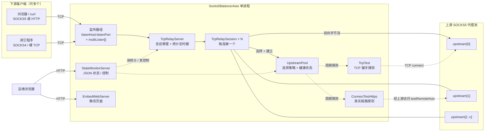
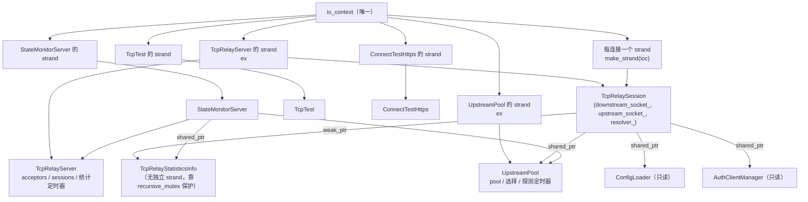
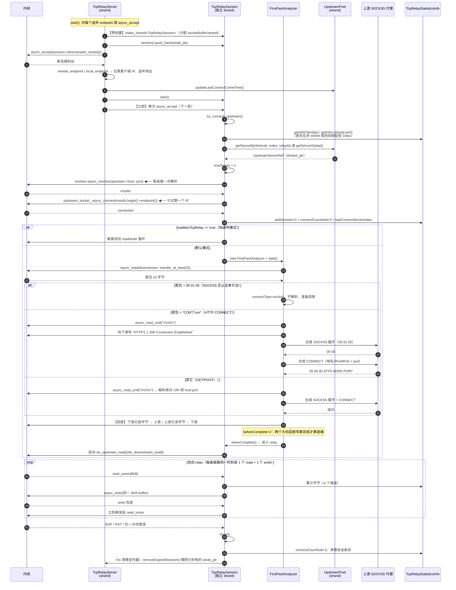
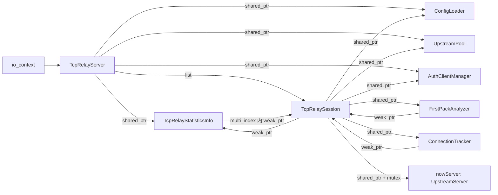

# Socks5BalancerAsio 总览与总体架构分析

> 本文是「Socks5BalancerAsio → Rust 移植」项目的第一篇分析文档，目标是让后续参与移植的工程师在不读原 C++ 源码的情况下，准确理解原程序的定位、功能边界、组件划分、执行模型与连接生命周期主流程。
>
> **2026-10-26 注记**：本文是 **C++ 现状分析**（"原程序是什么样"）。Rust 实施口径以 [07-decisions.md](07-decisions.md) 的 ADR 为准；涉及"应该怎么改"的段落已按决策加注。
>
> 与本文配套的深入分析见：
> - [02-relay-core.md](02-relay-core.md)：高性能转发架构（数据面）
> - [03-protocol.md](03-protocol.md)：入站协议识别与 SOCKS4/5、HTTP CONNECT 处理
> - [04-control-monitor.md](04-control-monitor.md)：运行控制、健康检查、统计与监控
> - [05-build-config-deploy.md](05-build-config-deploy.md)：构建、配置、部署与资源开销
> - [06-rust-port-assessment.md](06-rust-port-assessment.md)：100MB / C10K / 1K-per-sec 目标可行性评估与 Rust 架构映射

---

## 0. 文档信息

| 项目 | 内容 |
|---|---|
| 分析对象 | `Socks5BalancerAsio`（C++20 + Boost.Asio/Beast） |
| 仓库路径 | `H:\Code\CLionProjects\Socks5BalancerAsio` |
| Git 提交 | `5b4e9579119a00ac82480eded0e32adf2de30c33`（`v1.6.0-7-g5b4e957`，master，2025-08-27） |
| 代码规模 | `src/` 下 59 个文件（26 个 `.cpp`、30 个 `.h`、1 个 `.hpp`、2 个 `.in`），共 **11,308 行** C++ 源码 |
| 许可证 | GNU GPL v3 |
| 上游依赖 | Boost ≥ 1.81（Asio / Beast / Log / PropertyTree / ProgramOptions / multi_index / URL）、OpenSSL ≥ 1.1.0 |
| **源码编码** | **绝大部分文件是 UTF-8（无 BOM），但 `src/TcpRelaySession.cpp` 与 `src/ProxyHandshakeUtils/HttpServerImpl.cpp` 两个文件是 GB2312/GBK 编码**。移植时必须转码为 UTF-8，见 §9.3 |
| 分析方法 | 全量源码静态阅读 + 调用链追踪 + 配置/构建文件核对。所有 `文件:行号` 引用均指向原始 C++ 仓库（行号与原文一致；GBK 文件的行号取自转码后的 UTF-8 镜像） |
| 分析用 UTF-8 镜像 | `H:\Code\RustProject\Socks5BalancerRust\.analysis\utf8-src\`（仅为阅读方便而生成，**不是**移植产物） |

> **编码提示**：直接用编辑器/工具打开 GBK 文件会产生乱码，进而得出错误结论。本项目的分析全部基于 `.analysis/utf8-src` 镜像进行；移植阶段的任何转码动作都必须保留原始行号对应关系以便回溯。

---

## 1. 项目定位

一句话概括：

> **Socks5BalancerAsio 是一个"单进程、单可执行文件、多上游 SOCKS5 代理之间的 TCP 负载均衡器 + 健康检查器 + 混合协议入口"。**

它自己**不是**代理服务器（不解析最终目的地之后的应用层协议、不做 TLS 解密、不缓存内容），而是一个**带协议识别能力的 TCP 中继（relay）**：

```
下游客户端                      本程序                        上游 SOCKS5 代理              目标站点
──────────                     ─────────                     ────────────────            ────────
浏览器 / curl  ──TCP──▶  accept ─▶ 首包嗅探 ─▶ 选择上游 ─▶ 建立到上游的 TCP
                                │                              │
                                └── 若下游是 SOCKS5：字节级透传 ──▶ 上游自己完成 SOCKS5 协商
                                └── 若下游是 HTTP(CONNECT)：本程序扮演 SOCKS5 客户端 ──▶ 合成 CONNECT
```

两条关键设计后果，必须先理解才能读懂代码：

1. **SOCKS5 下游是"透传"而非"终结"**。当首包是 `05 01 00`（SOCKS5 + 仅一种"无认证"方法）时，本程序不解析后续 SOCKS5 报文，直接把字节流双向搬运；真正的 SOCKS5 协商发生在"下游客户端 ↔ 上游代理"之间。这让热路径极短，也是它能承载大量连接的架构基础（`src/FirstPackAnalyzer.cpp:169-176`）。
2. **HTTP 下游是"协议转换"**。当首包是 `CONNECT` 或普通 HTTP 方法时，本程序解析出目标 `host:port`，**自己**向上游发起 SOCKS5 客户端握手（含 `CONNECT` 请求），再双向搬运（`src/FirstPackAnalyzer.cpp:268-371`）。

因此项目的核心价值不是"代理协议实现"，而是：**多上游选择策略 + 存活/可用性探测 + 首包协议嗅探 + 极低开销的字节搬运**。

创作动机（`README.md:509-513`、`README.md:548-567`）值得记录：作者先写了 Node.js/TypeScript 版本，因性能与稳定性问题用 C++/Boost.Asio 重写；而 C++ 版本在 2 core / 500MB 的 qemu 环境中也会在"连接创建速率 > 70/s"时崩溃甚至拖死整机。**本次 Rust 移植的目标正是把这个数字从 70/s 提升到 1000/s，同时把内存压到 100MB 以内并持有 C10K 连接**——这直接决定了哪些原设计需要保留、哪些必须替换。

---

## 2. 功能清单（已在源码中逐项核实）

### 2.1 对外功能

| # | 功能 | 实现位置 | 说明 | 移植优先级 |
|---|---|---|---|---|
| F1 | 混合协议入口（同一端口同时接受 SOCKS5 / SOCKS4 / HTTP CONNECT / 普通 HTTP） | `FirstPackAnalyzer`（默认）或 `ProxyHandshakeAuth`（可选编译） | 通过首包嗅探分流，见 [03-protocol.md](03-protocol.md) | **P0** |
| F2 | 多端口监听 | `TcpRelayServer::start` `src/TcpRelayServer.cpp:17-52` | `listenHost/listenPort` + `multiListen[]` 各解析出的全部 endpoint 都监听 | P1 |
| F3 | 多上游负载均衡（5 条规则） | `UpstreamPool::getServerByHint` `src/UpstreamPool.cpp:173-233` | `loop` / `random` / `one_by_one` / `change_by_time` / `force_only_one`，另有 `inherit` 表示"沿用到全局规则" | **P0** |
| F4 | 每客户端 IP / 每监听端口的规则覆盖 | `RuleEnum` + `TcpRelaySession::try_connect_upstream` `src/TcpRelaySession.cpp:96-142` | 监控面可运行时修改、并带"上次使用的上游"粘性 | P1 |
| F5 | 上游存活探测（TCP 握手级） | `TcpTest` + `UpstreamPool::do_tcpCheckerTimer_impl` `src/UpstreamPool.cpp:337-374` | 周期 `tcpCheckPeriod`，每上游每次探测都带随机错峰延迟 | **P0** |
| F6 | 上游可用性探测（经代理的真实 HTTPS 请求） | `ConnectTestHttps` + `UpstreamPool::do_connectCheckerTimer_impl` `src/UpstreamPool.cpp:472-521` | 周期 `connectCheckPeriod`（默认 5 分钟），验证"这条链路是否真的能上网" | P1（重） |
| F7 | 死上游隔离与自动恢复 | `UpstreamPool::checkServer`、`UpstreamServer::isOffline/lastConnectFailed` | 任一探测失败即离线，两项探测都恢复才重新启用（`README.md:278-286`） | **P0** |
| F8 | 全上游下线时的"保命"调度 | `UpstreamPool::do_AdditionTimer` `src/UpstreamPool.cpp:403-430` | 全下线且最近 `sleepTime` 内仍有流量时，提高探测频率 | P2 |
| F9 | 状态监控 HTTP API | `StateMonitorServer`（1146 行） | 返回 JSON 状态、接收 `/op` 控制指令 | **P0**（可裁剪） |
| F10 | 内嵌静态 Web 服务器（监控页面） | `EmbedWebServer`（394 行） | 静态文件 + `/backend` 反向代理到状态服务 | P2 |
| F11 | 运行时控制：切换规则、禁用/启用上游、强制探测、关闭连接 | `StateMonitorServer` + `UpstreamPool::forceCheckNow/forceCheckOne` + `TcpRelayServer::closeAllSession` | 见 [04-control-monitor.md](04-control-monitor.md) | P1 |
| F12 | 多维度流量/连接/延迟统计 | `TcpRelayStatisticsInfo`（525 行）、`DelayCollection` | 按上游 / 客户端 IP / 监听端口 / 认证用户四维聚合，1 秒刷新速率 | P1 |
| F13 | 客户端侧认证（SOCKS5 用户名密码、HTTP Basic） | 仅 `Need_ProxyHandshakeAuth=ON` 时启用 | 默认 OFF，见 §5.3 | P1 |
| F14 | 上游侧认证（配置中 `upstream[].authUser/authPwd`） | 仅 `Need_ProxyHandshakeAuth=ON` 时在合成握手路径生效 | 默认 OFF；`FirstPackAnalyzer` 路径**固定发 `05 01 00`，不支持上游认证** | P1 |
| F15 | 纯 TCP 直通模式（不做任何协议分析） | `traditionTcpRelay=true` | 兼容"上游是普通 TCP 端口转发"的场景 | P0 |
| F16 | 纯中继极简构建（`MINI_BUILD_MODE`） | CMake 开关，强制 `traditionTcpRelay`，砍掉测试/追踪/Web | 见 [05-build-config-deploy.md](05-build-config-deploy.md) | P2 |

### 2.2 明确的非功能 / 未实现项

来自 `README.md:515-546` 的 TODO 列表，直接标注了**边界**，移植时不应"顺手实现"以免范围失控。
**Rust 移植决策（2026-10-26 登记）**：以下 4 项**不在 Rust 版范围**，不实现也不作为验收项；如需再做需先经 ADR 裁决：

- 未实现（Rust 同样不做）：按目标域名选上游（当前"先选上游、后嗅探目标"，架构性限制，见 `src/TcpRelaySession.cpp:210-213` 的 TODO 注释）。
- 未实现（Rust 同样不做）：`best_latency` / `best_stable` / `fast_download_speed` / `fast_upload_speed` 规则（枚举里被注释掉，`src/ConfigRuleEnum.h:22-31`）。
- 未实现（Rust 同样不做）：上游优先级、（原计划的）trojan 协议客户端。
- "socks5 UDP 支持"处于勾选状态且带说明"仅 localhost/LAN 可用"，但这与当前代码路径**矛盾**：`FirstPackAnalyzer` 遇到 `CMD != CONNECT` 的 SOCKS5 请求根本不会识别（它只嗅探前 3 字节就透传），所以 UDP ASSOCIATE 是否真的可用需要按模式区分，**列为待确认项**。Rust 版按 ADR-004 明确只支持 CONNECT（BIND/UDP 回 0x07）。

---

## 3. 设计目标与非目标

### 3.1 作者的设计目标（从代码与 README 归纳）

| 目标 | 体现 |
|---|---|
| 单可执行文件、零外部依赖部署 | 静态链接 Boost/OpenSSL，配置只有一个 `config.json`，监控页是纯静态资源（`README.md:553`） |
| Windows + Linux 双平台 | 大量 `#ifdef _WIN32` / `MSVC`；CMake 同时支持 MSVC 与 GCC |
| 小内存、低核数下长时间稳定运行 | 每连接固定 2×8KB 栈内缓冲、无每连接线程、单 `io_context` 多线程 `run` |
| 上游故障不拖累前端 | 双重探测 + 连接前过滤 + 重试换上游 |
| 可观测、可远程控制 | 内建 REST 状态/控制面 + 内嵌监控页面 |

### 3.2 非目标（重要，移植时不要扩大范围）

- **不做 TLS 中间人**：HTTPS 只是 CONNECT 隧道，程序看不到明文。
- **不做应用层缓存 / 连接复用（HTTP keep-alive 聚合）**：每个下游连接对应一个独立上游连接。
- **不做 UDP 中继的完整实现**（见上）。
- **不做多进程 / 多实例协调、不做鉴权加密**：监控 API 无认证，靠绑定内网地址来保护。
- **不做配置热重载**：`config.json` 只在启动时读取一次（`src/main.cpp:97-99`）。

---

## 4. 总体架构

### 4.1 部署拓扑



**关键部署事实**（移植必须保留）：

- 一个进程内**只有一个** `boost::asio::io_context`（`src/main.cpp:95`），所有组件共享它；网络 I/O 线程数 = `min(hardware_concurrency, config.threadNum)`（`src/main.cpp:176-207`）。
- 监听端点数 = `listenHost:listenPort` 解析结果数（`"::"` 会同时得到 v4/v6 两个 endpoint）+ `multiListen[]` 每一项的解析结果数（`src/TcpRelayServer.cpp:22-47`）。
- 三个对外服务端口族：**代理入口**（listenPort / multiListen）、**状态 API**（stateServerHost:stateServerPort）、**内嵌 Web**（EmbedWebServerConfig.host:port，可选）。

### 4.2 进程内组件图（含执行器归属）



**执行器（strand）语义**：

| 组件 | 执行器 | 含义 |
|---|---|---|
| `TcpRelayServer` | `make_strand(ioc)`（`src/TcpRelayServer.h:66`） | 所有 acceptor、会话表、清理/统计定时器串行执行 |
| 每个 `TcpRelaySession` | 独立的 `make_strand(ioc)`（`src/TcpRelayServer.cpp:68`） | 该连接所有读写/解析/握手回调串行执行，**不需要锁** |
| `UpstreamPool` | `make_strand(ioc)`（`src/main.cpp:106`） | 选择逻辑、探测定时器链、探测结果回写 |
| `TcpTest` / `ConnectTestHttps` | 各自 strand（`src/main.cpp:101-102`） | 探测任务串行化 |
| `StateMonitorServer` | `make_strand(ioc)`（`src/main.cpp:110-111`） | HTTP 请求处理串行化 |
| `TcpRelayStatisticsInfo` | **无 strand** | 由各调用方持 `std::recursive_mutex` 保护（`src/TcpRelayStatisticsInfo.h:146,187`），是跨线程热点 |

> 这套"每连接一个 strand"的模型是 C++ 实现的稳定基石，但也是**每连接一次堆分配 + 一次 strand 状态初始化**的来源；在 Rust 中它会自然退化为"每连接一个 task"，需要额外注意任务数量与调度开销（详见 [02-relay-core.md](02-relay-core.md) §8 与 [06-rust-port-assessment.md](06-rust-port-assessment.md)）。

### 4.3 组件职责表

| 组件 | 文件 / 行数 | 职责 | 对外接口 | 状态 |
|---|---|---|---|---|
| 入口装配 | `main.cpp` / 225 | 解析 CLI、加载配置、构造所有组件、装配信号处理、启动 I/O 线程池 | `main()` | 无状态 |
| 配置 | `ConfigLoader` / 269+102 | 读 `config.json`（boost property_tree）、默认值填充、打印 | `load/parse_json/print` | 启动后只读 |
| 客户端认证 | `AuthClientManager` / 70+135 | 保存 `AuthClientInfo[]`、base64 预处理、按用户查 `AuthUser` | `verify/getUserInfo` | 启动后只读 |
| 接入与转发 | `TcpRelayServer` / 150+76 | 监听、accept 循环、会话弱引用表、5s 清理定时器、1s 统计定时器 | `start/stop/closeAllSession/getStatisticsInfo` | 有状态 |
| 连接 | `TcpRelaySession` / 486+163 | 单条连接的全部状态：socket、缓冲、上游引用、首包分析器、追踪器、统计累计 | `start/stop/forceClose` | 每连接一份 |
| 首包识别 | `FirstPackAnalyzer` / 566+95 | 嗅探 3 字节 → 分流；HTTP 场景合成 SOCKS5 客户端握手；回放已吞字节 | `start()` + 两个回调 | 每连接一份（默认模式） |
| 首包识别（增强） | `ProxyHandshakeAuth` / 439+167（可选编译） | 终结下游 SOCKS4/5/HTTP 握手、校验认证、再作为客户端连上游 | 同上 | 每连接一份（`Need_ProxyHandshakeAuth=ON`） |
| 上游池 | `UpstreamPool` / 574+155 | 上游列表与状态、选择规则、探测定时器链、强制探测 | §2.1 F3/F5/F7 | 单例 |
| 上游对象 | `UpstreamServer`（结构体） | 每条上游的 host/port/认证/在线状态/计数/延迟采样 | — | 每上游一份 |
| TCP 探测 | `TcpTest` / 198+102 | 对上游做 TCP connect 并测量耗时 | `createTest()->run()` | 单例 |
| 连通性探测 | `ConnectTestHttps` / 712+142 | 模拟完整链路：本地起一个临时 HTTP 服务 + 经上游 SOCKS5 访问 `testRemoteHost` | `createTest()->run()` | 单例 |
| 统计 | `TcpRelayStatisticsInfo` / 525+205 | 四维（上游/客户端IP/监听/用户）会话集合 + 字节/连接计数 + 每秒速率 | 大量 `add*/get*` | 单例 |
| 连接追踪 | `ConnectionTracker` / 108+144 | 前若干包的协议分析（最多缓存 80KB/方向）、首包延迟 | `relayGotoUp/Down` | 每连接一份（可关闭） |
| 延迟采样 | `DelayCollection` / 20+224 | 每上游的 TCP/HTTP/首包延迟滑动窗口 | `push*/get*` | 每上游一份 |
| 状态服务 | `StateMonitorServer` / 1146+125 | JSON 状态输出 + `/op` 控制指令 | HTTP | 单例 |
| 静态服务 | `EmbedWebServer` / 394+117 | 静态文件 + `/backend` 代理 | HTTP | 单例（可关） |
| 日志 | `log/Log.{h,cpp}` / 199+54 | boost::log 同步 sink 到 stdout，含线程名/relayId 前缀 | 宏 `BOOST_LOG_S5B*` | 全局 |
| 协议工具 | `ProxyHandshakeUtils/*` / ~1900 | SOCKS4/5 服务端与客户端、HTTP 服务端/客户端实现（供 `ProxyHandshakeAuth` 复用） | — | 仅增强模式编译 |

### 4.4 线程模型细节

`src/main.cpp:175-207`：

```cpp
size_t processor_count = boost::thread::hardware_concurrency();
processor_count = std::min(processor_count, configLoader->config.threadNum);
if (processor_count > 2) {
    boost::thread_group tg;
    for (unsigned i = 0; i < processor_count - 1; ++i) {   // ← 主线程也算一个
        tg.create_thread([&ioc, &tg, i]() { ioc.run(); });
    }
    tg.join_all();
} else {
    ioc.run();
}
```

由此可推出几条重要结论：

1. **`threadNum` 是上限而非精确值**：实际线程数 = `min(hardware_concurrency, threadNum)`。
2. **当 `min(...) <= 2` 时退化为单线程 `ioc.run()`**（主线程）。这解释了为什么作者在小机器上"2 core"就有性能问题：`> 2` 才启用多线程分支。
3. **`config.json` 里 `threadNum: 11`** 意味着"按 CPU 核数跑满"，在 2~4 核目标机上等价于 2~4 线程。
4. 所有工作线程共享同一个 `io_context`，**没有** SO_REUSEPORT / 多 reactor 分片；acceptor 的回调统一落在 `TcpRelayServer` 的 strand 上，因此 **accept 是全局串行的**（每个 accept 完成后才发起下一个 accept）。这是 1K 连接/秒目标的第一个可疑瓶颈，详见 [02-relay-core.md](02-relay-core.md) §7。

### 4.5 控制面与数据面

| 面 | 组成 | 共享状态 | 风险 |
|---|---|---|---|
| 数据面 | acceptor、`TcpRelaySession`、`FirstPackAnalyzer`、socket 读写 | 只读的配置/认证/上游池快照；`TcpRelayStatisticsInfo`（写） | 统计锁、日志锁会成为全局串行点 |
| 控制面 | `StateMonitorServer`、`EmbedWebServer`、`UpstreamPool` 探测与选择、`TcpRelayServer` 定时器 | 上游状态（原子量）、`RuleEnum`、统计（读） | 控制面请求会读统计（拿 `recursive_mutex`），与数据面写统计相互阻塞 |

**当前实现没有把控制面与数据面隔离**：监控 API 与转发共用同一个 `io_context` 线程池与同一把统计锁。在 Rust 移植中这一点必须重新设计（独立 runtime 或至少独立任务池），否则监控请求抖动会直接反映为转发延迟抖动。

---

## 5. 连接生命周期主流程

### 5.1 一条下游连接的完整时序



### 5.2 三个阶段的边界（必须理解，否则移植时会漏状态）

| 阶段 | 主要对象 | 关键不变量 | 结束条件 |
|---|---|---|---|
| A. 接入 | `TcpRelayServer` → `TcpRelaySession` | session 在 `async_accept` **之前**就已构造完毕（这是"降低 accept 后延迟"的优化，`src/TcpRelayServer.cpp:66-77`） | 上游 TCP 连接建立成功 |
| B. 协商 | `FirstPackAnalyzer` 或 `ProxyHandshakeAuth` | 下游 socket 上已读但未消费的字节存在 `FirstPackAnalyzer::downstream_buf_`（`asio::streambuf`），必须在进入 relay 前**原样回放**到上游；上游 socket 同理反向回放 | `whenComplete()` 被调用（两个方向回放写都完成） |
| C. 转发 | `TcpRelaySession::do_*_read/write` | 任一时刻每条方向只有一个在途 read 与一个在途 write；write 完成才发起下一次 read | 任一方向 EOF/错误 |

**阶段 B 是最容易出错的地方**：`FirstPackAnalyzer` 会把下游的前 3 字节（SOCKS5 场景）或整个 HTTP 头（HTTP 场景）读进自己的 `streambuf`，然后通过 `do_prepare_complete_downstream_write()` / `do_prepare_complete_upstream_write()` 把残余字节写回各自的对端（`src/FirstPackAnalyzer.cpp:110-152`）。`beforeComplete` 计数从 2 递减到 0 才触发 `whenComplete`（`src/FirstPackAnalyzer.cpp:66,87-100`）。移植时若直接把"嗅探用的 buffer"丢弃或只回放一个方向，就会丢包。

### 5.3 三种工作模式

由 CMake 选项与运行时配置组合出三条互斥的数据面路径：

| 模式 | 编译/配置开关 | 数据面实现 | 协议能力 | 每连接额外开销 |
|---|---|---|---|---|
| **默认模式**（Normal） | `Need_ProxyHandshakeAuth=OFF`（缺省） | `FirstPackAnalyzer`（`src/TcpRelaySession.h:45`） | SOCKS5 无认证透传；SOCKS4 被当作"其它协议"尝试 HTTP 解析（**实际不可用**）；HTTP CONNECT / 普通 HTTP 转换；不支持客户端认证、不支持上游认证 | `FirstPackAnalyzer` 对象 + 2×`streambuf` |
| **认证模式**（ProxyHandshakeAuth） | `-DNeed_ProxyHandshakeAuth=ON` | `ProxyHandshakeAuth`（`src/TcpRelaySession.h:41`） | 完整终结下游 SOCKS5/SOCKS4/HTTP、校验客户端认证；作为客户端向上游完成带认证的 SOCKS5 握手 | 更重（含 4 个协议状态机对象） |
| **纯透传模式**（traditionTcpRelay） | 配置 `traditionTcpRelay: true` 或 `FORCE_traditionTcpRelay` | `TcpRelaySession` 直接双向 read/write | 不做任何协议识别，要求上游是"能接受任意字节的 TCP 端点" | 无额外对象（最轻） |

> **移植决策点**：Rust 版本不应该复制"三种模式 + 编译期宏"的分裂，而应统一为一个"首包识别 → 协议状态机 → 透传"的数据面，模式只作为配置项（详见 [06-rust-port-assessment.md](06-rust-port-assessment.md)）。

---

## 6. 目录结构与模块划分

```
Socks5BalancerAsio/
├── CMakeLists.txt              # 单一构建脚本（含大量 option 开关）
├── config.json                 # 实际运行配置（作者本机）
├── config-test.json            # 测试用配置
├── example-config/             # 多份示例配置
├── Dockerfile / docker-compose.yaml / azure-pipelines.yml / .github/ / github-action-old/
├── html/                       # Vue.js + webpack 的监控前端（产物直接放 html/ 下）
└── src/
    ├── main.cpp                # 装配与线程池
    ├── ConfigLoader.{h,cpp}    # 配置
    ├── ConfigRuleEnum.h        # 选择规则枚举
    ├── ConnectType.h           # 首包识别结果枚举
    ├── TcpRelayServer.{h,cpp}  # 接入层
    ├── TcpRelaySession.{h,cpp} # 连接（GBK 编码！）
    ├── FirstPackAnalyzer.{h,cpp}       # 默认模式的首包嗅探
    ├── ProxyHandshakeAuth.{h,cpp}      # 增强模式的首包/认证（可选编译）
    ├── ProxyHandshakeUtils/            # SOCKS4/5、HTTP 的 server/client 实现
    │   ├── Socks4ServerImpl.{h,cpp}
    │   ├── Socks5ServerImpl.{h,cpp}    # 最大单文件（764 行）
    │   ├── Socks5ClientImpl.{h,cpp}
    │   ├── HttpServerImpl.{h,cpp}      # GBK 编码！
    │   ├── HttpClientImpl.{h,cpp}
    │   └── ProxyRelayMode.h
    ├── UpstreamPool.{h,cpp}    # 上游池 + 选择 + 探测调度
    ├── TcpTest.{h,cpp}         # TCP 探测
    ├── ConnectTestHttps.{h,cpp}# 真实链路探测（712 行）
    ├── DelayCollection.{h,cpp} # 延迟采样
    ├── TcpRelayStatisticsInfo.{h,cpp}  # 统计（525 行）
    ├── ConnectionTracker.{h,cpp}       # 连接内协议追踪
    ├── StateMonitorServer.{h,cpp}      # 状态/控制 API（1146 行，最大文件）
    ├── EmbedWebServer.{h,cpp}          # 静态服务
    ├── AuthClientManager.{h,cpp}       # 客户端认证
    ├── SessionRelayId.{h,cpp}          # 全局递增 relayId（原子）
    ├── AsyncDelay.{h,cpp}              # 随机错峰延时
    ├── UtilTools.{h,cpp}
    ├── base64.h
    ├── CMakeParamsConfig/CMakeParams.h # 编译参数快照
    ├── VERSION/{ProgramVersion,CodeVersion}.h
    ├── log/{Log,BoostAssertionFailed}.{h,cpp}
    └── 3thlib/{http_client_async_ssl.cpp,root_certificates.hpp}
```

**模块划分评价**：分层是清晰的（接入 / 连接 / 协议 / 上游 / 统计 / 控制 / 基础设施），但存在两个明显的"上帝对象"倾向：

- `TcpRelaySession` 同时承担 socket 持有、上游选择、首包分析器生命周期、统计写入、延迟采样、连接追踪 —— 6 项职责。
- `StateMonitorServer` 1146 行把 HTTP 路由、JSON 序列化、控制指令、统计聚合全部塞进一个类。

Rust 移植时建议按职责拆分模块（`ingress` / `relay` / `handshake` / `upstream` / `observe` / `control`），而不是 1:1 平移类结构。

---

## 7. 关键数据结构与所有权模型

### 7.1 对象所有权



**所有权约定（源码中反复出现的模式）**：

- **异步操作链持有自身的强引用**：每个 async handler 都捕获 `[this, self = shared_from_this()]`，保证回调执行时对象存活；链断裂（最后一个 handler 返回）时对象析构。这是 `enable_shared_from_this` 的典型用法。
- **向上引用用 `weak_ptr` 打破环**：`FirstPackAnalyzer::tcpRelaySession`、`ConnectionTracker::tcpRelaySession`、`SessionInfo::ptr`（`src/TcpRelayStatisticsInfo.h:69`）、`TcpRelayServer::sessions` 都是 `weak_ptr`，避免"session ↔ 分析器/统计"形成引用环导致永不释放。
- **`nowServer` 用了 `mutex + atomic_bool refAdded`**（`src/TcpRelaySession.h:94-96`），因为 `UpstreamServer` 会被多个连接共享，且可能在监控面被并发读写。
- **`TcpRelayServer::sessions` 是 `std::list<std::weak_ptr>`**，由 5 秒定时器扫描清理（`src/TcpRelayServer.cpp:107-116`），因此"已断开但尚未清理"的会话会在表里残留至多 5 秒。

### 7.2 每连接内存占用的主要来源（摘要，详见 05 篇）

| 项 | 大小/说明 | 位置 |
|---|---|---|
| 两个固定缓冲 | 2 × 8192 B = 16 KB | `src/TcpRelaySession.h:80-83` |
| `downstream_socket_` / `upstream_socket_` | 各含 asio 内部状态、执行器引用等 | `src/TcpRelaySession.h:59-60` |
| `resolver_` | 每连接一个 resolver（**未复用**） | `src/TcpRelaySession.h:61` |
| 独立 strand | `make_strand(ioc)` 状态对象 | `src/TcpRelayServer.cpp:68` |
| `FirstPackAnalyzer` | 对象 + 2 × `asio::streambuf`（可增长） | `src/FirstPackAnalyzer.h:54-56` |
| `ConnectionTracker` | 懒创建；2 × `asio::streambuf`。**当前 `analysisData` 是占位实现**：首个 ≥3 字节包后即 `isEnd`，实际几乎不占内存（设计上限 80 KB/方向，见 02 篇 §6.3） | `src/ConnectionTracker.h:43-48`、`src/ConnectionTracker.cpp:96-128` |
| 统计条目 | `SessionInfo` 会被插入 **3~4 个 multi_index 容器**（上游/客户端/监听/用户），每个容器都是独立索引节点 | `src/TcpRelayStatisticsInfo.h:107-142` |
| 字符串 | `clientEndpointAddrString`、`clientEndpointAddrPortString`、`listenEndpointAddrString`、`targetEndpointAddrString`、`host` 等（SSO 之外的会堆分配） | `src/TcpRelaySession.h:69-77` |

> 单连接**静态下限**约 17~20 KB（不含内核 socket 缓冲），加上 `ConnectionTracker` 的最坏情况（160 KB）与统计条目，C10K 会显著突破 100 MB。这是 [06-rust-port-assessment.md](06-rust-port-assessment.md) 要解决的核心问题。

---

## 8. 配置驱动的行为差异（速查）

> 完整字段字典见 [05-build-config-deploy.md](05-build-config-deploy.md)。这里只列"改变架构行为"的配置。

| 配置项 | 取值 | 架构级影响 |
|---|---|---|
| `listenHost` / `listenPort` / `multiListen[]` | 任意 | 决定 acceptor 数量；`"::"` 会派生 v4+v6 两个监听 |
| `threadNum` | 默认 11 | 实际 I/O 线程数 = `min(核数, threadNum)`；**≤2 时退化为单线程**。Rust 侧语义见 ADR-003：`threadNum` 为最大 worker 上限，另有 `workerThreads`/`maxBlockingThreads`/`threadStackSize` |
| `traditionTcpRelay` | `false`（默认）/`true` | 是否启用首包识别与协议转换；`true` 时最轻 |
| `disableConnectTest` | `false`（默认）/`true` | `true` 时**只要求上游未被手动禁用**即可选用（`src/UpstreamPool.cpp:107-118`），完全跳过两项探测定时器 |
| `disableConnectionTracker` | `false`（默认）/`true` | 是否对每个连接做前 80KB 的协议镜像拷贝 |
| `upstreamSelectRule` + 每条 `upstream[]` | 5 种规则 | 选择算法与粘性行为不同；`force_only_one` 有越界隐患（见 04 篇） |
| `retryTimes` | 默认 3 | 上游连接失败时最多换几个上游（**不是**重试次数，是"尝试的上游数量上限"） |
| `connectTimeout` | 默认 2000ms | **死配置**：`ConfigLoader.cpp:223-224` 解析了它，但全仓没有任何地方用它挂超时；`async_connect` 无定时器（见 02 篇 §7） |
| `internalBehavior.*` | 示例配置里有 `connectTimeout/socksTestTimeout/momentLocale/statisticalTimerPeriod` | **整节未被解析**（`grep internalBehavior` 在 `ConfigLoader` 中零命中）；`config.json` 把它写在 `internalBehavior` 下，因此连顶层 `connectTimeout` 也读不到，实际永远用代码默认值 |
| `sleepTime` | 默认 1800000ms | 最近这么久没有新连接则暂停周期探测（省流量） |
| `AuthClientInfo[]` | 空数组 | 非空时**必须**用 `Need_ProxyHandshakeAuth=ON` 编译才有意义（默认模式下认证不会生效） |
| `EmbedWebServerConfig.enable` | 默认 `true` | 是否额外开静态 Web 服务；编译期 `DISABLE_EmbedWebServer` 可彻底移除 |

---

## 9. 架构评价

### 9.1 值得保留的设计

1. **"首包嗅探 + 字节回放"的混合入口**：用一个端口同时服务 SOCKS5 / HTTP / 裸 TCP，且 SOCKS5 路径零解析、零改造，这是本项目最聪明的设计。Rust 移植应保留该思路（但可以做得更严格、更安全）。
2. **每连接独立 strand + 全异步无阻塞**：没有线程池阻塞调用，没有用户态线程切换，天然适合 C10K。
3. **"预创建 session 再 accept"**：把对象构造、socket 创建、strand 初始化挪到 accept 之前，缩短"连接建立 → 开始处理"的延迟（`src/TcpRelayServer.cpp:66-77`）。
4. **单 outstanding read/write 的背压模型**：写完成才继续读，天然不会被慢速对端拖爆内存（代价是单连接吞吐受限，见 02 篇）。
5. **双重健康探测 + 随机错峰**：TCP 层探活快（秒级），应用层探真实可用（分钟级），且每次探测带随机延迟避免雪崩。
6. **控制面内建**：一个 JSON API 就能观测/控制，运维成本极低。

### 9.2 明确的架构缺陷（移植时必须解决）

| # | 缺陷 | 证据 | 对目标的影响 |
|---|---|---|---|
| D1 | **日志无级别过滤、同步写 stdout、全局锁** | `src/log/Log.cpp:121-156`（`synchronous_sink`），所有 `set_filter` 都被注释（`:166-181`） | 1000 conn/s 时每连接 ~10 条 trace 日志 → 万行/秒格式化 + 互斥锁 + stdout 写，直接吃掉 CPU |
| D2 | **统计结构过重且带全局 `recursive_mutex`** | `src/TcpRelayStatisticsInfo.h:107-142,187`；每包 4 次 `addByte*` 调用（`src/TcpRelaySession.cpp:507-529`） | 每个数据包（8KB）要拿多次全局锁、查 4 张 `std::map<std::string,...>`，C10K 下锁竞争严重 |
| D3 | ~~`ConnectionTracker` 每包整块 memcpy~~ **（已复核修正：占位实现，实际几乎无开销）** | `src/ConnectionTracker.cpp:96-128`：`analysisData` 只要 ≥3 字节就返回 ok 并 `isEnd`；`up_count/down_count` 无读取方 | 不是瓶颈，是死代码层；移植时直接删除 |
| D13 | **无任何协议/握手/首包超时** | 全仓仅健康检查与内置 Web 服务器用 `expires_after`；`connectTimeout` 解析后未使用 | 见 D14 |
| D14 | **"建连不发首包"的连接永久泄漏**：挂起的 `async_read` handler 捕获 `shared_ptr<TcpRelaySession>`，而 session 持有 `shared_ptr<FirstPackAnalyzer>` → 引用环 | `src/FirstPackAnalyzer.cpp:158-166`、`src/TcpRelaySession.h:88` | **C10K/100MB 的头号障碍**：一条 ~17KB、无上限，压测时极易踩中 |
| D15 | **协议帧校验用"字节数必须精确相等"**（粘包/拆包/early data/应答与数据同包都会失败） | 见 [03-protocol.md](03-protocol.md) §9.4、附录 B 的 S-4/C-2/B-2/B-3 | 可用性缺陷簇；Rust 版必须用"边界解析 + 剩余字节回填" |
| D4 | **每连接一次 DNS 解析、无缓存** | `src/TcpRelaySession.cpp:144-177` | 上游用域名时，1K conn/s = 1K 次 getaddrinfo/s（线程池阻塞回调），必然成为瓶颈 |
| D5 | **`async_connect` 只试 `results.begin()`** | `src/TcpRelaySession.cpp:182-183` | 上游多个 A 记录时只尝试第一个，失败即换上游，可用性降低 |
| D6 | **`connectTimeout` 配置项未被使用** | 全仓 grep 只有解析与注释，无 `expires_after` 关联到 connect | 上游半开/黑洞时连接会挂起很久，拖慢 `retryTimes` 链 |
| D7 | **accept 全局串行 + 无 SO_REUSEPORT** | `src/TcpRelayServer.cpp:66-105`（回调里才发起下一次 accept，且在同一 acceptor 的 strand 上） | 1K conn/s 时 accept 成为串行点；多核无法分担 |
| D8 | **`TcpRelayServer::stop()` 跨线程直接操作 session socket** | `src/TcpRelayServer.cpp:59-63` vs `forceClose()` 的 `post`（`src/TcpRelaySession.cpp:488-493`） | 关闭期数据竞争（未实测，静态分析结论） |
| D9 | **`closeAllSession()` 在统计 strand 上遍历/删除 `sessions` 链** | `src/TcpRelayServer.cpp:118-129`，由 `StateMonitorServer` 调用 | 与 accept 线程并发修改 `std::list`，潜在崩溃 |
| D10 | **监控 API 无鉴权、全 GET、CORS 反射任意 Origin，且 `/` 明文返回客户端密码** | 默认绑定 `127.0.0.1`，但配置可改（`src/StateMonitorServer.cpp:281-356`） | 若绑定公网则任何人可切断全部连接/禁用上游，并直接读到客户端凭据 |
| D11 | **配置不支持热重载** | `src/main.cpp:97-99` 只加载一次 | 改配置必须重启，连接全断 |
| D12 | **`force_only_one` 规则下标未做边界检查** | `src/UpstreamPool.cpp:194`（`_pool[_lastUseUpstreamIndex]`） | 若 hint 的 index 来自已变更的上游列表 → 越界崩溃 |

### 9.3 编码问题（移植必做的第一件事）

| 文件 | 现状 | 处理方式 |
|---|---|---|
| `src/TcpRelaySession.cpp`（23,748 B） | **GB2312/GBK**，含中文注释 | 移植前用 GBK→UTF-8 转码并人工校验乱码；不得直接 `git mv` 后按 UTF-8 读取 |
| `src/ProxyHandshakeUtils/HttpServerImpl.cpp`（23,453 B） | **GB2312/GBK**，含中文注释 | 同上 |
| 其余 57 个文件 | UTF-8（无 BOM），可正常读取 | 直接引用 |
| 配置与文档 | `config*.json`、`README.md` 均为 UTF-8 | 新项目统一 UTF-8（无 BOM） |

> 已建立只读镜像 `.analysis/utf8-src/`（59 个文件全部 UTF-8，行号与原文件一致）供分析使用。**该目录不是移植产物**，最终 Rust 工程不应依赖它。

### 9.4 与「100MB / C10K / 1K-per-sec」目标的初步差距

| 指标 | C++ 现状（静态估算） | 结论 |
|---|---|---|
| 持有 10,000 并发连接 | 每连接静态下限 ~17–20 KB × 10,000 ≈ **170–200 MB**（实测 22,039 B/连接 → 210 MiB）；**另有 D14 的永久泄漏** | **不满足**。⚠️ 但 Rust 侧已裁决（ADR-005 + U1=方案 B）：默认 `bufferSize=8192`（8K×2 预分配，≈17.5–18 KB/连接，10K ≈197–200 MB，性能基线）；`bufferSize` 可配 2048/4096/8192，**100MB 达标压测用 2048（10K ≈77 MB）** |
| 每秒新建 1,000 连接 | 受 D1/D2/D4/D6/D7 联合制约：日志锁 + 统计锁 + 每连接 DNS + accept 串行 + 无 connect 超时 | **不满足**。作者自述 >70/s 就崩溃（`README.md:512`），改造点集中在上述 5 项 |
| 2~4 core 运行 | 线程数 `min(核数, threadNum)`；无分片 reactor；统计/日志全局锁 | 多核利用率差；需按核数分片（sharded metrics / per-core accept） |
| 100 MB 内存上限 | 需要排除所有"按连接数线性增长且带索引"的结构 | 见 [06-rust-port-assessment.md](06-rust-port-assessment.md) 的预算表 |

---

## 10. 文档地图与阅读顺序

| 顺序 | 文档 | 回答什么问题 |
|---|---|---|
| 1 | **本文** | 它是什么、由哪些组件构成、一条连接怎么走完、有哪些配置开关 |
| 2 | [02-relay-core.md](02-relay-core.md) | **热路径到底怎么转发的**、为什么快、为什么不够快、Rust 该怎么重写热路径 |
| 3 | [03-protocol.md](03-protocol.md) | 首包怎么识别、SOCKS4/5 与 HTTP 状态机如何工作、字节级时序、异常路径 |
| 4 | [04-control-monitor.md](04-control-monitor.md) | 健康检查与选择算法、统计口径、HTTP API 清单、运行时控制 |
| 5 | [05-build-config-deploy.md](05-build-config-deploy.md) | 怎么构建、配置字段全表、部署形态、每连接资源定量估算 |
| 6 | [06-rust-port-assessment.md](06-rust-port-assessment.md) | 硬指标可行性、Rust 技术选型、模块划分与里程碑建议 |

---

## 附录 A：术语表

| 术语 | 含义 |
|---|---|
| 下游 / downstream | 连接本程序的客户端；对应 `downstream_socket_` |
| 上游 / upstream | 本程序连接的后端 SOCKS5 代理；对应 `upstream_socket_` / `UpstreamServer` |
| 首包 / first pack | 下游连接建立后的第一批字节，用于识别协议类型 |
| 回放 / replay | 首包嗅探时已从 socket 读走但未消费的字节，必须在进入 relay 前原样写给对端 |
| relay | 建立后的双向字节搬运循环 |
| hint | 由"客户端 IP 或监听端口"携带的、指定使用哪个上游的线索（粘性选择） |
| relayId | 全局单调递增的连接编号，日志中 `[R:xxxxxx]` 前缀 |
| UP / DOWN | 上游可用 / 不可用 |

## 附录 B：分析范围与未验证事项

- 本文档为**静态源码分析**结论，未执行 C++ 程序、未做压测、未做内存实测；所有性能判断均标注了推理依据。
- 标记为"待确认"的事项会在各篇对应章节列出，需在 Rust 实现前通过实测或与原作者确认。
- 本阶段未修改任何 C++ 源码。
