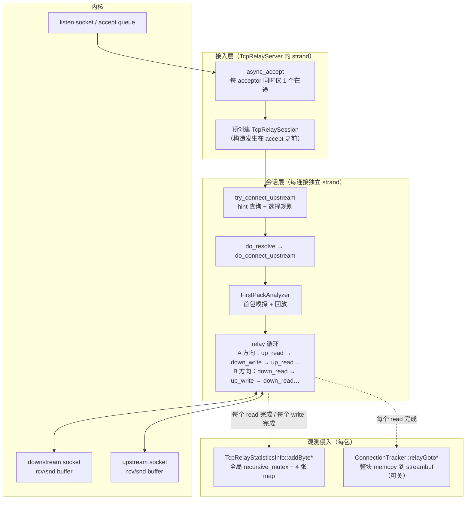

# 高性能转发架构深度分析（数据面）

> 本文聚焦 Socks5BalancerAsio 的**数据面（data plane）**：一个数据包从下游 socket 读出、到被写进上游 socket（或反向），中间经过了哪些代码、分配了哪些内存、发起了几次系统调用、在哪些点可能阻塞或串行化。
>
> 这是整个移植工程中**最不能出错**的部分。控制面/监控面可以重写甚至简化，但热路径的任何一次多余分配、任何一把全局锁、任何一次多余的 `memcpy`，在 10,000 连接、1,000 连接/秒的规模下都会被放大成数量级的差距。
>
> 配套阅读：[01-overview.md](01-overview.md)（总体架构）、[03-protocol.md](03-protocol.md)（首包识别细节）、[06-rust-port-assessment.md](06-rust-port-assessment.md)（Rust 重写方案与预算）。
>
> **2026-10-26 修订**：§3.2、§7、§8、§9.2、§10 的 Rust 实现建议已按 [07-decisions.md](07-decisions.md) ADR-005（转发缓冲双向 8 KB、会话建立时提前分配）更新；关键数字：每连接 ≈17.5–18KB（2×8192 B 缓冲 + ≈1.2–1.5 KB 元数据）、10K 连接 ≈197–200MB（含固定 ≈18MB、统计 ≈4MB）。与 100MB 的冲突**已裁决为方案 B**：默认 `bufferSize=8192` 保性能，`bufferSize` 可配 2048/4096/8192，100MB 达标压测用 2048（≈77MB）。§1–§7、§8.1、§8.3、§9 中的 C++ 现状分析、实测数据与行号证据**未改动**。与本文冲突处以 07-decisions.md 为准。

---

## 0. 结论先行

| 维度 | C++ 现状 | 评价 |
|---|---|---|
| 热路径结构 | 每方向"单在途 read + 单在途 write"的链式循环，固定 8KB 缓冲 | **设计正确且极省内存**，是最值得继承的部分 |
| 热路径分配 | 稳态转发阶段**零堆分配**（缓冲区在 session 对象内） | 优秀 |
| 热路径加锁 | 每个数据包要拿 2~4 次统计全局 `recursive_mutex` + 若干次 `std::map<std::string>` 查找 | **严重问题**，是首要改造点 |
| 热路径拷贝 | 每包 1 次 `read_some` 拷入 + 1 次 `write` 从同一缓冲发出 = 最少 1 次内核→用户拷贝；`ConnectionTracker` 当前是占位实现，只在首包做一次 memcpy | 良好 |
| 连接建立路径 | ~40–60 次堆分配、1 次 DNS 解析、无 connect 超时、accept 全局串行 | **与 1K conn/s 目标冲突**，需整体重设计 |
| 内存模型 | 每连接固定 2×8KB 缓冲常驻 + 统计 multi_index + 可增长 streambuf | **与 100MB / C10K 目标冲突**（见 §6） |
| 背压 | 天然背压：写不出去就不读 | 正确，但需注意与"慢速对端 + 定时器"的交互 |

一句话：**C++ 版的交付路径（steady-state relay）已经接近教科书式的 Asio 代理实现；真正拖垮它的是"连接建立路径"和"可观测性侵入"**。Rust 移植的收益主要来自重写这两块，而不是重写 relay 循环本身。

---

## 1. 数据面全景



### 1.1 三个"每连接"对象

| 对象 | 构造时机 | 生命周期 | 主要字段 |
|---|---|---|---|
| `TcpRelaySession` | **accept 之前**（`src/TcpRelayServer.cpp:67-77`） | 从 accept 到 close，由异步链的 `shared_from_this` 维持 | 2 个 socket、1 个 resolver、2×8KB 缓冲、nowServer、统计/配置/认证引用、`firstPackAnalyzer`、`connectionTracker` |
| `FirstPackAnalyzer` | 上游 TCP 连接**成功之后**（`src/TcpRelaySession.cpp:258-279`） | 直到 `whenComplete` 或出错；之后回调被清空，对象随所属 handler 释放 | 2 个 `asio::streambuf`、socket 引用、`beforeComplete`、`host/port`、`connectType` |
| `ConnectionTracker` | 第一次 relay 且有数据时**懒创建**（`src/TcpRelaySession.cpp:74-94`） | 收到首个 ≥3 字节包后立即 `isEnd`（`analysisData` 是占位实现，`src/ConnectionTracker.cpp:96-128`） | 2 个 `asio::streambuf`（代码写了 80KB/方向上限，但当前实现远用不到）、协议状态 |

> 注意 `FirstPackAnalyzer` 与 `ConnectionTracker` 都是**懒创建**：前者在上游连上后才 new，后者在第一个包到达时才 new。这是作者有意为之的优化（缩短关键路径）。

### 1.2 一条数据的两种可能路径

```
路径 P1（稳态转发，traditionTcpRelay=false，首包已完成）
  内核 rcv buffer ──read_some(8KB)──▶ upstream_data_[8192]
                                   ├─▶ [可选] ConnectionTracker::relayGotoDown（占位：仅首包一次 memcpy，之后 isEnd 短路）
                                   ├─▶ addDown2Statistics（4 次锁 + map 查找）
                                   └─▶ async_write(downstream_socket_, buf, n)
                                          └─ write 完成 ──▶ 再次 read_some

路径 P2（traditionTcpRelay=true，纯透传）
  read_some(8KB) ──▶ add*2Statistics ──▶ async_write
  （没有 ConnectionTracker，也没有首包分析器）
```

**关键点：整个稳态路径上没有 `new`/`malloc`**（`upstream_data_`/`downstream_data_` 是 `std::array` 成员，`async_write` 的 buffer 直接引用它；handler 通过 `shared_from_this` 捕获，Asio 的 handler 内存分配由 `any_io_executor` 的分配器承担，通常走 `std::allocator`）。这一点在 Rust 中很容易被 `Vec`/`BytesMut` 的按需增长破坏，必须显式设计。

---

## 2. 接入层（accept）分析

### 2.1 实现细节

```cpp
// src/TcpRelayServer.cpp:66-105 简化
void TcpRelayServer::async_accept(tcp::acceptor &sa) {
    auto session = std::make_shared<TcpRelaySession>(
            boost::asio::make_strand(ioc),   // ← 每连接一个 strand（1 次分配）
            ...);                            // ← 构造 socket 对象、缓冲等
    sessions.push_back(session->weak_from_this());  // ← list 节点分配
    sa.async_accept(session->downstream_socket(),
        [this, session, &sa](const error_code error) {
            if (error == operation_aborted) return;      // ← 取消则不再续接
            if (!error) {
                ...remote_endpoint/local_endpoint...
                upstreamPool->updateLastConnectComeTime();  // ← 拿 UpstreamPool 的 recursive_mutex
                session->start();
            }
            async_accept(sa);                             // ← 串行续接下一个 accept
        });
}
```

### 2.2 设计意图

1. **预创建 session**：把"新连接到达后"的对象构造、strand 创建、socket 对象创建全部提前到 accept 之前完成，从而缩短 accept→`start()` 的延迟。这是作者对"高连接建立速率"的直接优化。
2. **每个 acceptor 只有 1 个在途 accept**：简单、无并发问题，但意味着 accept 的吞吐受限于"回调调度 + session 构造 + `start()` 的同步部分"的总延迟。
3. **accept 回调绑定在 `TcpRelayServer` 的 strand 上**：所有 acceptor 的 accept 完成回调串行执行。

### 2.3 代价与风险

| 问题 | 说明 | 量化 |
|---|---|---|
| 串行 accept | N 个 acceptor 的 accept 回调、session 构造、`start()` 都在同一个 strand 上串行 | 若单次回调 + 构造耗时 ~5 µs，理论上限 ~200K/s；但若其中夹了 `updateLastConnectComeTime()` 的锁竞争、`make_shared` 的 malloc 抖动、日志格式化，实际会低一个数量级 |
| EMFILE 忙轮询 | `async_accept` 在**任何**错误（除 `operation_aborted`）后都会立即再次 `async_accept`（`src/TcpRelayServer.cpp:102-103`）；若是 `EMFILE`/`ENFILE`，会形成紧密的失败-重试自旋，CPU 100% | **高危**：高连接速率下 fd 耗尽时无法自愈 |
| 预创建浪费 | 每次只预创建 1 个 session；若 accept 长期无连接，这 1 个 session 常驻（无害）；但在 accept 出错时会重复构造 | 轻微 |
| 无 `SO_REUSEPORT` | 所有 acceptor 都在同一进程同一线程池；多核不能各自独立 accept | 与 2~4 core 目标相关 |
| 无 `accept` 批量 | 未使用 `accept4`/多 accept 循环，1 次回调只处理 1 个连接 | 1K/s 尚可，10K/s 会有压力 |
| 会话表无锁 | `sessions` 是 `std::list<weak_ptr>`，`push_back` 在 accept 回调（strand）里，但 `closeAllSession()` 可能从 `StateMonitorServer` 的 strand 并发遍历（`src/TcpRelayServer.cpp:118-129`） | **数据竞争**：`std::list` 并发修改未定义行为 |

### 2.4 给 Rust 的映射

- 不要"预创建 session"这种手工优化：Rust 中 accept 返回的 `TcpStream` 本身就是对象，后续 task 在首次 poll 时才分配。若要坚持降延迟，可在 accept 后立即 `spawn`，把"选择上游/解析"放进 task 的首个 poll。
- **必须**处理 accept 错误：`EMFILE` 要指数退避（sleep 100ms~1s），而不是自旋。
- 多核：Linux 用 `SO_REUSEPORT` + 每核一个 listener 是最简单的分片方式；Windows 没有 REUSEPORT，只能用单个 listener + 多 task `accept()`（tokio 的 `TcpListener::accept` 支持多 task 并发调用）。
- 会话表：用 `slab`/`DashMap`/分片 `Mutex<Vec>`，或干脆不要全局会话表——用 `CancellationToken` + 每连接 task 自己注册到分片表。

---

## 3. 会话层与缓冲区策略

### 3.1 内存布局

```cpp
// src/TcpRelaySession.h:57-110（节选）
boost::asio::any_io_executor ex;                  // 执行器（引用 strand）
boost::asio::ip::tcp::socket downstream_socket_;  // 下游
boost::asio::ip::tcp::socket upstream_socket_;    // 上游
boost::asio::ip::tcp::resolver resolver_;         // 每连接一个 resolver！
...
enum { max_data_length = 8192 };
std::array<unsigned char, max_data_length> downstream_data_;  // 8 KB
std::array<unsigned char, max_data_length> upstream_data_;    // 8 KB
std::shared_ptr<FirstPackAnalyzer> firstPackAnalyzer;
std::shared_ptr<ConnectionTracker> connectionTracker;
std::mutex nowServerMtx;
std::atomic_bool refAdded{false};
UpstreamServerRef nowServer;                      // shared_ptr 到共享上游对象
size_t retryCount; const size_t retryLimit;
bool traditionTcpRelay; bool disableConnectionTracker;
std::shared_ptr<ConfigLoader> configLoader;       // 每连接多一份 shared_ptr（8 B + 原子计数）
std::atomic_int64_t firstDelayTimestamp{-1};
...
```

对象本身约 **16.5 KB + 头**（两个 `std::array` 就占 16 KB）。`make_shared` 会一次性分配"控制块 + 对象"，即一次 ~17 KB 的 malloc。

> 这 17 KB 是**常驻**的：连接空闲时也不释放。10,000 连接 = 170 MB。**这是 100MB 目标的第一杀手**。

### 3.2 缓冲策略的取舍

| 方案 | 优点 | 缺点 | C++ / Rust 取舍 |
|---|---|---|---|
| 固定 8KB × 2 内嵌在 session | 零分配、零释放、无生命周期问题 | 每连接 16KB 常驻；空闲连接浪费 | **C++ 本项目采用**；**Rust 沿用（ADR-005）** |
| 按需分配（首包才分配） | 空闲连接几乎零缓冲 | 首个包多一次分配；实现稍复杂；**违反"会话建立时提前分配"** | **已否决**（ADR-005 第 1 条） |
| 全局缓冲池（固定容量） | 内存有上界、可复用 | 需要背压/等待机制；池耗尽时连接被暂停；池化锁与饥饿 | **已否决**（ADR-005 方案 C，明确不推荐） |
| 动态增长（`Vec`/`BytesMut`） | 灵活 | 增长点不可控、碎片化、易 OOM；每包潜在分配 | **禁止用于 C10K**（ADR-005 第 2 条） |

**Rust 方案（ADR-005，已裁决方案 B）**：固定 8 KB × 2、在会话对象创建时（accept 后、开始转发前）一次性预分配，运行期零分配、不增长、不池化，随 task drop 释放。`bufferSize` 可配（2048/4096/8192，默认 8192）：默认 8K 保性能，100MB 达标压测时设 2048。

**这一选择的后果（必须记住）**：每连接 16,384 B 缓冲 + ≈1.2–1.5 KB 元数据 ≈ **17.5–18 KB**；10,000 连接 ≈ **197–200 MB**（含固定开销 ≈18 MB、统计 ≈4 MB）。**这与 100 MB 指标冲突**；已裁决为 ADR-005 的**方案 B**：

| 方案 | 做法 | 10K 连接内存 | 说明 |
|---|---|---|---|
| **A** | 严格固定 8KB×2 | ≈197 MB | 100 MB 指标降级为"≤4,400–4,700 连接时成立" |
| **B（已裁决 ✅）** | 默认 8K；`bufferSize` 可配 2048/4096/8192 | 2K→≈77 MB；4K→≈117 MB | **执行此方案**：默认 8K 保性能，100 MB 达标压测用 2K |
| **C** | 全局池按需借还 | ≈80–100 MB | 违反 ADR-005，**已否决** |

> 结论：**不再把"按需分配/全局缓冲池"当作推荐方案**——它们与 ADR-005（用户已决策：双向 8K、提前分配、运行期零分配）冲突。内存指标只能靠方案 B 的 `bufferSize` 或连接数上限来满足。

### 3.3 relay 循环的精确语义

```cpp
// 方向 A：上游 → 下游（src/TcpRelaySession.cpp:302-369）
void do_upstream_read() {
    upstream_socket_.async_read_some(buffer(upstream_data_, 8192), [..](ec, n) {
        if (!error) {
            [可选] getConnectionTracker()->relayGotoDown(upstream_data_, n);
            [可选] firstDelay 采样
            do_downstream_write(n);          // 写完才继续读
        } else close(error);
    });
}
void do_downstream_write(size_t n) {
    async_write(downstream_socket_, buffer(upstream_data_, n), [..](ec, m) {
        if (!error || m != n) { addDown2Statistics(m); do_upstream_read(); }
        else close(error);
    });
}
// 方向 B：下游 → 上游，完全对称（:371-439）
```

**要点与陷阱**：

1. **单在途 read + 单在途 write → 天然背压**：如果下游写得慢，内核发送缓冲满了，`async_write` 迟迟不完成，就不会发起下一次 `async_read_some`，上游的接收窗口随之收缩。**不需要任何显式限流代码**。
2. **同一方向不能流水线化**：读必须等写完成。这使得"读"和"写"无法重叠，但影响有限（写完成=数据进入内核发送缓冲，通常 µs 级）；只有在发送缓冲满时才真正等待。
3. **`if (!error || bytes_transferred_ != bytes_transferred)` 是**错误的条件**（`src/TcpRelaySession.cpp:354`、`:424`）：当 `error` 非空且部分写入时，条件为真，代码会当成成功继续循环，可能把未定义内容当作"已发送字节"继续统计/继续读。正确写法是 `if (!error)`。这是一个真实的 bug，移植时不要照抄。
4. **`close()` 被多次调用是幂等的**（用 `is_open()` 检查 + `isDeCont` 标记），但两侧 `shutdown(shutdown_both)` 再 `close`，会立即给对端发 FIN/RST 而不是优雅半关闭。
5. **不做半关闭转发**：一侧 EOF 直接两边全关。对 HTTP/1.0、需要 `shutdown(SHUT_WR)` 后继续读的协议（如某些 SMTP/自定义协议）不友好；对代理场景大多可接受。
6. **`firstDelay` 统计用 `compare_exchange_strong` 在第一个包上记录时间戳**（`src/TcpRelaySession.cpp:313-329`），用于测量"首包往返延迟"。这段代码在热路径上（仅第一次），成本可忽略。
7. **`getConnectionTracker()` 每次 read 都调用**：内部有 `if (!connectionTracker) {...}` 判断，稳态下是一次指针判空。**注意：`ConnectionTracker` 的 `analysisData` 目前是占位实现**（`src/ConnectionTracker.cpp:96-128`：只要 `data.size() >= 3` 就返回 `ok`，随即 `cleanUp()` 置 `isEnd=true`），所以它实际只对首个包做一次 memcpy，之后每包仅一次 `isEnd` 分支判断，开销极小；代码里 `maxBufSize = 8192*10` 的 80KB/方向只是**设计意图**，当前实现不会接近。真正的问题是它**什么也没分析出来**（`up_count/down_count` 甚至没有对外读取接口），属于死代码层。

### 3.4 吞吐量级估算

假设单连接、无丢包、对端处理快：

| 因素 | 数值 | 说明 |
|---|---|---|
| 每轮搬运 | 8 KB | `max_data_length` |
| 每轮系统调用 | 2（`recvfrom` + `sendto`） | 加上 epoll 的 `epoll_wait` 摊销 |
| 每轮用户态拷贝 | 1（内核→用户）+ 0（用户→内核由 `sendto` 直接读用户缓冲） | 若启用 tracker 则 +1 |
| 单连接理论吞吐（本机回环） | ~1–3 GB/s 量级 | 受 syscall 与调度限制 |
| 单连接理论吞吐（RTT 50 ms 跨境链路） | 只受发送缓冲与窗口限制，通常能跑满线路 | 因为"写完成"不等待 ACK |

**结论：8KB 缓冲对"多连接、每连接低带宽"的代理场景完全够用**；真正需要关注的是**每包固定开销（统计锁）**，而不是缓冲大小。

> 但如果目标场景是"少量连接跑大流量"，8KB 会带来 ~2× 的 syscall 次数（相比 32KB/64KB）。Rust 版按 ADR-005 固定 **8 KB 双向预分配**，**不做运行期切换、不提供 16/32KB 运行期可调**；若确需调整，只改启动配置项 `bufferSize`（ADR-005 方案 B：2048/4096/8192，2K→≈77 MB、4K→≈117 MB）。

---

## 4. 握手/首包阶段对热路径的影响

虽然首包识别只发生在连接建立时（详见 [03-protocol.md](03-protocol.md)），但它决定了**连接何时开始转发**，直接影响"连接建立速率"这一硬指标。

### 4.1 关键时序（默认模式，SOCKS5 下游）

```
t0  accept 返回
t1  start() → try_connect_upstream() → 选择上游（可能拿 1~2 把锁 + map 查找）
t2  async_resolve(upstream.host)          ← DNS/解析（可能阻塞在 asio 内部解析线程）
t3  async_connect(第一个 endpoint)
t4  连接成功 → 统计写入（3 次 addSession + 3 次 connectCountAdd + lastConnectServerIndex，每次都要锁）
t5  构造 FirstPackAnalyzer → async_read(至少 3 字节)   ← 必须等下游发第一个包
t6  判定为 socks5 → do_prepare_whenComplete()
t7  回放：把 t5 读到的字节 async_write 给上游；同时（空）async_write 给下游
t8  beforeComplete 递减到 0 → whenComplete → 启动双向 relay
```

**注意 t5**：转发必须等下游**主动发第一个包**。对"连上但不说话"的连接（例如健康检查、预连接、慢客户端），会话会一直停在 t5，占用全部内存。**没有首包超时定时器**（`connectTimeout` 只被解析、未被使用；也没有"首包超时"这个概念）。

更严重的是：`FirstPackAnalyzer` 挂起的 `async_read` handler 捕获了 `ptr = shared_ptr<TcpRelaySession>`（`src/FirstPackAnalyzer.cpp:158-166`），而 `TcpRelaySession` 又持有 `shared_ptr<FirstPackAnalyzer>`（`src/TcpRelaySession.h:88`）——**两者构成引用环**。由于没有任何超时，这个异步操作永不完成，环永不打破，会话永不析构，`TcpRelayServer::sessions` 里的 `weak_ptr` 也永远不会 `expired()`，5 秒清理定时器清不掉它。

**结论：任何能连上监听端口的客户端，只要"建连后不发数据"，就能让每个连接永久泄漏一份 session（~17KB + 握手对象）。这是 100MB / C10K 目标下的头号风险，Rust 版必须用全链路超时 + task 取消语义彻底消除**（详见 [03-protocol.md](03-protocol.md) §9.5 U-6、§9.6）。

### 4.2 回放屏障（`beforeComplete = 2`）

```cpp
// src/FirstPackAnalyzer.cpp:66, 87-100
size_t beforeComplete = 2;         // 两个方向各一次"残余数据回放写"
void do_whenComplete() { --beforeComplete; if (0 == beforeComplete) { whenComplete(); } }
```

两个回放写**并行发起**（`src/FirstPackAnalyzer.cpp:80-81`）：
- `do_prepare_complete_downstream_write()`：把 `upstream_buf_`（上游侧已读的数据）写给下游；
- `do_prepare_complete_upstream_write()`：把 `downstream_buf_`（下游侧已读的数据）写给上游。

**因此进入 relay 前，两个 socket 上不能有其它在途写**，否则会违反 Asio 的"同一 socket 同时只能有一个 `async_write`"约束。当前代码满足这个前提（握手阶段的写都已串行完成）。

**Rust 移植要点**：Rust 的 `TcpStream` 是 `Send + Sync`，多个 task 同时写同一 socket 不会被编译器阻止，会交错污染数据流。必须：
- 用 `split()` 把读写分成两半（`OwnedReadHalf`/`OwnedWriteHalf`），或
- 握手阶段"拥有"整个 stream，握手结束后再 split，或用 `Option<TcpStream>` 的 `take()` 移交所有权。**推荐后者：状态机持有 `Option<TcpStream>`，交接时 `take()`，类型系统保证不会双写。**

---

## 5. 上游建立路径分析（连接建立速率的关键）

### 5.1 选择上游

```cpp
// src/TcpRelaySession.cpp:96-142
if (retryCount <= retryLimit) {           // 实际尝试 retryLimit+1 次
    ++retryCount;
    // 1) 按客户端 IP 的 hint（若该 IP 有非 inherit 规则）
    auto ic = pSI->getInfoClient(clientEndpointAddrString);   // ← 统计全局锁 + map 查找
    if (ic && ic->rule != RuleEnum::inherit) { lock ic->lastUseUpstreamIndexMtx; s = pool->getServerByHint(...); }
    // 2) 按监听地址的 hint
    // 3) 回落到全局规则
    s = upstreamPool->getServerGlobal(relayId);               // ← UpstreamPool 全局锁
    ...
    do_resolve(s->host, s->port);
}
```

- 每个新连接至少要进行 **1 次统计全局锁 + 2 次 map 查找 + 1 次 UpstreamPool 锁**，只是为了拿一个上游指针。
- hint 机制让"同一客户端 IP 的后续连接"可以粘在上一个上游上（配合 `one_by_one`/`change_by_time` 规则），代价是每个客户端 IP 一条 `Info`（内存随客户端 IP 数增长）。

### 5.2 解析（resolve）

```cpp
// src/TcpRelaySession.cpp:144-177
resolver_.async_resolve(upstream_host, std::to_string(upstream_port), [..](ec, results) {
    if (error) { nowServer->isOffline = true; try_connect_upstream(); }   // ← 直接标记上游离线并换下一个
    else if (results.empty()) { ... }
    else do_connect_upstream(results);
});
```

| 事实 | 影响 |
|---|---|
| **每连接一个 resolver，每次连接都解析** | 上游 `host` 为域名 → 每次连接一次 DNS 查询；1K conn/s = 1K 次 `getaddrinfo`/s。这是最可能先崩的点 |
| `resolver_` 是 `TcpRelaySession` 成员 | 无法跨连接复用；连接结束后 resolver 的缓存（如果有）也消失 |
| 解析失败 = 标记上游离线 | 单次 DNS 抖动可能误判上游死亡（虽然下一个探测会恢复） |
| 只取 `results.begin()` | 多个 A 记录只试第一个（`src/TcpRelaySession.cpp:182-183`） |
| **没有 connect 超时** | `config.connectTimeout` 未被使用；TCP SYN 黑洞时连接会挂到系统默认超时（Linux ~130s，Windows ~21s） |
| 失败重试会重新 `try_connect_upstream()` | 重新走一遍 hint 查询 + 选择 + 解析 |

**给 Rust 的整改要求（直接对应 1K/s 目标）**：
1. 启动时把 `upstream[].host` 解析成 `SocketAddr` 并缓存，按 TTL（如 30–300s）在后台刷新；热路径只做 `SocketAddr` 连接，**零 DNS**。
2. `connect` 必须包 `timeout(config.connectTimeout)`。
3. 解析出多个地址时按 RFC 8305（Happy Eyeballs）或顺序全部尝试。
4. 选择上游时避免"为了统计 hint 去查统计表"：把 hint 放到独立的小结构（如 `DashMap<IpAddr, Sticky>` 或 ring buffer），不依赖统计模块。

### 5.3 连接成功后的观测写入

```cpp
// src/TcpRelaySession.cpp:189-201
refAdded = true;
++nowServer->connectCount;
nowServer->updateOnlineTime();
pSI->addSession(nowServer->index, shared_from_this());   // 全局锁 + multi_index 插入（多个索引）
pSI->addSessionClient(shared_from_this());               // 全局锁 + 字符串 key 的 map 查找/插入
pSI->addSessionListen(shared_from_this());               // 同上
pSI->lastConnectServerIndex.store(nowServer->index);
pSI->connectCountAdd(nowServer->index);                  // 全局锁
pSI->connectCountAddClient(...);                         // 全局锁
pSI->connectCountAddListen(...);                         // 全局锁
```

**每个新连接要拿 6~7 次全局 `recursive_mutex`，并向 3 个 multi_index 容器插入节点**（每个 `SessionInfo` 有 3 个 `std::string` 字段 + 3~4 个索引节点）。这是"1K 连接/秒"最昂贵的固定成本之一，而且**随连接数增长，锁持有时间因容器变大而变长**。

---

## 6. 每包固定开销与内存放大

### 6.1 每 8KB 数据包的固定成本

| 动作 | 成本 | 可消除性 |
|---|---|---|
| `read_some` 系统调用 | ~1–2 µs | 不可消除（可增大缓冲摊销） |
| `addByte*Statistics` × 4 | 4 次 `recursive_mutex` 加解锁 + 4 次 `std::map` 查找（1 次 `size_t` key、2~3 次 `std::string` key） | **可消除**（分片无锁计数） |
| `ConnectionTracker`（若开） | 1 次 `streambuf::prepare/commit` + 整块 `memcpy` 8KB | **默认关闭** |
| `firstDelay` 判断（仅首包） | 2 个原子读 | 可忽略 |
| `async_write` | ~1–2 µs | 不可消除 |
| Asio handler 调度 | 每次 I/O 一次 `post`/直接调用 | 与运行时实现有关 |

按 8KB/包、目标 100 Mbps/连接（代理场景典型值）计算：约 1,500 包/s/连接；1,000 个活跃连接 = 1.5M 包/s，若每包 0.5 µs 的锁开销，就是 **0.75 CPU 秒/秒** —— 在 2~4 core 上是灾难性的。**统计必须移出热路径。**

### 6.2 内存放大链条（10,000 连接）

| 项 | 每连接 | 10K 合计 | 备注 |
|---|---|---|---|
| `TcpRelaySession` 对象（含 2×8KB） | ~17 KB | **170 MB** | 常驻，连接空闲也不释放 |
| `FirstPackAnalyzer` + 2 streambuf | ~0.3–1 KB | 3–10 MB | 握手结束后释放（但 handler 持有期间仍占） |
| `ConnectionTracker` + 2 streambuf | ~0.1 KB（首个 ≥3B 包后即 `isEnd`） | ~1 MB | 占位实现，几乎不占；**80KB/方向是设计意图而非实际行为** |
| 统计 `SessionInfo` + multi_index 节点 | ~0.3–0.5 KB × 3 容器 | 9–15 MB | 含 3 份重复字符串 |
| `sessions` weak_ptr 节点 | 24 B | 0.24 MB | — |
| strand 状态 | 数十 B | <1 MB | — |
| **合计（稳态）** | | **~185–200 MB** | 已超 100 MB 预算 |
| **额外风险：永久泄漏的"哑连接"** | ~17 KB/条 | 无上限 | 建连不发首包即永久泄漏（见 §4.1），是压测中最容易踩的坑 |

> 以上是**静态对象**估值，不含内核 socket 缓冲（内核内存，通常不计入进程 RSS，但受 `net.core.rmem_*` 与 cgroup 限制）、不含 glibc 堆碎片与线程栈（每线程 8 MB 虚拟、实际 RSS 几十 KB）。
>
> **结论：C++ 设计在当前形态下不可能满足 100MB / C10K。** Rust 版按 ADR-005 维持 16 KB 双向缓冲（每连接 ≈17.5–18 KB），因此 100 MB 同样只能靠 ADR-005 方案 B 的 `bufferSize`（2K→≈77 MB、4K→≈117 MB）或限制连接数（8K 下 ≈4,400–4,700）来达成（预算口径见 [06-rust-port-assessment.md](06-rust-port-assessment.md) §3 与 [05-build-config-deploy.md](05-build-config-deploy.md) §10.4）。

### 6.3 `ConnectionTracker` 特别说明（经源码复核后的准确结论）

```cpp
// src/ConnectionTracker.h:43
size_t maxBufSize = 8192 * 10;   // 80 KB 每方向（设计意图）
```

**看起来**它会把每一个转发的数据包整块 `memcpy` 进 `streambuf` 直到协议分析完成；**实际上**：

- `relayGotoUp/Down` 在 `isEnd == true` 时立即 `return`（`src/ConnectionTracker.h:122-124`）；
- `analysisData` 是**占位实现**：`data.size() >= 3` 就返回 `ok`（`src/ConnectionTracker.cpp:96-128`），`up_data_Update` 收到 `ok` 后立刻 `cleanUp()` 置 `isEnd = true`；
- 所以每个连接最多缓存**首包的少量字节**，做 1 次 memcpy，然后整层退化为"每包一次 `isEnd` 判断 + 两行计数器自增"。

**结论**：
1. 它**不是**性能瓶颈，也不是内存风险（之前把它列为"整块拷贝、80KB/方向"是夸大，已修正）；
2. 它是**死代码层**：`up_count`/`down_count` 没有任何对外读取接口，`analysisData` 只判断 `host/port` 是否已知（而这两者来自首包分析器，本来就已知），`// TODO start protocol delay analysis` 从未实现；
3. 移植时**直接删除这一层**，不要"为了兼容而保留一个占位类"。若将来真要做协议级 RTT 分析，应当作为独立的、采样率的观测能力实现，而不是挂在每包路径上。

---

## 7. 瓶颈清单（按对目标指标的影响排序）

| 排名 | 瓶颈 | 影响指标 | 证据 | Rust 版对策 |
|---|---|---|---|---|
| **0** | **无任何协议超时 + 挂起 handler 持有的强引用形成引用环 → "建连不发首包"的连接永久泄漏（~17KB/条，无上限）** | **内存（C10K 致命）** | 无超时；`src/FirstPackAnalyzer.cpp:158-166` 的 handler 捕获 `shared_ptr<TcpRelaySession>`，session 又持有 analyzer（`src/TcpRelaySession.h:88`） | 全链路超时（connect/首包/握手/空闲）+ task 取消语义；禁止"挂起操作持有父对象强引用" |
| 1 | 统计全局锁 + 每包 4 次 map 查找 | 吞吐 / CPU | `src/TcpRelaySession.cpp:507-529`、`src/TcpRelayStatisticsInfo.h:187` | 分片原子计数；聚合任务离线汇总 |
| 2 | 每连接 2×8KB 常驻缓冲 | 内存（C10K） | `src/TcpRelaySession.h:80-83` | **沿用（ADR-005）**：固定 8 KB 双向、会话建立时预分配；如需 100 MB，用方案 B 把 `bufferSize` 降到 2K/4K（2K→≈77 MB、4K→≈117 MB），或限制连接数（8K 下 ≈4,400–4,700） |
| 3 | 每连接一次 DNS 解析、无缓存 | 连接建立速率（1K/s） | `src/TcpRelaySession.cpp:144-177` | 启动解析 + TTL 缓存 + `SocketAddr` 直连 |
| 4 | `ConnectionTracker` 层（当前是占位实现，设计上限 80KB/方向） | 潜在内存/吞吐（若补全实现） | `src/ConnectionTracker.h:43-48`、`src/ConnectionTracker.cpp:96-128` | 直接删除该层；协议识别用固定小缓冲 |
| 5 | 无 connect 超时 | 连接建立速率、故障恢复 | `connectTimeout` 未被使用 | `tokio::time::timeout` |
| 6 | accept 全局串行 + EMFILE 自旋 | 连接建立速率 | `src/TcpRelayServer.cpp:66-105` | 多 accept + SO_REUSEPORT + 退避 |
| 7 | 日志同步写 stdout、无级别过滤 | CPU / 延迟抖动 | `src/log/Log.cpp:121-181` | `tracing` + 编译期 max level + 异步 writer |
| 8 | 创建连接时 6~7 次统计锁 + multi_index 插入 | 连接建立速率 | `src/TcpRelaySession.cpp:189-201` | 计数与明细分离；明细用分片结构或采样 |
| 9 | 无首包超时（t5 停滞） | 内存（慢连接攻击） | 无相关定时器 | 首包/握手超时定时器 |
| 10 | `close()` 立即 RST/FIN，不做半关闭转发 | 协议兼容性 | `src/TcpRelaySession.cpp:441-486` | 可选优雅半关闭 |
| 11 | `!error \|\| bytes != n` 逻辑错误 | 正确性 | `src/TcpRelaySession.cpp:354,424` | 修正为 `if error.is_none()` |
| 12 | `results.begin()` 只试第一个 IP | 可用性 | `src/TcpRelaySession.cpp:182` | 遍历全部地址 |

---

## 8. Rust 重写热路径的设计建议

> 本节只给"热路径必须长成什么样"的约束与建议；完整模块划分、crate 选型、里程碑见 [06-rust-port-assessment.md](06-rust-port-assessment.md)。

### 8.1 状态机形态：一个 task 走完一条连接的生命周期

推荐：

```rust
// 伪代码：一条下游连接 = 一个 tokio task
async fn handle(down: TcpStream, ctx: Arc<Ctx>) -> Result<()> {
    // 1. 接入（带超时）
    let mut down = down;
    let peer = down.peer_addr()?;

    // 2. 选择上游（读共享状态，无全局锁或分片锁）
    let upstream_ep = ctx.select_upstream(peer, local_addr);  // 返回 SocketAddr，零 DNS

    // 3. 连接上游（带超时，遍历全部地址）
    let up = timeout(ctx.connect_timeout, TcpStream::connect(upstream_ep)).await??;

    // 4. 首包识别（带超时）—— 在 split 之前完成，独占所有权
    let mut state = Handshake::new(down, up, ...);
    let (mut down, mut up) = state.run().await?;   // 内部完成嗅探/回放/合成握手

    // 5. 双向转发
    relay(down, up, ctx).await
}
```

**推荐这种线性 `async fn` + 局部状态机，而不是把 `TcpRelaySession` 的 20 多个 `do_xxx` 成员函数逐个翻译。** 理由：
- 借用检查器保证"同一 socket 不会被并发写"（所有权串行移交）；
- 取消（cancel）语义天然正确：task 被 drop 时所有资源随之释放，不会出现 C++ 里"handler 持有 shared_ptr，链断了但对象还在"的情况；
- 无需手工管理 `beforeComplete` 这类屏障计数。

**唯一需要显式状态机的地方**：首包协议识别（SOCKS4/5/HTTP 可能跨多个 TCP 段），用 `enum State` + `loop` 读取，或用 `read_until`/`read_exact` 组合。

### 8.2 缓冲区：预分配 8K × 2、运行期零分配、随 task 释放

> 本节按 [07-decisions.md](07-decisions.md) ADR-005 重写。原"L1 空闲零缓冲 / L2 池化 / L3 复用"的三层策略**已作废**。

| 项 | 决策（ADR-005） |
|---|---|
| 缓冲大小 | 每方向固定 **8,192 B**，双向合计 **16,384 B**；与 C++ 的 `max_data_length` 一致，便于字节级对比 |
| 分配时机 | **会话对象创建时（accept 后、开始转发前）一次性分配**，不等首包、不按需 |
| 分配形式 | 一次 `Box<[u8; 8192]>` × 2，或申请一个 `Box<[u8; 16384]>` 再用 `split_at_mut` 切成两半 |
| 运行期 | **零分配**：不增长、不 `resize`、不重新分配、**不池化**（无池锁、无饥饿、无背压等待） |
| 释放 | 缓冲随会话（task）生命周期存在，**task drop 时随之释放** |
| relay 循环 | 保持"单在途 read + 单在途 write"（§8.3），缓冲只做搬运目的地 |
| 运行期可调 | **不允许**在连接进行中切换缓冲大小或池化开关（ADR-005 第 4 条）；`bufferSize` 是**启动配置项**（2048/4096/8192，默认 8192） |

具体约束：

- **禁止**在每个包里 `Vec::new()` / `BytesMut::resize` / `Vec::with_capacity`；热路径上的任何一次分配都是回归。
- 若用 `tokio_util::io::copy_bidirectional_with_sizes(a, b, bufferSize, bufferSize)`：两个缓冲在 future 创建时分配一次、随会话存活，符合"提前分配 + 运行期零分配"；但**需要每包统计/首包延迟采样时应自写 relay 循环**（§8.3），仍按本表分配缓冲。
- 缓冲大小是**内存指标的唯一大杠杆**：每连接 16,384 B 缓冲 + ≈1.2–1.5 KB 元数据 ≈ 17.5–18 KB；10K 连接 ≈197–200 MB。100 MB 目标只能靠方案 B（2K→≈77 MB、4K→≈117 MB）或连接数上限（8K 下 ≈4,400–4,700）。

**已否决的方案（不要实现）**：

| 方案 | 结论 |
|---|---|
| 全局 `BufferPool`（`Mutex<Vec<Box<[u8;8192]>>>`/`ArrayQueue`，`acquire()` 池空时 `Notify` 等待） | **违反 ADR-005**（池化 + 运行期借还），ADR-005 方案 C 明确不推荐：实现复杂、需背压，收益仅是内存上界 |
| 懒分配（首个包才分配缓冲） | **违反 ADR-005**（要求会话建立时提前分配），且首个包多一次分配抖动 |
| 动态增长 `Vec<u8>`/`BytesMut` | **禁止**：Rust 代理项目最常见的内存炸弹，增长点不可控 |
| 把缓冲放大到 16/32 KB 以减 syscall | 与 ADR-005 的固定 8 KB 冲突；且内存线性增长，必须先走方案 B 的预算论证 |

### 8.3 relay 循环

```rust
// 单方向示意（另一方向对称；实际用 select! 或两个独立 future 并发）
// buf_a / buf_b 是 §8.2 在会话建立时预分配的 2×8KB
loop {
    let n = up.read(&mut buf_a).await?;
    if n == 0 { break; }
    down.write_all(&buf_a[..n]).await?;
}
```

要点：
- **保持"单在途 read + 单在途 write"**：不要为了吞吐先把数据 `Vec` 全读进来再写；那会破坏背压。
- 两个方向用两个 future，`tokio::select!` 或 `futures::join!` 驱动；一侧出错时取消另一侧并 `shutdown`。
- 统计：计数用 `AtomicU64::fetch_add(Relaxed)`（每包 2~4 次），聚合任务每秒读取；**绝不在热路径加锁**。
- 可选优化（按需、跨平台差异大）：
  - Linux `splice(2)`：socket→pipe→socket，零拷贝；需 `AsyncFd`，Windows 无对应物。
  - `SO_ZEROCOPY` / `MSG_ZEROCOPY`：收益视负载而定，复杂度高。
  - 缓冲大小**不做运行期切换**（ADR-005 第 4 条）；只允许改启动配置项 `bufferSize`（2048/4096/8192，默认 8192），且必须同步更新内存预算；**不要**为省 syscall 在运行期把单连接缓冲放大到 16/32 KB。
  - `TCP_NODELAY`：代理转发应开启（避免 Nagle 与延迟 ACK 互等）。**原 C++ 代码未设置任何 socket 选项**（除 `reuse_address`），这是一个直接的延迟优化点。

### 8.4 与"100MB / C10K"对齐的关键决策

| 决策 | 建议 | 依据 |
|---|---|---|
| 每连接缓冲大小 | **固定 16 KB**（2×8 KB），不随负载变化 | ADR-005 |
| 缓冲分配方式 | **内嵌 2×8 KB，会话建立时预分配**（`Box<[u8;8192]>`×2 或 `Box<[u8;16384]>` 切分）；运行期零分配，随 task 释放 | ADR-005 第 1–3 条 |
| 100 MB 冲突处置 | **已裁决方案 B**：默认 8K（≈197–200 MB，性能基线）；`bufferSize=2048` → ≈77 MB（达标）；`4096` → ≈117 MB；方案 A（固定 8K，100 MB 仅在 ≈4,400–4,700 连接时成立）为备选；方案 C（池化）**已否决** | ADR-005 后果 |
| 每连接元数据 | 控制在 ≈1.2–1.5 KB（task + 会话状态 + 注册表项），使每连接合计 ≈17.5–18 KB | ADR-005 后果 |
| 每连接 task 开销 | 接受 tokio task（~几百 B～1KB）；必要时用"完成队列 + 状态机事件循环" 降低（复杂度高，非首选） | 10K × 1KB = 10MB，可接受 |
| socket 内核缓冲 | 显式 `SO_RCVBUF/SO_SNDBUF` 调小（如 32–64KB），并说明这是内核内存 | 默认自动调优可能到 4MB/连接（尤其 Linux），在 10K 连接下爆系统内存 |
| DNS | 完全移出热路径 | §5.2 |
| 统计 | 分片原子 + 定期聚合 | §6.1 |
| 日志 | 编译期与运行期双重过滤；热路径用 `tracing::enabled!` 保护 | §7-7 |
| 首包/握手超时 | 必须有（建议 10–30 s） | §4.1 |
| 连接数上限 | 必须有（如 `max_connections`，超出直接 RST 或排队）；8K 缓冲下 100 MB ≈4,400–4,700 连接 | 防止 OOM；ADR-005 |

> 关键结论：**8K×2 与"100MB + C10K"数学上互斥**。若必须同时满足，只能由用户选择 ADR-005 方案 B 并显式配置 `bufferSize`，或明确接受"100MB 指标仅在 ≈4.5K 连接内成立"。

---

## 9. 行为等价性验收清单（移植后逐条验证）

> 这些是"看起来能跑"和"行为与原版一致"之间的差距，必须在移植后逐项测试。

### 9.1 功能等价

- [ ] SOCKS5 下游（首包 `05 01 00`）能透传到上游并完成端到端 CONNECT。
- [ ] 首包不是恰好 `05 01 00` 的 SOCKS5 客户端（如多方法 `05 02 00 02`）按 [07-decisions.md](07-decisions.md) ADR-004 处理：必须解析方法协商，含 `0x00` 且未配置客户端认证时选 `0x00`（**有意偏离 C++ 默认模式**）；`0x01/0x03+` 或配置了认证但无 `0x02` 时回 `05 FF` 并关闭。
- [ ] HTTP `CONNECT`：程序回 `HTTP/1.1 200 Connection Established\r\n\r\n`，并向上游合成 SOCKS5 CONNECT。
- [ ] 普通 HTTP（绝对 URI）：解析出 host:port 后合成 SOCKS5 握手，转发原始请求。
- [ ] 域名目标会以 `ATYP=0x03` 形式交给上游解析（socks5h 行为），IP 字面量用 `0x01/0x04`。
- [ ] `traditionTcpRelay=true` 时完全不做分析，字节透明。
- [ ] 上游全部不可用时，新连接被拒绝（原版：`try_connect_upstream` 拿不到 server 即记录错误并最终关闭）。

### 9.2 资源与性能

- [ ] 10,000 空闲连接（已建立但无流量）RSS 按 `bufferSize` 分档验收（ADR-005）：`bufferSize=8K`（默认）→ ≈197–200 MB（**超 100 MB**）；方案 B `2K` → ≈77 MB（达标）；`4K` → ≈117 MB（仍略超）。若坚持 100 MB 且用 8K，则按 ≈4,400–4,700 连接验收。
- [ ] 1,000 连接/秒持续 60 秒（新建 + 关闭），无 fd 泄漏、无内存增长。
- [ ] 稳定转发 100 Mbps × 200 连接时 CPU 占用与锁竞争可接受。
- [ ] 单连接大流量（>100 MB/s）吞吐不低于原版。
- [ ] 慢速读对端不会导致内存增长（背压生效）。
- [ ] 首包迟迟不到的连接会在超时后被关闭。

### 9.3 故障路径

- [ ] 上游 RST / FIN / 半开时，会话在有限时间内清理，统计计数正确归零。
- [ ] DNS 临时失败不会把上游永久标记离线。
- [ ] 进程收到 SIGINT/SIGTERM 时，先停止 accept，再关闭全部连接，最后退出（原版顺序见 `src/main.cpp:146-172`）。
- [ ] 监控面"关闭全部连接"不会与 accept 并发冲突（原版有 D8/D9 竞态，Rust 版应无 panic）。

### 9.4 统计口径

- [ ] 上下行字节数只统计**成功写入对端**的字节（原版在 `async_write` 完成回调里累计）。
- [ ] 连接数在 `close()` 时减去，且不会重复减（原版用 `isDeCont` 保证）。
- [ ] 控制面 JSON 字段名按 [07-decisions.md](07-decisions.md) ADR-001：`/api/v1/upstreams` 返回 host/port/name/state/RTT/conns/enabled；**不承诺与原 `/backend` 或前端兼容**，响应中不出现任何凭据。

---

## 10. 一句话总结给实现者

> **把 C++ 的 relay 循环照抄（但要修掉 `!error || ...` 那个条件），把连接建立路径重写（DNS 缓存、connect 超时、多地址、无统计锁），每连接维持 16 KB 双向预分配缓冲（ADR-005）但把元数据压到 ≤1.5 KB（合计 ≈17.5–18 KB），把日志与统计移出热路径**——这四件事做完，1000 conn/s、2~4 core 是可达的；**100 MB 则依赖 ADR-005 方案 B 的 `bufferSize`（2K→≈77 MB、4K→≈117 MB）或连接数上限（8K 下 ≈4,400–4,700）**，不能同时假设"8K 缓冲"与"100 MB + C10K"。
