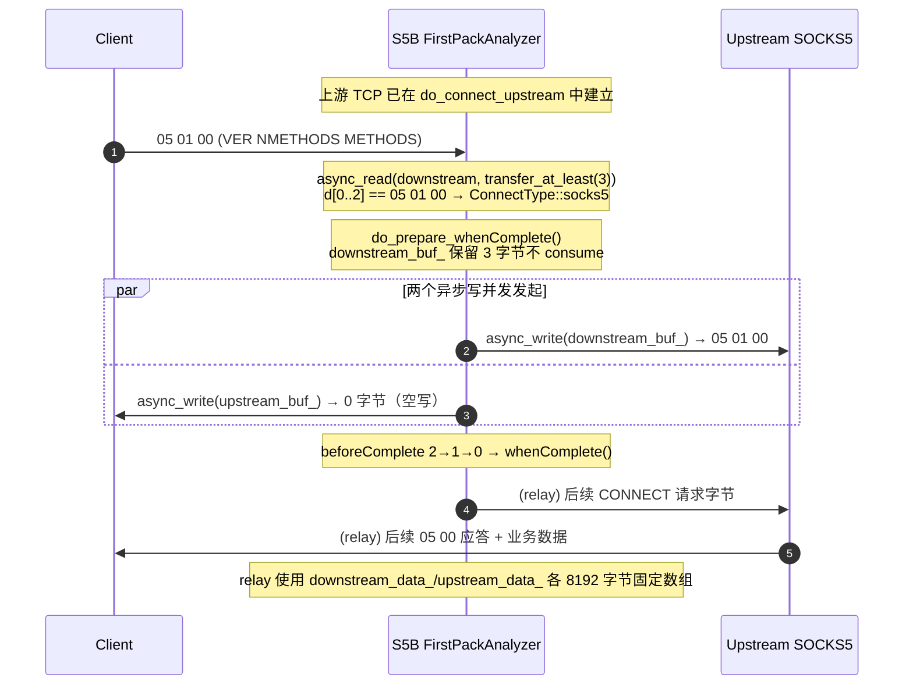
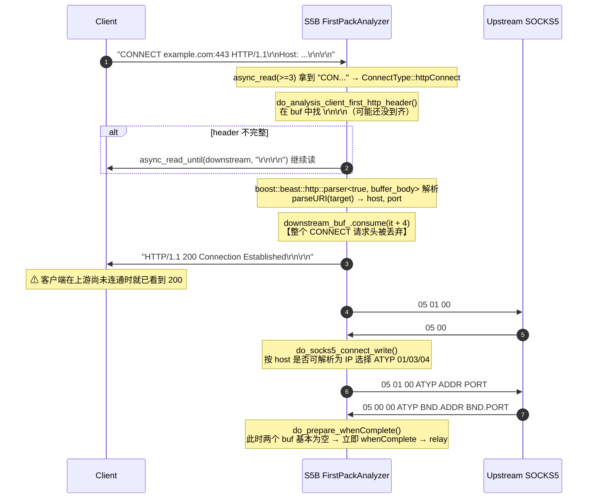
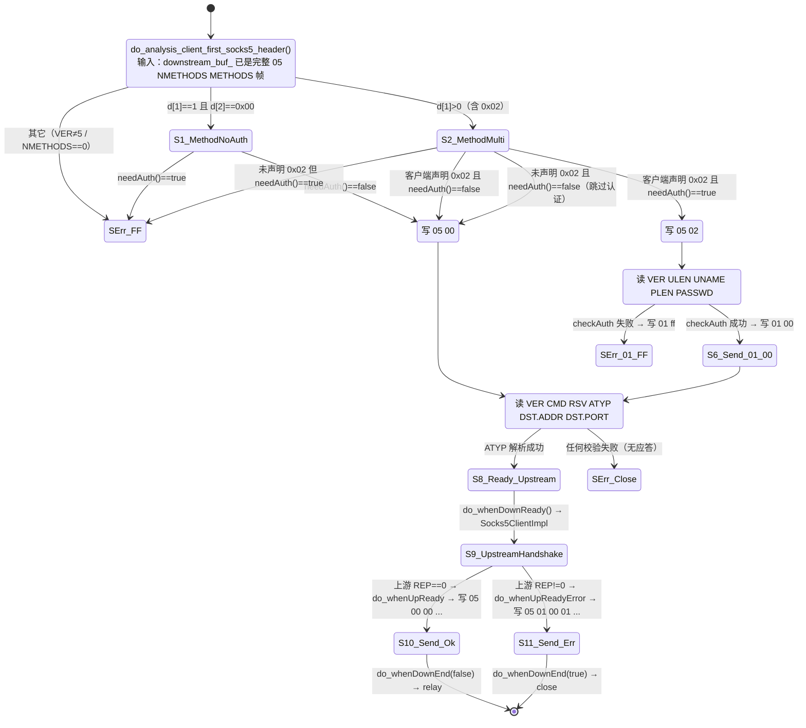
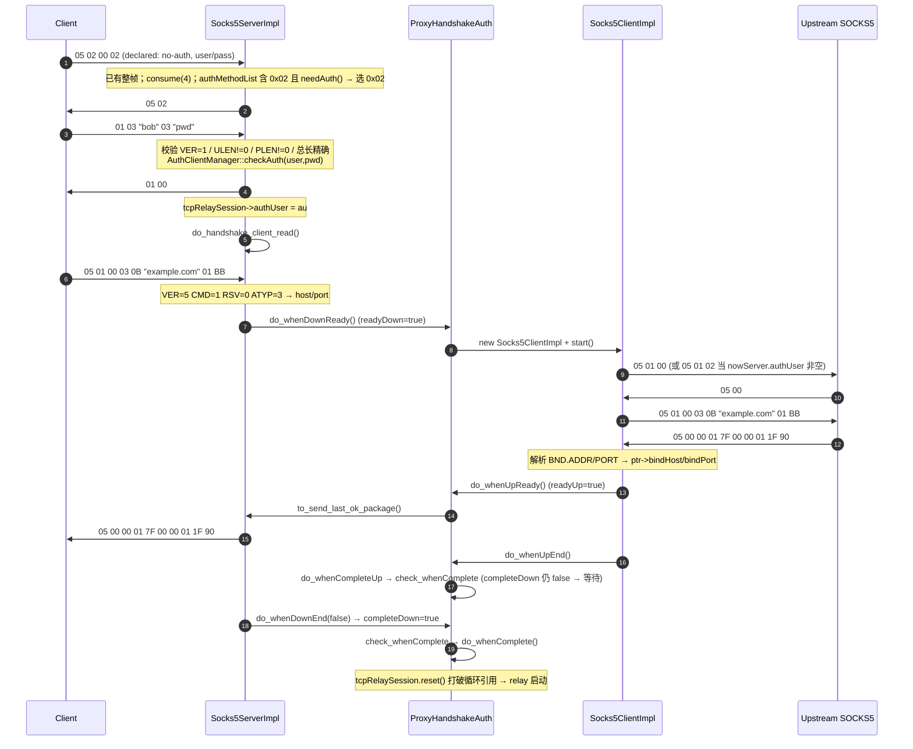
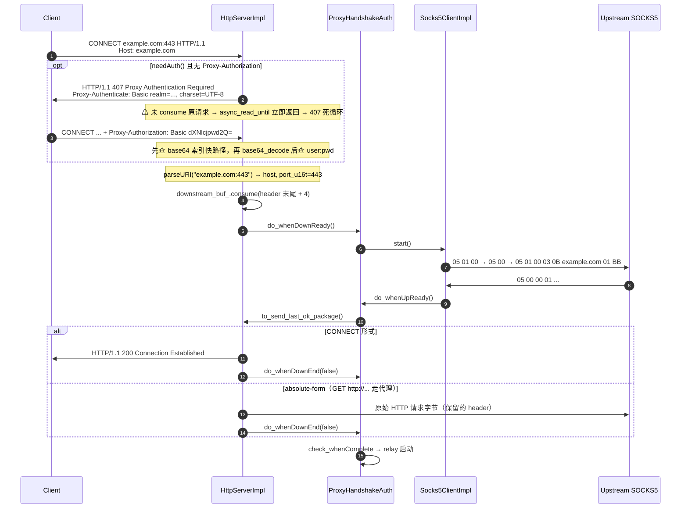
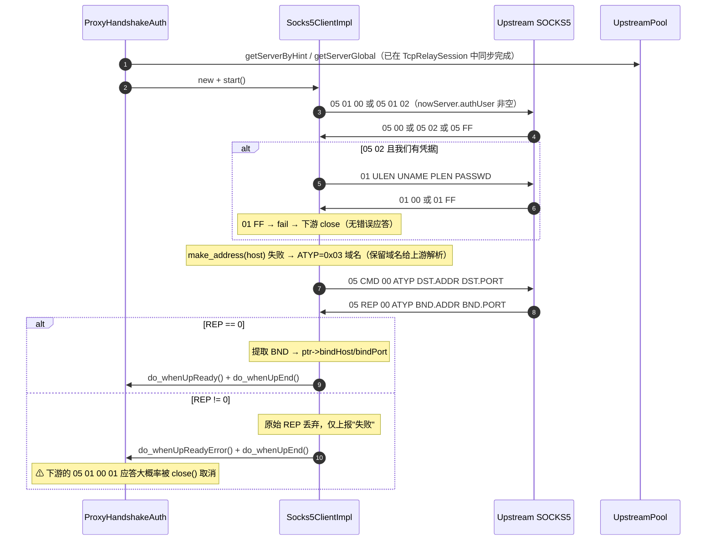

# 03 · 入站/出站协议处理分析

> 分析对象：`Socks5BalancerAsio`（C++20 / Boost.Asio / Boost.Beast）
> 目标读者：负责 Rust 重写（`Socks5BalancerRust`）的实现者
> 源码口径：原始工程 `H:\Code\CLionProjects\Socks5BalancerAsio\src`，本文所有 `src/xxx.cpp:行号` 均指该路径下的原始文件（其中 `src/TcpRelaySession.cpp`、`src/ProxyHandshakeUtils/HttpServerImpl.cpp` 原文为 GB2312 编码，行号由 UTF-8 镜像核对，与原文件一致）。
>
> 配套文档：[01-overview.md](01-overview.md)、[02-relay-core.md](02-relay-core.md)、[04-control-monitor.md](04-control-monitor.md)、[05-build-config-deploy.md](05-build-config-deploy.md)、[06-rust-port-assessment.md](06-rust-port-assessment.md)、[README.md](README.md)。

---

## 摘要（TL;DR）

1. **入站协议处理有两条互斥产品线**：默认构建（`Need_ProxyHandshakeAuth=OFF`）走 `FirstPackAnalyzer`，只嗅探前 3 字节，SOCKS5 场景**完全透传**（不做认证、不支持 SOCKS4）；打开宏之后走 `ProxyHandshakeAuth`，才是完整协议栈（SOCKS4/4a、SOCKS5 含 RFC1929 认证、HTTP CONNECT/Basic 认证）。移植时应**合并为一条路径**，用配置开关表达能力差异。
2. **协议路径没有任何超时**（`connectTimeout` 被解析但全仓无使用；`internalBehavior` 整节无解析代码）。叠加"未完成异步操作持有 `shared_ptr<TcpRelaySession>` + session 又持有握手对象"的引用环，**"连上但不发首包"的连接会永久泄漏**——这是 100MB@C10K 的头号障碍（详见 §9.5 U-6、§9.6）。
3. **协议帧解析普遍把 `async_read_some` 的"字节数必须精确等于某值"当作帧校验**，因此粘包/拆包、early data、上游应答与首批数据同包、IPv6 应答等情况会直接失败。这是可用性缺陷簇（§9.4、附录 B 的 S-4/C-2/B-2/B-3）。
4. **远程可触发的未定义行为**：`HttpServerImpl.cpp:224/240` 在 `Proxy-Authorization` 值短于 6 字节时做 `size()-6`，`size_t` 下溢后构造越界 `string_view`（仅在"增强模式 + 开启客户端认证"时可达）。另有 HTTP 407 后未消费请求导致的**单连接紧循环**（烧满一核）。
5. **语义级错误**：BIND 缺 `return` 导致双应答、UDP ASSOCIATE 假成功、上游 REP 全折叠为 `0x01`、上游失败时下游错误应答几乎必被 cancel 丢弃（§4.6/§4.7、附录 B 的 S-7/S-8/C-3/B-4）。Rust 版应统一为「**先完成上游，再回入站应答**」的顺序。
6. **一处被复核纠正的误判**：`Socks5ServerImpl.cpp:226` 的长度校验前索引**不会崩溃**（缓冲区预分配 8196 字节，`at()` 索引上限 257），已从"极高/远程 DoS"降级为"低/移植陷阱"。但它提醒了一条铁律：**先校验长度再索引，解析函数只接受 `&[u8]` 切片**。

---

## 0. 阅读约定

1. 本文只讨论**协议处理链路**（首包嗅探 → 入站协议握手 → 上游握手 → 交接给 relay），不讨论负载均衡选路、健康检查、统计上报的实现细节（见 04/05 文档）。
2. `Need_ProxyHandshakeAuth` 是一个 **CMake 编译开关**，它让整个入站协议处理走上完全不同的两套代码。本文把它当作「两条产品线」分别分析，最后给出取舍建议。
3. 凡标注 **【缺陷】** 的段落，都是已在该 C++ 实现中确认为真实缺陷（越界、崩溃、死循环、行为错误）的点，Rust 实现**不得等价复刻**，只能等价复刻其「正常路径」。
4. 凡标注 **【待确认】** 的段落，表示源码静态阅读无法完全确定，需要在真机抓包或补测试后确认。

### 0.1 关键编译开关一览

| 开关 | 默认值 | 影响 |
|---|---|---|
| `Need_ProxyHandshakeAuth` | **OFF** | OFF=走 `FirstPackAnalyzer`（透明嗅探回放）；ON=走 `ProxyHandshakeAuth`（完整协议栈：SOCKS4/5 服务端 + SOCKS5 上游客户端 + HTTP 服务端） |
| `MINI_BUILD_MODE` | OFF | 打开后强制 `FORCE_traditionTcpRelay` / `FORCE_disableConnectionTracker` / `FORCE_disableConnectTest` / `NOT_USE_BOOST_THEAD` |
| `FORCE_traditionTcpRelay` | OFF | 强制 `traditionTcpRelay=true`，即**完全跳过首包嗅探**，accept 后直接双向转发 |
| `USE_BOOST_THEAD` | 非 MINI 时 ON | 决定 `main.cpp` 是否多线程 `ioc.run()` |
| `BOOST_ENABLE_ASSERT_HANDLER` | 固定 ON | 大量 `BOOST_ASSERT`/`BOOST_ASSERT_MSG` 是**真实生效的控制流分支**（见 0.2） |

`CMakeLists.txt:124`：

```cmake
option(Need_ProxyHandshakeAuth "Enable ProxyHandshakeAuth" OFF)
if (Need_ProxyHandshakeAuth)
    message(STATUS "Enable ProxyHandshakeAuth ON.")
    set(ProxyHandshakeAuthHeader
            src/ProxyHandshakeUtils/HttpServerImpl.cpp
            ...
            src/ProxyHandshakeAuth.h
            src/ProxyHandshakeUtils/ProxyRelayMode.h)
```

但工程自带的 `CMakeSettings.json`（作者本人的 CLion Debug 配置）显式传了 `-DNeed_ProxyHandshakeAuth=ON`，说明**作者实际开发/调试的是 ON 分支**，而默认的 OFF 分支是「精简发布」形态。这解释了两套代码为什么都带着大量调试日志与不一致的实现成熟度。

### 0.2 断言即控制流

`CMakeLists.txt:90` 打开了 `BOOST_ENABLE_ASSERT_HANDLER`，工程里注册了自定义 assert handler（`src/log/BoostAssertionFailed.cpp`）。因此：

- `BOOST_ASSERT(false)` / `BOOST_ASSERT_MSG(false, ...)` **不是**编译期消失的空操作，而是会走 handler（默认打印并 `std::abort()`）。
- 大量协议代码把「不应该到达的分支」写成 `BOOST_ASSERT_MSG(false, ...)` + `fail(...)`，一旦断言被触发就是**进程级崩溃**，而不是单连接失败。

对 Rust 的含义：任何 C++ 里「靠断言兜底」的路径，Rust 必须写成返回 `Err`，绝不能 `panic!`。

---

## 1. 总览

### 1.1 协议栈分层

```
┌──────────────────────────────────────────────────────────────────────┐
│ L4  relay（双向字节流搬运，与协议无关）                                │
│     TcpRelaySession::do_downstream_read/do_upstream_write            │
│                    do_upstream_read  /do_downstream_write            │
│     每方向 8KB 固定 std::array；read_some → async_write → 再 read      │
├──────────────────────────────────────────────────────────────────────┤
│ L3  首包嗅探 / 协议分派（握手期，结束后自我注销）                       │
│     分支A: FirstPackAnalyzer        （Need_ProxyHandshakeAuth=OFF）   │
│     分支B: ProxyHandshakeAuth       （Need_ProxyHandshakeAuth=ON）    │
├──────────────────────────────────────────────────────────────────────┤
│ L2  入站协议服务端                                                     │
│     Socks5ServerImpl(RFC1928/1929) / Socks4ServerImpl / HttpServerImpl│
├──────────────────────────────────────────────────────────────────────┤
│ L1  出站（上游）协议客户端                                             │
│     Socks5ClientImpl  —— 只实现了 SOCKS5 CONNECT/BIND/UDP ASSOCIATE   │
│     HttpClientImpl    —— 空壳，未实现                                 │
├──────────────────────────────────────────────────────────────────────┤
│ L0  上游选择（UpstreamPool 接口契约，细节见 04/05 文档）               │
└──────────────────────────────────────────────────────────────────────┘
```

关键点：**本程序的出站协议永远是 SOCKS5**（`ProxyHandshakeAuth::upsideConnectType` 只有 `socks5` 被真正使用，`socks4`/`http` 枚举存在但从未赋值）。这意味着：

- SOCKS4 入站 → 必须做 SOCKS4→SOCKS5 的**命令翻译**（`Socks4ServerImpl` 解析 + `Socks5ClientImpl` 重编码）。
- HTTP CONNECT 入站 → 同样翻译成上游 SOCKS5 CONNECT。
- SOCKS5 入站 → 语义直通（可选地重新编码地址）。

### 1.2 连接生命周期（非 `traditionTcpRelay`）

```
accept()
  └─ TcpRelaySession::start()
       └─ try_connect_upstream()            // 同步选路（UpstreamPool 加锁）
            └─ do_resolve() → do_connect_upstream()   // 异步 DNS + TCP connect
                 └─ 成功:
                      ├─ traditionTcpRelay=true  → 直接 do_upstream_read + do_downstream_read
                      └─ traditionTcpRelay=false → 构造 FirstPackAnalyzer|ProxyHandshakeAuth
                                                   → start()  (握手期)
                                                       └─ 双方握手完成
                                                            → whenComplete()
                                                                 └─ relay 启动
                 └─ 失败: nowServer->isOffline=true; try_connect_upstream() 重试
```

**重要语义**：上游 TCP 连接是在**读到客户端首包之前**建立的（`src/TcpRelaySession.cpp:135` → `do_resolve`）。`src/TcpRelaySession.cpp:210-212` 的注释明确承认了这一点并留了 TODO：

```cpp
// TODO: if we want to impl upstream select by target domain ,
//      must need move the firstPackAnalyzer call to the `start()` before the `try_connect_upstream()` call
//      and then , the `try_connect_upstream()` use the `ptr->targetEndpointAddrString` (aka `ptr->firstPackAnalyzer->host` ) to select upstream
```

后果：本程序**无法按目标域名做上游选路**（这是负载均衡器的核心卖点之一），且「客户端连上来但永不发首包」会白占一条上游 TCP 连接（无超时，见 §9.1）。

### 1.3 文件职责表

行数为 UTF-8 镜像实测 LF 数（含版权头）。

| 文件 | 行数 | 职责 | 关键类/函数 |
|---|---|---|---|
| `src/TcpRelayServer.cpp/.h` | 174 / 98 | acceptor 管理、多监听地址、周期清理 | `TcpRelayServer::async_accept` |
| `src/TcpRelaySession.cpp/.h` | 532 / 221 | 单连接：选路上游、connect、握手入口、双向 relay、统计 | `TcpRelaySession::try_connect_upstream` / `do_connect_upstream` / `close` |
| `src/FirstPackAnalyzer.cpp/.h` | 623 / 133 | **分支A**：首包嗅探 + 首包回放 + HTTP→SOCKS5 转换 | `do_read_client_first_3_byte` / `do_prepare_whenComplete` |
| `src/ProxyHandshakeAuth.cpp/.h` | 459 / 220 | **分支B**：首包嗅探 + 分派 + 双端完成协调 | `do_read_client_first_3_byte` / `do_whenUpReady` / `check_whenComplete` |
| `src/ProxyHandshakeUtils/Socks5ServerImpl.cpp/.h` | 833 / 100 | SOCKS5 服务端状态机（RFC1928/1929） | `do_analysis_client_first_socks5_header` / `do_auth_client_read` / `do_handshake_client_read` / `do_handshake_client_end` |
| `src/ProxyHandshakeUtils/Socks4ServerImpl.cpp/.h` | 343 / 90 | SOCKS4 / SOCKS4a 服务端 | `do_analysis_client_first_socks4_header` |
| `src/ProxyHandshakeUtils/HttpServerImpl.cpp/.h` | 546 / 117 | HTTP 代理服务端（CONNECT + absolute-form） | `do_analysis_client_first_http_header` / `do_send_407` / `to_send_last_ok_package` |
| `src/ProxyHandshakeUtils/Socks5ClientImpl.cpp/.h` | 524 / 88 | 上游 SOCKS5 客户端（含可选用户名密码认证） | `do_socks5_handshake_read` / `do_socks5_auth_write` / `do_socks5_connect_read` |
| `src/ProxyHandshakeUtils/HttpClientImpl.cpp/.h` | 44 / 72 | **空壳**，从未被构造 | — |
| `src/ProxyHandshakeUtils/ProxyRelayMode.h` | 33 | 转发模式枚举 | `ProxyRelayMode{connect,udp,bind,none}` |
| `src/ConnectType.h` | 34 | 入站协议类型枚举 | `ConnectType{socks5,socks4,httpConnect,httpOther,unknown}` |
| `src/AuthClientManager.cpp/.h` | 78 / 165 | 客户端白名单（multi_index 四索引） | `needAuth` / `checkAuth` / `checkAuthUserOnly` / `checkAuth_Base64AuthString` |
| `src/base64.h` | 88 | Boost 迭代器实现的 base64 编解码 | `base64_encode_string` / `base64_decode_string` |
| `src/ConfigLoader.cpp/.h` | 323 / 136 | JSON 配置解析 | `ConfigLoader::parse_json` |
| `src/ConfigRuleEnum.h` | 33 | 上游选择规则枚举 | `RuleEnum` |
| `src/ConnectionTracker.cpp/.h` | 128 / 184 | 首包镜像用于延迟分析（**不参与转发**） | `relayGotoUp` / `relayGotoDown` |
| `src/UpstreamPool.cpp/.h` | 634 / 217 | 上游池与选路 | `getServerGlobal` / `getServerByHint` |
| `src/SessionRelayId.h` | 55 | 全局自增 relayId | `getNextRelayId` |

### 1.4 读源码时最容易误判的三件事

1. **`FirstPackAnalyzer::upstream_buf_` 永远是空的**。`upstream_buf_`（远端→客户端方向）只在 `do_prepare_complete_downstream_write` 里被 `async_write` 读取，但全文件**没有任何一处向它写入数据**（`do_socks5_handshake_read` 用临时 `std::vector` 收包，不落 streambuf）。因此「下游补发」是一个 0 字节写操作，`beforeComplete = 2` 里的那 1 份只是为了保持对称。
2. **`ConnectionTracker` 与转发无关**。它的 `relayGotoUp/Down` 只是把首包**复制**一份到自己的 streambuf 用来做延迟统计（`src/ConnectionTracker.cpp:23-56`），拷贝完的副本由 `analysisData` 消费；它从不参与补发。
3. **`ProxyHandshakeAuth::tcpRelaySession` 是 `shared_ptr`（强引用）**，`src/ProxyHandshakeAuth.h:60-62` 注释自认这是循环引用，必须靠 `do_whenComplete()/do_whenError()` 里的 `tcpRelaySession.reset()` 打断。而 `FirstPackAnalyzer::tcpRelaySession` 是 `weak_ptr`。这是两条分支最容易踩差异的地方（§9.6）。

---

## 2. 分支A：FirstPackAnalyzer（`Need_ProxyHandshakeAuth=OFF`）

### 2.1 数据结构与 buffer 语义

`src/FirstPackAnalyzer.h:49-73`：

```cpp
class FirstPackAnalyzer : public std::enable_shared_from_this<FirstPackAnalyzer> {
public:
    std::weak_ptr<TcpRelaySession> tcpRelaySession;

    // Client --> Proxy --> Remove Server
    boost::asio::streambuf downstream_buf_;
    // Remote Server --> Proxy --> Client
    boost::asio::streambuf upstream_buf_;

    boost::asio::ip::tcp::socket &downstream_socket_;
    boost::asio::ip::tcp::socket &upstream_socket_;

    std::function<void()> whenComplete;
    std::function<void(boost::system::error_code error)> whenError;

    size_t beforeComplete = 2;
    ConnectType connectType = ConnectType::unknown;
    std::string host{};
    uint16_t port{0};
    const size_t relayId;
```

- `downstream_buf_` = **客户端发来的原始字节**，握手期唯一真正承载数据的 buffer。命名里的 "downstream" 指「下行（客户端→代理）方向」，别按 TCP 的 down/up 直觉理解。
- `upstream_buf_` = 声明为「远端→客户端」方向，实际从未写入（见 §1.4）。
- `beforeComplete = 2`：握手结束时需要等到**两个方向各一次 `async_write` 完成**才回调 `whenComplete`。递减在 `do_whenComplete()`，由两个写回调各自调用一次。

### 2.2 首包的第一次读取

`src/FirstPackAnalyzer.cpp:154-242`：

```cpp
boost::asio::async_read(
        downstream_socket_,
        downstream_buf_,
        boost::asio::transfer_at_least(3),
        [this, self = shared_from_this(), ptr](
                const boost::system::error_code &error,
                const size_t &bytes_transferred) {
            if (!error && bytes_transferred >= 3 && downstream_buf_.size() >= 3) {
                auto d = reinterpret_cast<const unsigned char *>(downstream_buf_.data().data());
                if (d[0] == 0x05 && d[1] == 0x01 && d[2] == 0x00) {
                    // is socks5
                    connectType = ConnectType::socks5;
                    do_prepare_whenComplete();
                } else if ((d[0] == 'C' || d[0] == 'c') && ...) {
                    // is http Connect
                    connectType = ConnectType::httpConnect;
                    do_analysis_client_first_http_header();
                } else { ... }
```

要点：

- 使用 `async_read` + `transfer_at_least(3)`（**不是** `read_some`）。语义是「至少 3 字节，能多拿就多拿」，`downstream_buf_.size()` 可能 **远大于 3**（最多到一次读取的可用空间）。这一点对理解分支A 的健壮性非常关键：它不要求「第一个 TCP 段恰好是协议首包」。
- 判定只依赖 `d[0]`（SOCKS5 还依赖 `d[1]`/`d[2]`），**不 consume**，因此 buffer 里的原始字节完整保留，后续要么被回放给上游（socks5），要么被解析后丢弃（HTTP）。
- 失败分支只有一个 `do_whenError(error)`，没有协议级错误应答（本来也无法通用地回）。

### 2.3 判定表（魔数 / 偏移 / 优先级）

判定是**严格顺序的 if-else 链**，先命中先返回：

| 优先级 | 判定条件（字节偏移） | 结果 `connectType` | 后续动作 |
|---|---|---|---|
| 1 | `d[0]==0x05 && d[1]==0x01 && d[2]==0x00` | `socks5` | `do_prepare_whenComplete()`：原样回放首包给上游，透明中继 |
| 2 | `d[0..2]` 大小写不敏感等于 `"CON"` | `httpConnect` | `do_analysis_client_first_http_header()` → 自己发 `200 Connection Established` → **自行与上游做 SOCKS5 CONNECT** |
| 3 | `d[0] ∈ {'P','p','G','g','H','h','D','d','O','o','T','t'}` | `httpOther` | 同上走 HTTP 解析路径（POST/PUT/PATCH/GET/HEAD/DELETE/OPTIONS/TRACE） |
| 4 | 其它任意字节 | `unknown` | **仍然**调用 `do_analysis_client_first_http_header()`（见【缺陷 A-1】） |

【缺陷 A-1】**SOCKS5 多方法协商被判成 unknown 并挂死。**
判定 1 要求 `NMETHODS==1 && METHODS[0]==0x00`。而大量客户端（各类 SDK、curl 的某些版本、golang `golang.org/x/net/proxy` 在配置了认证时）发送的是 `05 02 00 02`（两种方法：无认证 + 用户名密码）。此时：

- `d[2]==0x02` ≠ `0x00` → 不匹配判定 1；
- `d[0]==0x05` 不在 `P/G/H/D/O/T` → `connectType = unknown`；
- 但代码**无条件**接着执行 `do_analysis_client_first_http_header()`（`src/FirstPackAnalyzer.cpp:232`），该函数找 `"\r\n\r\n"`（`src/FirstPackAnalyzer.cpp:276`）；SOCKS5 二进制流里几乎不会出现该序列，于是转入 `do_read_client_first_http_header()` → `async_read_until("\r\n\r\n")` 永久挂起。

结论：**分支A 只支持「单方法、无认证」的 SOCKS5 客户端首包**，其它一律挂死（且无超时，见 §9.1）。这是分支A 最严重的可用性缺陷。

【缺陷 A-2】HTTP 方法白名单不完整（`TRACE` 之后没有 `CONNECT` 独立分支之外的兜底），且 `d[0]` 大小写判断是手写展开的 6 个 case，与判定 2 的 `CON` 前缀判定重复。功能上不致命（`unknown` 也会进 HTTP 解析），但语义混乱。

### 2.4 首包「吞掉再补发」机制（核心）

#### 2.4.1 两条路径的差异

| 路径 | 首包去向 | 谁负责重建 |
|---|---|---|
| `socks5` | `downstream_buf_` 里的原始字节 **一字不改** 写回 `upstream_socket_` | 无需重建，客户端自己就是 SOCKS5，上游也是 SOCKS5，语义直通 |
| `httpConnect` / `httpOther` | `downstream_buf_` 里的 **请求头被 `consume` 丢弃**，不转发 | `FirstPackAnalyzer` 自己扮演 SOCKS5 客户端，用解析出的 `host:port` 重新构造 `05 01 00` + `CONNECT` 发给上游 |

因此「补发」在分支A 里其实是两件不同的事：**透明回放**（socks5）与**协议翻译**（HTTP）。

#### 2.4.2 `do_prepare_whenComplete()`：双向并发写

`src/FirstPackAnalyzer.cpp:69-152`：

```cpp
void FirstPackAnalyzer::do_prepare_whenComplete() {
    auto ptr = tcpRelaySession.lock();
    if (ptr) {
        auto ct = ptr->getConnectionTracker();
        if (ct) {
            ct->relayGotoDown(upstream_buf_);   // 空 buffer，仅统计
            ct->relayGotoUp(downstream_buf_);   // 首包副本，仅统计
        }
        // send remain data
        do_prepare_complete_downstream_write();   // async_write(downstream, upstream_buf_)  —— 0 字节
        do_prepare_complete_upstream_write();     // async_write(upstream,   downstream_buf_) —— 首包
    } else {
        badParentPtr();
    }
}
```

两个 `async_write` **并发发起**（不是串行），各自回调里 `do_whenComplete()` 递减 `beforeComplete`：

```cpp
void FirstPackAnalyzer::do_whenComplete() {
    --beforeComplete;
    if (0 == beforeComplete) {
        auto ptr = tcpRelaySession.lock();
        if (ptr) {
            if (whenComplete) {
                whenComplete();          // → TcpRelaySession 启动 relay
                whenComplete = nullptr;
                whenError = nullptr;
            }
        }
    }
}
```

写完成后才允许 relay 接管，这是**防止首包与 relay 数据乱序**的唯一机制（因为两者写的是同一个 socket，若 relay 先写会插队）。

#### 2.4.3 完整时序：SOCKS5 透明中继



关键结论：**分支A 对 SOCKS5 不做任何协议解析**，它只判断「这是不是 SOCKS5」，然后把首包原样交给上游。真正的 SOCKS5 状态机在上游代理里。所以分支A 的 SOCKS5 支持度 = 上游代理的支持度，本程序只做 TCP 中继 + 上游负载均衡 + （可选的）必须嗅探的部分。

这也意味着分支A 对 SOCKS5 **没有客户端认证能力**（`AuthClientManager` 在分支A 完全没被调用，见 §10 表）。

#### 2.4.4 完整时序：HTTP CONNECT → SOCKS5 翻译



【缺陷 A-3】**HTTP CONNECT 采用「乐观应答」**：`200 Connection Established` 在 SOCKS5 上游握手**之前**就发给客户端（`src/FirstPackAnalyzer.cpp:313` → `do_send_Connection_Established()` → 写回调里才 `do_socks5_handshake_write()`）。因此上游不可达/握手失败时，客户端已经收到 200，随后被静默断开（`whenError → TcpRelaySession::close`）。标准 HTTP 代理应在上游连通后才回 200。

【缺陷 A-4】上游握手使用 `async_read_some`（不是 `async_read` + `transfer_*`），见 `src/FirstPackAnalyzer.cpp:423` 与 `src/FirstPackAnalyzer.cpp:528`。`read_some` 只保证「至少 1 字节」，所以：

- `do_socks5_handshake_read` 要求 `bytes_transferred >= 2` 且 `at(0)==5 && at(1)==0`；上游若把 `05 00` 拆成两个 TCP 段（罕见但合法），会直接 `fail`。
- `do_socks5_connect_read` 更严格：要求 `bytes_transferred` **精确等于**应答长度（`src/FirstPackAnalyzer.cpp:544-582`），任何一个字节的分片都会失败。

这两处是分支A 对上游实现的**隐含假设：上游必须一次 write 输出完整握手帧**，与 RFC 允许的任意分片冲突。

### 2.5 分支A 的握手失败处理

`src/FirstPackAnalyzer.cpp:594-610`：

```cpp
void FirstPackAnalyzer::fail(boost::system::error_code ec, const std::string &what) {
    ...
    do_whenError(ec);
}

void FirstPackAnalyzer::badParentPtr() {
    if (0 != beforeComplete) {
        do_whenError({});
    }
}
```

- 所有失败都汇总到 `do_whenError` → `TcpRelaySession` 的 `whenError` lambda → `TcpRelaySession::close(error)`。
- `badParentPtr()` 用 `beforeComplete != 0` 作为「还没完成」的判据，避免已完成后再报错。
- **没有任何协议级错误应答**：分支A 在失败时对客户端只有 TCP FIN/RST，没有 SOCKS5 REP、没有 SOCKS4 CD、没有 HTTP 5xx（HTTP 路径因为已经发了 200，更没法补救）。

---

## 3. 分支B：ProxyHandshakeAuth（`Need_ProxyHandshakeAuth=ON`）

### 3.1 分派流程

`src/ProxyHandshakeAuth.cpp:23-210`。同样先用 `async_read(..., transfer_at_least(3))`，但判定条件与分支A **不同**：

| 优先级 | 判定条件 | `ConnectType` | 构造的 Impl |
|---|---|---|---|
| 1 | `d[0]==0x05 && (d[1]==0x02\|\|d[1]==0x01) && (d[2]==0x02\|\|d[2]==0x00)` **且** `downstream_buf_.size() == 2 + d[1]` | `socks5` | `Socks5ServerImpl::do_analysis_client_first_socks5_header()` |
| 2 | `d[0]==0x04 && (d[1]==0x02\|\|d[1]==0x01)` | `socks4` | `Socks4ServerImpl::do_analysis_client_first_socks4_header()` |
| 3 | `d[0..6]` 大小写不敏感等于 `"CONNECT"` | `httpConnect` | `HttpServerImpl::do_analysis_client_first_http_header()` |
| 4 | `d[0] ∈ {P,G,H,D,O,T}` | `httpOther` | `HttpServerImpl::do_analysis_client_first_http_header()` |
| 5 | 其它 | `unknown` | `fail({}, "ConnectType::unknown")`（分支A 此处会挂死，这里直接失败，**更正确**） |

【缺陷 B-1】**HTTP CONNECT 判定越界读。**
`src/ProxyHandshakeAuth.cpp:112-118` 在 `transfer_at_least(3)` 之后直接读 `d[3]`~`d[6]`：

```cpp
} else if ((d[0] == 'C' || d[0] == 'c') &&
           (d[1] == 'O' || d[1] == 'o') &&
           (d[2] == 'N' || d[2] == 'n') &&
           (d[3] == 'N' || d[3] == 'n') &&      // ← d[3] 可能越界
           (d[4] == 'E' || d[4] == 'e') &&      // ← d[4] 可能越界
           (d[5] == 'C' || d[5] == 'c') &&      // ← d[5] 可能越界
           (d[6] == 'T' || d[6] == 't')) {      // ← d[6] 可能越界
```

`transfer_at_least(3)` 只保证**至少** 3 字节。若客户端分片为 `"CON"` + `"NECT ..."`（合法 TCP 行为），`downstream_buf_.size()==3`，`d[3..6]` 读到的是 streambuf 内部 `std::vector` 已分配但未 commit 的字节 —— **未定义行为**。而分支A 同样位置只读到 `d[2]`（`"CON"`），没有这个问题。讽刺的是分支B（更"完整"的实现）反而引入了这个越界。

【缺陷 B-2】**SOCKS5 判定要求「协商包恰好一个完整帧」。**
`src/ProxyHandshakeAuth.cpp:45`：

```cpp
if (downstream_buf_.size() != (2 + (uint8_t) d[1])) { ... fail ... }
```

若客户端在同一次 `write` 里发出 `05 01 00` + CONNECT 请求（pipe-lining，RFC 不禁止，很多客户端会为了让首包更快到达而合并），则 `size` 大于 `2+d[1]` → **直接失败**。这是对「首包分片/合并」两个方向的**双重脆弱**：少一个字节失败（合理），多一个字节也失败（不合理）。

【缺陷 B-3】**SOCKS4 判定依赖 `d[len]` 越界读，且几乎必然失败。**
`src/ProxyHandshakeAuth.cpp:81-98`：

```cpp
bool pLenOk = len >= (1 + 1 + 2 + 4 /*+ pUserIdLen*/ + 1);   // >= 9
bool pEndWithNull = dd[len] == '\x00';                        // ← 应为 dd[len-1]！
if (!pLenOk || !pEndWithNull) { ... fail ... }
```

两个独立问题：

1. `dd[len]` 是 **off-by-one 越界读**（合法末字节索引是 `len-1`）。实践中常"侥幸"通过，因为 `boost::asio::streambuf` 的 `prepare` 保留空间大于 `commit`，越界位置通常是 `0`。但这是 UB。
2. `pLenOk` 要求 `len >= 9`，而 `transfer_at_least(3)` 只保证 3 字节。一个「先发 3 字节再发剩余」的客户端（或 TCP 恰好切成 `"04 01 00"` + 剩余）→ `len==3` → `!pLenOk` → **把合法 SOCKS4 请求判为非法并断开**。文档注释自己承认了这个风险（`src/ProxyHandshakeUtils/Socks4ServerImpl.cpp:48-51`）：

```cpp
// NOTE: maybe we will face a bad or slow impl client , witch split a package into two or more piece
//      so, we will not receive all the data in the package
//      that is a bad impl, now , only the Golang impl have this issue
//      BUT, in this place , we cannot detect is the client slow OR the client invalid
```

结论：分支B 的 SOCKS4 支持在真实网络中**不可靠**，只能对「一次 write 发完整个 SOCKS4 请求」的客户端工作。

### 3.2 双端完成协调模型

分支B 用 4 个布尔 + 2 个错误位协调「下行入站握手」与「上行出站握手」（`src/ProxyHandshakeAuth.h:91-96`）：

```cpp
bool readyUp = false;          // 上游握手已结束（成功或失败），"最后应答"已发出/正在发
bool readyDown = false;        // 下行入站握手已解析完毕，可以开始上游握手
bool completeUp = false;       // 上游侧完成（含失败）
bool completeDown = false;     // 下行"最后应答"写完
bool completeUpError = false;
bool completeDownError = false;
```

状态迁移（`src/ProxyHandshakeAuth.cpp:227-368`）：

```
                  ┌──────────────────────────────────────────────┐
下行解析完成 ───→ │ do_whenDownReady()  readyDown=true           │
                  │   → new Socks5ClientImpl → start()           │
                  └───────────────────────┬──────────────────────┘
                                          │ 上游握手
              ┌───────────────────────────┴───────────────────────────┐
              ▼                                                       ▼
   do_whenUpReady()                                        do_whenUpReadyError()
     readyUp=true                                            readyUp=true
     → to_send_last_ok_package()                             completeUpError=true
     → 写下游「成功应答」                                     → to_send_last_error_package()
                                                              → 写下游「失败应答」
              │                                                       │
   do_whenUpEnd()  → do_whenCompleteUp()                   do_whenUpEnd() → do_whenCompleteUp()
              │                                                       │
   写回调 → do_whenDownEnd(false) → completeDown             写回调 → do_whenDownEnd(true)
              │                                                       │
              └──────────────→ check_whenComplete() ←─────────────────┘
                                    │
              completeDownError||completeUpError → fail → do_whenError
              completeDown&&completeUp           → do_whenComplete
```

【缺陷 B-4】**上游失败时，下游的 SOCKS5 错误应答大概率丢失。**
`src/ProxyHandshakeUtils/Socks5ClientImpl.cpp:355-362`：

```cpp
if (socks5_read_buf->at(1) != 0x0) {
    // backend server failed
    ptr->do_whenUpReadyError();   // → 发起 async_write(downstream, 05 01 00 01 ...)
    ptr->do_whenUpEnd();          // → do_whenCompleteUp → check_whenComplete
    return;
}
```

`do_whenUpReadyError()` 内部只是**发起**了 `async_write`；紧接着同步执行的 `do_whenUpEnd() → check_whenComplete()` 看到 `completeUpError==true`，立刻 `fail() → do_whenError() → TcpRelaySession::close()`。`close()` 会 `cancel()` + `close()` 下游 socket（`src/TcpRelaySession.cpp:453-460`），而刚发起的 `async_write` 还没被 reactor 处理，**几乎必然被取消**。

净效果：客户端发 `CONNECT` → 上游 REP≠0 → 客户端看到的是「连接被重置/关闭」，而不是 `05 01 00 01 ...`。这与 RFC1928 的要求不符，也与分支A 的行为（同样不发错误码，但分支A 至少不会假装发）不同。

正确的顺序应当是「写完错误应答 → 再 completeDown → 再 close」。Rust 实现必须修正。

### 3.3 分支A vs 分支B：架构差异与取舍

| 维度 | 分支A `FirstPackAnalyzer` | 分支B `ProxyHandshakeAuth` |
|---|---|---|
| 代码量 | 623 + 133 行 | 459+220 行 ∥ 833+100 ∥ 343+90 ∥ 546+117 ∥ 524+88 行 |
| SOCKS5 处理 | **不解析**，透明回放给上游 | 完整状态机（方法协商/认证/请求/应答） |
| 客户端认证 | ✗ 完全不支持 | ✓ SOCKS5 用户名密码 / SOCKS4 USERID / HTTP Basic |
| SOCKS4 | ✗ | ✓（但脆弱，见 B-3） |
| HTTP CONNECT | ✓（乐观 200，无认证） | ✓（支持 407 + Basic 认证） |
| HTTP absolute-form | ✗（等价于 httpOther 路径，行为不正确） | ✓（`absoluteFormRequest` 分支） |
| 上游认证 | ✗（只发 `05 01 00`） | ✓（`nowServer->authUser/authPwd`） |
| 上游应答校验 | 弱（`read_some` + `if` 链） | 强（`async_read` + 精确长度 + 取 BND 地址） |
| 协议错误应答 | 无 | SOCKS5 REP / SOCKS4 CD / HTTP 407/503 |
| 首包回放机制 | streambuf 保留 + 并发 `async_write` | 显式 `consume` + 由各 Impl 重建 |
| 生命周期 | `weak_ptr` 父引用（无循环） | `shared_ptr` 父引用（**需手动 reset 破环**） |
| 构造时机 | `TcpRelaySession::do_connect_upstream` 成功后 | 同 |
| 主要缺陷 | 多方法 SOCKS5 挂死；无认证；乐观 200 | HTTP 判定越界读；SOCKS5/4 帧完整性过度假设；错误应答丢失 |

**取舍建议（给 Rust 重写）**：不要二选一，取**分支B 的协议语义 + 分支A 的流式读取方式**。

- 语义上必须走分支B：认证、SOCKS4、HTTP 407、错误码回传，这些都是生产环境的硬需求。
- 读取方式上必须走分支A 的「不假设帧边界」：用 `read_buf`/增量解析，绝不要求「第一次读恰好是一个完整帧」。
- 分支A 的「透明回放」能力在有认证/需要改写的场景下无法保留（因为必须解析才能鉴权），可以放弃；但可以保留一条 **「无认证 + 无改写需求时的零解析快路径」** 作为优化（类比 `traditionTcpRelay`）。

---

## 4. SOCKS5 服务端状态机（Socks5ServerImpl）

### 4.1 状态图



### 4.2 方法协商（VER / NMETHODS / METHODS）

入口 `src/ProxyHandshakeUtils/Socks5ServerImpl.cpp:31-145`。注意**它假设 `downstream_buf_` 里已经是一整帧**（由 `ProxyHandshakeAuth` 用 `size == 2+d[1]` 保证）：

```cpp
auto data = ptr->downstream_buf_.data();
size_t len = data.size();
auto d = reinterpret_cast<const unsigned char *>(data.data());
if (len < 3) { fail(...); return; }                       // 防御
if (len != (2 + (uint8_t) d[1])) {                        // 再次确认整帧
    fail(...); return;
}
if (d[0] == 0x05 && d[1] == 0x01 && d[2] == 0x00) {
    // is socks5 no auth
    ptr->downstream_buf_.consume(3);
    if (ptr->authClientManager->needAuth()) {
        fail({}, "... no auth");                          // 不发 05 ff！
        return;
    } else {
        do_handshake_client_write();                      // 写 05 00
        return;
    }
} else if (d[0] == 0x05 && d[1] > 0) {
    std::string authMethodList{reinterpret_cast<const char *>(d) + 2, (uint8_t) d[1]};
    ptr->downstream_buf_.consume((2 + (uint8_t) d[1]));
    if (authMethodList.find(0x02) != std::string::npos) { ... }
```

分支细节：

| 客户端首包 | `needAuth()` | 服务端动作 |
|---|---|---|
| `05 01 00` | false | `consume(3)` → 写 `05 00` → 读请求 |
| `05 01 00` | true | **`fail()` 直接断开**（不回 `05 ff`）【缺陷 S-1】 |
| `05 0N xx..`（含 0x02） | true | `consume(2+N)` → 写 `05 02` → 读认证 |
| `05 0N xx..`（含 0x02） | false | `consume(2+N)` → 写 `05 00` → 读请求（跳过认证） |
| `05 0N xx..`（不含 0x02） | true | `do_handshake_client_header_error()` → 写 `05 ff` → 关闭 |
| `05 0N xx..`（不含 0x02） | false | `consume` → 写 `05 00` → 读请求（宽容） |
| `VER≠5` 或 `NMETHODS==0` | — | `do_handshake_client_header_error()` → 写 `05 ff` → 关闭 |

【缺陷 S-1】「客户端只报无认证 + 服务端要求认证」时应当回 `05 ff` 告知「没有可接受的方法」，实际是直接 `fail` 断开。功能上客户端也能察觉（连接断），但不合 RFC1928。

值得注意的**优点**：`authMethodList.find(0x02)` 用 `std::string::find(char)` 在方法列表里找 `0x02`，支持 `NMETHODS>1` 的任意组合 —— 这一点比分支A 强得多（分支A 只认 `05 01 00`）。

### 4.3 用户名密码认证（RFC1929）

`do_auth_client_write` → `do_auth_client_read` → `do_auth_client_ok` / `do_auth_client_error`。

协议帧：

```
+----+------+----------+------+----------+
|VER | ULEN |  UNAME   | PLEN |  PASSWD  |
+----+------+----------+------+----------+
| 1  |  1   | 1 to 255 |  1   | 1 to 255 |
+----+------+----------+------+----------+
VER 必须为 0x01
```

解析（`src/ProxyHandshakeUtils/Socks5ServerImpl.cpp:190-282`），使用 `async_read_some` + 临时 8196 字节 `std::vector`：

```cpp
if (bytes_transferred < (2 + 1 + 1 + 1)) { return fail(...); }                          // < 5
if (bytes_transferred < (2 + at(1) + 1 + at(2 + at(1)))) { return fail(...); }           // 太短
if (bytes_transferred > (2 + at(1) + 1 + at(2 + at(1)))) { return fail(...); }           // 太长
if (at(0) != 0x01) { return fail(...); }                                                 // VER 必须 1
if (at(1) == 0)    { return fail(...); }                                                 // ULEN 不能 0
if (at(2 + at(1)) == 0) { return fail(...); }                                            // PLEN 不能 0
std::string_view user{ (char*)(data() + 2), at(1) };
std::string_view pwd { (char*)(data() + 2 + at(1) + 1), at(2 + at(1)) };
auto au = ptr->authClientManager->checkAuth(user, pwd);
```

【缺陷 S-2】**长度校验前索引 + 读取未接收区域（日志污染；当前不崩溃，但极其脆弱）。**
`src/ProxyHandshakeUtils/Socks5ServerImpl.cpp:216-228` 的**调试日志**写在长度校验**之前**：

```cpp
{
    std::stringstream ss;
    ss << "do_auth_client_read get bytes_transferred:"
       << bytes_transferred
       << " data:" << std::string{(char *) socks5_read_buf->data(), bytes_transferred}
       << " [*]:"
       << "[0]" << (int) socks5_read_buf->at(0)
       << "[1]" << (int) socks5_read_buf->at(1)
       << "[2]" << (int) socks5_read_buf->at(2 + socks5_read_buf->at(1));   // ← 未校验
    BOOST_LOG_S5B_ID(relayId, trace) << ss.str();
}
```

> **复核修订（Lead，已逐行核对）**：此处**不会**崩溃。`socks5_read_buf` 是 `std::make_shared<std::vector<uint8_t>>(8196)`（同文件 `:204-205`），容量固定 8196，而索引上限 `2 + at(1)` ≤ 257，`std::vector::at` 不可能越界抛 `out_of_range`。因此最初把它判为「远程可触发的进程退出」是**误判**，已降级。
>
> 真实缺陷有两层：
> 1. **功能层（低）**：日志会把 `bytes_transferred` 之外的缓冲区内容（零初始化值/上次残留）当成数据打印，日志不可信；且这是 trace 级别，默认又全部输出（见 [02](02-relay-core.md) §7 的日志问题），会放大无效输出。
> 2. **工程层（高，但属于"移植陷阱"而非现状缺陷）**：这段代码之所以安全，完全依赖"缓冲区被预分配成 8196"这个隐含前提。**任何人在 Rust 移植时把它"优化"成按实际读到的字节数开缓冲（或 `&buf[..n]` 后继续索引），就会立刻变成真正的远程崩溃。** 移植时的铁律是：**先校验长度、再索引；解析函数只接受 `&[u8]` 切片，索引由长度检查保护**。
>
> 另注：本段校验顺序与源码实际顺序不同（源码是"先打日志、后校验"，此处摘录为了可读性把校验放前面）。

认证结果处理：

- 成功：`ptr->tcpRelaySession->authUser = au;`（供统计按用户分类，见 `TcpRelaySession::addUp2Statistics`）→ 写 `01 00` → 读请求。
- 失败：写 `01 ff` → `ptr->do_whenDownEnd(true)` → `check_whenComplete` → `fail` → 关闭。

【缺陷 S-3】认证帧与后续请求帧**不能合并**：`do_auth_client_read` 用独立临时 buffer 读一次并丢弃多余字节，若客户端把 `01 00 01 user 01 pwd` 与 `05 01 00 01 ...` 一起发出（pipe-lining），CONNECT 请求会**被丢掉**，随后 `do_handshake_client_read` 阻塞在 `read_some` 上等新数据（客户端却在等应答）→ 死锁式挂起（无超时）。

### 4.4 请求解析（VER / CMD / RSV / ATYP / DST.ADDR / DST.PORT）

`src/ProxyHandshakeUtils/Socks5ServerImpl.cpp:415-576`：

```cpp
if (bytes_transferred < (4 + 2)) { return fail(...); }               // 至少 6 字节
if (socks5_read_buf->at(0) != 5
    || ( at(1) != 0x01 && at(1) != 0x02 && at(1) != 0x03 )            // CONNECT/BIND/UDP
    || at(2) != 0x00) {                                                // RSV 必须 0
    return fail(...);
}
```

【缺陷 S-4】**不处理拆包/粘包，用「精确长度相等」当作校验。**
三个 ATYP 分支的校验模式完全一致（以 IPv4 为例）：

```cpp
if (bytes_transferred < (4 + 4 + 2)) { return fail(...); }
if (bytes_transferred > (4 + 4 + 2)) { return fail(...); }
```

这意味着：

- **拆包**（CONNECT 请求被 TCP 切成两段）→ `bytes_transferred < 10` → `fail` → 断开。客户端看到连接被关。
- **粘包**（CONNECT 请求后紧跟 early data，或客户端为了省 RTT 把请求和 TLS ClientHello 一起发）→ `bytes_transferred > 10` → `fail` → 断开。**这是实践中最常见的失败**：许多客户端在 `CONNECT` 后会立刻流水线发送应用数据。

这是本实现最影响可用性的协议缺陷。因为它用的是 `async_read_some`（`src/ProxyHandshakeUtils/Socks5ServerImpl.cpp:431`），而不是 `async_read` + `transfer_exactly`，「读到多少算多少」与「必须恰好一帧」的假设直接矛盾。

【缺陷 S-5】`prt->host` 的域名长度上限不一致：请求解析没有检查 `at(4) == 0`（零长域名），也没有检查 `at(4) > 0` 与后续长度够不够（有 `bytes_transferred` 校验兜底，勉强安全）。端口用 `at(bytes_transferred-2) << 8 | at(bytes_transferred-1)`，因为要求精确长度所以正确 —— 但**一旦未来放松长度校验，这个写法就会错位**。

### 4.5 ATYP 三种取值的解析细节

| ATYP | 值 | 地址字节数 | 代码位置 | 转换为 `host` 的形式 |
|---|---|---|---|---|
| IPv4 | `0x01` | 4（+2 端口） | `Socks5ServerImpl.cpp:455-478` | `boost::asio::ip::address_v4::to_string()` 点分十进制 |
| DOMAINNAME | `0x03` | 1+N（+2 端口），N=`at(4)` | `Socks5ServerImpl.cpp:479-494` | 原样字符串（**不做 IDNA/punycode 处理，不做长度>253 检查**） |
| IPv6 | `0x04` | 16（+2 端口） | `Socks5ServerImpl.cpp:495-518` | `address_v6::to_string()` 压缩形式 |

IPv4 示例（`src/ProxyHandshakeUtils/Socks5ServerImpl.cpp:465-478`）：

```cpp
auto addr = reinterpret_cast<unsigned char *>(socks5_read_buf->data() + 4);
boost::asio::ip::address_v4::bytes_type ipV4Byte;
std::copy(addr, addr + ipV4Byte.size(), ipV4Byte.data());
boost::asio::ip::address_v4 ipv4(ipV4Byte);
ptr->host = ipv4.to_string();
ptr->port = (socks5_read_buf->at(bytes_transferred - 2) << 8
             | socks5_read_buf->at(bytes_transferred - 1));
```

域名示例（`src/ProxyHandshakeUtils/Socks5ServerImpl.cpp:487-494`）：直接切片成 `std::string`，**不校验域名合法性**（不检查 `\0`、不检查是否全 ASCII、不检查是否含控制字符）。这个字符串随后被塞进上游 SOCKS5 请求（`Socks5ClientImpl::do_socks5_connect_write`）和统计/日志。

【缺陷 S-6】**域名原样透传 = 潜在日志注入/协议注入面**。若域名里含 `\r\n`（某些客户端会这么发），它会被写进下游方向的 SOCKS5 请求（长度前缀保护，不会破坏上游帧），但会被写进日志（`BOOST_LOG ... << ptr->host`）与状态监控 JSON（`TcpRelayStatisticsInfo`），可能破坏监控页渲染。Rust 实现应对 `DOMAINNAME` 做字符集校验（RFC1928 允许任意字节，但工程上应限制为可打印 ASCII / 合法 IDNA）。

### 4.6 CMD 支持范围

| CMD | 值 | 本实现行为 | 结论 |
|---|---|---|---|
| CONNECT | `0x01` | 正常：解析目标 → `proxyRelayMode=connect` → 上游握手 → 应答 | ✓ 唯一完整支持 |
| BIND | `0x02` | 先 `do_handshake_client_end_error(0x07)`（写 `05 07 00 01 0.0.0.0:0`），**然后没有 return**，继续执行 `prop->proxyRelayMode = ProxyRelayMode::bind` 与 `do_ready_to_send_last_ok_package(ptr)` | ✗ 且**双重应答**（见 S-7） |
| UDP ASSOCIATE | `0x03` | `upside_support_udp_mode()` 恒为 `true`（`upsideConnectType` 恒 socks5）→ 不拒绝 → `udpEnabled=true`、`proxyRelayMode=udp` → 上游发 `CMD=0x03` → 成功后给下游回 `REP=0` + 上游的 BND 地址 → **然后走 TCP relay**，没有任何 UDP 转发逻辑 | ✗ 「虚假成功」（见 S-8） |
| 其它 | — | `fail(...)`，无 REP 应答，直接断开 | ✗ 应回 `0x07` |

【缺陷 S-7】**BIND 路径双重应答 + 状态错乱。**
`src/ProxyHandshakeUtils/Socks5ServerImpl.cpp:526-568`：

```cpp
switch (socks5_read_buf->at(1)) {
    case 0x01:
        ptr->proxyRelayMode = ProxyRelayMode::connect;
        break;
    case 0x02:
        // BIND
        // we not impl this, never
        BOOST_LOG_S5B_ID(relayId, trace) << "do_handshake_client_read BIND";
        do_handshake_client_end_error(0x07);          // ← 发起「不支持」应答
        ptr->proxyRelayMode = ProxyRelayMode::bind;
        break;                                        // ← 没有 return！
    case 0x03:
        ...
}
BOOST_LOG_S5B_ID(relayId, trace) << "... call do_ready_to_send_last_ok_package";
do_ready_to_send_last_ok_package(ptr);               // ← 仍然启动上游握手
```

后果链：
1. 写下游 `05 07 00 01 00 00 00 00 00 00`（REP=命令不支持）；
2. 同时 `do_whenDownReady()` → 启动 `Socks5ClientImpl` → 向上游发 `CMD=0x02`（BIND）；
3. 上游若返回 `REP=0`，`do_whenUpReady()` → `to_send_last_ok_package()` → **再写一次下游成功应答**（第二个 SOCKS5 应答帧）；
4. 客户端收到两个应答帧，第二个会被当成业务数据；
5. 若上游返回失败，`do_whenUpReadyError()` → 再写第三个应答。

`Socks4ServerImpl` 的 BIND 有**完全相同**的结构（`src/ProxyHandshakeUtils/Socks4ServerImpl.cpp:169-186`，缺 `return`），且更糟：第 174 行 `consume(len)` 之后，第 188 行又 `consume(len)` 一次 —— `BOOST_ASSERT(ptr->downstream_buf_.size() == 0)` 之后再次消费，`boost::asio::streambuf::consume(n)` 在 `n > size()` 时行为未定义（release 下破坏 buffer 指针）。

【缺陷 S-8】**UDP ASSOCIATE 是"假成功"。**
`udpEnabled=true` 只影响两处：`do_handshake_client_end` 里的 `BOOST_ASSERT` 和 `do_handshake_client_end` 中的 `upside_in_udp_mode()` 检查。**relay 层完全不知道 UDP 的存在**：`TcpRelaySession::do_upstream_read/do_downstream_read` 永远只是 TCP 字节搬运。

所以客户端拿到 `REP=0` + 一个 BND 地址（来自上游 SOCKS5 的 BND，即上游 relay 的 UDP 端口），随后把带 SOCKS5 UDP 头的报文写进**这条 TCP 连接**，本程序会把它们当作普通 TCP 字节转发给上游的 TCP 控制连接 —— 上游根本不会解析。UDP 功能实际不可用。

对 Rust 的决策：**明确拒绝 UDP ASSOCIATE（REP=0x07）**，而不是假装支持。若将来要支持，必须引入独立的 UDP socket + 会话表，与 TCP relay 完全分离（见 §11.3）。

### 4.7 REP 错误码映射

服务端**能发出**的 REP 只有 3 个值（`src/ProxyHandshakeUtils/Socks5ServerImpl.cpp:629-699`）：

```cpp
switch (errorType) {
    case 0x01:
    case 0x07:
        break;
    default:
        BOOST_ASSERT_MSG(false, "do_handshake_client_end_error switch (errorType) default, never go there");
        return fail({}, "...");
}
auto data_send = std::make_shared<std::string>(
        "\x05\x01\x00\x01\x00\x00\x00\x00\x00\x00", 10);
data_send->at(1) = static_cast<char>(errorType);
```

完整 REP 语义与本实现的实际使用：

| REP | RFC 含义 | 本实现是否发出 | 触发点 |
|---|---|---|---|
| `0x00` | succeeded | ✓ | 上游 `REP==0`，`do_handshake_client_end()` |
| `0x01` | general SOCKS server failure | ✓ | 上游任何失败（`to_send_last_error_package()`） |
| `0x02` | connection not allowed by ruleset | ✗ | — |
| `0x03` | Network unreachable | ✗ | — |
| `0x04` | Host unreachable | ✗ | — |
| `0x05` | Connection refused | ✗ | — |
| `0x06` | TTL expired | ✗ | — |
| `0x07` | Command not supported | ✓ | BIND / UDP 上游不支持 |
| `0x08` | Address type not supported | ✗ | 未知 ATYP 时走 `fail()`，无应答 |
| `0x09`–`0xFF` | unassigned | ✗ | `BOOST_ASSERT` 会先 abort |

**核心结论：上游的所有错误码被折叠成 `0x01`。** `Socks5ClientImpl::do_socks5_connect_read` 只判断 `at(1) != 0`，把上游 REP 原值（如 `0x05 Connection refused`）直接丢弃，只把「失败」这一事实传回 `ProxyHandshakeAuth`。客户端无法区分「上游拒绝连接」与「上游主机不可达」。这对排障很不利，Rust 实现应保留原始 REP 透传。

BND.ADDR / BND.PORT 的构造（`do_handshake_client_end`）：

| 条件 | 应答字节 |
|---|---|
| `ptr->bindHost.size() == 0`（正常 CONNECT） | 固定 `05 00 00 01 00 00 00 00 00 00`（ATYP=IPv4，BND=0.0.0.0:0） |
| `bindHost.size() == 4`（上游回 IPv4 BND） | `05 00 00 01 <4B> <2B>` |
| `bindHost.size() == 16`（上游回 IPv6 BND） | `05 00 00 04 <16B> <2B>` |
| 其它（上游回域名 BND） | `05 00 00 03 <len> <host> <2B>` |

`bindHost`/`bindPort` 由 `Socks5ClientImpl::do_socks5_connect_read` 从上游应答中提取（`src/ProxyHandshakeUtils/Socks5ClientImpl.cpp:414-497`），**注意 `bindHost` 存的是原始字节而不是可读文本**（IPv4/IPv6 是 4/16 字节二进制），而 `bindAddr` 才是文本 —— 但 `bindAddr` 只被 `boost::ignore_unused` 掉，不参与应答。这个设计是「为了能把上游 BND 原样回给下游」而刻意为之，结果正确。

【缺陷 S-9】域名 BND 分支里检查的是 `ptr->host.size() > 255` 而不是 `ptr->bindHost.size() > 255`（`src/ProxyHandshakeUtils/Socks5ServerImpl.cpp:758-761`），检查对象错了。虽然紧邻的 `BOOST_ASSERT(ptr->bindHost.size() <= 255)` 兜住了（但按 §0.2，assert 失败 = 进程 abort）。

### 4.8 粘包/拆包处理的真实状况

**结论：完全没有处理。** 全部协议读取都用 `async_read_some` + 「精确长度相等」校验：

| 读取点 | 原语 | 长度策略 |
|---|---|---|
| 首包 3 字节 | `async_read` + `transfer_at_least(3)` | 要求 `size == 2+NMETHODS`（外部校验） |
| 认证帧 | `async_read_some` | `==` 精确 |
| 请求帧 | `async_read_some` | `==` 精确 |
| 上游应答 | `async_read` + `transfer_at_least(8)` | `==` 精确 |

应当改成：

1. 维护一个「已读缓冲 + 解析游标」；
2. 每步先 `try_parse(buf)`，返回 `NeedMore(need_n)` 则 `read_exact(need_n - have)` 补齐；
3. 解析成功后 `consume(consumed)`，剩余字节留给下一步（early data 直接交给 relay）。

这正是 §11.1 推荐 Rust 设计的原因。

### 4.9 完整时序（SOCKS5 入站 + 认证 + 上游）



---

## 5. SOCKS4 / SOCKS4a 服务端

### 5.1 SOCKS4 vs SOCKS5 差异

| 维度 | SOCKS4 / 4a | SOCKS5 |
|---|---|---|
| 版本字节 | `0x04` | `0x05` |
| 方法协商 | **无**（直接发请求） | 有（VER/NMETHODS/METHODS） |
| 认证 | USERID 明文（无密码，用于 identd） | 无认证 / 用户名密码（RFC1929） |
| 命令 | `0x01` CONNECT / `0x02` BIND | 1/2/3 |
| 地址 | IPv4（4 字节）或 v4a 域名（`0.0.0.x` 哨兵 + 域名） | IPv4 / 域名 / IPv6 |
| 端口 | 2 字节，**大端，但在地址之前** | 2 字节，在地址之后 |
| 应答 | 8 字节（VN/CD/DSTPORT/DSTIP） | 可变长（VER/REP/RSV/ATYP/BND.ADDR/BND.PORT） |
| 错误码 | 90/91/92 | REP 0x00–0x08 |

**注意 SOCKS4 的字段顺序陷阱**：`VN | CD | DSTPORT(2) | DSTIP(4) | USERID | NULL | [HOSTNAME | NULL]` —— 端口在 IP **之前**，与 SOCKS5 相反。

### 5.2 请求解析与 v4a 判定

`src/ProxyHandshakeUtils/Socks4ServerImpl.cpp:33-197`。解析依赖「在 `d[8..len)` 里找所有 `0x00` 的位置」：

```cpp
std::vector<int> nullByteIndex;
for (int i = 8; i < len; ++i) {
    if (d[i] == 0) {
        nullByteIndex.emplace_back(i);
    }
}
if (d[4] == 0 && d[5] == 0 && d[6] == 0 && d[7] != 0) {
    // this is socks4a
    if (nullByteIndex.size() != 2) { fail("invalid socks4a package"); return; }
    if (nullByteIndex[1] - nullByteIndex[0] < 2) { fail("invalid HOSTNAME"); return; }
    ptr->host = std::string{ d + nullByteIndex[0] + 1, d + nullByteIndex[1] };
} else {
    // this is socks4
    if (nullByteIndex.size() != 1) { fail("invalid socks4 package"); return; }
    // 取 d[4..8) 作为 IPv4
}
ptr->port = (d[2] << 8 | d[3]);      // 端口在 IP 之前
```

判定规则：

- **SOCKS4a 哨兵**：`DSTIP` 高 3 字节为 0、最低字节非 0（即 `0.0.0.x`，x∈1..255）。这是 SOCKS4a 的惯例（严格地说应是 `0.0.0.1` 起，实践中接受任意非零 x）。
- v4a 的 USERID 仍存在，且**可以为空**（`\0` 紧跟 DSTIP 之后）；此时 `nullByteIndex[0] == 8`。
- `nullByteIndex.size() != 1/2` 的严格要求等于「请求帧里不能有其它 `0x00`」—— 若客户端把请求与后续数据合并（数据里含 `0x00`），直接失败。

【缺陷 T-1】**`d[len]` off-by-one 越界读**（同 B-3）：`src/ProxyHandshakeUtils/Socks4ServerImpl.cpp:42` 应为 `d[len-1]`。

【缺陷 T-2】**`nullByteIndex[0] <= 8` 判定「USERID 为空」**（`src/ProxyHandshakeUtils/Socks4ServerImpl.cpp:132`）。注释写的是 `nullByteIndex[1] <= 8`，代码写 `[0]`。代码是对的（`index 8` 就是 USERID 起始位置），注释是错的。但这一行在 `needAuth()` 分支里，若 `nullByteIndex` 为空（`len==8`，非法但未被前面的检查挡住）会 `UB` 访问 `nullByteIndex[0]`。

### 5.3 认证（复用 USERID 做用户名）

SOCKS4 没有密码字段，本实现用 **USERID 当用户名**，`checkAuthUserOnly(username)` 只校验用户名不校验密码（`src/ProxyHandshakeUtils/Socks4ServerImpl.cpp:130-160`）：

```cpp
if (ptr->authClientManager->needAuth()) {
    if (nullByteIndex[0] <= 8) {
        // the len(USERID)==0, USERID not exist
        do_handshake_client_end_error(92);
        return;
    } else {
        auto username = std::string{ d + 8, d + nullByteIndex[0] };
        auto au = ptr->authClientManager->checkAuthUserOnly(username);
        if (au) { ptr->tcpRelaySession->authUser = au; }
        else { do_handshake_client_end_error(92); return; }
    }
}
```

用 CD=92（"cannot connect to identd on the client"，本应是 91/93 场景）表达「认证失败」是不规范的，但服务端与客户端都只看「非 90 即失败」，实际可用。

### 5.4 应答字节

成功（`do_handshake_client_end`）：

```
00 5A 00 00 00 00 00 00
VN=0x00  CD=0x5A(90，注意 data_send->at(1) = 90 十进制 = 0x5A)
DSTPORT=0x0000  DSTIP=0.0.0.0
```

失败（`do_handshake_client_end_error(errorType)`，`errorType ∈ {91, 92}`）：

```
00 5B ... (91 = 0x5B)  request rejected or failed
00 5C ... (92 = 0x5C)  cannot connect to identd
```

`src/ProxyHandshakeUtils/Socks4ServerImpl.cpp:235-239`：

```cpp
auto data_send = std::make_shared<std::string>(
        "\x00\x01\x00\x00\x00\x00\x00\x00", 8);
data_send->at(1) = static_cast<char>(errorType);   // errorType 是十进制 91/92
```

注意：**BND（DSTPORT/DSTIP）永远是 0**，即使上游 SOCKS5 返回了真实 BND 也不回填（与 SOCKS5 路径不同）。因为 SOCKS4 的 BND 字段语义与 SOCKS5 不同（是「服务端用于 BIND 的地址」），不填是常见做法。

### 5.5 时序

```mermaid
sequenceDiagram
    autonumber
    participant C as Client
    participant S4 as Socks4ServerImpl
    participant SC as Socks5ClientImpl
    participant U as Upstream SOCKS5

    C->>S4: 04 01 01 BB 00 00 00 00 "user" 00
    Note over S4: 高 3 字节 DSTIP==0 且最低字节==0 → 普通 SOCKS4<br/>取 d[4..8) 为 IPv4，d[2..4) 为端口
    opt v4a 形式
        C->>S4: 04 01 01 BB 00 00 00 01 "user" 00 "example.com" 00
        Note over S4: DSTIP==0.0.0.1 → socks4a<br/>nullByteIndex.size()==2，取第二个 \0 段为域名
    end
    opt 配置了 AuthClientInfo
        Note over S4: checkAuthUserOnly(USERID)；失败 → 写 00 5C ... 并关闭
    end
    S4->>S4: proxyRelayMode = connect; consume(len)
    S4->>SC: do_whenDownReady() → 上游握手（见 §4.9）
    SC->>U: 05 01 00 → 05 00 → 05 01 00 ATYP ADDR PORT
    U->>SC: 05 00 00 ...
    SC->>S4: do_whenUpReady()
    S4->>C: 00 5A 00 00 00 00 00 00
    S4->>S4: do_whenDownEnd(false) → completeDown → check_whenComplete → relay
```

---

## 6. HTTP 代理服务端（HttpServerImpl）

> 原文件 `src/ProxyHandshakeUtils/HttpServerImpl.cpp` 为 **GB2312** 编码（作者为中文注释所留），本文所有引用基于 UTF-8 镜像核对。

### 6.1 请求行与头部解析

用 Boost.Beast 的 `http::parser<true, http::buffer_body>` 解析（`src/ProxyHandshakeUtils/HttpServerImpl.cpp:191-202`）：

```cpp
boost::beast::http::parser<true, boost::beast::http::buffer_body> headerParser;
headerParser.skip(true);                       // 跳过 body
boost::system::error_code ec;
headerParser.put(boost::asio::buffer(s), ec);  // s 是 downstream_buf_ 的 string_view
if (ec) { fail(ec, "...") ; return; }
auto h = headerParser.get();
```

`isRequest=true` 模板参数，`buffer_body` + `skip(true)` 表示「只解析头部，body 不消费」。整个 header 必须在 `downstream_buf_` 里（否则 `put` 报 `need_more`，`ec` 非空 → `fail`）。

上游读取由 `async_read_until(downstream, downstream_buf_, "\r\n\r\n")` 驱动（`src/ProxyHandshakeUtils/HttpServerImpl.cpp:365`），并有「找不到就再读」循环（`src/ProxyHandshakeUtils/HttpServerImpl.cpp:351-355`）。

**没有 header 大小上限**（`boost::asio::streambuf` 默认 `max_size = size_t::max()`，会一直 `reserve` 增长）。恶意客户端可以发一个 10MB 的 header 把内存吃满。Rust 实现必须设上限（如 16KB），超限回 `431 Request Header Fields Too Large`。

### 6.2 CONNECT 与 absolute-form 两条路径

**CONNECT**（`src/ProxyHandshakeUtils/HttpServerImpl.cpp:254-286`）：

```cpp
auto target = std::string(h.target());         // 例如 "example.com:443"
auto uri = parseURI(target, relayId);          // 正则解析
ptr->host = uri.domain;
ptr->port = uri.port_u16t;
ptr->proxyRelayMode = ProxyRelayMode::connect;
ptr->downstream_buf_.consume(it + 4);          // 丢弃整个请求头
do_ready_to_send_last_ok_package(ptr);         // → do_whenDownReady → 上游握手
```

然后是 `ProxyHandshakeAuth::do_whenUpReady()` → `HttpServerImpl::to_send_last_ok_package()` → `do_send_Connection_Established()` 写 `HTTP/1.1 200 Connection Established\r\n\r\n`，写回调里 `ptr->do_whenDownEnd()`。

注意顺序：**HTTP CONNECT 是「先连上游、后回 200」**（与分支A 的乐观 200 相反，这里正确）。

**absolute-form**（普通 HTTP 请求走代理，如 `GET http://example.com/path HTTP/1.1`）：

```cpp
if (h.count(boost::beast::http::field::host) == 0) { fail("no host field"); return; }
auto target = headerParser.get().base().target();
auto host = h.at(boost::beast::http::field::host);
auto uriHost = parseURI(host, relayId);
auto uriTarget = parseURI(target, relayId);
ParsedURI uri = uriHost.isOk ? uriHost : (uriTarget.isOk ? uriTarget : fail);
ptr->host = uri.domain;
ptr->port = uri.port_u16t;
ptr->proxyRelayMode = ProxyRelayMode::connect;
absoluteFormRequest = true;                    // ← 关键
do_ready_to_send_last_ok_package(ptr);
```

`absoluteFormRequest = true` 时，`to_send_last_ok_package()` 的行为是（`src/ProxyHandshakeUtils/HttpServerImpl.cpp:497-525`）：

```cpp
if (!absoluteFormRequest) { do_send_Connection_Established(); return; }
// 把还留在 downstream_buf_ 里的原始请求转发给上游
auto d = ptr->downstream_buf_.data();
auto request = std::make_shared<std::string>(static_cast<const char*>(d.data()), d.size());
ptr->downstream_buf_.consume(ptr->downstream_buf_.size());
boost::asio::async_write(ptr->upstream_socket_, boost::asio::buffer(*request), [..]{
    if (ec) { fail(...); }
    ptr->do_whenDownEnd();
});
```

语义：**absolute-form 请求不能回 `200 Connection Established`**（客户端会把它当成 origin 的响应），必须把原请求原样转给上游 SOCKS5 隧道。这个设计是对的，注释也写得很清楚（`src/ProxyHandshakeUtils/HttpServerImpl.h:53-55`）。

【缺陷 H-1】absolute-form 路径**只在 `Need_ProxyHandshakeAuth=ON` 时存在**；分支A 的 `httpOther` 路径会走 `do_socks5_handshake_write()`（先发 `05 01 00`）**却不回任何 HTTP 响应**（既不回 200 也不转发原请求）—— 因为分支A 的 `do_analysis_client_first_http_header` 对非 CONNECT 方法直接 `do_socks5_handshake_write()`，而 `downstream_buf_` 里的原请求**既没被 consume 也没被转发**，最后被 `do_prepare_complete_upstream_write` 整块写给上游（把 HTTP 明文塞进 SOCKS5 隧道）→ 上游把 `GET http://...` 当成 SOCKS5 之后的应用数据转发给目标 → 目标服务器收到畸形请求。这是分支A 的一个**语义级 bug**（§2.4 已提及回放机制）。

### 6.3 认证：Basic + base64

仅在 `needAuth()` 时检查（`src/ProxyHandshakeUtils/HttpServerImpl.cpp:205-252`）：

```cpp
auto hPA = h.count(boost::beast::http::field::proxy_authorization);   // Proxy-Authorization
auto hA  = h.count(boost::beast::http::field::authorization);         // Authorization
if (hPA == 0 && hA == 0) { do_send_407(); return; }
if (hPA > 0) {
    auto pa = h.at(boost::beast::http::field::proxy_authorization);
    auto startCheck = boost::starts_with(pa, std::string{"Basic "});
    // TODO support `basic BASIC BaSIc bAsIC`
    const std::string_view base64Part(pa.begin() + 6, pa.size() - 6);   // ← 危险
    auto au = checkHeaderAuthString(base64Part, ptr);
    if (!au) { do_send_407(); return; } else { ptr->tcpRelaySession->authUser = au; }
}
```

【缺陷 H-2】**`pa.size() < 6` 时 `size_t` 下溢 → 越界读 → 崩溃（远程可触发）。**
`startCheck` 计算出来**从未使用**（死代码），代码无条件执行 `pa.begin() + 6` 与 `pa.size() - 6`。若客户端发：

```
CONNECT example.com:443 HTTP/1.1
Proxy-Authorization: x
```

则 `pa.size() == 1`，`pa.size() - 6` 下溢为 `SIZE_MAX - 4`，`std::string_view` 声称有 1.8e19 字节 → `checkAuth_Base64AuthString` 里 `std::string{base64AuthString}` 会尝试分配/复制天文数字 → `std::bad_alloc` 或段错误。**一个请求就能打死进程**（结合 §0.2，异常逃出 handler → `return -1`）。Rust 实现必须用 `strip_prefix("Basic ")` + `Option`。

认证校验（`src/ProxyHandshakeUtils/HttpServerImpl.cpp:142-169`）：

```cpp
std::shared_ptr<AuthClientManager::AuthUser> HttpServerImpl::checkHeaderAuthString(
        const std::string_view &base64Part, ...) {
    auto au = ptr->authClientManager->checkAuth_Base64AuthString(base64Part);   // 快路径：直接比对 base64 串
    if (au) { return au; }
    auto rr = base64_decode_string(base64Part);                                 // 慢路径：解码 "user:pwd"
    auto indexSplitFlag = rr.find(':');
    if (indexSplitFlag == npos || indexSplitFlag < 1) { return {}; }            // 不允许空用户名
    std::string_view user{rr.data(), indexSplitFlag};
    std::string_view pwd{rr.data() + indexSplitFlag + 1, rr.length() - indexSplitFlag - 1};
    return ptr->authClientManager->checkAuth(user, pwd);
}
```

两级查找：先按**预计算的 base64 串**做 hash 命中（`AuthUser::base64` 由 `ConfigLoader` 在加载时用 `base64_encode_string(user + ":" + pwd)` 算出），未命中再解码后比对 `user:pwd`。这是为性能刻意设计的（避免每次认证都 base64 解码）。

副作用：`base64` 索引是 `hashed_unique`，若两个用户 `user:pwd` 拼接后的 base64 相同则加载期冲突（`AuthClientInfo` 允许重复 user？`ConfigLoader` 只跳过 `user.empty()`，不去重）。

407 响应（`src/ProxyHandshakeUtils/HttpServerImpl.cpp:395-397`）：

```
HTTP/1.1 407 Proxy Authentication Required
Proxy-Authenticate: Basic realm="Access to internal site", charset="UTF-8"

```

带 `charset="UTF-8"`（理由见源码注释：配置里的用户名密码是 UTF-8 raw bytes）。

【缺陷 H-3】**407 之后无限循环。**
`do_send_407()` 写完 407 后直接 `do_read_client_first_http_header()`（`src/ProxyHandshakeUtils/HttpServerImpl.cpp:416`），**没有 consume 掉已经读入的原始请求头**。而 `async_read_until(downstream_buf_, "\r\n\r\n")` 在 buffer 里**已经存在** `\r\n\r\n` 时会**立即完成**（不读 socket）。于是：

```
do_analysis → needAuth && 无 auth header → do_send_407
   → 写回调 → do_read_client_first_http_header
      → async_read_until 立即返回（buffer 里还有老请求）
         → do_analysis → 仍无 auth → do_send_407
            → ...
```

形成**无网络交互的紧凑死循环**：CPU 100%、无限写 407 到 socket（写缓冲满后开始阻塞/报错），连接永不释放。这不是「慢」，是**每连接一个 CPU 燃烧器**。

Rust 实现必须：407 之后 `consume` 掉已解析的请求，并限制认证重试次数（如 3 次后直接关闭）。

### 6.4 HTTP 错误响应

| 场景 | 响应 | 代码 |
|---|---|---|
| 需要认证但没带 / 认证失败 | `HTTP/1.1 407 Proxy Authentication Required` + `Proxy-Authenticate: Basic realm=..., charset="UTF-8"` | `do_send_407` |
| 上游握手失败（`to_send_last_error_package`） | `HTTP/1.1 503 Service Unavailable` | `do_send_Connection_Failed` |
| 请求头解析失败 / 无 Host / URI 解析失败 | **无响应**，直接 `fail` → 关闭 | `fail(...)` |

【缺陷 H-4】`do_send_Connection_Failed` 的写回调里调用 `fail({}, "...")`，注释自己写着 `// TODO ????? maybe leak memory here ? or duplicate free memory ?`（`src/ProxyHandshakeUtils/HttpServerImpl.cpp:482`）。实际路径是 `fail → do_whenError → ProxyHandshakeAuth::do_whenError → TcpRelaySession::close`，不会 double free，但会在 503 写完后立刻关闭连接 —— 客户端可能收不到 503（同 B-4 的时序问题）。

### 6.5 时序



---

## 7. 上游客户端（Socks5ClientImpl）

### 7.1 握手序列

```
① 05 NMETHODS METHODS        → ② 05 METHOD
③ 01 ULEN UNAME PLEN PASSWD  → ④ 01 STATUS         （仅当 ② 返回 0x02）
⑤ 05 CMD 00 ATYP DST.ADDR DST.PORT → ⑥ 05 REP 00 ATYP BND.ADDR BND.PORT
```

`src/ProxyHandshakeUtils/Socks5ClientImpl.cpp:38-81`（①）：

```cpp
auto data_send = std::make_shared<std::string>("\x05\x01\x00", 3);
if (!ptr->nowServer->authUser.empty()) {
    // tell server, we can auth
    data_send->at(2) = '\x02';       // 变成 05 01 02
}
```

只有在**配置了 `upstream[].authUser`** 时才声明 `0x02`，且只声明**一种**方法。这意味着：

- 配置了 authUser 但上游不支持认证 → 上游返回 `05 FF`（无可接受方法）→ ② 的校验（`at(1)!=0x00 && at(1)!=0x02`）→ `fail`。**无法降级到无认证**。
- 未配置 authUser 但上游强制认证 → 上游返回 `05 02` → ② 命中 `at(1)==0x02` 且 `nowServer->authUser.empty()` → `fail("we cannot auth")`。

② 校验（`src/ProxyHandshakeUtils/Socks5ClientImpl.cpp:107-128`）：

```cpp
if (bytes_transferred < 2) { return fail(...); }
if (socks5_read_buf->at(0) != 5) { return fail(...); }
if (socks5_read_buf->at(1) != 0x00 && socks5_read_buf->at(1) != 0x02) { return fail(...); }
if (socks5_read_buf->at(1) == 0x02) {
    if (ptr->nowServer->authUser.empty()) { return fail(...); }
    else { do_socks5_auth_write(); return; }
}
do_socks5_connect_write();
```

③ 构造（`src/ProxyHandshakeUtils/Socks5ClientImpl.cpp:147-154`）：

```cpp
auto data_send = std::make_shared<std::string>(
        std::string{"\x01"} +
        std::string{"\x01"} + ptr->nowServer->authUser +
        std::string{"\x01"} + ptr->nowServer->authPwd
);
data_send->at(1) = static_cast<uint8_t>(ptr->nowServer->authUser.length());
data_send->at(2 + ptr->nowServer->authUser.length()) = static_cast<uint8_t>(ptr->nowServer->authPwd.length());
BOOST_ASSERT(data_send->length() == (authUser.length() + authPwd.length() + 3));
```

【缺陷 C-1】用户名/密码长度未检查 `<= 255`。`static_cast<uint8_t>` 会**静默截断**：`authUser.length()==300` 时 `ULEN` 写成 44，但实际发送 300 字节的用户名 → 上游按 44 字节解析 → 后续全部错位 → 认证必然失败，且错误信息误导。`BOOST_ASSERT` 只校验总长度关系，不校验单字段 ≤255。Rust 实现应在配置加载期校验。

⑤ 地址编码（`src/ProxyHandshakeUtils/Socks5ClientImpl.cpp:227-257`）：

```cpp
boost::beast::error_code ec;
auto addr = boost::asio::ip::make_address(ptr->host, ec);
data_send->insert(data_send->end(), {0x05, 0x01, 0x00});
if (ec) {
    // is a domain name
    data_send->push_back(0x03);
    if (ptr->host.size() > 253) { return fail(...); }
    data_send->push_back(static_cast<uint8_t>(ptr->host.size()));
    data_send->insert(data_send->end(), ptr->host.begin(), ptr->host.end());
} else if (addr.is_v4()) {
    data_send->push_back(0x01);
    auto v4 = addr.to_v4().to_bytes();
    data_send->insert(data_send->end(), v4.begin(), v4.end());
} else if (addr.is_v6()) {
    data_send->push_back(0x04);
    auto v6 = addr.to_v6().to_bytes();
    data_send->insert(data_send->end(), v6.begin(), v6.end());
}
data_send->push_back(static_cast<uint8_t>(ptr->port >> 8));
data_send->push_back(static_cast<uint8_t>(ptr->port & 0xff));
```

设计意图：**如果客户端给的是域名，就保持域名**（让上游做 DNS，避免本地解析导致的 DNS 泄漏/地域错误）。这是 SOCKS 代理的核心价值，是正确的。

注意：`make_address` 对 `"1.2.3.4"` 成功，对 `"example.com"` 失败，对 `"::1"` 成功。**对 `"1.2.3.4.5"` 失败 → 当域名发送**（合理）。但对 `"0x7f.1"` 或 `"127.1"` 这种 `inet_addr` 简写，`make_address` 会失败 → 当域名发（上游会解析失败），可接受。

CMD 由 `proxyRelayMode` 决定（`src/ProxyHandshakeUtils/Socks5ClientImpl.cpp:261-281`）：

```cpp
switch (ptr->proxyRelayMode) {
    case ProxyRelayMode::connect: data_send->at(1) = 0x01; break;
    case ProxyRelayMode::bind:    data_send->at(1) = 0x02; break;
    case ProxyRelayMode::udp:     data_send->at(1) = 0x03; udpEnabled = true; break;
    case ProxyRelayMode::none:
    default: return fail(ec, "do_socks5_connect_write case ProxyRelayMode::none");
}
```

### 7.2 上游应答解析与 BND 提取

⑥（`src/ProxyHandshakeUtils/Socks5ClientImpl.cpp:316-508`）：

```cpp
boost::asio::async_read(
        ptr->upstream_socket_,
        boost::asio::buffer(*socks5_read_buf, MAX_LENGTH),
        boost::asio::transfer_at_least(4 + 1 + 1 + 2),      // 至少 8 字节
        [..](boost::beast::error_code ec, const size_t &bytes_transferred) {
    if (bytes_transferred < 7) { return fail(...); }
    if (socks5_read_buf->at(1) != 0x0) {
        // backend server failed
        ptr->do_whenUpReadyError();
        ptr->do_whenUpEnd();
        return;
    }
    if (socks5_read_buf->at(0) != 5 || at(1) != 0x00 || at(2) != 0x00
        || (at(3) != 0x01 && at(3) != 0x03 && at(3) != 0x04)) { ... }
    if (at(3) == 0x03 && bytes_transferred != (at(4) + 4 + 1 + 2)) { return fail(...); }
    if (at(3) == 0x01 && bytes_transferred != (4 + 4 + 2))         { return fail(...); }
    if (at(3) == 0x04 && bytes_transferred != (4 + 16 + 2))        { return fail(...); }
    // 提取 BND
    ptr->bindPort = std::string{ (char)at(bytes_transferred-2), (char)at(bytes_transferred-1) };
    switch (at(3)) {
        case 0x03: ptr->bindHost = 域名原始字节; break;
        case 0x01: ptr->bindHost = 4 字节原始 IPv4; break;
        case 0x04: ptr->bindHost = 16 字节原始 IPv6; break;
    }
    ptr->do_whenUpReady();
    ptr->do_whenUpEnd();
});
```

【缺陷 C-2】**`transfer_at_least(8)` 与「精确长度」校验直接冲突。**
`transfer_at_least(8)` 只保证「至少 8」，可能返回 8、9、10、…；而紧接着的校验要求 `bytes_transferred` **精确等于** `10`（IPv4）/`22`（IPv6）/`7+N`（域名）。因此：

- 上游把 `05 00 00 01 <4B> <2B>` 分成两次 write（罕见）→ 第一次可能只到 8 字节 → `bytes_transferred==8 != 10` → `fail` → 上游看起来"握手失败"。
- 上游把应答与业务数据一起发（**很常见**：目标服务器立即回数据，上游代理可能在同一个 write 里把 SOCKS5 应答 + 首批数据发出）→ `bytes_transferred > 10` → `fail` → **握手失败，连接中断**。

第二种情况是真实网络中的高频失败（尤其 HTTPS 目标，TCP 建连后迅速吐 banner）。正确做法是 `transfer_at_least(4)` 先读固定头，再按 ATYP 读剩余，剩余字节留给 relay。

【缺陷 C-3】**上游 REP 原值被丢弃。** `at(1) != 0` 时只调用 `do_whenUpReadyError()`（内部把 REP 折叠成 `0x01` 回下游），上游的 `0x05 Connection refused` / `0x04 Host unreachable` 等语义信息全部丢失（同 §4.7）。

### 7.3 UpstreamPool 接口契约（协议层视角）

`TcpRelaySession::try_connect_upstream`（`src/TcpRelaySession.cpp:96-142`）依赖的契约：

```cpp
// 按优先级三级回退
UpstreamServerRef s;
auto pSI = statisticsInfo.lock();
auto ic = pSI->getInfoClient(clientEndpointAddrString);        // 1. 按客户端 IP 绑定的规则
if (ic && ic->rule != RuleEnum::inherit) {
    std::lock_guard lg{ic->lastUseUpstreamIndexMtx};
    s = upstreamPool->getServerByHint(ic->rule, ic->lastUseUpstreamIndex, relayId);
}
if (!s) {
    auto il = pSI->getInfoListen(clientEndpointAddrString);    // 2. 按监听地址绑定的规则
    if (il && il->rule != RuleEnum::inherit) {
        std::lock_guard lg{il->lastUseUpstreamIndexMtx};
        s = upstreamPool->getServerByHint(il->rule, il->lastUseUpstreamIndex, relayId);
    }
}
if (!s) {
    s = upstreamPool->getServerGlobal(relayId);                // 3. 全局规则
}
if (!s) { log("No Valid Server."); }                            // 4. 无可用上游：仅记日志，连接挂起
```

`UpstreamServer` 中对协议层可见的字段（`src/UpstreamPool.h:52-107`）：

| 字段 | 协议层用途 |
|---|---|
| `host` / `port` | 上游 TCP 连接目标（`do_resolve` / `do_connect_upstream`） |
| `authUser` / `authPwd` | `Socks5ClientImpl` 的 ①②③ 认证 |
| `isOffline` | 健康检查标记；协议层失败时会写 `true`（`src/TcpRelaySession.cpp:156,164,292`） |
| `connectCount` | 连接计数（`atomic_size_t`），`close()` 时递减 |
| `delayCollect` | 首包延迟统计（`pushRelayFirstDelay`） |
| `index` | 统计索引 |

`getServerByHint` 的规则语义（`src/UpstreamPool.cpp:173-233`）：`force_only_one`（固定 `lastUseUpstreamIndex`）/ `loop`（轮询下一个可用）/ `one_by_one`（尽量复用当前）/ `change_by_time`（超时才切换）/ `random`（在可用集合里均匀随机）。

【性能注意】**`getServerByHint` 内部 `std::lock_guard lg{mtx}` 用的是 `std::recursive_mutex`，且 `filterValidServer()` 每次都新建 `std::vector` 并遍历整个池。** 每秒 1000 新建连接的场景下，这是个全局串行点：每个 accept 都要抢同一把锁 + 堆分配一个 vector。Rust 实现必须换成无锁选路（如 `arc-swap` 持有不可变快照 + 原子游标），或至少按 upstream 分片。

### 7.4 时序



---

## 8. 认证与枚举子体系

### 8.1 AuthClientManager

`src/AuthClientManager.h:99-132`：`boost::multi_index_container<shared_ptr<AuthUser>, indexed_by<...>>`，共 7 个索引：

| 索引 tag | 唯一性 | 键 | 用途 |
|---|---|---|---|
| `sequenced<>` | — | 插入顺序 | 遍历（统计页） |
| `ordered_unique<identity<AuthUser>>` | unique | 整个 `AuthUser`（靠 `operator<=>`） | 去重 |
| `AuthUser::ID` | unique(hashed) | `id` | `getById`（统计按 user id 归档） |
| `AuthUser::USER` | non_unique(hashed) | `user` | `checkAuthUserOnly`（SOCKS4） |
| `AuthUser::PWD` | non_unique(hashed) | `pwd` | 未使用 |
| `AuthUser::USER_PWD` | unique(hashed composite) | `(user, pwd)` | `checkAuth`（SOCKS5 / HTTP 解码后） |
| `AuthUser::BASE64` | unique(hashed) | `base64` | `checkAuth_Base64AuthString`（HTTP 快路径） |
| `random_access<>` | — | 下标 | 未使用 |

关键实现细节（`src/AuthClientManager.cpp:28-68`）：

```cpp
bool AuthClientManager::needAuth() { return !authInfo.empty(); }     // 空表 = 不鉴权

std::shared_ptr<AuthUser> checkAuth(const std::string_view &user, const std::string_view &pwd) {
    auto &userPwd = authInfo.get<AuthUser::USER_PWD>();
    auto it = userPwd.find(std::make_tuple(std::string{user}, std::string{pwd}));   // ← 两次堆分配
    ...
}
```

【性能注意】每次认证都会 `std::string{user}` + `std::string{pwd}` 两次堆分配。C10K + 每秒 1000 新建连接下这是可测开销。Rust 用 `HashMap<(Box<str>, Box<str>), Arc<AuthUser>>` 也无法零分配查询；建议用 `hashbrown::HashMap<Box<str>, ...>` 的 `raw_entry` / `hashbrown::Equivalent` 自定义 key 比较，或者用一个「预计算 SHA-256(user||0x00||pwd) → Arc<AuthUser>」的 `HashMap<[u8;32], _>`，查询时只在一段栈上缓冲里拼接并哈希，**零分配**。

`needAuth()` 是「表非空即鉴权」，没有「部分路径豁免」的能力。`ConfigLoader` 只跳过 `user.empty()` 的条目（`src/ConfigLoader.cpp:277-280`），所以密码可以为空（等价于只校验用户名）。

### 8.2 base64

`src/base64.h` 用 Boost 迭代器实现：

```cpp
template<typename T>
std::string base64_encode(const T &binary) {
    using namespace boost::archive::iterators;
    using It = base64_from_binary<transform_width<typename T::const_iterator, 6, 8>>;
    auto base64 = std::string(It(binary.begin()), It(binary.end()));
    return base64.append((3 - binary.size() % 3) % 3, '=');
}

template<typename R, typename I>
R base64_decode(const I &base64) {
    using It = transform_width<binary_from_base64<typename I::const_iterator>, 8, 6>;
    auto binary = R(It(base64.begin()), It(base64.end()));
    // Remove padding.
    auto length = base64.size();
    if (binary.size() > 2 && base64[length-1]=='=' && base64[length-2]=='=') binary.erase(binary.end()-2, binary.end());
    else if (binary.size() > 1 && base64[length-1]=='=') binary.erase(binary.end()-1, binary.end());
    return binary;
}
```

【缺陷 b-1】**解码对非法输入是 UB。** `boost::archive::iterators::binary_from_base64` 对不在字母表内的字符**不报错**，直接产出垃圾字节；且 `transform_width` 在输入长度不是 4 的倍数时会读越界（Boost 该迭代器要求调用者保证输入长度和 padding 合法）。若客户端发送 `Proxy-Authorization: Basic !!!!`，`base64_decode_string` 可能产出越界读。这是 Boost 该模块的已知陷阱（该 StackOverflow 答案本身也标注了限制）。

Rust 实现必须用成熟的 base64 crate（`base64::engine::general_purpose::STANDARD` 严格模式），非法输入直接 `Err`。

### 8.3 ConnectType

`src/ConnectType.h:26-32`：

```cpp
enum class ConnectType {
    socks5,
    socks4,
    httpConnect,
    httpOther,
    unknown,
};
```

用途：
1. `ProxyHandshakeAuth::do_whenUpReady()/do_whenUpReadyError()` 用它选择「发哪种成功/失败应答」；
2. `TcpRelaySession::getConnectionTracker()` 把它传给 `ConnectionTracker`（统计分类）；
3. `TcpRelayStatisticsInfo` 用它给 session 打标签（状态监控页的协议分布）。

语义注意：`httpOther` 既包括「absolute-form 代理请求」，也包括「**任何以 P/G/H/D/O/T 开头的非 HTTP 流量**」（例如一个 Telnet 会话以 `P` 开头、一个 SSH 协商以 `H` 开头）。所以 `httpOther` 不是一个可靠的协议判定，只是「看起来像 HTTP」。

### 8.4 ProxyRelayMode

`src/ProxyHandshakeUtils/ProxyRelayMode.h:26-31`：

```cpp
enum class ProxyRelayMode {
    connect = 1,
    udp = 2,
    bind = 3,
    none
};
```

**作用：把「入站请求的 CMD 语义」从入站协议层传递到出站协议层。**

- `Socks5ServerImpl` 解析 `CMD` → 设置 `ProxyHandshakeAuth::proxyRelayMode`；
- `Socks4ServerImpl` 解析 `CD` → 设置 `connect`/`bind`；
- `HttpServerImpl` 恒设 `connect`；
- `Socks5ClientImpl` 读它决定上游 `CMD`。

这个「语义中介」的设计是对的，比「把 0x01/0x02 直接透传」更健壮（SOCKS4 的 0x01 与 SOCKS5 的 0x01 恰好同义，但这是巧合）。缺点是 `udp`/`bind` 分支没有对应的实现支撑（§4.6），成了「声明了却做不到」的枚举值。

Rust 建议保留这个枚举，但把 `udp`/`bind` 显式化为「不支持 → 直接拒绝」，而不是让它们一路传到上游。

---

## 9. 异常路径、超时与生命周期风险

### 9.1 超时：**协议路径完全没有超时**

这是整份分析里最重要的一条结论。

grep 全工程 `timeout` / `expires_after` 的结果：

| 出现位置 | 用途 | 是否作用于入站协议路径 |
|---|---|---|
| `src/TcpTest.cpp:59` | 健康检查 TCP connect，硬编码 30s | ✗（健康检查专用） |
| `src/ConnectTestHttps.cpp` 多处 | 健康检查 HTTPS 探测，硬编码 30s | ✗ |
| `src/EmbedWebServer.cpp:312` | 内置 HTTP 服务器，30s | ✗ |
| `src/3thlib/http_client_async_ssl.cpp` | 示例代码，未参与构建 | ✗ |
| `src/ConfigLoader.cpp:223` | 解析 `connectTimeout` 默认 2000ms | **解析了但从未使用** |

具体地说，以下**全部没有超时**：

- `FirstPackAnalyzer::do_read_client_first_3_byte` / `do_read_client_first_http_header`（等客户端首包 / 等 `\r\n\r\n`）
- `ProxyHandshakeAuth::do_read_client_first_3_byte`
- `Socks5ServerImpl::do_auth_client_read` / `do_handshake_client_read`
- `Socks4ServerImpl` 的全部读取
- `HttpServerImpl::do_read_client_first_http_header`
- `Socks5ClientImpl` 的全部读写（等上游应答）
- `TcpRelaySession::do_resolve` / `do_connect_upstream`（DNS + TCP connect）

后果：

1. **半开连接永久占用**：客户端连上后不发数据 → `async_read` 永远挂起 → session 对象（含 2×8KB `std::array`）永不释放。10K 个这样的连接 = 10K × 16KB = 160MB + 10K 个 socket，直接击穿 100MB 内存预算。
2. **上游黑洞**：上游接受 TCP 但不回 SOCKS5 应答 → 客户端与上游双向永久挂起。
3. **DNS 挂起**：`async_resolve` 无超时（取决于系统 resolver 配置）。

`config.json` 里其实**写了** `internalBehavior.connectTimeout: 2000` 和 `internalBehavior.socksTestTimeout: 15000`（`config.json:67-72`），但：

- `ConfigLoader::parse_json` 里**没有任何 `internalBehavior` 的处理代码**（grep 全工程零命中）；
- 顶层 `connectTimeout` 被解析（`src/ConfigLoader.cpp:223`）却**从未被协议代码读取**。

**结论：这两个配置项在当前源码中是死配置（可能是从旧版 README/文档流传下来的）。**

【待确认】旧版本（作者仓库的历史 tag 或下游 fork）是否真的使用过 `internalBehavior.*`。本文档基于当前源码快照，结论是「无效果」。

Rust 实现必须补齐（建议值）：

| 阶段 | 超时 | 失败动作 |
|---|---|---|
| TCP accept 后等首包 | 10s | 关闭（无应答，因为还不知协议） |
| 入站握手整体（含认证交互） | 15s | 按已识别的协议回错误应答后关闭 |
| 上游 TCP connect | 5s（可配） | `REP=0x01` |
| 上游 SOCKS5 握手（每步） | 10s | `REP=0x01` |
| relay 空闲（可选，默认关闭） | 600s | 关闭 |

实现上用一个 `tokio::time::timeout` 包住整个握手 future 即可（§11.1 的收益之一）。

### 9.2 半关闭与 RST

`TcpRelaySession::do_upstream_read`（`src/TcpRelaySession.cpp:302-345`）读到 `eof` 时：

```cpp
} else {
    if (error != boost::asio::error::operation_aborted && error != boost::asio::error::eof) {
        BOOST_LOG_S5B_ID(relayId, trace) << "... do_upstream_read call close(error) ...";
    }
    close(error);
}
```

`close()`（`src/TcpRelaySession.cpp:441-486`）里：

```cpp
if (error == boost::asio::error::eof || error == boost::asio::error::operation_aborted) {
    error = {};                       // eof 被归一化为"正常"
}
...
downstream_socket_.shutdown(boost::asio::socket_base::shutdown_both, ec);
downstream_socket_.cancel(ec);
downstream_socket_.close(ec);
upstream_socket_.shutdown(boost::asio::socket_base::shutdown_both, ec);
upstream_socket_.cancel(ec);
upstream_socket_.close(ec);
```

【缺陷 R-1】**没有半关闭传播。** 正确行为：远端 FIN → 本端应 `shutdown(upstream, send)` 并把 FIN 传播给下游，同时**继续**转发另一个方向直到它自己 EOF（这是 TCP 代理的标准行为，HTTP/1.1 的 `Connection: close` 与 `half-close` 场景依赖它）。当前实现是「任何一方 EOF → 立刻双方向 `shutdown_both` + close」，会**截断方向性的剩余数据**。

【缺陷 R-2】**RST 缺少处理。** RST 到达时读返回 `connection_reset`，`close()` 会继续对已 reset 的 socket 做 `shutdown`（返回 `ENOTCONN`，被 `ec.clear()` 吞掉），然后 `close`。行为可接受，但会**丢失一个方向已读但未写完的数据**。

【缺陷 R-3】（relay 层，与协议交界）`do_downstream_write` / `do_upstream_write` 的错误判断写反了：

```cpp
if (!error || bytes_transferred_ != bytes_transferred) {     // ← 应为 && 
    addDown2Statistics(bytes_transferred_);
    do_upstream_read();          // 在出错的连接上继续读
} else {
    ...
    close(error);
}
```

`async_write` 出错时 `bytes_transferred` 通常 `!= bytes_transferred`，因此会走「成功」分支继续读，导致错误被吞、在坏连接上继续循环。虽然最终会被下一次读的错误暴露，但期间会产生错误的统计与额外的日志/调度开销。

### 9.3 协议违规的统一处理

| 违规 | 当前行为 | 应有行为 |
|---|---|---|
| SOCKS5 VER≠5 | `do_handshake_client_header_error()` → `05 FF` → 关闭 ✓ | 同 |
| SOCKS5 NMETHODS==0 | `05 FF` → 关闭 ✓ | 同 |
| SOCKS5 needAuth 但客户端只报 0x00 | `fail()` → 无应答关闭 ✗ | `05 FF` |
| SOCKS5 认证 VER≠1 / 空 ULEN / 空 PLEN | `fail()` → 无应答关闭 ✗ | `01 FF` |
| SOCKS5 未知 ATYP | `fail()` → 无应答关闭 ✗ | `REP=0x08` |
| SOCKS5 未知 CMD（0x00/0x04..） | `fail()`（在 ATYP 解析之后）→ 无应答 ✗ | `REP=0x07` |
| SOCKS4 未知 CD | `fail()` → 无应答关闭 ✗ | `CD=91` |
| SOCKS4 v4a 域名非法 | `fail()` → 无应答 ✗ | `CD=91` |
| HTTP 无 Host / URI 解析失败 | `fail()` → 无响应 ✗ | `400 Bad Request` |
| HTTP header 超长 | 无上限，一直增长 ✗ | `431` |
| HTTP 方法非 CONNECT 且非 absolute-form | 分支B：当 absolute-form 处理；分支A：把明文塞进隧道 ✗ | `405`/`400` |

【缺陷 P-1】大量「协议违规」路径不发应答就断开，客户端只能看到「连接被重置」，排障困难。Rust 实现应该在**已知协议类型**的前提下**总是尽量发出协议级错误应答**再关闭（带一个小延迟/flush 保证发出）。

### 9.4 首包不足一包时的读取循环

三条读取循环：

1. **分支A/B 首包**：`async_read(..., transfer_at_least(3))` 一次即可（`async_read` 内部会循环直到满足条件）。达标后**不再读**，直接交给判断逻辑。所以「首包不足 3 字节」是安全的，不会无限循环。
2. **HTTP header**：`async_read_until(..., "\r\n\r\n")` → 若 buffer 里已有分隔符则**立即同步完成**（不读 socket）。`HttpServerImpl::do_analysis_client_first_http_header` 里「找不到就 `do_read_client_first_http_header()` 再读」的循环（`src/ProxyHandshakeUtils/HttpServerImpl.cpp:351-355`）因此是安全的 —— 因为 `async_read_until` 保证「要么找到分隔符，要么 buffer 已满」才返回，不会空转。

   但注意 `FirstPackAnalyzer::do_analysis_client_first_http_header` 用的也是同样的循环（`src/FirstPackAnalyzer.cpp:327-331`）。结合【缺陷 A-1】（SOCKS5 多方法被判 unknown 后进入 HTTP 解析），这里的循环是**唯一一次**进入，之后永久挂在 `async_read_until` 上 —— 不是 CPU 空转，是**静默挂起**（更隐蔽）。

3. **SOCKS5/4 各阶段**：`async_read_some` 单次读，**没有循环**。不足一帧就 `fail`（§4.8）。

对比：`async_read_until` 的循环是安全的，`async_read_some` 的「单次读」是不安全的。这正是「用对的读取原语」的教训。

### 9.5 use-after-free / 悬垂引用清单

这是 §9 的核心。逐条列出，按危害排序。

#### U-1 · `TcpRelaySession.cpp:239-242`：`ptr` 为空时解引用（确定的空指针解引用）

```cpp
auto whenError = [self = shared_from_this()](boost::system::error_code error) {
    if (auto ptr = self) {
        ...
        ptr->close(error);
    } else {
        BOOST_LOG_S5B_ID(ptr->relayId, error)         // ← ptr 在这里必然是空的
            << "firstPackAnalyzer whenError failed. what:"
            << error.what();
    }
};
```

`else` 分支存在的前提就是 `self == nullptr`，但分支体内又用 `ptr->relayId`。这是**确定会崩**（只要该分支被执行）。触发条件：`whenError` 在 `TcpRelaySession` 已被销毁后仍被调用 —— 而 lambda 捕获了 `self = shared_from_this()`，理论上 `self` 永不为空。所以这是一个「永远不会执行但一旦执行必崩」的死代码缺陷。Rust 里根本不存在这种写法，但值得记录，说明这套代码的错误处理分支没有被审查过。

#### U-2 · `ProxyHandshakeAuth.cpp:112-118`：越界读（§B-1）

`d[3]`~`d[6]` 在 `buffer.size()==3` 时越界。读到的是 `boost::asio::streambuf` 内部 `std::vector<char>` 已分配未 commit 的区域 —— 不会段错误（因为在 vector 容量内），但会让判定基于**未初始化内存**。若恰好等于 `N/E/C/T`，会误判为 HTTP CONNECT。属于「读未初始化内存」（MSAN 会报）。

#### U-3 · `ProxyHandshakeAuth.cpp:82` / `Socks4ServerImpl.cpp:42`：off-by-one 越界读（§B-3 / T-1）

`dd[len]` 应为 `dd[len-1]`。同上，通常落在 vector 容量内，不段错误但读未初始化字节。

#### U-4 · `Socks5ServerImpl.cpp:226`：长度校验前索引（**经复核：不崩溃，降级为低**）

```cpp
<< "[2]" << (int) socks5_read_buf->at(2 + socks5_read_buf->at(1));
```

`socks5_read_buf` 是 `std::vector<uint8_t>(8196)`，索引上限 257 < 8196，`at()` 不会抛异常。真实后果只是**日志读取了未接收区域**（低严重度）。

> **这一条保留在此处作为"移植陷阱"记录**：如果 Rust 版把缓冲改为"按实际读取长度切片"（这是正确的内存优化方向），同样写法就会立刻变成真的越界 panic / 崩溃。移植时必须先判长度再索引。

#### U-5 · `HttpServerImpl.cpp:224,240`：`size_t` 下溢 → 越界 string_view（§H-2）

`pa.size() - 6` 在 `pa.size() < 6` 时下溢。`std::string_view` 构造不校验，后续 `std::string{sv}` 会**尝试复制天文数字字节** → 段错误或 `bad_alloc`。同样是远程可触发的进程级故障。

#### U-6 · 循环引用泄漏：`TcpRelaySession` ↔ 握手对象

**分支A**（`FirstPackAnalyzer`，`weak_ptr` 父引用，**不循环**）：

```
TcpRelaySession --shared_ptr--> FirstPackAnalyzer
TcpRelaySession <--weak_ptr---- FirstPackAnalyzer
```

但 `FirstPackAnalyzer` 的**未完成异步操作 handler** 捕获了 `ptr = shared_ptr<TcpRelaySession>`：

```cpp
boost::asio::async_read(downstream_socket_, downstream_buf_,
    boost::asio::transfer_at_least(3),
    [this, self = shared_from_this(), ptr](...) { ... });
//                                    ^^^  shared_ptr<TcpRelaySession>
```

所以挂起期间：`FirstPackAnalyzer` 被 handler 的 `self` 保活，`TcpRelaySession` 被 handler 的 `ptr` 保活，而 `TcpRelaySession` 又持有 `shared_ptr<FirstPackAnalyzer>`（`src/TcpRelaySession.h:90`）。**形成 `TcpRelaySession ⇄ FirstPackAnalyzer` 的强引用环**，只有 handler 完成才会解开。而 handler 可能永不完成（无超时）。

结果：**每个「连上但不发首包」的连接泄漏 ≈ (TcpRelaySession + FirstPackAnalyzer + 2×streambuf + 2×socket) ≈ 数十 KB**。`TcpRelayServer::sessions` 存的是 `weak_ptr`（`src/TcpRelayServer.h:54`），`removeExpiredSession()` 只管 `expired()` 的条目（`src/TcpRelayServer.cpp:107-116`），因此这些 session **永远不会被清理**。

**分支B** 更直接：`ProxyHandshakeAuth` 持有 `std::shared_ptr<TcpRelaySession> tcpRelaySession`（`src/ProxyHandshakeAuth.h:62`），源码注释自己写着：

```cpp
// this is a circle ref, to keep parents valid
// must reset this ref, after complete or error, to make sure circle break
```

`do_whenComplete()` / `do_whenError()` 会 `tcpRelaySession.reset()` 解开。但只要握手没走完（无超时 + 客户端静默），环就一直在。

**这是「必须加握手超时」的最强论据**：不是性能问题，是**内存泄漏与 fd 泄漏的必然性**。

#### U-7 · `TcpRelaySession::close()` 被多次调用

`do_upstream_read` 与 `do_downstream_read` 各自出错时都会调 `close()`，`close()` 没有「只执行一次」的守卫（只有 `isDeCont` 保护**统计递减**部分）。socket 操作靠 `is_open()` 判断，`shutdown`/`cancel`/`close` 都有 `ec` 兜底，所以**实际是幂等的**。但 `nowServer->connectCount` 的递减靠 `isDeCont` 保证一次 —— 而 `isDeCont` 只在 `nowServer && refAdded` 时才置 true（`src/TcpRelaySession.cpp:471-485`），若 `nowServer` 为空则每次 `close()` 都会重新走一遍 `if (!isDeCont)` 分支（但不做任何事）。可接受。

#### U-8 · `nowServer` 的无锁读

`do_resolve` 的错误分支与 `do_connect_upstream` 的成功分支直接写 `nowServer->isOffline = true`（原子，OK），但 `nowServer` 本身（`shared_ptr`）的读写：

- 写：`try_connect_upstream` 里 `std::lock_guard<std::mutex> g{nowServerMtx}; nowServer = s;`
- 读：`do_resolve` / `do_connect_upstream` / `close` / `addUp2Statistics` 里**直接裸读**（`nowServer->...`）

`shared_ptr` 的读写不是原子的（除非用 `std::atomic_load/atomic_store` 的自由函数）。多线程 `ioc.run()` 时（`threadNum > 1`）这是**真实数据竞争**，可能读到半构造的 `shared_ptr`（引用计数与指针不一致）→ UB。

【待确认】实际并发度取决于 `config.threadNum`（默认 0 → 单线程，见 §10.3），单线程下不触发。但 `config.json` 里作者自己写了 `threadNum: 11`，此时风险真实存在。

#### U-9 · `std::function` 回调的一次性使用

`FirstPackAnalyzer::do_whenComplete()`：

```cpp
if (whenComplete) {
    whenComplete();
    whenComplete = nullptr;
    whenError = nullptr;
}
```

先调用后清空。若 `whenComplete()` 内部（同步地）再次触发 `do_whenComplete()`（例如 `whenComplete` 里启动 relay → relay 立即出错 → 调 `close` → ... → 又回到 `do_whenComplete`），会**递归调用同一个 `std::function`**（此时还没被置空），导致重复执行「启动 relay」。虽然 `beforeComplete` 已递减到 0 之前不会重入，风险较低，但这是典型的「先调用后失效」顺序问题。正确顺序是先 `auto f = std::move(whenComplete); f();`。

`ProxyHandshakeAuth::do_whenComplete()` 有同样问题（先 `whenComplete()` 再 `= nullptr`），且它前面还有 `BOOST_ASSERT(tcpRelaySession)` —— 若重入时 `tcpRelaySession` 已被 reset → assert 失败 → abort。

### 9.6 资源泄漏与故障矩阵

| 场景 | 泄漏内容 | 是否最终释放 |
|---|---|---|
| 客户端连上不发首包（无认证） | session + 2 sockets + 2 streambuf + 握手对象 | **永不**（无超时 + 循环引用） |
| 客户端发 HTTP 头后不发 `\r\n\r\n` | 同上 | **永不** |
| 上游接受 TCP 但不回 SOCKS5 | 同上 | **永不** |
| 认证失败（SOCKS5） | 正常关闭 | ✓ |
| HTTP 407 循环（B-3/H-3 场景） | 连接不关闭，CPU 100% + 写缓冲增长 | **永不**（且烧 CPU） |
| 上游 REP≠0 | 正常关闭（但下游应答丢失） | ✓ |
| relay 中一方 RST | 双向关闭 | ✓ |
| 日志读取未接收区域（`at(2+at(1))`） | 无（仅日志不可信） | — （原判"进程退出"经复核为误判） |
| HTTP `Proxy-Authorization` 短值（`pa.size()-6` 下溢） | **未定义行为**，可能整个进程退出 | — |

对 Rust 的启示：**超时是内存指标的隐含前提**。没有超时，`100MB @ C10K` 是不可能达成的（10K 泄漏连接就能吃光预算）。

---

## 10. 配置项对协议处理的影响

### 10.1 完整映射表

| 配置键（JSON） | 类型/默认 | 解析位置 | 对协议处理的影响 | 备注 |
|---|---|---|---|---|
| `listenHost` / `listenPort` | `127.0.0.1` / `5000` | `ConfigLoader.cpp:171-175` | 主监听；多监听地址用于 `statisticsInfo` 分桶 | `config.json` 实际是 `5100` |
| `multiListen[]` | 空 | `ConfigLoader.cpp:258-267` | 额外监听地址，同一套协议处理 | `TcpRelayServer::start` 里逐个 `bind/listen` |
| `upstream[].host/port` | `127.0.0.1` / 0 | `ConfigLoader.cpp:247-248` | 出站 TCP 目标 | |
| `upstream[].authUser/authPwd` | 空串 | `ConfigLoader.cpp:250-251` | **`Socks5ClientImpl` 是否声明 METHOD 0x02**；非空时只发 `05 01 02` | 空串=不认证 |
| `upstream[].disable` | false | `ConfigLoader.cpp:252` | `isManualDisable` → 不参与选路 → 协议层拿不到上游 → `No Valid Server` | |
| `upstream[].slowImpl` | false | `ConfigLoader.cpp:253` | 仅影响健康检查策略（`ConnectTestHttps`） | 不影响协议 |
| `upstreamSelectRule` | `"random"` | `ConfigLoader.cpp:189-190` | 选路规则；`inherit` 表示「不覆盖」→ 由全局兜底 | 协议层只消费选路结果 |
| `retryTimes` | **3** | `ConfigLoader.cpp:195-196` | `TcpRelaySession::retryLimit`：上游 **TCP connect / resolve 失败** 时最多重试 `retryTimes+1` 次 | **不覆盖协议握手失败**（握手失败不重试，见下） |
| `disableSocks4` | **true** | `ConfigLoader.cpp:217-218` | 仅分支B 生效：`04 xx` 首包 → 记 warning + `fail` 断开 | 分支A 根本不识别 SOCKS4，此项无意义 |
| `traditionTcpRelay` | false | `ConfigLoader.cpp:211-215` | true → **完全跳过首包嗅探**，accept 后直接双向转发；`FirstPackAnalyzer` 不构造 | 此时 `retryTimes`/协议全不生效；`disableConnectionTracker` 也被 `UpstreamServer::traditionTcpRelay` 传给 `DelayCollection` |
| `disableConnectionTracker` | false | `ConfigLoader.cpp:204-209` | true → `getConnectionTracker()` 返回空 → 不复制首包做延迟分析 | 纯性能开关，**不影响协议正确性** |
| `disableConnectTest` | false | `ConfigLoader.cpp:198-203` | true → `UpstreamPool::checkServer` 只看 `!isManualDisable`（不做健康状态过滤） | 影响「能否拿到上游」，间接影响协议路径是否被执行 |
| `connectTimeout` | 2000ms | `ConfigLoader.cpp:223-224` | **从未被使用**（死配置，见 §9.1） | |
| `sleepTime` | 1800000ms | `ConfigLoader.cpp:226-227` | `UpstreamPool` 的「最近有连接则跳过检查」窗口 | 与协议无关 |
| `serverChangeTime` | 60000ms | `ConfigLoader.cpp:220-221` | `change_by_time` 规则的切换周期 | 与协议无关 |
| `tcpCheckPeriod` / `tcpCheckStart` | 5000 / 1000ms | `ConfigLoader.cpp:229-232` | 健康检查节奏 | 与协议无关 |
| `connectCheckPeriod` / `connectCheckStart` | 300000 / 1000ms | `ConfigLoader.cpp:234-237` | 健康检查节奏 | 与协议无关 |
| `additionCheckPeriod` | 10000ms | `ConfigLoader.cpp:239-240` | 追加检查节奏 | 与协议无关 |
| `threadNum` | **0** | `ConfigLoader.cpp:192-193` | `main.cpp` 用 `min(hardware_concurrency, threadNum)` 决定线程数 | **0 → 单线程**（见 §10.3） |
| `AuthClientInfo[].user/pwd` | 空 | `ConfigLoader.cpp:269-282` | 非空条目进入 `AuthClientManager` → `needAuth()` 变 true → SOCKS5 认证 / SOCKS4 USERID / HTTP Basic 全部启用 | `user` 为空则跳过；`base64AuthString` 自动算出 |
| `testRemoteHost` / `testRemotePort` | `www.google.com` / 443 | `ConfigLoader.cpp:177-181` | 健康检查目标 | 与协议无关 |
| `stateServerHost` / `stateServerPort` | `127.0.0.1` / 5010 | `ConfigLoader.cpp:183-187` | 统计 HTTP API | 与协议无关 |
| `EmbedWebServerConfig.*` | disabled | `ConfigLoader.cpp:293-310` | 内置静态站点 | 与协议无关 |
| `internalBehavior.connectTimeout` | 2000 | **无解析代码** | **无任何效果** | 死配置 |
| `internalBehavior.socksTestTimeout` | 15000 | **无解析代码** | **无任何效果** | 死配置 |
| `internalBehavior.momentLocale` / `statisticalTimerPeriod` | — | **无解析代码** | 无效果 | 死配置 |

### 10.2 关键行为矩阵

**`retryTimes` 的真实作用域**（容易误解）：

```
retryTimes 生效：
  ├─ resolver_.async_resolve 失败/空结果  → isOffline=true → try_connect_upstream() 重试
  └─ upstream_socket_.async_connect 失败  → isOffline=true → try_connect_upstream() 重试

retryTimes 不生效：
  ├─ 上游 TCP 已连上，但 SOCKS5 方法协商失败      → fail → close（不重试！）
  ├─ 上游 SOCKS5 认证失败                        → fail → close（不重试）
  └─ 上游 SOCKS5 CONNECT 返回 REP≠0              → do_whenUpReadyError → close（不重试）
```

即：**只对「连不上」重试，不对「连上了但代理拒绝」重试**。这在负载均衡语义下是对的（换一个上游也没用，因为目标是同一个），但如果某个上游「能连上但 SOCKS5 全坏」，它不会被 `retryTimes` 排除，只能靠健康检查（`ConnectTestHttps`）把它标成 `isOffline`。

**`disableSocks4` × 编译分支**：

| | 分支A（OFF） | 分支B（ON） |
|---|---|---|
| `disableSocks4 = true`（默认） | 无影响（SOCKS4 首包 `04 01` → `unknown` → 进 HTTP 解析 → **挂死**） | `fail` + warning 断开 ✓ |
| `disableSocks4 = false` | 无影响（仍挂死） | 正常解析 SOCKS4 ✓ |

也就是说：**默认配置下（分支A + `disableSocks4=true`），一个 SOCKS4 客户端会一直挂着，而不是被明确拒绝。** 这又是一个必须加超时的理由。

**`traditionTcpRelay = true` 时协议层完全消失**：

- 不再构造 `FirstPackAnalyzer` / `ProxyHandshakeAuth`；
- 不再有任何首包判断，**任何协议都能透传**（包括并非 SOCKS5 的流量）；
- 但也**没有任何认证**，`AuthClientInfo` 完全无效；
- 这是给「上游本身就能处理所有协议，本程序只做 TCP 负载均衡」的场景准备的（也是 `MINI_BUILD_MODE` 强制打开的形态）。

### 10.3 线程模型（对协议层的影响）

`main.cpp:175-207`：

```cpp
size_t processor_count = boost::thread::hardware_concurrency();
processor_count = std::min(processor_count, configLoader->config.threadNum);
if (processor_count > 2) {
    boost::thread_group tg;
    for (unsigned i = 0; i < processor_count - 1; ++i) { tg.create_thread([&ioc](){ ioc.run(); }); }
    tg.join_all();
} else {
    ioc.run();
}
```

- `threadNum` 默认 **0** → `min(N, 0) == 0` → `0 > 2` 为假 → **`ioc.run()` 单线程**。
- `threadNum = 1` 或 `2` → 同样单线程（`processor_count - 1` 会小于 1）。
- 只有 `threadNum >= 3` 且 `hardware_concurrency >= 3` 时才多线程，且**实际线程数 = min(hw, threadNum) - 1**（主线程不 `run`）。

每个 session 的 socket 用 `boost::asio::make_strand(ioc)` 构造（`src/TcpRelayServer.cpp:68`），因此**同一连接的 handler 不会并发执行**（strand 保证）。跨连接之间在单线程下也无并发。所以 §9.5 的 U-8（`nowServer` 无锁读）在默认配置下不触发，但在 `threadNum >= 3` 时是真问题。

对 Rust 的映射：`tokio::runtime::Builder::new_multi_thread().worker_threads(n)`，每连接 `tokio::spawn` 一个 task（M:N，无需 strand），共享状态用 `Arc<ArcSwap<Snapshot>>` + 原子量。这样单连接内无锁、跨连接无锁，比 Asio 的 strand + mutex 组合更简单也更快。

---

## 11. Rust 移植要点

### 11.1 状态机怎么表达：`async fn` 线性 vs 显式 `State` enum

#### 结论先说

**推荐：`async fn` 线性状态机（I/O 编排） + 同步纯函数解析器（协议帧解析）。不推荐手写 `enum State` + 手写 `poll` 的显式状态机，也不推荐在 `async fn` 里用 `read_some` + 长度相等校验。**

理由分三层：

**① 为什么不用「显式 `enum State` + 手写 `poll`」**

显式状态机的收益是「状态转移可枚举、可单测、可在线恢复」，代价是把每一步拆成 `poll_read` 分支 + 状态字段，代码量约为 `async fn` 的 3~5 倍。对本项目的握手（最多 4 次往返、无跨连接状态、无需持久化/恢复）来说，这个代价换不来收益。

更重要的是：**C++ 的缺陷恰恰不是「状态机不够显式」，而是「读取原语用错」**。把 `async_read_some` + 精确长度改成 `read_exact`，就能修掉 §4.8/§B-2/§C-2/§S-4 一整类问题，而这个修复与「用 `async fn` 还是 `State` enum」正交。

**② 为什么 `async fn` 是安全的**

Rust 的 `Future` 是编译器生成的状态机，`await` 点就是保存/恢复点。关键收益：

- **取消即析构**：`tokio::time::timeout(d, handshake(...))` 在超时时 drop 整个 future，所有局部 buffer 与半构造状态立即释放。这直接消灭 §9.5 的 U-6（循环引用泄漏）—— Rust 里没有 `shared_from_this()`，也没有「回调持有父对象」的模式。
- **单一所有权**：`&mut TcpStream` 在同一时刻只能被一个 `async fn` 持有，编译器保证不会有两个并发读。C++ 的 `downstream_socket_` 是全局可见的 `reference` 成员，任何 Impl 都能拿它发起并发读（只靠「业务上不该」来保证）—— 这是 §4.6 BIND 双应答、§4.9 重复应答这类 bug 的温床。
- **错误传播**：`?` 让「协议违规 → 发错误应答 → 关闭」变成一条直线，不会漏 `return`（§S-7 就是漏 `return`）。

**③ 关键补充：解析逻辑必须是同步纯函数**

`async fn` 只负责「按需读字节」，**帧解析本身不要写在 `async fn` 里**。把它抽成：

```rust
/// 无 I/O 的纯函数：从已读字节里尽力解析一帧
/// 返回 Ok(Some((frame, consumed))) / Ok(None) 表示 NeedMore / Err(ProtocolError)
fn try_parse_method_negotiation(buf: &[u8]) -> Result<Option<(MethodNeg, usize)>, ProtoError>;
```

好处：可 `cargo test` 单测、可 `cargo fuzz` 模糊测试、可对每个长度（0..=260）做穷举。C++ 的这些解析函数全是成员函数 + 直接读 socket buffer + 直接 `fail()` 关闭连接，**完全不可测**（这是它为什么带着那么多 off-by-one 的原因之一）。

#### 推荐骨架

```rust
// 一次握手会话：所有状态都是局部变量，drop 即清理
async fn do_handshake(
    mut down: TcpStream,            // 入站（客户端）
    mut up: TcpStream,              // 出站（已连上的上游）
    cfg: Arc<Config>,
    auth: Arc<AuthTable>,
    upstream_cred: Option<UpstreamCred>,
) -> Result<RelayStart, HandshakeError> {
    // 1) 首包嗅探：读最少 3 字节，识别协议，同时保留已读字节（供回放）
    let mut pre = PrefixBuf::with_capacity(512);
    pre.fill_at_least(&mut down, 3).await?;
    let kind = classify(&pre[..])?;          // 纯函数

    // 2) 按协议走各自的入站处理（每个都是 async fn，共享同一个 pre 缓冲）
    let target = match kind {
        Proto::Socks5 => inbound_socks5(&mut pre, &mut down, &auth).await?,
        Proto::Socks4 => inbound_socks4(&mut pre, &mut down, &auth).await?,
        Proto::Http   => inbound_http(&mut pre, &mut down, &auth).await?,
    };
    if target.is_udp_associate() || target.is_bind() {
        // 明确拒绝，而不是假装支持
        return Err(HandshakeError::CommandNotSupported { cmd: target.cmd });
    }

    // 3) 上游握手（唯一的出站协议：SOCKS5）
    let bnd = outbound_socks5(&mut up, &target, upstream_cred).await?;

    // 4) 回入站成功应答（此时上游已通，语义正确）
    send_inbound_ok(&mut down, kind, &bnd).await?;

    // 5) 交接：把 pre 里剩余字节（early data）一并交给 relay
    Ok(RelayStart { early_up: pre.into_remainder() })
}

// 外层：一个 timeout 包住整个握手
let start = tokio::time::timeout(cfg.handshake_timeout, do_handshake(..)).await
    .map_err(|_| HandshakeError::Timeout)??;
```

要点：

- 步骤 4 的顺序（**先上游、后应答**）修掉了 §2.4 的 A-3（乐观 200）与 §3.2 的 B-4（错误应答被 close 取消）。
- `PrefixBuf` 同时承担「嗅探缓冲」与「early data 残留」，天然解决「首包被吞后如何补发」（§2.4）—— 不需要 C++ 那套 `beforeComplete=2` 的并发写。
- `inbound_*` 函数的返回值 `target` 里带 `cmd`，让「不支持的命令」在**分派处统一拒绝**，而不是散落在各 Impl 里（修 §S-7 的双应答）。

#### 什么时候才需要显式 `State` enum

只有一种情况值得：**需要把「已读到的部分字节」持久化成可迁移/可观测的状态**。例如：

- 想在状态监控页实时显示「该连接正在等客户端认证包」；
- 想做「握手进度超时差异化」（不同阶段不同超时）。

即便这样，也建议只把**阶段名**提成 `enum Stage`（用于日志/指标），I/O 仍用 `async fn`，不要为了可观测性把整个状态机手写掉。

### 11.2 零拷贝与少分配

#### 11.2.1 内存预算反推

硬指标：**≤100MB @ C10K** ⇒ 每连接常驻 **≤ 10KB**（还要给上游池、统计、日志留余量，实际目标应定 ≤8KB）。

C++ 的每连接常驻：

| 项 | 大小 | 说明 |
|---|---|---|
| `TcpRelaySession::downstream_data_` | 8192 B | `std::array<unsigned char, 8192>`，**连接一建立就分配** |
| `TcpRelaySession::upstream_data_` | 8192 B | 同上 |
| `FirstPackAnalyzer::downstream_buf_` | ≥512 B，动态增长 | `boost::asio::streambuf` 初始 512，HTTP 头可长到任意 |
| `FirstPackAnalyzer::upstream_buf_` | ≥512 B | **完全没用上** |
| `ConnectionTracker::up_data_` | 动态，上限 8192×10 = 80KB | 首包镜像，最坏情况下每个连接 80KB！ |
| `ConnectionTracker::down_data_` | 同上 | |
| 握手各 Impl 的临时 `std::vector<uint8_t>(8196)` | 8196 B | 每次 `read_some` **新分配**一个（`std::make_shared<std::vector<uint8_t>>(MAX_LENGTH)`） |
| `shared_ptr` 控制块/对象 | 数百 B | session + analyzer + tracker + 各级 Impl |

即使不算 `ConnectionTracker`，**固定部分就有 16KB + 512B×2 ≈ 17KB/连接** ⇒ 10K 连接 = **170MB**，已超预算 70%。加上 `ConnectionTracker`（如果 `disableConnectionTracker=false` 且跟踪未结束）会到数百 MB。

【重要结论】C++ 实现的**内存模型天然达不到 100MB @ C10K**，与「无超时导致的泄漏」叠加后差距更大。Rust 必须重新设计内存模型，而不是「逐函数翻译」。

#### 11.2.2 推荐的内存模型（已按 ADR-005 修订）

> **决策变更（2026-10-26）**：用户已决定转发缓冲**保持双向 8KB、会话建立时提前分配**（[07-decisions.md](07-decisions.md) ADR-005）。因此本节原"缓冲池 + 按需借还 + 4KB"的方案**作废**；下面是与之对齐的模型与由此产生的指标后果。

**原则：每连接在会话创建时一次性分配 2×8KB 双向缓冲；运行期零分配、零增长、不池化。**

```rust
/// 每连接：一对 8KB 转发缓冲，accept 成功后立即分配，随 task drop 释放
struct RelayBufs {
    down_to_up: Box<[u8; 8192]>,   // 或一个 Box<[u8; 16384]> 再 split
    up_to_down: Box<[u8; 8192]>,
}
// 占用：16,384 B + 少量元数据；一次 malloc（或一次 16KB 分配）
```

- 握手/嗅探阶段**复用其中一个缓冲**（SOCKS5 最大帧 262B、SOCKS4a ≈518B、HTTP 头设 8KB 上限），不再单独分配 `PrefixBuf`/`streambuf`，因此不存在动态增长路径。
- relay 阶段保持"单在途 read + 单在途 write"，两个方向各用一个缓冲，天然背压。
- **不做池化**：ADR-005 已否决方案 C（池化的锁/饥饿/背压复杂度与"性能优先、行为可预测"冲突）。

**内存账（ADR-005 口径）**：

| 项 | 大小 |
|---|---|
| 双向 8KB 转发缓冲 | 16,384 B |
| 会话状态（task + 地址 + 状态 + 注册表项） | ≈1.2–1.5 KB |
| **每连接合计** | **≈17.5–18 KB** |

10,000 连接：**≈197–200 MB**（含进程固定开销 ≈18MB、统计 ≈4MB）——**超出 100MB 约 2 倍**。这是 ADR-005 与内存指标的硬冲突，**已裁决为方案 B**：

| 方案 | 10K 连接内存 | 是否满足 100MB |
|---|---|---|
| A：严格 8K×2（备选） | ≈197–200 MB | ❌（100MB 仅在 ≤4.5K 连接时成立） |
| **B：默认 8KB，`bufferSize` 可配 2048/4096/8192（已裁决 ✅）** | 2K→≈77 MB；4K→≈117 MB；8K→≈197 MB | ✅（2K 达标）/ ⚠️（4K）/ ❌（8K） |
| C：池化按需借还 | 取决于池上限 | ❌ 违反 ADR-005 |

**已裁决（U1 = 方案 B）**：默认 `bufferSize=8192` 保持预分配与性能；100MB 达标压测用 2048（≈77 MB），8K 口径作为性能基线（10K ≈197–200 MB）。

> **对照 C++**：C++ 也是 2×8KB，但额外付出 `FirstPackAnalyzer`+2 streambuf、`ConnectionTracker`+2 streambuf、每连接 4~5 个 `std::string`、strand、统计 3~4 份 `SessionInfo`（实测 22,039 B/连接）。Rust 在同样缓冲大小下，靠"删掉这些附加结构 + 无每连接 String"把每连接从 ≈22KB 压到 ≈17.5KB。

#### 11.2.3 具体技术选型

| 需求 | 推荐 | 理由 |
|---|---|---|
| 增量解析 + 借用切片 | `bytes::BytesMut` / 自定义 `PrefixBuf(&mut [u8])` | `BytesMut::split_to` 零拷贝切分；但注意 `Bytes` 的引用计数有原子开销，纯单 task 内用裸 `&[u8]` 更快 |
| HTTP 头解析 | `httparse`（增量，`Partial`） | 纯 `no_std` 风格、零分配、可设 `max_headers`；比 `hyper` 轻得多（只需要 CONNECT 请求行 + 几个头） |
| base64 | `base64` crate（`STANDARD` 严格模式） | 替换掉 §b-1 的 UB 实现 |
| 缓冲池 | `crossbeam-queue::ArrayQueue<BytesMut>` 或 `bumpalo`/自写 slab | 无锁、固定容量、预分配；比每次 `Vec::with_capacity` 省掉 malloc |
| 域名/地址 | 尽量 `&str` 借用，需要跨 await 时用 `Arc<str>` 或内联 `heapless::String<256>` | 避免 §11.2 的地址字符串分配 |
| 认证表查找 | `hashbrown::HashMap` + `Equivalent` 自定义 key，或预计算 `SHA-256` 键 | 避免每次 `checkAuth` 两次 `String` 分配（§8.1） |

**关键反模式（务必避免）**：

```rust
// ✗ 每次读都新分配 8KB（C++ 就是这么干的）
let mut buf = vec![0u8; 8196];
stream.read_some(&mut buf).await?;
```

```rust
// ✗ 把整帧读成一个新 String/Vec 再解析
let line = read_line_alloc().await?;
```

```rust
// ✓ 复用缓冲 + 借用解析
prefix.fill_at_least(&mut down, 3).await?;
let (cmd, target, consumed) = parse_socks5_request(&prefix[..])?;
prefix.consume(consumed);
```

### 11.3 协议解析与 relay 的解耦边界

#### C++ 的耦合现状

```
TcpRelaySession  ──holds──▶  FirstPackAnalyzer / ProxyHandshakeAuth
      │                              │
      │                              ├─holds &downstream_socket_ / &upstream_socket_
      │                              └─holds shared_ptr<Impl>（每个 Impl 也拿 socket 引用）
      │
      └──holds──▶  downstream_data_ / upstream_data_（relay 缓冲）
```

问题：
1. 握手对象直接持有 socket 引用，relay 也持有 socket 引用 → 任何一方都能在任何时候发起 I/O；
2. 「握手结束」用 `std::function` 回调通知，回调里再启动 relay → 控制流是**回调链**，无法静态检查顺序；
3. 「首包残余数据」靠 `streambuf` 状态隐式传递（`do_prepare_whenComplete` 里的两次 `async_write`）；
4. 握手对象的生命周期与 session 绑死（`shared_ptr` 环）。

#### 推荐的 Rust 边界

```
        ┌─────────────────────────────────────────────────┐
        │  accept_loop（只做 accept + spawn）              │
        └───────────────────┬─────────────────────────────┘
                            │ TcpStream ×1
        ┌───────────────────▼─────────────────────────────┐
        │  session_task                                    │
        │  ┌────────────────────────────────────────────┐  │
        │  │ phase 1: pick_upstream() -> TcpStream      │  │  纯选路 + TCP connect
        │  └───────────────────┬────────────────────────┘  │
        │  ┌───────────────────▼────────────────────────────┐
        │  │ phase 2: handshake(down, up) -> HandshakeOut   │  │  纯协议（不碰 relay 结构）
        │  │   返回: { proto, target, bnd, early_up: Bytes }│  │
        │  └───────────────────┬────────────────────────────┘│
        │  ┌───────────────────▼────────────────────────────┐
        │  │ phase 3: relay(down, up, early_up)             │  │  纯字节流（不知协议）
        │  └────────────────────────────────────────────────┘│
        └──────────────────────────────────────────────────┘
```

关键点：

1. **所有权转移，而不是共享引用**：`handshake()` 拿到 `&mut TcpStream` 的两个独占借用，结束时**把 `early_up` 残余字节和所有权一起交回**。Rust 借用检查器保证握手期不存在并发 relay I/O。
2. **`HandshakeOut` 是纯数据**：`{ proto: Proto, target: Target, bnd: Bnd, early_up: Bytes }`。它不持有 socket、不持有闭包、不持有 session 引用。
3. **relay 不知道协议**：`relay()` 只接收两个 `TcpStream` + 一个「已经读到但还没转发给上游的字节」。它不知道 SOCKS5/HTTP，也不需要知道。这样：
   - relay 可以换成 `copy_bidirectional` 快速验证；
   - 将来要加 UDP 时，UDP 走**独立的 task + 独立 socket**，只共享 `HandshakeOut` 里的 `target`，不侵入 relay；
   - 将来要加「按目标域名选上游」时，只需把 `handshake()` 里返回的 `target` 提前到 `pick_upstream()` 之前 —— 正好修掉 C++ 的 TODO（§1.2）。
4. **`early_up` 显式存在**：这是 C++ 用 `streambuf` + 两次 `async_write` 隐式处理的「首包补发」。Rust 里它就是一个 `Bytes`（或 `Vec<u8>` 的切片），在 `relay()` 开头先 `up.write_all(&early_up)` 即可。**零魔法、可单测**。
5. **取消边界清晰**：`phase 2` 外包 `timeout`；`phase 3` 用 `select!` 处理半关闭；两者之间没有共享状态，不存在「超时时 relay 已经在写」的竞态。

#### 建议的模块划分

```
src/
  proto/
    mod.rs          // Proto enum, Target struct, ProtoError
    sniff.rs        // classify(&[u8]) -> Result<Proto>      纯函数
    socks5/
      server.rs     // inbound_socks5(&mut PrefixBuf, &mut TcpStream) -> Target
      client.rs     // outbound_socks5(&mut TcpStream, &Target, cred) -> Bnd
      frame.rs      // try_parse_* 纯函数 + 单元测试
    socks4/…
    http/…
  auth/
    mod.rs          // AuthTable（预计算哈希）
    base64.rs       // 用 base64 crate
  session.rs        // accept → pick → handshake → relay 的编排
  relay.rs          // 纯字节流搬运 + 半关闭
  pool.rs           // 缓冲池
  upstream/
    mod.rs          // UpstreamPool（无锁快照）
```

`proto/*` **不依赖** `session.rs` 与 `relay.rs`，可单独 `cargo test` / `cargo fuzz`。这是解耦的验收标准。

### 11.4 错误类型设计

C++ 的错误处理是 `boost::system::error_code` + `std::function<void(error_code)>` + `fail()`，问题：

- 错误码与「应该发什么协议应答」没有关联（§4.7 的 REP 折叠）；
- `fail()` 只有「记日志 + 上报」，没有「发应答」的职责，导致大量违规路径无应答（§9.3）；
- `error_code{}`（空）被当作「正常错误」，`do_whenError({})` 到处出现，语义丢失。

Rust 建议分层：

```rust
/// 1) I/O 层错误：来自 tokio/std
#[derive(Debug, thiserror::Error)]
pub enum IoError {
    #[error("io: {0}")] Io(#[from] std::io::Error),
    #[error("timeout at {stage}")] Timeout { stage: Stage },
    #[error("peer closed at {stage}")] Eof { stage: Stage },
}

/// 2) 协议层错误：能映射到协议应答
#[derive(Debug, thiserror::Error)]
pub enum ProtoError {
    #[error("bad version {0:#04x}")] BadVersion(u8),
    #[error("no acceptable method (need auth={need_auth})")] NoAcceptableMethod { need_auth: bool },
    #[error("auth failed")] AuthFailed,
    #[error("bad auth frame: {0}")] BadAuthFrame(&'static str),
    #[error("bad request: {0}")] BadRequest(&'static str),
    #[error("address type {0:#04x} not supported")] BadAtyp(u8),
    #[error("command {0:#04x} not supported")] BadCmd(u8),
    #[error("target malformed")] BadTarget,
    #[error("http header too large")] HeaderTooLarge,
    #[error("missing Host header")] MissingHost,
}
impl ProtoError {
    /// 协议错误 → 应当回给客户端的字节（None = 不发应答直接关）
    fn to_response(&self, kind: Proto) -> Option<Vec<u8>> { ... }
}

/// 3) 上游层错误：携带原始 REP，便于透传
#[derive(Debug, thiserror::Error)]
pub enum UpstreamError {
    #[error("connect failed: {0}")] Connect(#[source] std::io::Error),
    #[error("handshake io: {0}")] Io(#[from] std::io::Error),
    #[error("upstream rep {rep:#04x}")] Rep { rep: u8 },     // ← 保留原值！
    #[error("upstream auth rejected")] AuthRejected,
    #[error("upstream bad reply: {0}")] BadReply(&'static str),
}
impl UpstreamError {
    /// 映射到入站协议的失败应答（SOCKS5 REP / SOCKS4 CD / HTTP 5xx）
    fn to_inbound_rep(&self, kind: Proto) -> u8 {
        match self {
            Self::Rep { rep } => *rep,               // 上游原值透传（修 §4.7）
            Self::Connect(_) => 0x05,                // Connection refused-ish
            Self::AuthRejected => 0x02,              // not allowed by ruleset
            _ => 0x01,                               // general failure
        }
    }
}

/// 4) 顶层：统一成「要不要发应答、发什么、然后关」
#[derive(Debug, thiserror::Error)]
pub enum HandshakeError {
    #[error(transparent)] Io(#[from] IoError),
    #[error(transparent)] Proto(#[from] ProtoError),
    #[error(transparent)] Upstream(#[from] UpstreamError),
}
```

设计要点：

- **`ProtoError` 一定携带「能映射成应答」的信息**，并且在**类型层面**保证：任何 `ProtoError` 都有一个 `to_response`。这样「协议违规必发应答」变成编译期强制的惯例，而不是靠人记得写（修 §9.3 的 P-1）。
- **`UpstreamError::Rep { rep }` 保留原值**，`to_inbound_rep` 透传（修 §4.7 / C-3）。
- **`Stage` 枚举**让超时日志能定位（`Stage::WaitClientFirstPack` / `Stage::ClientAuth` / `Stage::UpstreamHandshake` ...），替代 C++ 里那一堆 `fail(ec, "xxx")` 字符串。
- **顶层 `HandshakeError` 只做「记录 + 发应答 + 关闭」**：`session_task` 里 `match handshake().await { Err(e) => { send_response(e).await; stats.record(e); } }`，一处收敛。

**禁止事项**：

- 禁止用 `panic!`/`unwrap()` 处理任何来自网络的数据（对应 §H-2 的进程级风险，以及 §S-2 揭示的"先索引后校验"陷阱）。
- 禁止把 `Result` 转成 `Option` 丢掉错误（C++ 的 `do_whenError({})` 等价物）。
- 禁止用 `anyhow::Error` 在协议层传播（会丢失 `ProtoError` 的结构，无法映射应答）。`anyhow` 只用在 `main` / 配置加载层。

### 11.5 与 C++ 行为等价性验收清单

每条都是可测试项。**「必须一致」= 黑盒行为要与 C++ 相同（bug 除外）；「必须修正」= 要按 RFC/常识做对。**

> **2026-10-26 决策注记（ADR-004）**：SOCKS5 入站**只支持 `0x00` 无认证与 `0x02` 用户名密码认证**（见 [07-decisions.md](07-decisions.md) ADR-004）。因此下表中的**多方法用例（A2、B3）是必须实现项**，不是"允许修正"的可选项；`0x01/0x03+` 一律回 `05 FF`。

#### A. 首包嗅探（必须一致）

| # | 用例 | 期望 |
|---|---|---|
| A1 | 客户端首包 `05 01 00` | 识别为 SOCKS5，进入 SOCKS5 服务端流程 |
| A2 | 客户端首包 `05 02 00 02` | 识别为 SOCKS5（C++ 分支A 会挂死 → **允许修正**），正确进入方法协商 |
| A3 | 客户端首包 `"CONNECT x:443 HTTP/1.1\r\n\r\n"` | 识别为 HTTP CONNECT，解析出 `x:443` |
| A4 | 客户端首包 `"GET http://x/ HTTP/1.1\r\n\r\n"` | 识别为 HTTP absolute-form，解析出 `x:80` |
| A5 | 客户端首包分片为 `"CON"` + `"NECT ..."` | **必须正确**（C++ 分支B 越界读 → 修正） |
| A6 | 客户端首包 `04 01 01 BB ...`（SOCKS4） | 识别为 SOCKS4；`disableSocks4=true` 时明确拒绝（首包 `05 FF` 或直接关，需与产品确认） |
| A7 | 客户端首包只有 1~2 字节后就断开 | 记录 `Eof{stage: FirstPack}`，无泄漏、无 panic |
| A8 | 客户端连上后完全静默 | `timeout(10s)` 后关闭，fd 与内存全部释放（**必须修正**，C++ 泄漏） |

#### B. SOCKS5 服务端（必须一致 + 修正）

| # | 用例 | 期望 |
|---|---|---|
| B1 | `05 01 00` + 无认证配置 | 回 `05 00` |
| B2 | `05 01 00` + 有认证配置 | 回 `05 FF`（C++ 直接关 → **允许修正**） |
| B3 | `05 02 00 02` + 有认证配置 | 回 `05 02`，然后走 RFC1929 |
| B4 | 认证 `01 U P` 正确 | 回 `01 00`，继续 |
| B5 | 认证 `01 U P` 错误 | 回 `01 FF`，关闭 |
| B6 | 认证帧 `01 01 41`（3 字节，缺 PLEN/PASSWD） | 关闭，**不得崩溃**（C++ 会 abort → **必须修正**） |
| B7 | 认证帧 `02 ...`（VER≠1） | 回 `01 FF` |
| B8 | 认证帧 ULEN=0 或 PLEN=0 | 回 `01 FF` |
| B9 | `CONNECT` ATYP=1 `0x0A000001:443` | 上游收到 ATYP=1 |
| B10 | `CONNECT` ATYP=3 `"example.com":443` | 上游收到 ATYP=3（**域名透传，不在本地解析**） |
| B11 | `CONNECT` ATYP=4 `2001:db8::1:443` | 上游收到 ATYP=4 |
| B12 | ATYP=2（未定义） | 回 `05 08 ...`（C++ 直接关 → **允许修正**） |
| B13 | CMD=2（BIND） | 回 `05 07 ...` 并**只回一次**、不发上游（C++ 双应答 → **必须修正**） |
| B14 | CMD=3（UDP ASSOCIATE） | 回 `05 07 ...`（C++ 假成功 → **必须修正**，除非真做 UDP） |
| B15 | CMD=0 | 回 `05 07 ...` |
| B16 | CONNECT 请求后紧跟 early data（粘包） | 请求被正确解析，early data 原样转发给上游（C++ 失败 → **必须修正**） |
| B17 | CONNECT 请求被拆成两段发送 | 正确解析（C++ 失败 → **必须修正**） |
| B18 | 上游 REP=0x05 | 下游收到 `05 05 ...`（C++ 折叠成 0x01 → **建议修正**） |
| B19 | 上游无响应 | 10s 超时 → 下游收到 `05 01 ...` → 关闭 |
| B20 | 上游 TCP 连不上 | 下游收到 `05 01 ...`（C++ 因 close 竞态可能收不到 → **必须修正**） |
| B21 | 两个并发 CONNECT，一个成功一个失败 | 互不影响 |
| B22 | 下游收到的 BND 地址 | `bindHost` 为空时 `0.0.0.0:0`；上游回 IPv4/IPv6 时原样回填 |

#### C. SOCKS4 / 4a（必须一致）

| # | 用例 | 期望 |
|---|---|---|
| C1 | `04 01 01 BB 7F000001 ""` | 成功回 `00 5A 00 00 00 00 00 00` |
| C2 | `04 01 01 BB 00000001 "u" 00 "example.com" 00` | v4a，域名透传给上游 ATYP=3 |
| C3 | 配了 `AuthClientInfo`，USERID 匹配 | 通过 |
| C4 | 配了 `AuthClientInfo`，USERID 不匹配 | 回 `00 5C ...` 关闭 |
| C5 | 配了 `AuthClientInfo`，USERID 为空 | 回 `00 5C ...` |
| C6 | `04 02 ...`（BIND） | 回 `00 5B ...` 并**只回一次**（C++ 双 consume + 双应答 → **必须修正**） |
| C7 | SOCKS4 请求被拆包 | 正确解析（C++ 失败 → **必须修正**） |
| C8 | `disableSocks4=true` | 明确拒绝（不能像 C++ 分支A 那样挂死） |

#### D. HTTP CONNECT（必须一致 + 修正）

| # | 用例 | 期望 |
|---|---|---|
| D1 | `CONNECT x:443` + 上游通 | 上游通后回 `200 Connection Established`（**顺序必须先是上游**，C++ 分支A 是乐观 200 → 修正） |
| D2 | `CONNECT x:443`，上游失败 | 回 `503 Service Unavailable`（C++ 分支A 已发 200 → 修正） |
| D3 | 带 `Proxy-Authorization: Basic <正确>` | 通过 |
| D4 | 带 `Proxy-Authorization: Basic <错误>` | 回 407，且**不能死循环**（C++ 死循环 → **必须修正**） |
| D5 | 带 `Proxy-Authorization: x`（1 字节） | 回 407 或 400，**不得崩溃**（C++ 段错误 → **必须修正**） |
| D6 | 无 `Proxy-Authorization` 且需要认证 | 回 407 + `Proxy-Authenticate` 头 |
| D7 | 407 后客户端重发正确凭据 | 通过；重试次数有上限（如 3 次） |
| D8 | `GET http://x/p HTTP/1.1` + Host | 走 absolute-form：**不回 200**，把原请求转发给上游隧道 |
| D9 | 无 Host 头的 HTTP 请求 | 回 `400` |
| D10 | header 超过上限（如 32KB） | 回 `431`，关闭 |
| D11 | `Proxy-Authorization: basic <..>`（小写） | 按 RFC 应接受（scheme 大小写不敏感）；C++ 只认 `Basic ` → 修正 |

#### E. 上游握手（必须一致）

| # | 用例 | 期望 |
|---|---|---|
| E1 | 上游无认证 | 发 `05 01 00`，收 `05 00`，发 CONNECT |
| E2 | 上游配了 authUser | 发 `05 01 02`；上游回 `05 02` 后发 `01 U P` |
| E3 | 上游回 `05 FF` | 失败，下游 REQ=0x01 |
| E4 | 上游要求认证但本地无凭据 | 失败，不发认证帧 |
| E5 | 上游 CONNECT 应答 `05 00 00 01 <4B> <2B>` | 正确解析 BND |
| E6 | 上游应答被拆包（先 4 字节再剩余） | 正确解析（C++ 失败 → **必须修正**） |
| E7 | 上游应答与首批数据一起到达 | 正确解析，首批数据交给 relay（C++ 失败 → **必须修正**） |
| E8 | 上游应答 ATYP=3 域名 BND | `bindHost` 存原始字节，下游应答 ATYP=3 |
| E9 | 上游 REP=0x04 | 下游 `05 04`（透传） |

#### F. 生命周期与资源（必须修正）

| # | 用例 | 期望 |
|---|---|---|
| F1 | 10K 并发空闲连接（不发数据） | 内存 ≤ 100MB；超时后全部释放 |
| F2 | 10K 并发活跃转发（小包） | 内存 ≤ 100MB；无 fd 泄漏 |
| F3 | 每秒 1000 新建连接，持续 60s | 无 fd/内存增长；P99 握手延迟可测 |
| F4 | 客户端异常 RST | 连接释放，无 panic，无日志刷屏 |
| F5 | 半关闭（客户端 `shutdown(SHUT_WR)`） | 上游收到 FIN，反向数据继续转发到 EOF（C++ 立即双关 → 修正） |
| F6 | 握手期被 `timeout` 取消 | 所有缓冲归还池，fd 关闭 |
| F7 | 任意随机字节流 fuzz 100 万次 | 零 panic（对比 C++ 的 §H-2 类未定义行为） |
| F8 | `AuthClientManager` 1000 用户，CONNECT 认证 1000 次/s | 无分配（可用 `dhat`/`heaptrack` 验证） |

#### G. 配置等价性

| # | 配置 | 期望 |
|---|---|---|
| G1 | `traditionTcpRelay=true` | 完全透传任意字节（等价 C++），无嗅探、无认证 |
| G2 | `traditionTcpRelay=false`（默认） | 走握手流程 |
| G3 | `disableConnectionTracker=true` | 不复制首包；行为等价 |
| G4 | `retryTimes=3` | 上游 connect 失败最多重试 4 次（C++ 语义：`retryCount <= retryLimit` 先 ++ 再比较） |
| G5 | `retryTimes` 对协议握手失败 | **不重试**（与 C++ 一致） |
| G6 | `AuthClientInfo` 为空 | `needAuth()` false，所有认证路径跳过 |
| G7 | `upstream[].disable=true` | 该上游不参与选路 |
| G8 | `internalBehavior.*` | 建议实现为真配置（C++ 是死配置），并在文档中标注差异 |

### 11.6 硬指标达成路径

| 指标 | C++ 现状 | Rust 方案 |
|---|---|---|
| **≤100MB @ C10K** | 每连接固定 17KB+ ⇒ 170MB+；叠加无超时泄漏 ⇒ 不达标 | `PrefixBuf` 4KB 常驻 + relay 缓冲池按需借还（§11.2.2）；10K 空闲 ≈ 50MB，10K 全活跃 ≈ 128MB（可调缓冲到 2×2KB 压到 90MB） |
| **C10K 并发** | 每连接 2 个 socket + 2 个 strande + 多个 shared_ptr；单线程默认（`threadNum=0`）；无超时导致泄漏 | `tokio` M:N 调度，每连接一个 task（~200B），`mio` epoll/kqueue 边缘触发；`SO_REUSEADDR` + `TCP_NODELAY` 策略；`ulimit -n` 需 ≥ 2×C10K |
| **1000 新建连接/s** | `UpstreamPool::getServerByHint` 全局 `recursive_mutex` + 每次新建 `vector`（§7.3）；`AuthClientManager::checkAuth` 每次 2 次 `String` 分配（§8.1）；每次 `read_some` 新分配 8KB `vector`（共 6 处） | 无锁快照选路（`ArcSwap<PoolSnapshot>` + 原子游标）；认证表用预计算哈希键零分配查询；所有缓冲走池；握手全程 0~2 次分配 |
| **2~4 core** | `main.cpp` 默认单线程（`threadNum=0` → `min(N,0)=0`）；`threadNum=11` 时才有 10 个工作线程 | `worker_threads = 2..4`（按核数），无阻塞调用（DNS 用 `tokio::net::lookup_host` 或 `hickory-resolver` 异步） |

**额外必须做的事（C++ 完全没有）**：

1. **握手超时**（§9.1）—— 否则其余指标全部无意义。
2. **max header size**（§6.1）—— 否则单连接可以吃光内存。
3. **域名/用户名长度校验**（§S-5、§C-1）。
4. **`SO_BACKLOG` 与 accept 策略**：C++ 每次 `async_accept` 只 accept 一个连接（`src/TcpRelayServer.cpp:78`），高并发新建时 backlog 可能溢出。Rust 用 `accept()` 循环 + `spawn`（或 `tokio::net::TcpListener` 的 `accept` 在 loop 里，`EPOLLEXCLUSIVE`/`SO_REUSEPORT` 可选）。

---

## 12. 待确认事项

以下条目在源码静态阅读中无法 100% 确定，需要真机验证或补测试。标 ★ 的建议优先确认。

| # | 事项 | 为什么不确定 | 建议验证方式 |
|---|---|---|---|
| ★1 | `internalBehavior.connectTimeout` / `socksTestTimeout` 是否在**历史版本**中被使用过 | 当前源码 `grep internalBehavior` 零命中，但 `config.json` 与 README 里存在 | 查 git 历史 / 查 README 的 release notes |
| ★2 | 分支A 对 SOCKS4 首包 `04 01 ...` 的实际行为 | 代码上会走 `unknown` → `async_read_until("\r\n\r\n")` 挂起；但若客户端后续发的内容恰好含 `\r\n\r\n` 则行为不同 | 用 `nc` 发 `04 01 00 50 7F 00 00 01 00` 到分支A 构建，观察是否挂起 |
| ★3 | 分支B 的 `d[3..6]` 越界读是否曾导致误判 | 越界读到的是 vector 未初始化区，可能恰好为 0，也可能残留上次数据（`streambuf` 复用时会残留！） | 用 `-fsanitize=memory` 构建分支B，发 `"CON"` 后停顿 |
| ★4 | `boost::asio::streambuf` 在 `async_read_until` 无匹配时是否真的「buffer 满才返回」 | 取决于 Boost 1.81 的 `read_until` 实现细节 | 读 Boost 源码或写单测；Rust 侧不依赖此行为 |
| ★5 | `Socks5ServerImpl` 的 UDP ASSOCIATE 在某些场景下是否会被上游拒绝（使「假成功」变成真失败） | 取决于上游实现是否支持 UDP ASSOCIATE | 用支持 UDP 的上游（如 `gost`）与不支持的（如某些商业代理）各测一次 |
| ★6 | `TcpRelayStatisticsInfo::updateSessionInfo` 对 `host` 为空（分支A 的 SOCKS5 直通）时统计页的实际展示 | 代码上 `targetEndpointAddrString` 会是 `":"`（空 host + 空 port），但前端可能做了特殊处理 | 起分支A 构建，走 SOCKS5 流量，看状态页 target 列 |
| ★7 | `AuthClientManager` 中 `user:pwd` base64 冲突的实际可能性 | `base64(user:pwd)` 对 `("a","b:c")` 与 `("a:b","c")` 是两个不同字符串，不会冲突；但索引是 `hashed_unique<base64>`，若同一组 `user/pwd` 在配置里重复出现会在 `emplace_back` 时静默失败 | 配置重复条目，看 `authInfo.size()` |
| 8 | `ConnectionTracker` 的 `maxBufSize = 81920` 在实际流量下的峰值内存 | 取决于首包之后多久能解析出 `host/port`；分支A 的 SOCKS5 直通下 `host` 永远为空，`analysisData` 立即返回 `ok` 并 `cleanUp`；但 `up_count` 仍在增长（不影响内存） | 用 `disableConnectionTracker=false` 跑 10K 连接测 RSS |
| 9 | `HttpServerImpl::parseURIBoost` 是否被实际调用 | 定义了但 `do_analysis_client_first_http_header` 里只调 `parseURI`（正则版） | grep 调用点（已确认：仅定义，无调用点 → **dead code**） |
| 10 | 分支A 的 `absoluteFormRequest` 不存在，`httpOther` 是否真的会把明文 HTTP 塞进 SOCKS5 隧道 | 代码路径推断如此，但未实测（需要能产生 `httpOther` 且上游接受连接的完整链路） | 起分支A 构建 + 假上游，发 `GET http://x/ HTTP/1.1\r\nHost: x\r\n\r\n`，抓上游字节 |

---

## 附录 A · 协议字节速查

### A.1 SOCKS5 方法协商

```
client → server:  VER(5) NMETHODS METHODS[1..255]
server → client:  VER(5) METHOD
  METHOD: 0x00 no auth / 0x02 user-pass / 0xFF no acceptable
```

### A.2 SOCKS5 用户名密码（RFC1929）

```
client → server:  VER(1) ULEN UNAME[ULEN] PLEN PASSWD[PLEN]
server → client:  VER(1) STATUS(0x00 ok / 其余 fail)
```

### A.3 SOCKS5 请求 / 应答

```
request:  VER(5) CMD RSV(0) ATYP DST.ADDR DST.PORT
  CMD: 0x01 CONNECT / 0x02 BIND / 0x03 UDP ASSOCIATE
  ATYP: 0x01 IPv4(4) / 0x03 DOMAINNAME(1+N) / 0x04 IPv6(16)
reply:    VER(5) REP RSV(0) ATYP BND.ADDR BND.PORT
  REP: 00 ok / 01 general / 02 not allowed / 03 net unreach / 04 host unreach
       05 refused / 06 TTL / 07 cmd unsupported / 08 atyp unsupported
```

### A.4 SOCKS4 / 4a

```
request:  VN(4) CD DSTPORT(2) DSTIP(4) USERID 0x00 [HOSTNAME 0x00]
  CD: 0x01 CONNECT / 0x02 BIND
  v4a: DSTIP = 0.0.0.x (x != 0) 且 HOSTNAME 存在
reply:    VN(0) CD DSTPORT(2) DSTIP(4)
  CD: 90(0x5A) granted / 91(0x5B) rejected / 92(0x5C) identd
```

### A.5 HTTP CONNECT

```
client → proxy:  CONNECT host:port HTTP/1.1\r\nHost: host\r\n[Proxy-Authorization: Basic <b64>]\r\n\r\n
proxy → client:  HTTP/1.1 200 Connection Established\r\n\r\n
                 | HTTP/1.1 407 Proxy Authentication Required\r\nProxy-Authenticate: Basic realm="...", charset="UTF-8"\r\n\r\n
                 | HTTP/1.1 503 Service Unavailable\r\n\r\n
```

### A.6 本工程发出的固定字节串

| 场景 | 字节 | 来源 |
|---|---|---|
| SOCKS5 无认证 | `05 00` | `Socks5ServerImpl.cpp:387` |
| SOCKS5 要求认证 | `05 02` | `Socks5ServerImpl.cpp:162` |
| SOCKS5 无可用方法 | `05 FF` | `Socks5ServerImpl.cpp:593` |
| SOCKS5 认证成功 | `01 00` | `Socks5ServerImpl.cpp:297` |
| SOCKS5 认证失败 | `01 FF` | `Socks5ServerImpl.cpp:342` |
| SOCKS5 连接成功 | `05 00 00 01 00 00 00 00 00 00` | `Socks5ServerImpl.cpp:732` |
| SOCKS5 连接失败（REP=01） | `05 01 00 01 00 00 00 00 00 00` | `Socks5ServerImpl.cpp:670-674` |
| SOCKS4 成功 | `00 5A 00 00 00 00 00 00` | `Socks4ServerImpl.cpp:287-291` |
| SOCKS4 失败 | `00 5B/5C 00 00 00 00 00 00` | `Socks4ServerImpl.cpp:235-239` |
| HTTP CONNECT 成功 | `HTTP/1.1 200 Connection Established\r\n\r\n` | `HttpServerImpl.cpp:428-430` |
| HTTP 需要认证 | `HTTP/1.1 407 Proxy Authentication Required\r\nProxy-Authenticate: Basic realm="Access to internal site", charset="UTF-8"\r\n\r\n` | `HttpServerImpl.cpp:395-397` |
| HTTP 上游失败 | `HTTP/1.1 503 Service Unavailable\r\n\r\n` | `HttpServerImpl.cpp:462-464` |
| 上游 SOCKS5 方法声明（无认证） | `05 01 00` | `Socks5ClientImpl.cpp:49-51` |
| 上游 SOCKS5 方法声明（有认证） | `05 01 02` | `Socks5ClientImpl.cpp:53-56` |

## 附录 B · 缺陷索引（供实施时逐条对照）

| 编号 | 位置 | 类型 | 严重度 |
|---|---|---|---|
| A-1 | `FirstPackAnalyzer.cpp:169-233` | SOCKS5 多方法首包 → 挂死 | 高 |
| A-2 | `FirstPackAnalyzer.cpp:189-229` | HTTP 方法白名单混乱 | 低 |
| A-3 | `FirstPackAnalyzer.cpp:313` | HTTP CONNECT 乐观 200 | 中 |
| A-4 | `FirstPackAnalyzer.cpp:423,528` | `read_some` + 精确长度 | 中 |
| B-1 | `ProxyHandshakeAuth.cpp:112-118` | `d[3..6]` 越界读 | 中 |
| B-2 | `ProxyHandshakeAuth.cpp:45` | 要求首包恰一帧 | 中 |
| B-3 | `ProxyHandshakeAuth.cpp:81-83` | `dd[len]` 越界 + 要求整帧 | 高 |
| B-4 | `Socks5ClientImpl.cpp:355-361` | 下游错误应答被 close 取消 | 高 |
| S-1 | `Socks5ServerImpl.cpp:62-66` | 需认证但客户端只报 0x00 → 无 `05 FF` | 低 |
| S-2 | `Socks5ServerImpl.cpp:216-228` | 长度校验前索引（**经复核不崩溃**，仅日志读未接收区；但移植时若改用"按 n 切片"会立即变成真越界） | 低（移植陷阱） |
| S-3 | `Socks5ServerImpl.cpp:190-282` | 认证帧与请求帧不得合并 | 中 |
| S-4 | `Socks5ServerImpl.cpp:443-522` | 不处理拆包/粘包 | **高** |
| S-5 | `Socks5ServerImpl.cpp:479-494` | 域名长度/字符集未校验 | 低 |
| S-6 | 全链路 | 域名原样进日志/监控 | 低 |
| S-7 | `Socks5ServerImpl.cpp:532-538` | BIND 双应答（缺 `return`） | 中 |
| S-8 | `Socks5ServerImpl.cpp:539-556` | UDP ASSOCIATE 假成功 | 中 |
| S-9 | `Socks5ServerImpl.cpp:758-761` | 检查 `host` 而非 `bindHost` | 低 |
| T-1 | `Socks4ServerImpl.cpp:42` | `d[len]` off-by-one | 中 |
| T-2 | `Socks4ServerImpl.cpp:132` | 注释与代码不一致 / 潜在 UB | 低 |
| T-3 | `Socks4ServerImpl.cpp:169-189` | BIND 双 consume + 双应答（`consume` 超量） | 中 |
| H-1 | `FirstPackAnalyzer.cpp:317-318` | `httpOther` 明文塞进 SOCKS5 隧道 | 中 |
| H-2 | `HttpServerImpl.cpp:224,240` | `size-6` 下溢 → 越界（远程 DoS） | **极高** |
| H-3 | `HttpServerImpl.cpp:385-422` | 407 无限循环（CPU 100%） | **高** |
| H-4 | `HttpServerImpl.cpp:482` | 503 后立即关闭（可能收不到） | 低 |
| C-1 | `Socks5ClientImpl.cpp:152-154` | 用户名/密码长度 >255 静默截断 | 中 |
| C-2 | `Socks5ClientImpl.cpp:325-412` | `transfer_at_least(8)` + 精确长度冲突 | **高** |
| C-3 | `Socks5ClientImpl.cpp:355-361` | 上游 REP 原值丢弃 | 中 |
| R-1 | `TcpRelaySession.cpp:441-486` | 无半关闭传播 | 中 |
| R-2 | `TcpRelaySession.cpp:302-345` | RST 路径丢数据 | 低 |
| R-3 | `TcpRelaySession.cpp:354,424` | 写错误判断写反（`\|\|` 应为 `&&`） | 中 |
| U-1 | `TcpRelaySession.cpp:239-242` | 空指针解引用（死代码） | 低 |
| U-6 | `TcpRelaySession.h:90` + `ProxyHandshakeAuth.h:62` | 循环引用 + 无超时 → 泄漏 | **高** |
| U-8 | `TcpRelaySession.cpp:156,164,292` | `nowServer` 无锁读（多线程） | 中（默认不触发） |
| P-1 | 全链路 | 协议违规不发应答 | 中 |
| b-1 | `base64.h:56-69` | 非法 base64 → UB | 中 |

---

*文档结束。*
