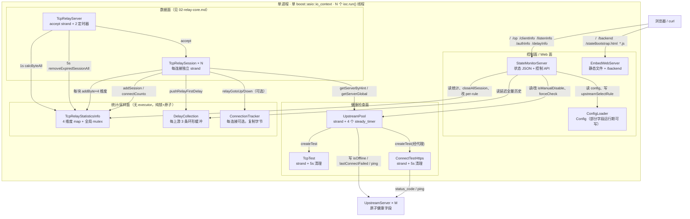
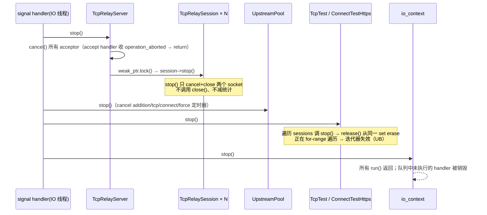

# Socks5BalancerAsio 运行控制面、监控、统计与健康检查分析

> 本文是「Socks5BalancerAsio → Rust 移植」项目的第四篇分析文档，聚焦**运行控制面（control plane）与可观测面（monitoring/statistics）**：定时器与调度、上游健康状态机、上游选择、统计聚合、连接追踪、延迟采样、内嵌 HTTP 状态/控制服务、静态 Web 服务、日志体系、生命周期与优雅关闭，并在最后一节给出 Rust 移植要点。
>
> 配套文档：[01-overview.md](01-overview.md)、[02-relay-core.md](02-relay-core.md)、[03-protocol.md](03-protocol.md)、[05-build-config-deploy.md](05-build-config-deploy.md)、[06-rust-port-assessment.md](06-rust-port-assessment.md)。
>
> **2026-10-26 修订**：本文 §14 与 §8.7 的 Rust 建议已按 [07-decisions.md](07-decisions.md) 的 ADR-001/002/003/005 更新；C++ 现状分析（§1–§13）保持不变。

## 0. 文档信息与结论速览

| 项目 | 内容 |
|---|---|
| 分析对象 | `Socks5BalancerAsio`（C++20 + Boost.Asio/Beast + OpenSSL） |
| C++ 仓库 | `H:\Code\CLionProjects\Socks5BalancerAsio`；快照 `5b4e957`（与 01-overview 一致） |
| 阅读镜像 | `H:\Code\RustProject\Socks5BalancerRust\.analysis\utf8-src\`（行号与原文一致） |
| 本文范围 | `main.cpp`、`StateMonitorServer.*`、`EmbedWebServer.*`、`TcpRelayStatisticsInfo.*`、`ConnectionTracker.*`、`DelayCollection.*`、`TcpTest.*`、`ConnectTestHttps.*`、`UpstreamPool.*`、`ConfigLoader.*`、`ConfigRuleEnum.h`、`log/Log.*`、`AsyncDelay.*`、`SessionRelayId.*`、`UtilTools.*`、`TcpRelayServer.*`、`TcpRelaySession.*`（控制/统计部分）、`html/` |
| 目标 Rust 指标 | ≤100MB 内存、C10K 连接、1000 conn/s、2~4 core |
| 引用约定 | `src/xxx.cpp:行号`（C++ 原仓库，镜像同号）；前端 `html/xxx.ts:行号`；无法证实处标 **【待确认】** |

| # | 结论 | 关键证据 | 对指标的影响 |
|---|---|---|---|
| C1 | 控制面与数据面**共享同一 `io_context` 与线程池**，慢请求占用 IO 线程 | `src/main.cpp:95,101-111,175-210` | 1K/s 稳定性；Rust 必须隔离 |
| C2 | 状态 HTTP 的所有连接**串行化在同一 strand**（含 JSON 生成） | `src/StateMonitorServer.h:113,133-134`；`.cpp:1248-1274` | 控制面单点，长 JSON 阻塞全部控制请求 |
| C3 | 统计热路径每块数据要拿**全局 `recursive_mutex`** 2~4 次、每轮双向转发 6~8 次，另有 4 次 `std::map` 查找 | `src/TcpRelaySession.cpp:507-529`；`src/TcpRelayStatisticsInfo.cpp:364-426` | C10K 下全局串行点，必须分片/原子化 |
| C4 | 统计**无分位、无平滑**：速率=相邻 tick 差，最大值为进程生命周期单调峰值 | `src/TcpRelayStatisticsInfo.cpp:54-68` | Rust 需补 P50/P95/EWMA |
| C5 | 日志是同步 sink 写 `std::cout`，**无 severity filter**，trace 编译期与运行期都生效 | `src/log/Log.cpp:121-156,167-181`；CMake 无 `BOOST_LOG_ACTIVE_LEVEL` | C10K 下日志即瓶颈 |
| C6 | 每连接固定 **2×8192B 缓冲** + 统计里**4 份 SessionInfo**；10K 连接仅缓冲 >160MB（05 篇实测 **22,039 B/连接 → 210 MiB**） | `src/TcpRelaySession.h:79-83`；`src/TcpRelayStatisticsInfo.cpp:114-234`；[05](05-build-config-deploy.md) §8 | C++ 设计不可能 ≤100MB@C10K |
| C7 | 健康检查**单次失败即 DOWN**，无去抖；恢复依赖 5 分钟的应用层探测周期 | `src/UpstreamPool.cpp:337-374,472-521,107-118` | 按 ADR-002：**保留 fail-fast、不做去抖/重试**；新增数据面失败即时降级 + DOWN 后指数退避降频 |
| C8 | 控制 API 全为 **GET、无鉴权、CORS 反射任意 Origin**，且状态 JSON **明文返回客户端密码** | `src/StateMonitorServer.cpp:281-292,332-337,339-356` | 安全缺陷，不应照搬 |
| C9 | 按 **client IP** 建 map **永不淘汰**；每次 `/` 请求做 O(总连接数) 清理 | `src/TcpRelayStatisticsInfo.cpp:25-38,78-84`；`src/StateMonitorServer.cpp:141-171` | NAT/C10K 内存与 CPU 双风险 |
| C10 | `connectTimeout` 被解析/打印/导出但**数据面未使用**（连上游无超时，探测 30s 硬编码） | `src/ConfigLoader.cpp:223-224`；`src/TcpRelaySession.cpp:179-186` | 死配置，Rust 必须落地 |

---

## 1. 组件总览

### 1.1 装配图



### 1.2 组件职责表

| 组件 | 源码 | 行数 | 职责 | 执行体 |
|---|---|---|---|---|
| `ConfigLoader` | `src/ConfigLoader.h:123-133`、`.cpp:162-323` | 136/323 | 读 `config.json`、填默认值、计算 `backend_json_string` | main 线程构造；运行期只读（`upstreamSelectRule` 可被控制 API 写） |
| `TcpTest` | `src/TcpTest.h:114-138`、`.cpp` | 141/223 | 对上游端口做**纯 TCP connect** 探测，返回 ping | `make_strand(ioc)`；`sessions` 集合**无锁** |
| `ConnectTestHttps` | `src/ConnectTestHttps.h:159-188`、`.cpp` | 191/800 | **经上游 SOCKS5** 完成 TLS + HTTP GET `testRemoteHost/`，返回 ping 与 status code | `make_strand(ioc)`；`sessions` 无锁 |
| `UpstreamPool` | `src/UpstreamPool.h:111-214`、`.cpp` | 217/634 | 持有 `UpstreamServer`；驱动 4 类探测定时器；实现选择规则 | `make_strand(ioc)` |
| `TcpRelayServer` | `src/TcpRelayServer.h:45-95`、`.cpp` | 98/174 | 监听/accept/建 session；1s 统计、5s 清理；持有统计对象 | `ex = make_strand(ioc)` |
| `TcpRelaySession` | `src/TcpRelaySession.h:55-218`、`.cpp` | 221/532 | 选上游→连上游→首包分析→双向转发；写统计/采样 | 每连接一个 strand |
| `TcpRelayStatisticsInfo` | `src/TcpRelayStatisticsInfo.h:49-287`、`.cpp` | 290/574 | 4 维度（上游/client IP/listen/auth user）的连接数、字节、速率、规则、粘性 | 无 executor；`recursive_mutex`+原子 |
| `ConnectionTracker` | `src/ConnectionTracker.h:40-117`、`.cpp` | 184/128 | 复制双向字节做首包"分析"，实际只统计字节后立即结束 | session strand 内调用 |
| `DelayCollection` | `src/DelayCollection.h:41-280` | 283/24（`.cpp` 空壳） | 每上游 3 条延迟采样环形缓冲 | 写：探测/转发；读：状态服务 |
| `StateMonitorServer` | `src/StateMonitorServer.h:112-152`、`.cpp` | 155/1274 | 状态 JSON + 控制 API + 延迟数据 | `make_strand(ioc)`，全部连接共享 |
| `EmbedWebServer` | `src/EmbedWebServer.h:106-136`、`.cpp` | 139/453 | 静态文件 + `/backend`；路径/扩展名校验 | 每连接 `make_strand` |
| `log` | `src/log/Log.h`、`.cpp`、`BoostAssertionFailed.cpp` | 67/233/45 | boost.log 初始化、级别、线程名、断言 | 全局同步 sink |
| `AsyncDelay` | `src/AsyncDelay.h`、`.cpp` | 32/38 | 一次性延迟定时器（探测错峰） | 调用方 executor |
| `SessionRelayId` | `src/SessionRelayId.h`、`.cpp` | 55/23 | 全局 relayId 自增（溢出回绕） | 静态 + 互斥锁 |

### 1.3 executor / strand 与线程归属

| 执行体 | 创建位置 | executor | 线程亲和 / 说明 |
|---|---|---|---|
| `ioc` | `src/main.cpp:95` | `io_context` | 全进程唯一事件循环 |
| IO 线程池 | `src/main.cpp:175-207` | `ioc.run()` | 线程数 = `min(hw, threadNum)`；**`>2` 时只创建 `n-1` 个线程跑 `ioc.run()`、main 只 `join_all()`**；`<=2` 时 main 单线程 run（`:205-207`） |
| `TcpTest` | `:101` | strand | 探测回调串行 |
| `ConnectTestHttps` | `:102` | strand | TLS 握手的调度在此串行 |
| `UpstreamPool` | `:106` | strand | 4 个定时器 handler 串行 |
| `TcpRelayServer` | `src/TcpRelayServer.h:66` | strand | accept + 1s/5s 定时器 + `calcByteAll` |
| `TcpRelaySession` | `src/TcpRelayServer.cpp:68` | 每连接 strand | 连接内读写/选路/统计写入串行 |
| `StateMonitorServer` | `src/main.cpp:110` | strand | **所有状态 HTTP 连接共用**（见 §8.1） |
| `EmbedWebServer` | `:127` | acceptor strand + 每连接 strand（`.cpp:430-434`） | 静态会话可并行 |
| 信号 | `:139-172` | `signal_set`（挂 ioc） | 任意 IO 线程；单次 `async_wait` |
| 主线程 | `:53` | — | `threadName="Main"` |

**数据流方向**：健康字段（探测回调/数据面失败/控制 API 写 → `checkServer`、状态 JSON 读）；统计（session 写、1s tick 聚合、状态服务读）；延迟（探测/首包写、`/delayInfo` 读）；规则与粘性（控制 API 写、选择器读）；日志（全组件 → boost.log → `std::cout`）。

**与硬指标**：单 `io_context` + 一连接一 strand 不阻塞，但控制/统计/健康检查与数据面抢同一批 IO 线程；2~4 core 下一次 O(总连接数) 快照或 20MB JSON 就会抬高转发尾延迟 → Rust 必须独立控制面 runtime。

### 1.4 main.cpp 装配时序

1. `threadName="Main"` → `init_logging()`（`:53-55`）；2. 解析 `-c/--help/--version`（`:58-90`）；3. `io_context`（`:95`）；4. `ConfigLoader::load+print`（`:97-99`）；5. `TcpTest(strand)`、`ConnectTestHttps(strand)`（`:101-102`）；6. `AuthClientManager`（`:104`）；7. `UpstreamPool(strand,...)+setConfig`（`:106-107`）；8. `TcpRelayServer`、`StateMonitorServer`（`:109-111`）；9. `tcpRelay->start()`→`upstreamPool->startCheckTimer()`→`stateMonitor->start()`（`:113-117`）；10. 可选 `EmbedWebServer`（`:119-137`）；11. 注册 `SIGINT/SIGTERM`（`:139-172`）；12. 起线程跑 `ioc.run()`（`:175-210`）；13. 外层 `try/catch`（`:212-222`）。

> 所有 `start` 都在 `ioc.run()` 之前同步完成，因此 `tcpCheckStart`/`connectCheckStart` 从**进程启动**开始计时，与第一个客户端无关。

---

## 2. 定时器与调度体系

### 2.1 定时器清单

| # | 定时器 | 组件 | 周期 | 首触发 | 重装 | 动作 | 源码 |
|---|---|---|---|---|---|---|---|
| T1 | `speedCalcTimer` | `TcpRelayServer` | 1s | start+1s | `expires_at(expiry()+1s)` | `calcByteAll()` | `src/TcpRelayServer.cpp:12-15,160-174` |
| T2 | `cleanTimer` | `TcpRelayServer` | 5s | start+5s | `expires_at(expiry()+5s)` | `removeExpiredSession()` + `statisticsInfo->removeExpiredSessionAll()` | `:8-11,143-158` |
| T3 | `tcpCheckerTimer` | `UpstreamPool` | `tcpCheckPeriod`（默认 5s） | start+`tcpCheckStart`（1s） | `expires_at(expiry()+period)` | `now-lastConnectComeTime<=sleepTime` 时跑一轮 TCP 探测 | `src/UpstreamPool.cpp:291-292,451-470` |
| T4 | `connectCheckerTimer` | `UpstreamPool` | `connectCheckPeriod`（默认 **300s**） | start+`connectCheckStart`（1s） | `expires_at(tcpCheckerTimer->expiry()+period)` — **用错对象，见 §2.5** | 跑一轮 HTTPS 连通性探测 | `:294-295,560-578` |
| T5 | `additionTimer` | `UpstreamPool` | `additionCheckPeriod`（10s） | start+`(tcpCheckStart+connectCheckStart+tcpCheckPeriod)*2`=14s | `expires_at(expiry()+period)` | 全池 DOWN 且最近 `sleepTime` 内有连接 → 追加一轮 TCP+HTTPS | `:263-277,403-430` |
| T6 | `forceCheckerTimer`（weak） | `UpstreamPool` | 一次性 500ms | 控制 API | 不重装 | 立即 TCP+HTTPS | `:580-592,608-624` |
| T7 | addition 防重入 | `UpstreamPool` | 一次性 `additionCheckPeriod*3` | 与 T5 同刻 | — | 复位 `isAdditionTimerRunning` | `:441-445` |
| T8/T9 | `cleanTimer` | `TcpTest` / `ConnectTestHttps` | 5s | 首次 `createTest`+5s | `expires_at(expiry()+5s)` | 清理 `isComplete()` 探测会话 | `src/TcpTest.cpp:149-181`；`src/ConnectTestHttps.cpp:720-723,746-771` |
| T10 | 随机错峰 | `AsyncDelay` | 一次性 `random[0,maxRandomDelay]` | `run()` | — | 延迟后 `do_resolve` | `src/AsyncDelay.cpp:24-38`；`src/TcpTest.cpp:136-142`；`src/ConnectTestHttps.cpp:79-85` |
| T11 | 探测单步超时 | `beast::tcp_stream` | 30s/步 | 每步前 | `expires_after` | 连接/读/写/TLS 超时 → `fail` | `src/TcpTest.cpp:59`；`src/ConnectTestHttps.cpp:167,206,234,297,326,396,424,614,658` |
| T12 | 状态 HTTP deadline | `HttpConnectSession` | 60s | 连接建立 | — | 到期关 socket | `src/StateMonitorServer.h:82`；`.cpp:1236-1246` |
| T13 | 静态 HTTP 读超时 | `EmbedWebServerSession` | 30s/请求 | 每 `do_read` | `expires_after` | 读超时 → `fail` | `src/EmbedWebServer.cpp:312` |

### 2.2 统计 1s 定时器（T1）

```cpp
// src/TcpRelayServer.cpp:160-174（节选）
void TcpRelayServer::do_speedCalcTimer() {
    auto c = [this, self = shared_from_this(), speedCalcTimer = this->speedCalcTimer]
            (const boost::system::error_code &e) {
        if (e) { return; }                                   // cancel 后不再续航
        statisticsInfo->calcByteAll();
        speedCalcTimer->expires_at(speedCalcTimer->expiry() + std::chrono::seconds{1});
        do_speedCalcTimer();
    };
    speedCalcTimer->async_wait(c);
}
```

```cpp
// src/TcpRelayStatisticsInfo.cpp:54-68（节选）
void TcpRelayStatisticsInfo::Info::calcByte() {
    std::lock_guard lg{calcByteMtx};
    size_t newByteUp = byteUp.load(), newByteDown = byteDown.load();
    byteUpChange   = newByteUp   - byteUpLast;      // 本 tick 增量，未除以时间
    byteDownChange = newByteDown - byteDownLast;
    byteUpLast = newByteUp; byteDownLast = newByteDown;
    if (byteUpChange   > byteUpChangeMax)   byteUpChangeMax   = byteUpChange.load();   // 生命周期单调最大
    if (byteDownChange > byteDownChangeMax) byteDownChangeMax = byteDownChange.load();
}
```

- `byteUpLast/byteDownLast` 是累计快照，`byteUpChange/byteDownChange` 是**相邻 tick 增量**，**不除以实际间隔**；前端直接按 `B/s` 展示（`html/utils.ts:46-62`）→ timer 漂移时速率被低估。
- `*ChangeMax` 是**进程生命周期内的单 tick 峰值**，不衰减、不滑窗。
- `calcByteAll`（`src/TcpRelayStatisticsInfo.cpp:428-442`）**持全局 `mtx`** 遍历 4 个 map 的所有 `Info` → 1s 一次 O(维度条目数) 的全局暂停；期间数据面 `addByte*` 被阻塞。
- 定时器跑在 `TcpRelayServer` 的 strand 上，与 accept、会话创建串行。

### 2.3 会话清理 5s（T2）

`TcpRelayServer::do_cleanTimer`（`src/TcpRelayServer.cpp:143-158`）→ `removeExpiredSession()`（只清 `std::list<weak_ptr>`，`:107-116`）+ `statisticsInfo->removeExpiredSessionAll()`（对 4 个维度每个 `Info` 执行 `sessions.remove_if(ptr.expired())`，`src/TcpRelayStatisticsInfo.cpp:25-38,444-458`，`multi_index` 上逐个 erase 是 O(n)）。

副作用：**清理只发生在 5s tick 或状态请求调用 `calcSessionsNumber()` 时**；已关闭 session 的统计条目最多残留 5s。`clientIndex` 中的空 `Info` **永不删除**（§5.6）。

### 2.4 TCP 探测链（T3）

`do_tcpCheckerTimer`（`src/UpstreamPool.cpp:451-470`）：handler 先判 `now - lastConnectComeTime <= sleepTime`（默认 30min 内有过连接）才探测，然后 `expires_at(expiry()+tcpCheckPeriod)` 并续注册。

`do_tcpCheckerTimer_impl`（`:337-374`）：

1. 本轮最大错峰 `maxDelayTime = min(pool.size, seconds(tcpCheckPeriod)/2) * 1000` ms（默认 5s→`min(M,2)*1000`）；`createTest` 内部再用 `getRandom(0, maxDelayTime)` 抽一次（`src/TcpTest.cpp:182-192`）。
2. 对每个 `!isManualDisable` 上游创建探测。
3. 成功：`if (isOffline) lastConnectFailed=false`；`lastOnlineTime=now`；`isOffline=false`；`lastOnlinePing=ping`；`pushTcpPing(ping)`。
4. 失败：`isOffline=true`；`lastOnlinePing=-1`；`pushTcpPing(-1)`。
5. 两个回调都持 `a->mtx`（`UpstreamServer` 的 recursive_mutex），但读者并不加锁（§8.8 CC-1）。

探测流程（`src/TcpTest.cpp:24-147`）：`startTime=steady_clock::now()`（`:27`）→ `async_resolve` → `expires_after(30s)` + `async_connect` → `close` → `allOk()` 计算 `timePing=now-startTime`（`:91`）→ 回调。**计时口径 = DNS + TCP 握手**；`async_resolve` 不受 stream 超时约束，**无硬超时**（【待确认】Q7）。

### 2.5 连通性探测链（T4）

结构对称（`src/UpstreamPool.cpp:560-578`），差异：

1. 周期 `connectCheckPeriod` 默认 **300s**，首启 1s。
2. 每轮 `ConnectTestHttps::createTest(host, port, authUser, authPwd, slowImpl, testRemoteHost, testRemotePort, R"(\)", 11, maxDelayTime)`（`:486-497`）；错峰上界 `min(M, 150)*1000`，实际由 M 决定。
3. **重装 expiry 用错对象**：`connectCheckerTimer->expires_at(tcpCheckerTimer->expiry() + connectCheckPeriod)`（`:574`）→ connect 相位被 TCP tick 牵引，节拍不可预测。【待确认】Q2。

### 2.6 addition 定时器（T5/T7）：全池 DOWN 的加速探测

```cpp
// src/UpstreamPool.cpp:403-449（节选）
bool isAllDown = std::all_of(_pool.begin(), _pool.end(),
        [this, self](const auto &a) { return !checkServer(a); });
if (isAllDown) {
    if ((UpstreamTimePointNow() - lastConnectComeTime.load()) <= config.sleepTime) {
        do_AdditionTimer_impl();          // 立即跑一轮 TCP + HTTPS
    }
}
additionTimer->expires_at(additionTimer->expiry() + config.additionCheckPeriod);
```

`do_AdditionTimer_impl`（`:432-449`）：用 `isAdditionTimerRunning.compare_exchange_strong` 防重入；起 `additionCheckPeriod*3`（30s）一次性定时器复位标志；执行 `do_tcpCheckerTimer_impl()+do_connectCheckerTimer_impl()`。

意义：正常节拍 5s/300s；当**全部上游不可用**且最近 `sleepTime` 内有真实连接请求时，每 10s 追加一轮双探测，把恢复时间从"最多 5min"压到"约 10s+探测耗时"。**只要有 1 个上游可用，加速即失效**。

### 2.7 强制检查（T6）与 `AsyncDelay`

- `/op?forceCheckAllServer=1` → `forceCheckNow()`（`:580-592`）：`forceCheckerTimer` weak 未失效则去重，否则 500ms 后跑一轮双探测。
- `/op?cleanAllCheckState=1` 清状态后也调 `forceCheckNow()`（`src/StateMonitorServer.cpp:474-492`）。
- `/op?forceCheckServer=N` → `forceCheckOne`（`:594-606`）：post 到 pool strand，对单上游跑 TCP+HTTPS，不受 `sleepTime` 门控。
- `AsyncDelay`（`src/AsyncDelay.cpp:24-38`）就是"`steady_timer` + 一次性 `async_wait`"，唯一用途是给探测会话做随机错峰。

### 2.8 漂移与调度特征

统一模式：

```cpp
timer->async_wait([...](const error_code &e) {
    if (e) return;                        // cancel：循环静默终止
    do_xxx_impl();                        // 本轮工作（同步）
    timer->expires_at(timer->expiry() + period);
    do_xxx();                             // 续注册
});
```

1. **漂移累积**：新到期时间 = 旧 expiry + 周期，与"实际执行时刻"无关 → 调度延迟不补偿、**相位单调偏移**；但工作耗时不会叠加到周期上（与 `sleep(period)` 链不同）。对 1s 统计 tick 意味着速率分母实际 >1s。
2. **handler 内做重活**：T1 `calcByteAll`、T2 `removeExpiredSessionAll` 都在 handler 内同步完成；若超期，下一次 `async_wait` 立刻返回并连续补跑（**没有跳过策略**）。
3. **取消约定**：周期定时器 `cancel()` 后 handler 收到 `operation_aborted` 即 return；但 `TcpRelayServer::stop()` **不 cancel** T1/T2（`src/TcpRelayServer.cpp:54-64`），靠 `ioc.stop()` 兜底。
4. **串行化**：T3/T4/T5/T6 全在 `UpstreamPool` 同一 strand；一轮 `do_connectCheckerTimer_impl` 会同时起 M 个 TLS 会话（含 DNS/SOCKS5/TLS/HTTP），在 2~4 core 上造成 CPU 抖动。

**与硬指标**：`1s × O(维度条目数)`（C10K + 每 IP 一条目时可达 1e4 次 `calcByte`）+ `/` 请求的 O(总 session) 清理，足以在 2~4 core 产生可观测尾延迟。Rust 侧用固定节拍 `interval` + `MissedTickBehavior::Skip`，tick 只做"分片求和 + 交换计数器"。

---

## 3. 上游健康状态机

### 3.1 两个探测器对比

| 维度 | `TcpTest` | `ConnectTestHttps` |
|---|---|---|
| 探测对象 | 上游代理自身 `host:port` | **经上游代理**访问 `testRemoteHost:testRemotePort` |
| 协议栈 | DNS → TCP connect → 关闭 | TCP → SOCKS5（可选认证）→ CONNECT → TLS → HTTP GET → TLS shutdown |
| 是否走代理 | **否**（直连上游端口，验证"端口活着"） | **是**（真实数据面链路，验证"能出网"） |
| 验证认证 | 否 | 是（`upstream[].authUser/authPwd`） |
| 测量值 | resolve+TCP 耗时 | 上游侧 DNS + TCP + SOCKS5 + TLS + HTTP 全程 |
| 写入字段 | `isOffline`、`lastOnlineTime`、`lastOnlinePing` | `lastConnectFailed`、`lastConnectTime`、`lastConnectPing`、`lastConnectCheckResult` |
| 采样 | `pushTcpPing` | `pushHttpPing` |
| 周期 | 5s（`tcpCheckPeriod`） | 300s（`connectCheckPeriod`） |
| 单步超时 | 30s | 30s（每步） |
| 错峰 | `random[0, min(M,period.sec/2)*1000]ms` | `random[0, min(M,150)*1000]ms` |
| 源码 | `src/TcpTest.cpp:24-143`；`src/UpstreamPool.cpp:337-374` | `src/ConnectTestHttps.cpp:29-681`；`src/UpstreamPool.cpp:472-521` |

### 3.2 `TcpTest`

流程：`run()`→（可选 `AsyncDelay`）→`startTime=now()`→`async_resolve`→`expires_after(30s)`+`async_connect`→`stream_.close()`→`allOk()` 计算 `timePing`→回调→`stop()`（cancel resolver/stream + `release()` 从 `sessions` 删除）。

- 失败即 `error` 级日志（`src/TcpTest.cpp:97-109`）：默认每 5s × 每个离线上游一条。
- `sessions`（`std::set<shared_ptr>`，`src/TcpTest.h:116`）**无锁**：pool strand 插入/删除、signal 线程 `stop()` 遍历 → 数据竞争（D-12）。
- 5s 清理定时器在**首次** `createTest` 时才创建（`:176-181`）。

### 3.3 `ConnectTestHttps`

| 步 | 方法 | 行号 | 说明 |
|---|---|---|---|
| 0 | 构造 | 29-67 | 立即 `SSL_set_tlsext_host_name(targetHost)`；构造 `GET <targetPath>`、`Host`、`User-Agent`；`targetPath=R"(\)"`（**单个反斜杠**） |
| 1 | `do_resolve` | 136-160 | `startTime=now()`，解析**上游**地址 |
| 2 | `do_tcp_connect` | 162-186 | 连上游，30s |
| 3 | `do_socks5_handshake_write/read` | 188-273 | `05 01 00/02`；校验 REP/METHOD |
| 4 | `do_socks5_auth_write/read` | 276-354 | `01 ULEN UNAME PLEN PASSWD`，校验 `01 00` |
| 5 | `do_socks5_connect_write/read` | 356-595 | ATYP 先 `make_address`，失败按域名 `0x03`；`slowImpl` 分支按 ATYP 预期长度补齐分包（`:469-555`） |
| 6 | `do_ssl_handshake` | 597-609 | `verify_peer` + 系统根证书（Windows 额外加载 `ROOT` store，`:687-705`） |
| 7 | `do_write` | 611-631 | 发送 HTTP 请求，30s |
| 8 | `do_read` | 633-653 | 读完整响应（`string_body`，**无 body 大小上限**） |
| 9 | `do_shutdown(true)`→`allOk` | 655-681,127-134 | `timePing=now-startTime`；回调携带整个 `http::response` |
| 10 | `stop` | 100-105 | 同步 `stream_.shutdown()` + `resolver_.cancel()` + `release()` |

**判定语义（关键）**：

1. **只看"能否完成一次 HTTP 往返"，完全不看状态码**；`lastConnectCheckResult="status_code:N"` 仅展示（`src/UpstreamPool.cpp:505-507`）。
2. 因此 400/403/404/502 都算"上游可用"。
3. TLS 证书校验**强制**（`need_verify_ssl=true` 硬编码，`src/ConnectTestHttps.h:162`，无配置开关）→ 目标证书不可信则**全部上游永远 DOWN**。
4. 请求路径是 `\` 而非 `/`：多数服务器返回 400，不影响判定，但每次探测产生一个 4xx 请求。【待确认】Q3。
5. `timePing` 是"真实链路综合延迟"，包含上游侧 DNS/TLS，与 `tcpPing` 量级不同，不可混用。
6. `SuccessfulInfo` 按值拷贝整个 response，回调只用 status code；大响应会额外占用内存/CPU。

### 3.4 `UpstreamServer` 字段语义

| 字段 | 类型 | 默认 | 写入者 | 语义 |
|---|---|---|---|---|
| `host/port/name/index/authUser/authPwd` | 值类型 | 配置 | `setConfig` | 标识与出网认证；`index` 是统计/选择器的键 |
| `mtx` | `recursive_mutex` | — | — | 保护 `lastConnectCheckResult` 等非原子字段；**读侧未加锁** |
| `lastOnlineTime` | `atomic<time_point>` | epoch0 | TCP 探测成功、session 连上游成功 | 最后 TCP 在线时刻；**0=从未在线** |
| `lastConnectTime` | `atomic<time_point>` | epoch0 | HTTPS 探测成功 | 最后应用层连通时刻；**0=从未通过** |
| `lastConnectFailed` | `atomic_bool` | **true** | HTTPS 成功=false/失败=true；TCP 从离线恢复时清 false | 最近应用层探测结果；初值 true → 启动期不可用 |
| `lastConnectCheckResult` | `std::string` | "" | HTTPS 成功 | `status_code:N`，仅展示（数据竞争者，CC-1） |
| `isOffline` | `atomic_bool` | **true** | TCP 成功=false/失败=true；session 解析或连接失败=true；session 连上游成功（`updateOnlineTime`）=false | TCP 层离线标志；**数据面失败会直接写** |
| `connectCount` | `atomic_size_t` | 0 | 连上游成功 +1（`TcpRelaySession.cpp:190`）、`close()` -1（`:476`） | **当前活跃连接数**（非累计） |
| `isManualDisable` | `atomic_bool` | 配置 `disable` | `/op?enable/disable`、All 变体 | 人工禁用；`checkServer` 与探测循环都受约束 |
| `disable` | `atomic_bool` | 配置 `disable` | 仅构造 | 配置原值，**仅展示**，`checkServer` 不看 |
| `slowImpl` | `bool` | 配置 | 构造 | 传给 HTTPS 探测的 SOCKS5 分包兼容 |
| `lastOnlinePing`/`lastConnectPing` | `atomic<ms>` | -1 | 探测回调 | -1=无效；否则最近 RTT |
| `traditionTcpRelay` | `bool` | 配置 | 构造 | 决定 `DelayCollect` 是否记历史 |
| `delayCollect` | `shared_ptr` | 构造 | — | 3 条采样序列（§7） |

`connectCount` 语义陷阱：不是累计数；`/` JSON 中 `pool.upstream[].connectCount` 与 `connectCount2` 本应相等，但 `+1` 与 `connectCountAdd` 不同临界区（`:189-201` vs `:471-485`），状态页可见瞬时不一致。

### 3.5 `checkServer`：唯一可用性判定

```cpp
// src/UpstreamPool.cpp:107-118
if (config.disableConnectTest) return u && !u->isManualDisable;   // 关闭探测：只受人工禁用约束
return u
    && u->lastConnectTime.load().time_since_epoch() != UpstreamTimePoint::duration::zero()  // 至少成功过一次应用层探测
    && u->lastOnlineTime.load().time_since_epoch() != UpstreamTimePoint::duration::zero()  // 至少成功过一次 TCP 探测
    && !u->lastConnectFailed
    && !u->isOffline
    && !u->isManualDisable;
```

推论：

- **冷启动窗口**：首次应用层探测要等 `connectCheckStart`(1s)+错峰(0~M·1s)+探测耗时，默认 15 上游时**最长约 16s 内无任何可用上游**，期间新连接全部 `No Valid Server`（`src/TcpRelaySession.cpp:137`）。
- **恢复窗口**：任何 `lastConnectFailed=true` 之后必须等下一次应用层探测成功 → 默认最长 5min（§3.6）。
- `disableConnectTest=true` 时健康检查定时器全部不启动（`startCheckTimer` 直接 return，`src/UpstreamPool.cpp:286-288`），退化为"永远可用（除人工禁用）"。

### 3.6 状态转移与恢复时间

| 事件 | 位置 | isOffline | lastConnectFailed | lastOnlineTime | lastConnectTime | ping | connectCount |
|---|---|---|---|---|---|---|---|
| TCP 探测成功 | `UpstreamPool.cpp:353-363` | false | 原 true 则 false | now | — | online=ping | — |
| TCP 探测失败 | `:364-371` | **true** | — | — | — | online=-1 | — |
| HTTPS 探测成功 | `:498-510` | — | **false** | — | now | connect=ping | — |
| HTTPS 探测失败 | `:511-518` | — | **true** | — | — | connect=-1 | — |
| session 解析失败/空结果 | `TcpRelaySession.cpp:156,163` | **true** | — | — | — | — | — |
| session 连上游失败 | `:292` | **true** | — | — | — | — | — |
| session 连上游成功 | `:189-191` | false | — | now | — | — | **+1** |
| session 关闭 | `:471-485` | — | — | — | — | — | **-1** |
| 手动 disable/enable | `StateMonitorServer.cpp:394-407` | — | — | — | — | — | — |
| `cleanAllCheckState=1` | `:474-492` | false | false | 0 | 0 | 全部 -1，清采样 | — |

**没有去抖**：全仓库无"连续失败 N 次"计数器，**单次事件即翻转**。**数据面失败也直接写健康状态**（E5/E6/E7），且不持 `a->mtx`（与探测回调不同）。

| 场景 | 恢复条件 | 最坏时间（默认） | 加速机制 |
|---|---|---|---|
| TCP 瞬断（`lastConnectFailed` 仍 false） | 下一次 TCP 探测成功 | 5s + 错峰 2s + RTT | 无 |
| 应用层失败，其它上游可用 | 下一次 HTTPS 探测成功 | **300s + 错峰 15s + RTT** | **无**（addition 只在全挂时启用） |
| 全池 DOWN | 任一 TCP/HTTPS 探测成功 | 10s + RTT | 有：每 10s 双探测全池 |
| 冷启动 | 首次 TCP + 首次 HTTPS 均成功 | 1s + 错峰 + 探测 | 无 |
| 手动禁用 | `/op?enable=N` | 下一次 `checkServer` 求值 | — |

> **最大自愈短板**：只要不是"全挂"，单个上游应用层失败恢复期长达 5min（`std::all_of` 条件，`src/UpstreamPool.cpp:413-419`）。

### 3.7 `testRemoteHost` 依赖与风险

配置默认 `www.google.com:443`（`src/ConfigLoader.cpp:177-181`），两个示例配置也都是它；只被 `ConnectTestHttps` 使用。

| 风险 | 说明 | 后果 |
|---|---|---|
| 可达性依赖 | 经上游访问 Google；上游网络不可达/被墙/白名单 → 探测必失败 | `lastConnectFailed` 恒 true → **全部上游 DOWN，服务不可用**（上游本身健康） |
| TLS 证书依赖 | `verify_peer` 硬编码 | 证书过期/自签/中间人 → 全部 DOWN |
| 状态码无关 | 只要求完成 HTTP 往返 | 4xx/5xx 仍算成功；3xx 重定向链、需要 HTTP/2、直接 RST 可能失败 |
| 路径 `\` | `targetPath=R"(\)"` | 目标大概率 400（不影响判定） |
| 探测成本 | 每上游每 300s 一次完整 TLS+HTTP | 上游日志噪音、流量、目标站点限流 |
| 隐私 | 定期向第三方发请求 | 审计风险 |
| DNS 位置 | `ATYP=0x03` 由**上游**解析 | 上游 DNS 污染 → 探测失败（符合"验证端到端"意图） |
| 配置变更 | `setConfig` 只在启动调用，无热重载 | 改目标必须重启（控制面无 reload 端点） |

Rust 侧：**默认不指向第三方**，启动校验；探测只读响应头，不读 body；liveness 与 readiness 分离。

---

## 4. 上游选择

### 4.1 规则枚举

```cpp
// src/ConfigRuleEnum.h:22-31
enum class RuleEnum { loop, random, one_by_one, change_by_time, force_only_one, /*best_latency,*/ /*best_stable,*/ inherit };
```

| 取值 | 语义 | 粘性 | 源码 |
|---|---|---|---|
| `loop` | 索引自增（模 N），跳过不可用，返回第一个可用；**每次调用都前进** | 否 | `UpstreamPool.cpp:197-200`→`getNextServer:120-138` |
| `random` | 从可用集合均匀随机；写回命中 index | 否 | `:217-231` |
| `one_by_one` | 当前 index 可用就继续用；不可用才向后找 | **是** | `:201-204`→`tryGetLastServer:140-161` |
| `change_by_time` | 距上次切换 > `serverChangeTime` 才轮询，否则粘性 | **是** | `:205-216` |
| `force_only_one` | **无条件**返回 `pool[lastUseUpstreamIndex]`，不查可用性、不查边界 | — | `:193-196` |
| `inherit` | per 维度默认值：表示"未设置，回退全局"；`getServerByHint` 在 `dontFallbackToGlobal=false` 时直接返回空 | — | `:182-189` |

`RuleEnumList` = 全部 6 个（`src/ConfigLoader.cpp:68-75`）；字符串转换未知值静默回退 `random`（`:46`）。全局 `/op?newRule=inherit` 会被强制改成 `random`（`src/StateMonitorServer.cpp:598-600`）。

### 4.2 选择入口与优先级

唯一入口 `TcpRelaySession::try_connect_upstream()`（`src/TcpRelaySession.cpp:96-142`）：

```text
++retryCount;                                  // 先自增；总尝试次数 = retryLimit + 1（默认 4）
server = null

# 1) client IP 维度
if (auto ic = stats->getInfoClient(clientIp); ic && ic->rule != inherit) {
    lock(ic->lastUseUpstreamIndexMtx);
    server = pool->getServerByHint(ic->rule, ic->lastUseUpstreamIndex, relayId);   // 不回退全局
}
# 2) listen 维度（BUG：这里取的是 clientIp，见 SEL-2）
if (!server) {
    if (auto il = stats->getInfoListen(clientIp); il && il->rule != inherit) { ... }
}
# 3) 全局规则
if (!server) server = pool->getServerGlobal(relayId);      // 内部 dontFallbackToGlobal=true

if (server) { nowServer = server; do_resolve(server->host, server->port); }
else        { log(error) "No Valid Server."; return; }     // 不重试、不关连接
```

优先级 **client 规则 > listen 规则 > 全局规则**；**auth user 维度不参与选路**（`try_connect_upstream` 只查 client/listen）。失败后由失败回调**同步递归**重试，无退避延迟（`:158,165,294`）。

### 4.3 三个基础算法

```cpp
// getNextServer（src/UpstreamPool.cpp:120-138）
if (pool.empty()) return null;
start = i;
loop { ++i; if (i >= pool.size()) i = 0; if (checkServer(pool[i])) return pool[i];
       if (i == start) return null; }

// tryGetLastServer（:140-161）
loop { if (i >= pool.size()) i = 0; if (checkServer(pool[i])) return pool[i];
       ++i; if (i >= pool.size()) i = 0; if (i == start) return null; }

// filterValidServer（:163-171）
return pool.filter(checkServer);            // 每次 random 选路都 O(N) 全扫
```

`loop` 先自增再检查（永远前进），`one_by_one` 先检查当前再前进（粘住）——这是两者唯一区别。

### 4.4 `serverChangeTime`、粘性与 hint

| 输入 | 存储 | 维护者 | 作用 |
|---|---|---|---|
| 规则 | `Info::rule` / `Config::upstreamSelectRule` | `/op?newRule=` | 选哪条规则 |
| `lastUseUpstreamIndex` | `Info::lastUseUpstreamIndex` / `UpstreamPool::lastUseUpstreamIndex` | 每次选路后由规则写回；`addSession*` 时设为当前上游 | 粘性起点 |
| `relayId` | 会话自增 id | 构造时 | **仅日志前缀 `[R: id]`，不参与选择**（`src/UpstreamPool.cpp:195-229` 只出现在 `BOOST_LOG_S5B_ID`） |

- `serverChangeTime`：毫秒，默认 60s（`src/ConfigLoader.cpp:220-221`），是 `change_by_time` 的**最小切换间隔**，不是连接保持时长、不是探测周期。
- `lastChangeUpstreamTime`：`atomic<time_point>`，构造=now（`:70`），只在 `change_by_time` 分支更新（`:210`），**全局共享**——per-client 的 `change_by_time` 会互相推进这个时钟。
- `lastUseUpstreamIndex`（per 维度）在每次 `addSession*` 时被设为该 session 的上游（`src/TcpRelayStatisticsInfo.cpp:136-139,166-169,196-199`），因此天然记录"该客户端上次用的上游"。
- `/op?forceNowUseServer=N`（无 `_target`）改**全局**索引；带 `_targetMode/_target` 改对应维度索引（`src/StateMonitorServer.cpp:408-448`）。只对粘性型规则（`one_by_one`/`change_by_time`）有效，`loop`/`random` 会立即覆盖。

### 4.5 无可用上游时

| 环节 | 行为 | 证据 |
|---|---|---|
| 选择返回空 | `error` 日志 `No Valid Server.`，**不 close、不重试、无超时** | `src/TcpRelaySession.cpp:136-138` |
| 连接状态 | 已 accept，`downstream_socket_` 保持打开，永久黑洞 | 同上 |
| 资源 | session 对象 + 2×8KB 缓冲 + weak 列表项持续存在 | `src/TcpRelayServer.cpp:66-77` |
| 日志 | 每个新连接一条 error | 同上 |

**健壮性缺陷**：全池 DOWN 时服务"接受连接但黑洞"，而非快速 RST/503。Rust 应改为"立即关闭 + 失败计数 + 可观测拒绝原因"。

### 4.6 选择器缺陷

| # | 缺陷 | 位置 | 影响 |
|---|---|---|---|
| SEL-1 | `force_only_one` 无 `empty()`/越界检查 | `:193-196` | 空池或索引越界 → UB |
| SEL-2 | listen 规则查询用 **client 地址**作 key | `TcpRelaySession.cpp:112` | listen 规则**永不生效** |
| SEL-3 | auth 维度既不参与选路，`/op` 也无 `auth` 的 `newRule` 分支 | `:96-142`；`StateMonitorServer.cpp:565-607` | auth 规则完全无效 |
| SEL-4 | `getLastUseUpstreamIndex()` 无锁读非原子 `size_t` | `UpstreamPool.cpp:103-105` | 数据竞争 |
| SEL-5 | `Info::rule` 非原子，控制面写/数据面读 | `TcpRelayStatisticsInfo.h:160` | 数据竞争 |
| SEL-6 | 全局 `default_random_engine`（`UtilTools.cpp:63-67`）被多 strand 并发调用 | `UpstreamPool.cpp:223`；`TcpTest.cpp:188`；`ConnectTestHttps.cpp:738` | UB/随机性退化 |
| SEL-7 | `getServerByHint` 全程持 `UpstreamPool::mtx`，`random` 还要 O(N) 扫全池 | `:178,220-224` | 建连速率高时锁竞争 |
| SEL-8 | `forceSetLastUseUpstreamIndex` 的 `i>=0` 对 `size_t` 恒真 | `:98` | 边界检查是装饰性的 |

---

## 5. 统计体系 `TcpRelayStatisticsInfo`

### 5.1 结构

```cpp
// src/TcpRelayStatisticsInfo.h:185-196
std::recursive_mutex mtx;                                  // 全局锁
std::map<size_t, std::shared_ptr<Info>> upstreamIndex;     // key = 上游 index
std::map<std::string, std::shared_ptr<Info>> clientIndex;  // key = 客户端 IP（不含端口）
std::map<std::string, std::shared_ptr<Info>> listenIndex;  // key = "ip:port"
std::map<size_t, std::shared_ptr<Info>> authUserIndex;     // key = AuthUser::id
```

`Info`（`src/TcpRelayStatisticsInfo.h:144-183`）：

| 字段 | 类型 | 语义 |
|---|---|---|
| `sessions` | `SessionInfoContainer`（multi_index，8 索引） | 该维度全部会话（`weak_ptr` 判活） |
| `sessionsMtx` | `recursive_mutex` | 保护 `sessions` |
| `byteUp/byteDown` | `atomic_size_t` | 累计上下行字节 |
| `byteUpLast/byteDownLast` | `atomic_size_t` | 上一 tick 累计快照 |
| `byteUpChange/byteDownChange` | `atomic_size_t` | 本 tick 增量（≈B/s） |
| `byteUpChangeMax/byteDownChangeMax` | `atomic_size_t` | 生命周期单 tick 峰值 |
| `connectCount` | `atomic_size_t` | 当前活跃会话数（与 `UpstreamServer::connectCount` 重复） |
| `rule` | `RuleEnum`（非原子） | 该维度规则，默认 `inherit` |
| `lastUseUpstreamIndex` + 锁 | `size_t` | 该维度粘性索引 |
| `calcByteMtx` | `recursive_mutex` | 保护 `calcByte` 读改写 |

### 5.2 `SessionInfo` 与 multi_index

`SessionInfo`（`src/TcpRelayStatisticsInfo.h:52-142`）**按值**入容器，字段：`upstreamIndex`、`clientEndpointAddrPortString`、`listenEndpointAddrString`、`rawPtr`（裸指针）、`ptr`（weak_ptr）、`startTime`、`host`、`post`、`targetEndpointAddrString`、`authUserId`。

8 个索引中**只有 sequenced 遍历与组合键 `(clientAddrPort, listenAddr)` 真正使用**；其余（ordered_unique<identity>、UpstreamIndex、ClientAddrPort、ListenAddr、RawPtr、random_access）是纯维护开销。

三个事实：

1. 一个会话会写入**最多 4 个容器**（upstream/client/listen/authUser）→ **最多 4 份 `SessionInfo` 拷贝**（每份 3~4 个 `std::string` + weak_ptr）。
2. `ordered_unique<identity<SessionInfo>>` 要求整个结构可比较（`:79-92`），插入时多次字符串比较。
3. `addSession*` 里用 `BOOST_ASSERT` 断言 `(clientAddrPort, listenAddr)` 唯一（`:131-134` 等），Debug 下失败即 `abort()`（§11.7）。

### 5.3 写路径

| 事件 | 位置 | 写入 |
|---|---|---|
| 连上上游（**首包分析之前**） | `TcpRelaySession.cpp:189-201` | `nowServer->connectCount+1`、`updateOnlineTime()`、`addSession/addSessionClient/addSessionListen`、`lastConnectServerIndex`、`connectCountAdd`×3 |
| 非传统模式首包完成 | `:214-232` | 有认证时 `addSessionAuthUser`、`updateSessionInfo` |
| 上行块写出成功 | `:417-439`→`:507-517` | `addByteUp`+`addByteUpClient`+`addByteUpListen`(+`addByteUpAuthUser`) |
| 下行块写出成功 | `:347-369`→`:519-529` | 同上，Down 方向 |
| 会话关闭 | `:471-485` | `connectCount-1`（上游）+`connectCountSub`×3；**没有 authUser 维度** |
| 1s tick | `TcpRelayStatisticsInfo.cpp:54-68,428-442` | `byte*Last/Change/ChangeMax` |
| 5s tick | `:25-38,444-458` | 删除 expired sessions |

`connectCountAddAuthUser/connectCountSubAuthUser` 定义但**从未调用** → `/` 的 `AuthIndex[].connectCount` 恒 0；`byteUp/DownAuthUser` 是真调用的。

### 5.4 每 1 秒聚合出什么

| 输出 | 计算 | 语义 |
|---|---|---|
| `byteUpLast/byteDownLast` | 当前累计值 | 累计字节 |
| `byteUpChange/byteDownChange` | `byte - last` | 本 tick 增量（前端当 B/s） |
| `byteUpChangeMax/byteDownChangeMax` | 历史 max | 单 tick 峰值 |

**没有**：平均速率、EWMA、分位数、conn/s、失败率、重试次数、TLS 握手耗时分布。整个统计面只有"累计 + 单 tick 增量 + 峰值"。

**与硬指标**：要做 1K conn/s 的验收，必须新增"连接建立/失败计数器 + 定时差分"；C++ 没有 conn/s 指标，状态页无法判断是否达标。

### 5.5 读取与一致性

`/` 的组装（`src/StateMonitorServer.cpp:99-298`）：`pool()` 返回 `const deque&` 引用（无锁，仅启动时改写）→ 4 个 `get*Index()` 各加全局 `mtx` 返回 map 浅拷贝（`src/TcpRelayStatisticsInfo.cpp:556-574`）→ 逐 `Info` 读原子字段 + `calcSessionsNumber()`（加 `sessionsMtx`，**顺带清理 expired**）。

- **无事务性快照**：4 个 map 分别加锁，字节字段逐字段读 → 可能读到"`byteUpLast` 旧 tick + `byteUpChange` 新 tick"的混合值，或 `connectCount` 与 `sessions.size()` 不一致。
- 单字段不会撕裂（`size_t` 原子），但**跨字段一致性无保证**。
- `calcSessionsNumber()` 会打 trace 日志并 O(n) 清理 → **读操作有副作用**。

### 5.6 两个隐藏 bug：目标地址回填失效、client map 不淘汰

**（1）`updateSessionInfo` 条件写反**（`src/TcpRelayStatisticsInfo.cpp:236-289`）：

```cpp
auto ui = upstreamIndex.find(s->getNowServer()->index);
if (ui == upstreamIndex.end()) { ... ui->second ... }   // 应为 != end()；对 end() 解引用 → UB
```

- 正常情况（`ui != end`）**整段跳过** → `SessionInfo::host/post/targetEndpointAddrString` 保持构造时的值；
- 而构造发生在 `addSession`（首包分析之前），此时 `firstPackAnalyzer` 尚未创建 → `host=""`、`post=0`；
- 所以 `/clientInfo` 等的 `TargetHost/TargetPort` **恒空/0**（`src/StateMonitorServer.cpp:775-776`），只有 `TargetEndpoint`（来自活 session）有值。
- 若真进入 `ui == end()` 分支 → 解引用 `end()` → UB。

**（2）client map 只增不减**：`removeExpiredSessionAll` 只清 `sessions`，**不删除空的 `Info`**（`:444-458`）；`clientIndex` 按 IP 建条目 → NAT/公网场景 IP 数持续增长。

内存增长点与量级（推算，非实测）：

| 增长点 | 机制 | 淘汰 | 风险 |
|---|---|---|---|
| `clientIndex` | 每不同 client IP 一个 `Info`（含 4 把锁、multi_index、原子） | **从不** | 高 |
| `sessions` | 每会话每维度一个 `SessionInfo`（4 份） | 5s tick / 读操作 | 高 |
| `SessionInfo` 字符串 | client/listen/target/host | 随会话 | 中（长字符串走堆） |
| 上游/listen/auth map | 配置决定 | 否 | 低 |

### 5.7 锁、热路径与内存

锁清单：

| 锁 | 层级 | 使用者 | 持锁工作 |
|---|---|---|---|
| `TcpRelayStatisticsInfo::mtx` | 全局 | 全部 `addByte*`/`addSession*`/`getInfo*`/`calcByteAll`/`removeExpiredSessionAll`/`closeAllSession*`/`connectCount*` | map 查找、multi_index 插入（可嵌套 per-Info 锁） |
| `Info::sessionsMtx` | per-Info | `addSession*`、`calcSessionsNumber`、`removeExpiredSession`、`closeAllSession`、`/clientInfo` 遍历 | multi_index 增删/遍历 |
| `Info::calcByteMtx` | per-Info | `calcByte` | 读改写 6 个原子 |
| `Info::lastUseUpstreamIndexMtx` | per-Info | 选路、`addSession*`、`/op`、JSON | 读写 `size_t` |
| `UpstreamServer::mtx` | per-上游 | 探测回调、`print` | 写非原子 string |
| `UpstreamPool::mtx` | 全局 | 选路、定时器启停、`setConfig`、`forceCheck*` | 整个选择算法（可 O(N)） |
| `TimeHistory::mtx` | per-序列 | 采样写、`history()` 深拷贝 | 环形缓冲拷贝 |
| `SessionRelayId::mtxLastRelayId` | 全局 | **每连接一次** | 自增 |
| boost.log sink 锁 | 全局 | **每条日志** | 格式化 + 写 `std::cout` |

锁序风险：`addSession` 是 `statsInfo.mtx → Info::sessionsMtx → session.nowServerMtx`（`SessionInfo` 构造里 `getNowServer()`），而 `close()` 是 `session.nowServerMtx → statsInfo.mtx`（`src/TcpRelaySession.cpp:471-485`）→ **反向锁序（ABBA）**。当前靠"同一 session 的 add/close 都在其 strand 上串行"侥幸避免；一旦 `close()` 从其它线程发生（shutdown/析构）就有死锁理论可能。

**数据面热路径代价**（关键）：

```cpp
addUp2Statistics(bytes)                                   // src/TcpRelaySession.cpp:507-517
  pSI->addByteUp(idx, b);        // lock(全局 mtx) + map.find(u64)  + atomic add
  pSI->addByteUpClient(addr, b); // lock(全局 mtx) + map.find(string) + atomic add
  pSI->addByteUpListen(addr, b); // lock(全局 mtx) + map.find(string) + atomic add
  if (authUser) pSI->addByteUpAuthUser(id, b);
```

- 上下行各一次 → **每轮双向转发 6~8 次全局锁**；
- 每次都是"短临界区"，但 C10K × 双向吞吐下形成**跨核 cache-line 乒乓**；
- 每连接建连/关闭还要额外 4~8 次全局锁（`addSession*`、`connectCount*`）+ 4 条 trace 日志。

内存估算：

| 项 | 每连接 | 10K |
|---|---|---|
| 2×8192B 转发缓冲（`std::array` 成员） | 16KB | 160MB |
| `TcpRelaySession` 其它成员 | 0.5~1KB | 5~10MB |
| `FirstPackAnalyzer`（streambuf 等） | 0.3~1KB | 3~10MB |
| 统计 `SessionInfo` 4 份 + 索引节点 | 1~1.5KB | 10~15MB |
| **合计** | **≈18~20KB** | **≈180~200MB** |

→ **C++ 实现在 100MB 上限下不可能 C10K**；Rust 必须去掉固定大缓冲与统计副本（§14.8）。

### 5.8 与硬指标适配点评

| 指标 | C++ 现状 | 结论 |
|---|---|---|
| ≤100MB | 18~20KB/连接 | 不可达，需重设计 |
| C10K | 全局锁 + 每块 6~8 次加锁 + 4 份 SessionInfo | 需原子/分片，数据面零锁 |
| 1K/s | 每连接：`SessionRelayId` 锁 + `UpstreamPool` 锁（含 O(N) 扫描）+ 统计插入 4 次 + 4 条 trace | 建连路径锁与日志过多 |
| 2~4 core | 全局锁跨核竞争；`calcByteAll`/`calcSessionsNumber` O(条目数) 同步工作 | 分片 + 独立聚合线程 |

---

## 6. `ConnectionTracker`

### 6.1 真实实现：未完成的"首包嗅探占位"

任务期望的"逐状态枚举 + 每阶段耗时"在源码中**不存在**。`ConnectionTracker`（`src/ConnectionTracker.h:40-117`、`.cpp:23-128`）实际字段：

| 字段 | 值 | 说明 |
|---|---|---|
| `tcpRelaySession` | `weak_ptr` | 反向引用，**从未使用**（无 `.lock()`） |
| `maxBufSize` | `8192*10=80KB` | 超限即 `cleanUp()` |
| `up_data_/down_data_` | `boost::asio::streambuf` | 复制一份双向字节 |
| `up_count/down_count` | `size_t` | 双向累计字节（**无 getter 暴露**） |
| `connectType` | `ConnectType` | 来自 `FirstPackAnalyzer`：`socks5/socks4/httpConnect/httpOther/unknown` |
| `host/port` | `string/u16` | 目标地址（构造时传入） |
| `isEnd` | `bool` | 置位后所有 `relayGoto*` 立即返回 |
| `timePing` | `ms` | **从未赋值、从未使用** |

唯一枚举是分析结果（`src/ConnectionTracker.h:107-111`）：`needMoreData / ok / wrong`。

### 6.2 状态与转移

| 状态 | 进入条件 | 行为 | 离开 |
|---|---|---|---|
| `Idle` | `disableConnectionTracker=true` | `getConnectionTracker()` 返回空 | — |
| `Collecting`（`isEnd=false`） | 首次 `relayGoto*` 前惰性创建 | 每块数据**完整复制**进 streambuf，`up_data_Update` 调 `analysisData` | 上行 ≥3B 且识别出类型 → `ok`；或缓冲 >80KB |
| `DownOnly`（隐式） | 只有下行数据 | `down_data_Update` 直接 `consume`，不分析、不结束 | 等到上行数据 |
| `Done`（`isEnd=true`） | `analysisData` 返回 ok/wrong 或超限 | 模板版直接 return；streambuf 版先 `up_count += size` 再 return | 终态 |

```cpp
// src/ConnectionTracker.cpp:96-128（节选）
if (data.size() < 3) return needMoreData;        // 只看前 3 字节
switch (connectType) { /* 全是 no-op */ }
if (!host.empty() && port != 0 && connectType != unknown) {
    // TODO start protocol delay analysis
}
return AnalysisResult::ok;                        // 永远 ok！
```

即：**收到 ≥3 字节上行就立即 `ok` 并 `cleanUp()`**，协议延迟分析是 `// TODO`。

### 6.3 记录内容与开销

| 期望 | 实际 |
|---|---|
| 首包时间 | ❌ 没有；`timePing` 从未赋值 |
| 目标地址 | ✅ 构造时从 `FirstPackAnalyzer` 传入 |
| 每阶段耗时 | ❌ 完全没有 |
| 双向字节 | ✅ `up_count/down_count`，但外部不可见 |
| 协议类型 | ✅ `connectType` |

开销与 `disableConnectionTracker`：

- 构造时机：非传统模式 `whenComplete` 里（`src/TcpRelaySession.cpp:221`）；每次读都 `getConnectionTracker()`（`:308,378`）。
- `isEnd` 之前每个数据块**多复制一次**；由于只等上行 3 字节，通常只复制首块（≤8KB）。
- 但"服务端先说话"的协议（SSH/SMTP/MySQL）在**整个连接生命周期**内每个下行块都被复制再 `consume`（`relayGotoDown` → `down_data_Update` → `consume(size)`）→ 双倍内存带宽。
- 开关链：编译期 `FORCE_disableConnectionTracker`/`MINI_BUILD_MODE`（`CMakeLists.txt:46,66-69`）→ 配置 `disableConnectionTracker`（`src/ConfigLoader.cpp:204-209`）→ 透传（`src/TcpRelayServer.cpp:75`）→ `getConnectionTracker()` 早退（`src/TcpRelaySession.cpp:74-94`）。默认 **false（启用）**，但模块无产出 → Rust 默认关闭。

> 真正对外可见的"首包延迟"是 `delayCollect->pushRelayFirstDelay`（§7.3），与 `ConnectionTracker` 无关。

---

## 7. `DelayCollection`

### 7.1 `TimeHistory`：固定容量环形缓冲

```cpp
// src/DelayCollection.h:86-168（节选）
std::recursive_mutex mtx;
std::unique_ptr<boost::circular_buffer<DelayInfo>> q;
size_t maxSize = 8192;
#ifdef Limit_TimeHistory_Memory_Use
    maxSize = CMParams_Limit_TimeHistory_Number;      // CMakeParams.h:23 默认 12
#endif
```

| 属性 | 值 |
|---|---|
| 元素 | `DelayInfo{ TimeMs delay; TimePointClock timeClock; }`（-1=失败；`system_clock` 供前端 x 轴） |
| 容量 | **8192**（默认）；开 `Limit_TimeHistory_Memory_Use` 时为 `CMParams_Limit_TimeHistory_Number`（`CMakeParams.h:23`=12；`CMakeLists.txt:214-218` 的 cache 默认 8；`CMakeSettings.json` 仅 Debug 配 12） |
| 淘汰 | `trim()`：超容 `pop_front()`；需删多个时**重建整个 circular_buffer + copy** |
| 读取 | `history()` 加锁**深拷贝**为 `std::deque` |
| 过滤 | `removeBefore(timeClock)` 从头 pop，依赖插入顺序=时间顺序 |
| 清空/调容 | `clean()`；`setMaxSize(m)`（`max(m,1)` + `trim` + warning 日志） |

### 7.2 三条序列

| 序列 | 写入点 | 语义 | 频率 |
|---|---|---|---|
| `historyTcpPing`/`lastTcpPing` | `UpstreamPool.cpp:362,370,391,399` | TCP 探测 RTT | 每 5s/上游 |
| `historyHttpPing`/`lastHttpPing` | `UpstreamPool.cpp:509,517,548,556` | 经代理全链路 RTT | 每 300s/上游 |
| `historyRelayFirstDelay`/`lastRelayFirstDelay` | `TcpRelaySession.cpp:325,395` | 双方向首包时间差（§7.3） | 每连接最多一次 |

`traditionTcpRelay==true` 时只更新 `last*`、**不写历史**（`src/DelayCollection.h:254-276`）。失败写入 `-1`。

### 7.3 `relayFirstDelay` 的精确语义

```cpp
// src/TcpRelaySession.cpp:312-330（do_upstream_read 内，节选）
if (!firstDelayUpEnd) {
    firstDelayUpEnd = true;
    int64_t tt = -1;
    int64_t ttt = duration_cast<milliseconds>(steady_clock::now().time_since_epoch()).count();
    if (firstDelayTimestamp.compare_exchange_strong(tt, ttt)) { /* 本方向先到：只记时间戳 */ }
    else { nowServer->delayCollect->pushRelayFirstDelay(milliseconds{ttt - tt}); }
}
```

`do_downstream_read` 镜像（`:382-400`）。因此它测的是**"第一个方向的首包到达" → "反方向首包到达"的时间差**：

- 客户端先发请求：≈ 上行 + 服务端处理 + 下行的**首字节往返（TTFB 近似）**；
- 服务端先说话（SSH banner）：语义变成"客户端反应时间"，**不再是网络延迟**。

所以它是"双方向首包间隔"而非"TTFB"，语义依赖协议方向。Rust 应重定义为明确的 TTFB 并区分方向。

### 7.4 消费方与 JSON 体量

唯一消费者：`path_delay_info`（`src/StateMonitorServer.cpp:1055-1142`）与 `makeUpstreamServerDI`（`:939-1053`）；前端 `DelayInfo.ts`/`DelayInfoAll.ts` 画图。

`makeDI`（`:928-937`）输出 `[{"delay":"12","time":"2025.08.27-10.01.02.123"}, ...]`。默认容量 8192 时：

| 序列 | 每上游条目 | 每上游 JSON |
|---|---|---|
| 3 条 × 8192 条 × ~55 字符 | 24576 | **≈1.3MB/上游** |

- `/delayInfo`（单上游）≈1.3MB；全量（M=15）**≈20MB**，且全部在 StateMonitorServer 的**单 strand** 上同步 `write_json`（24 万节点）；
- `PingInfoTotal` 是服务端生成 JSON 的耗时（作者自测）；
- 部署通常开 `Limit_TimeHistory_Memory_Use` 规避，但**默认 OFF**。

### 7.5 分位/平滑：不存在

无分位数、无 EWMA、无窗口聚合；历史就是原始采样，前端逐点连线。唯一聚合是 `last*` 与 `byte*ChangeMax`。Rust 建议服务端直接给 P50/P90/P99 + EWMA，历史用固定容量环形缓冲或 HDR Histogram。

---

## 8. `StateMonitorServer`

### 8.1 连接处理模型

```cpp
// src/StateMonitorServer.h:112-152（节选）
boost::asio::any_io_executor ex;          // main 传入 make_strand(ioc)
boost::asio::ip::tcp::acceptor acceptor;  // acceptor(ex, {address, port})
boost::asio::ip::tcp::socket socket;      // socket(ex)

// src/StateMonitorServer.cpp:1248-1274（节选）
acceptor.async_accept(socket, [this, self = shared_from_this()](beast::error_code ec) {
    if (!ec) std::make_shared<HttpConnectSession>(std::move(socket), ...)->start();
    if (ec && (operation_aborted || host_unreachable || address_in_use || address_family_not_supported)) return;
    http_server();                        // 继续 accept
});
```

| 特征 | 值 | 影响 |
|---|---|---|
| 并发模型 | 单 acceptor + 单 `socket` 成员复用 | 同时只有一个 accept 在飞 |
| executor | 所有 socket 都用**同一个 strand** | **所有状态/控制请求串行**（含 JSON 生成） |
| 连接复用 | `keep_alive(false)`（`:330`） | 每请求一个 TCP 连接；前端 1s 轮询=1 conn/s |
| 超时 | 60s `deadline_`，到期 `socket_.close()`（`src/StateMonitorServer.h:82`；`.cpp:1236-1246`） | 慢请求最长 60s，期间阻塞整个 strand |
| 方法 | 只接受 `GET`，其它 400（`:339-356`） | 无 POST |
| 响应头 | `Server: Beast`、`Content-Type: text/json 或 text/plain`、`Access-Control-Allow-Origin: <请求 Origin>`（`:332-337`） | CORS 全开 |
| 错误处理 | `try/catch` 包住 `bad_lexical_cast`/`std::exception` → 400 | 单请求不崩进程 |
| 监听 | `stateServerHost`（默认 `127.0.0.1`）+ `stateServerPort`（默认 5010） | 默认仅本机 |
| 鉴权 | **无** | 本机任意进程可控制 |

### 8.2 全部 HTTP 端点

> 两个服务是**独立端口**（StateMonitor vs EmbedWebServer）。JSON 由 `property_tree::write_json` 生成，**标量一律字符串**（数字/布尔加引号），前端用 `_.parseInt`/`=== 'true'` 解析。

| # | 路径 | 方法 | 参数 | 作用 | 返回 | 类型 |
|---|---|---|---|---|---|---|
| A1 | `/` | GET | 无 | 全量状态快照 | `text/json`（§8.4） | 只读 |
| A2 | `/op` | GET | §8.3 | **控制命令** | `text/plain` 空 body / 错误文本 | **控制** |
| A3 | `/clientInfo` | GET | `targetMode=client`、`target=<client IP>` | 单客户端详情 | `text/json`（§8.5） | 只读 |
| A4 | `/listenInfo` | GET | `targetMode=listen`、`target=<ip:port>` | 单监听详情 | 同上 | 只读 |
| A5 | `/authInfo` | GET | `targetMode=auth`、`target=<id>` | 单认证用户详情 | 同上 | 只读 |
| A6 | `/delayInfo` | GET | 可选 `backendServerIndex=<n>`（省略=全部） | 延迟采样历史 | `text/json`（§8.6） | 只读（深拷贝） |
| A7 | 其它路径 | GET | — | — | `404` `File not found` | — |
| A8 | 任意 | 非 GET | — | — | `400` `Invalid request-method '...'` | — |

路由实现（`src/StateMonitorServer.cpp:1144-1220`）：

```cpp
if (target == "/") { response.content_type="text/json"; body = createJsonString(); return; }
static const std::regex PARSE_URL{R"((/([^ ?]+)?)?/?\??([^/ ]+\=[^/ ]+)?)", ...};
if (regex_match(url, match, PARSE_URL) && match.size() == 4) {
    path = match[1]; query = match[3];
    if (path=="/op") return path_op(queryPairs);
    if (path=="/clientInfo"||path=="/listenInfo"||path=="/authInfo") return path_per_info(queryPairs);
    if (path=="/delayInfo") return path_delay_info(queryPairs);
}
response = 404 "File not found";
```

> 无 query 时 `match[3]` 为空 → `queryPairs` 插入 `("","")`；`/clientInfo` 无参数会返回 **412** 而不是 400。

### 8.3 `/op` 控制端点

`/op` 用 `std::multimap<string,string>` 承载参数（`src/StateMonitorServer.h:101`），参数名大小写敏感、**无 URL 解码**；多个 `if (count(...))` 顺序执行，**一次请求可叠加多个命令**。

| # | 参数 | 作用域 | 副作用 | 并发/缺陷 | 源码 |
|---|---|---|---|---|---|
| O1 | `enable=<idx>` | 单上游 | `isManualDisable=false`（`disable` 不变） | 原子写；越界静默忽略 | `:394-400` |
| O2 | `disable=<idx>` | 单上游 | `isManualDisable=true` | 立即影响 `checkServer` | `:401-407` |
| O3 | `forceNowUseServer=<idx>` | 全局或 `_targetMode`+`_target` | 改 `lastUseUpstreamIndex`（**不检查可用性**） | 全局持 `UpstreamPool::mtx`；维度持 `lastUseUpstreamIndexMtx`；只对粘性规则有效 | `:408-448` |
| O4 | `forceCheckServer=<idx>` | 单上游 | post 到 pool strand 跑 TCP+HTTPS | 越界忽略 | `:449-455` |
| O5/O6 | `enableAllServer=1` / `disableAllServer=1` | 全部 | 全部 `isManualDisable=false/true` | **O6 会导致全池不可用 → 黑洞** | `:456-473` |
| O7 | `cleanAllCheckState=1` | 全部 | 清 6 个健康字段 + 清 3 条采样 + `forceCheckNow()` | 清空后到探测返回前因时间戳为 0 仍不可用 | `:474-492` |
| O8 | `forceCheckAllServer=1` | 全部 | `forceCheckNow()`（500ms 后一轮） | weak_ptr 去重 | `:493-499` |
| O9 | `endConnectOnServer=<idx>` | 单上游 | `closeAllSession(index)`：该 Info 的 session 全部 `forceClose()` | 持 `sessionsMtx` 遍历 | `:500-509` |
| O10 | `endAllConnect=1` | 全部 | `tcpRelayServer->closeAllSession()` | 在 state strand 遍历 weak 列表 | `:555-563` |
| O11 | `endAllConnect=0&_targetMode=client&_target=<ip>` | client | 关该 IP 全部会话 | 必须是 `0` | `:513-524` |
| O12 | `endAllConnect=0&_targetMode=listen&_target=<ip:port>` | listen | 关该监听全部会话 | 同上 | `:525-531` |
| O13 | `endAllConnect=0&_targetMode=authUser&_target=<id>` | auth | 关该用户全部会话 | **值是 `authUser`**，而 O3 用 `auth` | `:532-546` |
| O14 | `endAllConnect=2&_upstream=<n>` | — | `// TODO` | **未实现** | `:549-554` |
| O15 | `newRule=<rule>` | 全局 | 写 `config.upstreamSelectRule`；`inherit`→强制 `random` | **无锁写普通 enum**；非法串回退 `random` | `:595-601` |
| O16 | `newRule=<rule>&_targetMode=client&_target=<ip>` | client | `Info::rule=...` | 目标不存在则静默无效 | `:575-594` |
| O17 | `newRule=...&_targetMode=listen&_target=<ip:port>` | listen | 同上 | 同上 | `:586-593` |
| O18 | `newRule=...&_targetMode=auth...` | — | **没有 auth 分支** | 静默无效 | `:565-607` |
| O19 | `setDelayMax=true&maxSize=<n>` | 全部 | 3 条序列 `setMaxSize(n)` | **BUG**：检查 `setDelayMax` 却 `*find("newRule")` → 缺 `newRule` 时 UB | `:608-620` |
| O20 | `removeBefore=true&timestamp=<epoch_ms>` | 全部 | 删除早于 timestamp 的采样 | 同上 UB | `:621-635` |

共同特征：

1. **全部 GET** → ``/`fetch` 即可触发 → **CSRF**；
2. **无鉴权、无审计日志**；
3. 参数用 `boost::lexical_cast`，类型错误 → 400，但**同一请求里前面的命令已执行**（无回滚）；
4. `_targetMode`/`_target` 是"带下划线"的私有参数（A3~A5 用不带下划线的 `targetMode`/`target`），前端正是这么用的；
5. **没有**"重载配置/重启/改监听/改上游列表"端点——结构性配置变更必须重启进程。

### 8.4 `GET /` JSON 结构

`createJsonString()`（`src/StateMonitorServer.cpp:31-311`）：

| 键 | 内容 | 行号 |
|---|---|---|
| `config` | 17 个配置标量（listen/testRemote/stateServer/retry/disable*/timers/serverChangeTime/connectTimeout/sleepTime）+ `relayId`/`relayIdMod` + `upstream[]{name,host,port,disable}` + `multiListen[]{host,port}` + `EmbedWebServerConfig{8}` | 38-93 |
| `nowRule` | 全局规则名 | 95 |
| `pool.getLastUseUpstreamIndex` / `lastConnectComeTime` / `lastConnectComeTimeAgo` | 全局粘性索引 / 最近有连接时刻 / 距今 ms | 99-105 |
| `pool.upstream[]` | `index,name,host,port,isOffline,lastConnectFailed,isManualDisable,disable,lastConnectCheckResult,connectCount,lastOnlinePing,lastConnectPing,lastOnlineTime,lastConnectTime,isWork,byteInfo,byteDownChange,byteUpChange,byteDownLast,byteUpLast,byteUpChangeMax,byteDownChangeMax,sessionsCount,connectCount2` | 113-171 |
| `RuleEnumList` | 6 个规则名 | 176-184 |
| `lastConnectServerIndex` | 全局最近连上的上游 index | 190 |
| `UpstreamIndex[]` / `ClientIndex[]` / `ListenIndex[]` / `AuthIndex[]` | 每项 `index(id),connectCount,sessionsCount,byte*,rule,lastUseUpstreamIndex`；Auth 项另含 `AuthUser{ok,id,user,pwd,base64}` | 192-296 |
| `startTime` / `runTime` / `nowTime` / `VersionInfoString` | 启动时刻 / 已运行 ms / 当前时刻 / 版本 | 300-306 |

精简示例（注意所有标量都是字符串）：

```json
{ "config": { "listenPort": "5100", "disableConnectTest": "false", "stateServerPort": "5110", "relayId": "1" },
  "nowRule": "loop",
  "pool": { "getLastUseUpstreamIndex": "0",
            "upstream": [ { "index": "0", "isOffline": "false", "isWork": "true",
                            "lastOnlinePing": "3", "lastConnectPing": "130",
                            "byteUpChange": "512", "sessionsCount": "2", "byteInfo": "true" } ] },
  "RuleEnumList": [ "loop", "random", "one_by_one", "change_by_time", "force_only_one", "inherit" ],
  "UpstreamIndex": [ { "index": "0", "rule": "inherit", "lastUseUpstreamIndex": "0", "...": "..." } ],
  "ClientIndex": [ { "index": "127.0.0.1", "...": "..." } ],
  "AuthIndex": [ { "id": "1", "AuthUser": { "ok": "true", "user": "123", "pwd": "321", "base64": "MTIzOjMyMQ==" } } ],
  "runTime": "123456", "nowTime": "2025.08.27-10.02.03.456", "VersionInfoString": "..." }
```

> **安全**：`AuthIndex[].AuthUser.pwd/base64` 是明文客户端认证凭据（`:281-292`）→ 状态端口可达即泄露。Rust 必须移除。

### 8.5 `/clientInfo`、`/listenInfo`、`/authInfo`

三者共用 `path_per_info`（`src/StateMonitorServer.cpp:650-925`），必须同时给 `targetMode` 与 `target`，否则 412。

| 键 | 内容 |
|---|---|
| `UpstreamPool[]` | 全部上游完整状态（字段同 `/` 的 `pool.upstream`） |
| `UpstreamIndex[]` | 全部上游维度统计 |
| `ClientIndex[]`/`ListenIndex[]`/`AuthIndex[]` | **仅目标维度**的会话列表：`serverIndex, ClientEndpoint, ListenEnd, TargetEndpoint, TargetHost, TargetPort, StartTime`（`:758-894`） |
| `BaseInfo` | 目标维度汇总：`index, connectCount, sessionsCount, byte*, rule, lastUseUpstreamIndex` |

注意：`TargetHost/TargetPort` 因 §5.6(1) 恒空/0；遍历会话时持 `sessionsMtx`，命中多时阻塞该维度统计写入。

### 8.6 `/delayInfo`

| 模式 | 请求 | 顶层键 |
|---|---|---|
| 单个 | `?backendServerIndex=N` | `BaseInfo`（上游完整状态）、`tcpPing[]`、`httpPing[]`、`relayFirstPing[]`、`PingSetting{tcpPingMax,httpPingMax,relayFirstPingMax}`、`PingInfoTotal{tcpPing,httpPing,relayFirstPing,total}`（生成耗时 ms）、`startTime/runTime/nowTime/CollectWastTime` |
| 全部 | 无参数 | `pool[]`（每项上述结构）、`startTime/runTime/nowTime/CollectWastTime` |

`backendServerIndex` 不存在 → 412；`makeUpstreamServerDI` 里 `BOOST_ASSERT(pT)`（`:939-941`）在 `TcpRelayServer` 已析构时 Debug 直接 abort。

### 8.7 鉴权与安全评估

| 风险 | 现状 | 证据 | Rust 建议 |
|---|---|---|---|
| 无鉴权 | 任意 GET 可改状态 | `:339-356` | **不鉴权**（ADR-001）：默认仅绑 `127.0.0.1`，非回环只强警告不拦截（风险接受） |
| CORS 全开 | 反射 `Origin` | `:332-337` | **不设置任何 CORS 头**（ADR-001）；不做预检、不接受跨域 |
| CSRF | 控制全是 GET | 同上 | 写操作只走 `POST /api/v1/control`（JSON body，非简单请求天然免疫简单 CSRF）；**不引入 CSRF token**（ADR-001） |
| 凭据泄露 | `/` 返回 pwd/base64 | `:281-292` | **绝不返回**密码、base64 认证串、上游密码（ADR-001 硬性要求） |
| 无审计 | 控制操作不记日志 | 全 `path_op` | 每个操作记 info（含来源 IP） |
| 明文 | 无 TLS | — | 仅回环；**不实现 TLS**（ADR-001），非回环在启动日志与文档强警告 |
| DoS | `/delayInfo` ~20MB 且阻塞单 strand；无限速 | `:1055-1142` | 响应上限 `stateMaxResponseBytes`（默认 64KB）；不移植 `/delayInfo` 原始序列 |
| 绑定 | 默认 127.0.0.1，可配置 | `ConfigLoader.cpp:183-187` | 保持默认回环；非回环**不强制 token**，仅强警告（ADR-001） |

> **ADR-001 决策记录（2026-10-26）**：控制面按 [07-decisions.md](07-decisions.md) ADR-001 采用**精简实现、不做鉴权**，这是**已接受的风险**——任何能访问监听地址的人都能关连接、禁用后端。缓解措施：默认仅绑定 `127.0.0.1`、启动日志与文档强警告、控制面目标 ≤400 行、不移植静态文件服务。因此上表"Rust 建议"列原先的 `Bearer token`、CSRF token、"非回环强制 token" 三条**已作废**；而"凭据泄露"一条**升级为硬性要求**：响应中**绝不**出现客户端密码、base64 认证串与上游密码——即使只绑回环也不返回。同时移除 C++ 的 CORS 反射与 `GET /` 明文密码这两处旧设计，控制面不引入任何鉴权头/鉴权中间件。

### 8.8 并发安全

**有保护**：健康原子字段、统计原子计数、`Info::sessions`（`sessionsMtx`）、`lastUseUpstreamIndex`（per-Info 锁）、延迟采样（每 `TimeHistory` 锁）、控制面自身（单 strand 串行）、`forceClose`（post 到 session strand）。

**无保护（按严重度）**：

| 编号 | 竞争点 | 写者 | 读者 | 后果 |
|---|---|---|---|---|
| CC-1 | `UpstreamServer::lastConnectCheckResult`（`std::string`） | HTTPS 探测回调（持 `a->mtx`） | 状态 JSON（**不加锁**） | 读-写 `std::string` → UB/乱码 |
| CC-2 | `Config::upstreamSelectRule`（enum） | `/op?newRule=` | `getServerGlobal`/`getServerByHint` | 数据竞争 |
| CC-3 | `Info::rule`（enum） | `/op?newRule=&_target` | `try_connect_upstream` | 数据竞争 |
| CC-4 | `UpstreamPool::lastUseUpstreamIndex` 读 | 选路（持 mtx 写） | `getLastUseUpstreamIndex()`（无锁） | 数据竞争 |
| CC-5 | `TcpTest::sessions`/`ConnectTestHttps::sessions`（`std::set`） | `createTest`（pool strand）、`release*` | `stop()`（signal 线程） | 无锁并发增删 → UB |
| CC-6 | 全局 `default_random_engine` | 多探测/选路线程 | 同左 | UB |
| CC-7 | `TcpRelayServer::sessions`（`std::list<weak_ptr>`） | accept strand 添加 | 5s timer（同 strand）、`closeAllSession()`（**state strand**） | 跨 strand 增删 → UB |
| CC-8 | `TcpRelayServer::stop()` 在 signal 线程直接 `session->stop()` | signal 线程 | session strand 在途操作 | socket 跨线程 cancel/close → UB |

> 控制面的 strand 只保证**控制面内部**一致；控制面与数据面之间没有统一同步，靠原子字段与"碰巧够用"的锁。Rust 必须为"控制→数据"定义明确的所有权/消息传递。

### 8.9 解析器缺陷

| # | 缺陷 | 后果 |
|---|---|---|
| P-1 | **不做 URL 解码** | `target` 含特殊字符无法传（当前 IP/数字值恰好安全） |
| P-2 | 正则要求 `key=value`；无 query 时插入 `("","")` | `/op` 无参返回 200；`/clientInfo` 无参返回 412 而非 400 |
| P-3 | 值里不能含 `&`；含 `=` 会拼接且不还原 | 枚举值无影响 |
| P-4 | `setDelayMax`/`removeBefore` 解引用 `find("newRule")` 的 `end()` | **UB（可能崩溃）**，`src/StateMonitorServer.cpp:609,622` |
| P-5 | `_targetMode` 取值不规则（`auth` vs `authUser`，`newRule` 无 auth） | 前端必须按端点选值，易错 |
| P-6 | 所有命令都不校验"是否至少执行了一个" | 无效请求也 200，前端无法感知失败 |
| P-7 | 未知路径 404 body 为 `File not found`（与静态服务语义混用） | 语义误导 |

---

## 9. 前端页面与 API 对应关系

`html/` 是独立子模块（`html/README.md`），webpack 产物为 `boot.js`/`DelayInfo.js`/`DelayInfoAll.js`/`perState.js`（`html/webpack.config.js:14-19`）。

| 页面（源码） | 请求 | 目的 | 后端 | 源码 |
|---|---|---|---|---|
| `html/stateBootstrap.html`（主状态页；`config.json` 里写的是 `state.html`，**当前 checkout 不存在**） | `GET http://<backend>/` | 1s 轮询全量状态 | `createJsonString` | `html/boot.ts:169-171` |
| 同上 | `GET /op?newRule=<rule>` | 全局切换规则 | O15 | `stateBootstrap.html:92` |
| 同上 | `GET /op?enable=/disable=<index>` | 单上游启用/禁用 | O1/O2 | `:205,213` |
| 同上 | `GET /op?endConnectOnServer=<index>` | 关某上游全部连接 | O9 | `:225` |
| 同上 | `GET /op?forceNowUseServer=<index>` | 强制下次选某上游 | O3 | `:233` |
| 同上 | `GET /op?forceCheckServer=<index>` | 立即探测某上游 | O4 | `:241` |
| 同上 | `GET /op?cleanAllCheckState=1` | 清状态并重探 | O7 | `:263` |
| 同上 | `GET /op?endAllConnect=1` | 关全部连接 | O10 | `:269,693` |
| 同上 | `GET /op?forceCheckAllServer=1` | 立即探测全部 | O8 | `:276,698` |
| 同上 | `GET /op?disableAllServer=1` / `enableAllServer=1` | 全部禁用/启用 | O6/O5 | `:703,708` |
| 同上 | `GET /op?_targetMode=client&newRule=...&_target=<idx>` | 改客户端规则 | O16 | `:418` |
| 同上 | `GET /op?_targetMode=client&...` | 客户端维度其它命令 | O1~O3/O11 | `:401-430` |
| 同上 | `GET /op?_targetMode=listen&newRule=...&_target=<idx>` | 改监听规则 | O17 | `:520` |
| 同上 | `GET /op?_targetMode=listen&...` | 监听维度其它命令 | O1~O3/O12 | `:503-532` |
| 同上 | `GET /op?_targetMode=authUser&...` | 认证用户维度关连接 | O13 | `:641-642` |
| `html/perState.html` | `GET /clientInfo?targetMode=client&target=<ip>` | 单客户端详情 | `path_per_info` | `html/perState.ts:125-145` |
| 同上 | `GET /listenInfo?targetMode=listen&target=<ip:port>` | 单监听详情 | 同上 | 同上 |
| 同上 | `GET /authInfo?targetMode=auth&target=<id>` | 单认证用户详情 | 同上 | 同上 |
| 同上 | `GET /op?...`（复用 `sendCommand`） | 维度命令 | O16/O17 | `html/perState.ts:226-239` |
| `html/DelayInfo.html` | `GET /delayInfo?backendServerIndex=<n>` | 单上游延迟曲线 | `path_delay_info` | `html/DelayInfo.ts:148` |
| `html/DelayInfoAll.html` | `GET /delayInfo` | 全部上游延迟曲线 | 同 all 模式 | `html/DelayInfoAll.ts:157` |
| 所有页面 | `GET /backend`（**EmbedWebServer**） | 状态服务地址发现 | `EmbedWebServer` | `html/utils.ts:126` |
| 所有页面 | 1s `setInterval(flush)` | 自动刷新（开关控制） | `/` 等 | `html/boot.ts:152-168` |

要点：

1. **跨域**：页面由 EmbedWebServer（如 :5102）提供，数据请求指向 StateMonitorServer（如 :5110）→ 浏览器视为跨域，靠服务端反射 Origin 的 ACAO 通过。
2. **后端发现**：`/backend` 返回 `backend_json_string`（`ConfigLoader.cpp:313-319`）；`backendHost` 空则前端用 `location.hostname`，`backendPort` 为 0 时服务端已填 `stateServerPort`。
3. **`state.html` 缺失**：`config.json` 指向 `state.html`，checkout 只有 `stateBootstrap.html`，`ConfigLoader` 默认是 `stateBootstrap.html`（`src/ConfigLoader.cpp:291`）。**【待确认】Q1**。
4. **参数契约不统一**：`targetMode` vs `_targetMode`、`auth` vs `authUser`、`perState` 复用 `sendCommand` 时的 `_target` 语义 **【待确认】Q10**。

---

## 10. `EmbedWebServer`（静态文件服务）

### 10.1 职责与装配

| 项 | 内容 |
|---|---|
| 开关 | 编译期 `DISABLE_EmbedWebServer`（`CMakeLists.txt:57-60`）；运行期 `EmbedWebServerConfig.enable`（默认 false，`src/ConfigLoader.cpp:284-310`） |
| 装配 | `src/main.cpp:119-137`（`enable` 为真时构造并 `start()`） |
| 地址/根目录/首页 | `host:port`（示例 `127.0.0.1:5102`）；`root_path` 默认 `./html/`；`index_file_of_root` 默认 `stateBootstrap.html`（`config.json` 覆盖为 `state.html`） |
| 扩展名白名单 | `allowFileExtList` 默认 `"htm html js json jpg jpeg png bmp gif ico svg css"`，按空格切分（`src/EmbedWebServer.cpp:390-394`） |
| 动态端点 | `/backend`（状态服务地址发现） |

### 10.2 处理流程

`src/EmbedWebServer.cpp`：session `run()` → `do_read`（`expires_after(30s)`）→ `on_read`：

- `GET /backend` → 直接返回 `backend_json_string`（`:333-346`，**不走** `handle_request`，不受扩展名白名单约束）；
- 其它 → `handle_request(doc_root, req, send, index, extList)`（`:93-257`）→ 成功则 `file_body` 流式响应（keep-alive 支持），失败则 400/404/500。

### 10.3 路径穿越防护（6 道检查）

| # | 检查 | 代码 | 说明 |
|---|---|---|---|
| 1 | 方法白名单 | `:148-150` | 只允许 GET/HEAD |
| 2 | target 合法性 | `:152-156` | 非空、以 `/` 开头、**原始 target 不含 `..`**（含 query 部分） |
| 3 | 去 query + index 拼接 | `:160-167` | 去 `?` 后，若以 `/` 结尾则拼 `index_file_of_root` |
| 4 | 根目录 canonical | `:170-176` | 失败 → 400 `Illegal request-target 2.1` |
| 5 | 目标 canonical + relative + symlink | `:178-197` | `relative(file, root)` 含 `..` → 400；`is_symlink` → 400 |
| 6 | 扩展名白名单 | `:199-212` | `extension()` 去前导 `.`，与白名单**区分大小写**比较；不匹配 → 400 |

评价：

- 第 2 道在 query 剥离前，`?x=..` 会被误拒（过度严格但安全）。
- 第 5 道的 `is_symlink` **实际无效**：`canonical()` 已解析符号链接，对 canonical 结果做 `symlink_status` 永不为 symlink；应检查未 canonical 化的原始路径链。
- 扩展名比较**区分大小写**，`.PNG`/`.JS` 被拒。
- **`ext.front()` 对空扩展名是 UB**（`:199-202`）：请求无扩展名且存在的文件（如 `/README`）时，MSVC Debug 触发 STL 断言 abort，Release 越界读。真实崩溃风险。
- 无 Range/gzip/ETag，1.7MB 的 `boot.js` 每次全量传输。

### 10.4 MIME 与 index

`mime_type`（`:30-61`）按扩展名映射：`.htm/.html/.php→text/html`、`.css→text/css`、`.js→application/javascript`、`.json→application/json`、`.xml→application/xml`、`.png`、`.jpg/.jpeg/.jpe`、`.gif`、`.bmp`、`.ico`、`.tif/.tiff`、`.svg/.svgz`、`.swf`、`.flv`、`.txt→text/plain`，**其它 → `application/text`（非标准）**。MIME 表比白名单宽（`.php/.swf/.xml/.txt` 实际不可达）。

index 只在路径以 `/` 结尾时生效（`:166-167`）；`/sub`（不带斜杠）不会命中 `sub/index.html`。`state.html` 不存在时 `canonical` 先失败 → 返回 **400** 而非 404。

### 10.5 与 `StateMonitorServer` 的关系

| 维度 | EmbedWebServer | StateMonitorServer |
|---|---|---|
| 端口 | `embedWebServerConfig.port`（5102） | `stateServerPort`（5110） |
| 共用端口/分流 | **否**，两个独立 acceptor，无反代 | 同左 |
| 内容 | 静态文件 + `/backend` | 动态 JSON + 控制命令 |
| 跨域 | 页面源 | 数据源（反射 CORS） |
| 认证 | 无 | 无 |
| 启停 | 可编译期/运行期关闭 | **始终启动**（`src/main.cpp:117`） |
| 优雅关闭 | 无 `stop()` | 无 `stop()` |

即"页面与 API 分离在不同端口"，靠 CORS 打通；关掉页面后状态服务仍然监听。

### 10.6 缺陷

| # | 缺陷 | 位置 | 后果 |
|---|---|---|---|
| EWS-1 | 构造期 bind/listen 失败只打日志，`start()` 仍 `do_accept()` | `:396-425,428-435` | acceptor 未打开 → accept 立即失败 → **tight loop 刷 error 日志（CPU 100%）** |
| EWS-2 | `ext.front()` 空扩展名 UB | `:199-202` | Debug abort / Release 越界读 |
| EWS-3 | symlink 检查无效 | `:192-194` | 安全假设不成立 |
| EWS-4 | canonical 失败返回 400 而非 404 | `:170-183` | 语义错误 |
| EWS-5 | 扩展名大小写敏感；未知 MIME `application/text` | `:204-209,60` | 兼容性差 |
| EWS-6 | 无 Range/压缩/缓存；无鉴权/TLS/限速/并发上限 | 全文件 | 1.7MB 文件全量传输；`html/` 白名单文件可被任意拉取 |

---

## 11. 日志体系

### 11.1 初始化与 sink

```cpp
// src/log/Log.cpp:112-193（节选）
boost::log::register_simple_formatter_factory<severity_level, char>("Severity");
auto core = boost::log::core::get();
typedef boost::log::sinks::synchronous_sink<boost::log::sinks::text_ostream_backend> sink_t;
boost::shared_ptr<sink_t> sink(new sink_t());
sink->locked_backend()->add_stream(boost::shared_ptr<std::ostream>(&std::cout, boost::null_deleter()));
sink->set_formatter( ... );            // 见 §11.2
core->add_sink(sink);
core->add_global_attribute("ThreadName", thread_name());
core->add_global_attribute("ThreadID", boost::log::attributes::current_thread_id());
core->add_global_attribute("TimeStamp", boost::log::attributes::local_clock());
// 所有 set_filter 都被注释掉（Log.cpp:167-181）
BOOST_LOG_S5B(info_VSERION) << versionInfo();
BOOST_LOG_S5B(trace) << "BOOST_LOG_S5B(trace)";    // 7 个级别各打一条自检
```

| 属性 | 值 |
|---|---|
| sink | `synchronous_sink<text_ostream_backend>`（**同步**，调用方在锁内完成格式化+写流） |
| 目标 | `std::cout`（`null_deleter`，不接管所有权） |
| 轮转 | **无**（仅 shell 重定向） |
| 过滤 | **无**（全部级别输出） |
| 异步队列 | **无** |
| 全局属性 | `ThreadName`（自定义 thread_local 读取）、`ThreadID`（OS 线程 id）、`TimeStamp`（本地时钟） |

### 11.2 格式与线程名

```text
[%Y-%m-%d %H:%M:%S.%f][G:<git rev>][<ThreadID>][<ThreadName, setw(6)>][<severity>] <message>
```

- `ThreadName` 来自 `thread_name_impl`（`src/log/Log.cpp:85-108`），读 `thread_local std::string threadName`，空则 `"no name"`。
- 线程名：主线程 `"Main"`（`src/main.cpp:53`）；多线程 `ioc.run()` 的每个线程 `"Th-0"…`（`:186`，在 `run()` 前赋值，对该线程后续 handler 生效）。
- `BOOST_LOG_S5B_ID(id,lvl)` = `BOOST_LOG_S5B(lvl) << "[R:" << setw(6) << id << "] "`（`src/log/Log.h:63-65`）；`id` 是 `TcpRelaySession::relayId`（`SessionRelayId::getNextRelayId`，全局自增、超 `max/2` 回绕）。
- **`[R: id]` 是唯一能把一条连接的所有日志串起来的标识**；探测/选路日志没有 id 前缀。状态 JSON 里的 `config.relayId`（`lastRelayId+1`）没有与活跃连接关联，前端无法按 relayId 过滤。

### 11.3 级别与 C10K 影响（关键）

| 事实 | 证据 | 影响 |
|---|---|---|
| 未定义 `BOOST_LOG_ACTIVE_LEVEL` | 全仓库 grep 无该宏；CMake 未定义 | **trace/debug 语句全部编译**，运行时也执行 |
| 没有 `set_filter` | `src/log/Log.cpp:167-181` 全注释 | **所有级别都输出** |
| 级别枚举自定义顺序 | `trace<debug<info<info_VSERION<warning<error<fatal`（`src/log/Log.h:36-45`） | 无法用标准 trivial 过滤（也没启用） |

**每连接日志量（成功路径）**：accept 1 + incoming 1 + session start 1 + do_resolve 1 + do_connect 1 + `addSession*` 3~4 + firstPack complete 1 ≈ **9~11 条 trace**。叠加：

- 每个探测失败 1 条 `error`（每 5s × 每个离线上游）；
- 每次 `/` 或 `/clientInfo`，`calcSessionsNumber()` 对**每个 Info** 打 2 条 trace（`src/TcpRelayStatisticsInfo.cpp:80-83`）→ 10K 个 client IP 时一次状态请求 = **2 万条日志**；
- T8/T9 每 5s 各 1 条 trace。

估算：

| 场景 | 速率 | 成本 |
|---|---|---|
| 1000 conn/s 建连 | ~9~11k 行/s | 每行 1~3µs（格式化+全局锁+cout）≈10~30ms CPU/s，但**全局 sink 锁把所有线程串行化** |
| 10K client IP 的状态页轮询（1s） | +20k 行/s | 与建连日志叠加 → 30k 行/s |
| 15 个离线上游 | 3 行/s error | 可忽略 |
| trace 是否被编译掉 | **不会** | 二进制更大；每次调用构造 record + 收集 4 个属性（ThreadName 是虚函数 + thread_local） |

> 结论：**日志是 C10K 的隐藏瓶颈**。Rust 必须编译期 `max_level` 裁剪（release 只留 info+）、非阻塞 writer、高频路径零日志，只记录状态变化（连接建立/关闭/上游切换/探测失败）。

### 11.4 断言

`CMakeLists.txt:90` 定义 `BOOST_ENABLE_ASSERT_HANDLER`；实现 `src/log/BoostAssertionFailed.cpp:23-44`：打 `fatal` 日志后 `std::abort()`。

`BOOST_ASSERT` 在 `Debug`（未定义 `NDEBUG`）生效、`Release/RelWithDebInfo`（定义 `NDEBUG`）被编译掉。因此 Debug 下统计的"同 (client,listen) 只插一次"断言（`src/TcpRelayStatisticsInfo.cpp:131-134`）与 `getInfoAuthUser` 的"必须存在"断言（`:324`）会**直接 abort 进程**；Release 下退化为 UB。生产应改为"记录 + 降级"。

---

## 12. 生命周期与优雅关闭

### 12.1 启动顺序与失败点

| 步骤 | 位置 | 失败行为 |
|---|---|---|
| 1 | `init_logging` | 无返回值 |
| 2 | 读配置 | `read_json` 抛异常 → main catch → 返回 -1 |
| 3 | `TcpRelayServer::start()` | resolve/bind 抛异常 → 退出 |
| 4 | `UpstreamPool::startCheckTimer()` | `disableConnectTest` 时静默不启动 |
| 5 | `StateMonitorServer::start()` | 构造期 bind 失败抛异常 → 退出 |
| 6 | `EmbedWebServer` 构造 | **bind 失败只打日志**（EWS-1）→ 继续运行但 accept tight loop |
| 7 | 注册信号 → `ioc.run()` | handler 抛异常 → 该线程 catch + `interrupt_all()` 退出，其它线程继续 |

没有 readiness 语义：状态服务绑定失败则进程退出；静态服务绑定失败则进程继续刷日志。

### 12.2 信号处理

```cpp
// src/main.cpp:139-172（节选）
sig.add(SIGINT); sig.add(SIGTERM);
sig.async_wait([&](const error_code error, int signum) {
    if (error) return;
    BOOST_LOG_S5B(warning) << "got signal: " << signum;
    switch (signum) {
        case SIGINT: case SIGTERM:
            tcpRelay->stop(); upstreamPool->stop(); tcpTest->stop(); connectTestHttps->stop();
            ioc.stop();
    }
});
```

- 仅 `SIGINT`/`SIGTERM`；`SIGHUP`/`SIGUSR1`（配置/证书重载）被注释。
- **只注册一次**，完成后不重新 `async_wait` → **第二次 Ctrl+C 不生效**（信号被 signal_set 捕获但无等待者）→ 可能需要 `SIGKILL`。
- 执行在任意 IO 线程；不处理 StateMonitorServer/EmbedWebServer 的 acceptor 与连接，也不 cancel `sig` 自身。

### 12.3 停止链时序



源码：`src/main.cpp:146-172`；`src/TcpRelayServer.cpp:54-64`；`src/TcpRelaySession.cpp:495-505`；`src/UpstreamPool.cpp:326-335`；`src/TcpTest.cpp:196-215`；`src/ConnectTestHttps.cpp:773-792`。

### 12.4 在途操作取消顺序

| 层 | 动作 | 等待完成 | 问题 |
|---|---|---|---|
| accept | `acceptor.cancel(ec)` | 否 | cancel 跨线程调用；handler 收到 aborted 后 return，不再 accept |
| session 读写 | `socket.cancel` + `close` | 否 | 在途 handler 以 aborted 完成并执行 `close(error)`（重复 close 有保护） |
| session 统计 | **不处理** | — | `stop()` 不调 `close()` → `connectCount` 不减，统计"冻结" |
| 探测 | `resolver.cancel` + `stream.cancel/close`（TcpTest）；`stream.shutdown()` 同步（HTTPS） | 否 | `ConnectTestHttpsSession::stop()` 的同步 SSL shutdown 可能阻塞【待确认】Q8 |
| 定时器 | `cancel()` | 否 | handler aborted 即 return；TcpRelayServer 的 T1/T2 **未 cancel** |
| 控制面 | **无 stop** | — | state/embed acceptor 存活到 ioc 销毁 |

### 12.5 `ioc.run()` 多线程退出

```cpp
// src/main.cpp:175-210（节选）
size_t processor_count = boost::thread::hardware_concurrency();
processor_count = std::min(processor_count, configLoader->config.threadNum);
if (processor_count > 2) {
    boost::thread_group tg;
    for (unsigned i = 0; i < processor_count - 1; ++i) {
        tg.create_thread([&ioc, &tg, i]() { threadName="Th-i"; ioc.run(); /* catch → interrupt_all → return -1 */ });
    }
    tg.join_all();      // 主线程不跑 ioc
} else {
    ioc.run();          // 单线程
}
```

| 事实 | 说明 |
|---|---|
| IO 线程数 | `min(hw, threadNum) - 1`（`>2` 时）；`threadNum=0`（默认）→ 单线程 |
| 退出条件 | `ioc.stop()` 使所有 `run()` 返回 |
| 异常 | 每线程自行 catch + `tg.interrupt_all()`；**其它线程不会因此停止** → 可能"半死" |
| `ioc.stop()` | 立即返回；**未完成 handler 不执行**，其 shared_ptr 在 ioc 析构时释放 |
| 析构顺序 | `ioc` 最先声明（`:95`）→ **最后析构**；`TcpRelaySession` 析构发生在 `TcpRelayServer`/`statisticsInfo`/`UpstreamPool` 之后 |
| 析构期安全 | `~TcpRelaySession()` → `close()`（`src/TcpRelaySession.h:130-133`）；`statisticsInfo.lock()` 已过期 → 跳过统计；`nowServer` 仍有效 → `--connectCount` 安全 |
| 关闭期 UB | `TcpRelayServer::stop()` 在 signal 线程遍历 `sessions` 并 close socket，与 session strand 在途 IO 并发；`sessions` 列表 accept 线程也会 `push_back` → 数据竞争 |

### 12.6 关闭缺陷

| # | 缺陷 | 位置 | 影响 |
|---|---|---|---|
| SD-1 | 第二次 Ctrl+C 无 handler | `src/main.cpp:146` | 进程可能无法用信号终止 |
| SD-2 | `TcpRelayServer::stop()` 跨线程操作 session socket | `src/TcpRelayServer.cpp:54-64` | 与在途 completion 竞争 → UB |
| SD-3 | `sessions` 跨 strand 并发增删 | `:77,107-116` | 数据竞争 |
| SD-4 | `TcpTest/ConnectTestHttps::stop()` for-range 中 erase | `src/TcpTest.cpp:202-214`；`src/ConnectTestHttps.cpp:779-791` | 迭代器失效 → UB |
| SD-5 | `ConnectTestHttpsSession::stop()` 同步 shutdown | `src/ConnectTestHttps.cpp:100-105` | 可能阻塞信号线程 |
| SD-6 | T1/T2 未 cancel；控制面/`sig` 无 stop | `src/TcpRelayServer.cpp:54-64`；`src/main.cpp:139-172` | 依赖 `ioc.stop()` |
| SD-7 | `ioc.stop()` 丢弃在途 handler，无 drain、无超时 | `src/main.cpp:158` | 客户端被直接断开；`join_all()` 可能长时间不返回 |

**与指标**：关闭对 1K/s 不是瓶颈，但关闭期数据竞争在热重启下会随机崩溃；Rust 用 `CancellationToken` + `JoinSet` + `grace_period`，socket 只在 owner task 内操作。

---

## 13. 缺陷与风险汇总

> P0 = 影响稳定性/安全/指标；P1 = 影响可维护性；P2 = 语义瑕疵。

| # | 类别 | 缺陷 | 位置 | 优先级 |
|---|---|---|---|---|
| D-01 | 性能 | 统计热路径全局锁 + 每块 6~8 次加锁 + 4 次 map 查找 | `TcpRelaySession.cpp:507-529`；`TcpRelayStatisticsInfo.cpp:364-426` | P0 |
| D-02 | 内存 | 每连接 2×8192B + 4 份 SessionInfo | `TcpRelaySession.h:79-83`；`TcpRelayStatisticsInfo.cpp:114-234` | P0 |
| D-03 | 内存 | 按 client IP 的 Info 永不淘汰 | `TcpRelayStatisticsInfo.h:192`；`.cpp:444-458` | P0 |
| D-04 | 安全 | 控制 API 全 GET + 无鉴权 + CORS 反射 + 明文密码 | `StateMonitorServer.cpp:281-292,332-337,339-356` | P0 |
| D-05 | 稳定性 | 无可用上游时"接受连接但黑洞" | `TcpRelaySession.cpp:136-138` | P0 |
| D-06 | 性能 | 日志同步 sink、无过滤、trace 全开 | `log/Log.cpp:121-156,167-181` | P0 |
| D-07 | 正确性 | `updateSessionInfo` 条件写反（目标地址恒空 + end() 解引用） | `TcpRelayStatisticsInfo.cpp:241-289` | P1 |
| D-08 | 正确性 | `setDelayMax`/`removeBefore` 解引用 end() | `StateMonitorServer.cpp:609,622` | P1 |
| D-09 | 正确性 | 健康检查无去抖、单次失败即 DOWN、恢复最长 5min | `UpstreamPool.cpp:337-374,472-521,107-118` | P0 |
| D-10 | 正确性 | listen 规则用 client 地址查 key → 永不生效 | `TcpRelaySession.cpp:112` | P1 |
| D-11 | 稳定性 | `force_only_one` 无边界检查 | `UpstreamPool.cpp:193-196` | P1 |
| D-12 | 稳定性 | 探测 `sessions` 无锁并发增删 | `TcpTest.h:116`；`ConnectTestHttps.h:163`；`TcpTest.cpp:202-214` | P1 |
| D-13 | 稳定性 | `stop()` 跨线程 close + `sessions` 无锁 | `TcpRelayServer.cpp:54-64` | P1 |
| D-14 | 正确性 | `connectCheckerTimer` 用错 `tcpCheckerTimer->expiry()` | `UpstreamPool.cpp:574` | P2 |
| D-15 | 正确性 | `connectTimeout` 未使用；session 连上游无超时 | `ConfigLoader.cpp:223-224`；`TcpRelaySession.cpp:179-186` | P1 |
| D-16 | 可观测 | 无速率/分位/失败率/conn-s | 统计模块 | P1 |
| D-17 | 可观测 | `ConnectionTracker` 未完成、无产出 | `ConnectionTracker.cpp:96-128` | P2 |
| D-18 | 稳定性 | `EmbedWebServer` bind 失败 tight loop | `EmbedWebServer.cpp:396-435` | P1 |
| D-19 | 安全 | 静态服务 `ext.front()` 空 UB、symlink 检查无效、无 TLS | `EmbedWebServer.cpp:199-202,192-194` | P2 |
| D-20 | 可维护 | 前后端参数不一致（`targetMode`/`_targetMode`、`auth`/`authUser`） | `StateMonitorServer.cpp:378-391,532` | P2 |
| D-21 | 正确性 | `state.html` 配了不存在的文件 | `config.json`；`ConfigLoader.cpp:291` | P2 |
| D-22 | 稳定性 | 第二次 SIGINT 不生效 | `main.cpp:146` | P2 |
| D-23 | 正确性 | 全局 `default_random_engine` 并发使用 | `UtilTools.cpp:63-67`；`TcpTest.cpp:188`；`ConnectTestHttps.cpp:738` | P2 |
| D-24 | 语义 | 探测路径 `\`、状态码不参与判定 | `UpstreamPool.cpp:494,535`；`ConnectTestHttps.cpp:61-65` | P2 |

---

## 14. Rust 移植要点

### 14.1 控制面/数据面/健康检查三域划分（单 runtime）

```text
┌──────────────────────────────────────────────────────────────────────┐
│ process（内存预算见 §14.8）                                           │
│                                                                      │
│  单 tokio multi-thread runtime（worker 数由配置决定，见 ADR-003）     │
│   ├─ accept loop + TcpRelaySession tasks（数据面，跑在 worker 上）    │
│   │     只读健康快照、只写分片原子计数                                │
│   ├─ 控制面 task（hyper，http1，4 端点；纯内存操作 µs 级）             │
│   │     读 Arc<Snapshot>（零锁）／发 mpsc<ControlCmd> + oneshot 回执  │
│   ├─ 健康探测 task（单写者 prober loop；Semaphore 限并发）            │
│   │     liveness / readiness；fail-fast + DOWN 指数退避               │
│   └─ 统计聚合 task（1s tick：求和 shard → 差分 → 发布快照）           │
└──────────────────────────────────────────────────────────────────────┘
```

| 决策 | 理由 | 反例（C++ 现状） |
|---|---|---|
| 数据面**只读**健康状态、**只写**计数器 | 消除"数据面失败直接改健康"的多写者竞争 | `TcpRelaySession.cpp:156,163,292` 直接写 `isOffline` |
| 健康判定**单写者**（prober task） | 状态机只有一个 owner，无锁一致性 | 探测回调 + 数据面 + 控制 API 三处写 |
| **单 runtime**：控制面、健康检查、聚合都是同一个 multi-thread runtime 里的普通 task，**不单独开 runtime/线程**（[07-decisions.md](07-decisions.md) ADR-003 第 6 条） | 线程数可控、部署简单；控制命令是纯内存操作（µs 级），不会阻塞转发 | C++ 共享同一 `io_context`（§1.3）；但其问题在"慢 JSON/静态文件占用 IO 线程"，不是"同线程"本身 |
| 线程数由配置决定：`threadNum`（最大 worker 上限，`0`=自动）/`workerThreads`（精确指定）/`maxBlockingThreads`（默认 2）/`threadStackSize`（默认 512KB）；**总线程 = effective_worker + maxBlockingThreads**（ADR-003） | 2~4 核机器可精确限制总线程预算；阻塞操作走 `spawn_blocking` 并受 `maxBlockingThreads` 约束 | 实际线程 = `min(hardware_concurrency, threadNum)`，且 `≤2` 时退化单线程（`src/main.cpp:175-207`） |
| 控制命令走 channel | 跨域修改有明确所有权与回执 | state strand 直接改共享对象（CC-2/CC-3） |
| 配置 `ArcSwap<Config>` | 新连接 O(1) 无锁读；整版本替换 | `Config::upstreamSelectRule` 裸写（CC-2） |
| *可选优化*：若实测健康探测阻塞明显，再把健康检查迁到 **1 个独立 `current_thread` runtime** | ADR-003 后果保留的优化项；**不改变配置语义**，不作为初版硬要求 | — |

### 14.2 指标：分片原子 / 固定数组 / 有界缓存

**不要**照搬"全局 mutex + 4 个 `BTreeMap`"。四层设计：

| 层 | 内容 | 结构 | 写代价 | 读 |
|---|---|---|---|---|
| L1 全局字节/连接 | 总上下行、建连/关闭/失败数 | `[CachePadded<AtomicU64>; N]`，shard=`worker_id`（thread_local） | 1 次 `fetch_add`，无争用 | 1s 聚合求和 |
| L2 有界维度 | 每上游/监听/认证用户/规则 | **固定数组** `Vec<UpstreamStats>`（索引=配置顺序），字段 `AtomicU64` | 1 次 `fetch_add` | O(M) |
| L3 每客户端 IP | 活跃连接数（可选字节） | 容量上限的 `ClientTable`（4096~16384 槽，clock/LRU 淘汰），key=`IpAddr` | 仅建连/断开各 1 次 | 按需/仅 top-K |
| L4 延迟分布 | tcp ping / 经代理 ping / TTFB | HDR Histogram 或固定环形缓冲（每上游一把 `Mutex`，低频写） | 每次探测 1 次 | 快照时算 P50/P90/P99+EWMA |

```rust
#[repr(align(64))]
struct Shard { bytes_up: AtomicU64, bytes_down: AtomicU64, opened: AtomicU64, closed: AtomicU64, failed: AtomicU64 }
static SHARDS: [Shard; MAX_WORKERS] = /* const init */;

#[inline(always)]
fn on_write(dir: Dir, n: usize, worker: usize) {
    let s = &SHARDS[worker & (MAX_WORKERS - 1)];
    match dir { Dir::Up => s.bytes_up.fetch_add(n as u64, Relaxed),
                Dir::Down => s.bytes_down.fetch_add(n as u64, Relaxed) };
}   // 无锁、无 map、无字符串；替代 C++ 每块 6~8 次全局锁

// 1s 聚合（O(worker) + O(M)，不做 O(维度) 遍历）
let sum = |f: fn(&Shard) -> u64| SHARDS.iter().map(f).sum::<u64>();
let snap = Snapshot { ts: now_ms(), total: Total { up_bps: up - prev.up, .. }, .. };
snap_swap.store(Arc::new(snap));    // 控制面读到的永远是完整快照
```

| 方案 | 何时用 | 注意 |
|---|---|---|
| 原子（`std::sync::atomic`） | L1/L2，写多读少、无组合逻辑 | `Relaxed` 即可（单调计数），聚合时 `Acquire` 不必要 |
| 分片累加 | 高写入速率（每块数据） | shard 数 = worker 数（2~4），避免伪共享用 `CachePadded` |
| `Mutex`/`RwLock` | L4 低频、需要复杂结构（histogram） | 只允许探测器/聚合器拿，数据面不碰 |
| `HashMap` + 锁 | **不推荐**用于逐字节/逐连接计数 | 扩容 + 锁竞争 + 无界增长（C++ `clientIndex` 的教训） |

### 14.3 统计结构：固定容量 + 淘汰

| 数据 | C++ | Rust 建议 |
|---|---|---|
| 每连接元数据 | 4 份 `SessionInfo`（4 个 multi_index 容器） | **一份** `Arc<ConnMeta>` 放 `Registry`（分片 `DashMap<ConnId, Arc<ConnMeta>>` 或 slab + `RwLock<Vec<Option<..>>>`），按维度筛选改为"扫描 + 过滤" |
| 维度连接数 | 遍历容器计数 | 每维度 `AtomicU32 active`，建连 +1/断开 -1（`ConnGuard::drop`） |
| 目标地址 | `updateTargetInfo` 回填（实现有 bug） | 首包分析后**一次性写入** `OnceCell`，只读 |
| 字符串 | `std::string` 重复存 | `IpAddr`+`u16` 定长；域名用 `Arc<str>` 共享 |
| 客户端维度 | `std::map<IP, Info>` 永不淘汰 | 固定容量 LRU/clock；溢出时淘汰最久未活跃并计入 `evicted_total` |
| 连接清理 | 5s tick + 读路径顺带清理 | **RAII**：`ConnGuard` drop 时归还计数并移除；无可观测残留 |

### 14.4 HTTP 控制面：crate 与 API

| 方案 | 优点 | 缺点 | 结论 |
|---|---|---|---|
| **`hyper` 1.x + `hyper-util` + `http` + `http-body-util`** | 依赖树可控；4 个端点足够；成熟 | 路由/JSON 需自己拼（端点少，可接受） | **推荐**（[07-decisions.md](07-decisions.md) ADR-007 依赖清单） |
| `axum`（hyper+tower） | 路由/extractor/中间件开箱 | 依赖多、二进制 +1~2MB | **备选**（ADR-007 允许） |
| `tiny_http`（阻塞） | 极简 | 需 `spawn_blocking`，占用 blocking 线程 | 不推荐 |
| 手写 minimal HTTP | 最省内存 | 解析/安全边界多，C++ 问题会重演 | **不推荐** |

控制面保留 **4 个基础端点 + 2 个连接监测端点**（[07-decisions.md](07-decisions.md) ADR-001）：

| 方法 | 路径 | 作用 | 返回 | 备注 |
|---|---|---|---|---|
| `GET` | `/api/v1/status` | 进程 / 总量 / 后端 / 监听 / 健康 / 连接摘要 | 一个 JSON（≤64 KB 上限） | 实时聚合（无快照缓存） |
| `GET` | `/api/v1/upstreams` | 后端逐条详情（host/port/name/enabled/health/RTT） | JSON 数组 | 固定数组，索引=解析成功上游的顺序（通常=配置顺序）；RTT 为最近一次探测耗时，无 conns |
| `GET` | `/api/v1/connections` | 连接明细（过滤 + 游标分页） | JSON 对象 | 需 `connectionTracking.detail=true`；`client`/`listen`/`upstream`/`cursor`/`limit` |
| `GET` | `/api/v1/connections/summary` | 按上游/客户端/监听三维度连接数 | JSON 对象 | 明细关闭时仍可用（只计数） |
| `POST` | `/api/v1/control` | 控制命令（JSON body） | `{"ok":true}` 或错误 | **唯一的写端点** |
| `GET` | `/healthz` | 存活探针（容器 / K8s） | `200 ok` 纯文本 | 不读业务状态 |

控制命令（`POST /api/v1/control`，body 形如 `{"cmd":"...","args":{...}}`）：

> **实现状态（2026-10-26）**：已实现 `set_rule`（`rule` + `scope`/`target`/`index` 维度覆盖）、
> `enable_upstream` / `disable_upstream`、`check_upstream`、`close_conn` / `close_all`
> （需 `connectionTracking.detail=true`，默认开启）；`reload_config`（U5 不做）**未实现**，
> 返回 `{"ok":false,"detail":"不支持的命令…"}`。

| `cmd` | 参数 | 作用 |
|---|---|---|
| `set_rule` | `rule`，或 `scope`(global/client/listen) + `target`(ip 或 ip:port) + `index`（`clear=true` 清除） | 改选路规则 / 设置维度强制上游（粘性规则生效，强制目标不可用时回落） |
| `enable_upstream` / `disable_upstream` | `index` 或 `name` | 启用 / 禁用后端（人工） |
| `check_upstream` | `index`（可选） | 立即探测（**一次，不重试**） |
| `close_conn` | `id` / `client` / `listen` / `upstream`（任一；`all=true` 等价 close_all） | 中断匹配连接（需明细；取消该连接的子令牌，立即生效） |
| `close_all` | — | 中断全部连接（需明细） |
| `reload_config` | — | 热重载（U5：**不做**） |

**安全默认（[07-decisions.md](07-decisions.md) ADR-001）**：

- **不鉴权、不设 CORS 头、不实现 TLS**。默认仅回环：沿用 `stateServerHost`（缺省 `127.0.0.1`）/ `stateServerPort`；绑定非回环地址时启动日志与文档**强警告**（不拒绝启动，风险接受）。
- **响应绝不返回**客户端密码、base64 认证串、上游密码——与"不鉴权"无关，即使只绑回环也不返回。
- 只服务上述端点：**不移植** `EmbedWebServer` 静态文件、`GET /` 全量 JSON、`/clientInfo`、`/listenInfo`、`/authInfo`、`/delayInfo` 原始序列、`/op`；**不承诺**与原 `/op?xxx` 兼容。
- 监控面可独立监听（`monitorServerHost` / `monitorServerPort`），独立监听**只提供只读端点**（含连接明细/摘要），不提供 `POST /api/v1/control`；未配置时监控端点挂在控制面监听上。
- HTTP/1.1 only；请求体 ≤64 KB，状态响应上限 `stateMaxResponseBytes`（默认 65536）；每个控制命令记 1 条 `info` 审计日志（来源 IP + cmd + 参数 + 结果）。
- JSON 用 `serde` 输出真 `bool` / 数字并带 `"schema":"v1"`（替代 C++ `property_tree` 的全字符串化）。

### 14.5 定时器：`interval` 与漂移

| 方案 | 漂移 | 适用 |
|---|---|---|
| `loop { sleep(period).await; work() }` | **累积** = Σ(work+调度延迟)，周期越来越长 | 不推荐 |
| `sleep_until(next); next += period` | 仅调度延迟（等价 C++ `expires_at(expiry()+period)`）；work>period 时连续补跑 | 需要固定相位 |
| `interval(period)`（默认 `Burst`） | 固定节拍；错过立即补发多次 | 统计可用 |
| `interval` + `MissedTickBehavior::Skip` | 错过的 tick 直接丢 | **推荐：1s 统计** |
| `interval_at(start, period)` | 首次在 start，之后按节拍 | 复现 `tcpCheckStart`/`connectCheckStart` |

```rust
// 1s 统计聚合
let mut tick = tokio::time::interval(Duration::from_secs(1));
tick.set_missed_tick_behavior(MissedTickBehavior::Skip);
loop { tick.tick().await; aggregate_and_publish().await; }

// 健康检查：单 ticker 扫"到期"上游，避免 M 个 timer 相位漂移/齐发
let mut scan = tokio::time::interval_at(Instant::now() + cfg.connect_check_start, Duration::from_millis(200));
loop {
    scan.tick().await;
    for u in health.upstreams_mut() {
        if Instant::now() >= u.next_liveness_due { spawn_probe(u, Tcp); u.next_liveness_due = now + backoff(u).jitter(0.2); }
    }
}
```

- `connectTimeout` 必须真正生效：`tokio::time::timeout(cfg.connect_timeout, connect)`（C++ 完全缺失，D-15）。
- 探测并发用 `Semaphore(2~4)` 限制（防 M 个 TLS 握手打满 2 core）。
- 统计 tick 只做"求和 + 快照"，绝不遍历维度。

### 14.6 健康检查：fail-fast + DOWN 退避 + 恢复即 UP

按 [07-decisions.md](07-decisions.md) ADR-002 重写。**核心是"快判死、快切换、对坏后端降频"**：判定要快（单次失败即 DOWN），切换要快（数据面失败当次就换后端），但对已判死的后端不要高频探测（避免打断其自恢复）。

| 行为 | 决策（ADR-002） | 对比 C++ |
|---|---|---|
| 失败判定 | **单次探测失败即 `down`**；无连续失败计数、无多次采样、**无重试**（配置里不存在 `retry` / 失败阈值字段） | C++ 也是单次即 DOWN，但恢复靠 300s 应用层周期 |
| 去抖 / 半开 | **不做去抖**；"半开"只是"降频后一次探测成功即 `up`"的语义，**不是独立状态机** | C++ 无此概念，靠 `additionCheckPeriod` 加速 |
| 快速切换 | 数据面 `connect` 失败 / 首包超时 / 握手失败 → **立即**标记该后端 `degraded`（由探测器确认 `down`），当前连接**立即切到下一个可用后端**（换后端，不是重试同一后端） | C++ 数据面直接写 `isOffline`（多写者竞争，CC-2/CC-3） |
| 常规探测 | `up` 按 `healthCheck.tcp.period`（默认 5000ms）/ `healthCheck.connect.period`（默认 300000ms）探测；`probeJitter`（默认 0.2）错峰 | 固定 5s / 300s，无抖动 |
| `degraded` | 只由探测器按"失败后首次延迟"探测**一次**，成功即回 `up` | 无此状态 |
| `down` 降频 | **指数退避**：`initial × multiplier^n`，cap `max`，±`jitter`；默认 `downBackoff = { initial: 30000, multiplier: 2.0, max: 600000, jitter: 0.2 }`，全部**可配置**；成功一次即回 `up`，失败继续退避 | 全池 DOWN 时仍每 5s 高频探测（`additionTimer`），可能打断自恢复 |
| 超时 | `healthCheck.tcp.timeout`（默认 2000ms）/ `healthCheck.connect.timeout`（默认 11000ms）；每次探测用 `tokio::time::timeout` 包裹 | 探测无硬超时（D-15 / Q7） |
| 探测目标 | `healthCheck.target.{host,port,sni,httpPath,userAgent,expectStatus}` **必填、启动校验**（为空拒绝启动）；**默认不指向第三方**；`expectStatus` 空=不校验状态码（对齐 C++ `ConnectTestHttps`） | 硬编码 `www.google.com:443` + 强制 TLS 校验，目标不可达则全池永久 DOWN |
| 并发 | `Semaphore(maxProbeConcurrency)`（默认 4）限制在途探测 | 无并发限制，M 个 TLS 握手齐发 |
| 判定语义 | `liveness`（TCP 建连）与 `readiness`（经上游到目标完成一次 TLS+HTTP 往返）分开记录；`available = liveness && readiness && !manual_disabled`（沿用 C++） | `isOffline` / `lastConnectFailed` 混用，恢复要求两者都成功 |
| 单写者 | 只有探测器 task 写健康状态；数据面只上报"本次连接失败"事件（`mpsc` / 原子计数，`connectFailMarkDegraded`），**不直接改状态** | 探测回调 + 数据面 + 控制 API 三处写（§8.8 CC-1） |
| 全池不可用 | 新连接**立即拒绝**（RST/关闭）并计入 `rejected_total`，**不黑洞**；`additionCheckPeriod`（默认 10000ms，**默认生效**）在"全池不可用 **且不在 `sleepTime` 休眠中**"时按该周期加速探测一轮全池 | 接受连接后永久挂起（§4.5） |
| `sleepTime` | **默认 1800000ms（30min，对齐 C++）**：最近 `sleepTime` 内无新连接就进入空闲休眠，**暂停全部自动探测**——TCP 周期探测、readiness 周期探测、`additionCheckPeriod` 加速探测都停（对齐 C++ 三个定时器共同的 `now - lastConnectComeTime <= sleepTime` 门控）。恢复条件：新连接到来或控制面 `check_upstream`。**显式 `0` 关闭休眠**。目的不是省流量，而是避免长时间无人使用时后端链路上出现单调、有规律的探测流量，被链路状态检测/防火墙判为异常通信而拉黑后端（C++ README "Full configuration" 与作者说明） | C++ 同样语义（冻结 `lastConnectComeTime`，三个定时器全部门控）；Rust 早期实现曾让 `down` 后端在休眠期继续退避探测、且 `addition` 不受门控，已改为**全停** |

要点：

- `fastrand` 线程本地抖动，避免全局 RNG 竞争（D-23）；抖动作用于"下次探测时间"，不作用于判定结果——**判定永远是单次采样**。
- 每次状态翻转记 1 条 `info` 日志与 `health_transitions_total{from,to}` 计数，不每 tick 打日志。
- 恢复就是"退避后的那一次探测成功"，没有额外确认轮次；这与"不做重试"是同一决策的两面：**判定快、恢复也不拖**。
- 探测目标为空即启动失败（不再有"默认 google"兜底），避免第三方不可达导致全池永久 DOWN（[07-decisions.md](07-decisions.md) ADR-002 第 5 条）。

### 14.7 状态快照一致性

| 数据 | Rust 方案 |
|---|---|
| 配置 | `ArcSwap<Config>`，控制面整版本替换；数据面每个新连接 `load()` 一次 |
| 统计 | 1s 聚合 task 构造 `Arc<Snapshot>` 后 `ArcSwap::store`；API handler 只读快照 |
| 健康 | prober 每轮发布 `Arc<HealthSnapshot>`（或 `Arc<[AtomicU8]>` + 版本号） |
| 连接明细 | `Registry` 分片；查询时按分片过滤（弱一致，文档写明） |
| 控制命令 | `mpsc<ControlCmd>` + `oneshot` 回执；控制面等待完成或超时 |

```rust
#[derive(Serialize, Clone)]
struct Snapshot {
    schema: &'static str,      // "v1"
    ts_unix_ms: u64, uptime_ms: u64, config_epoch: u64,
    totals: Totals,            // 累计/速率/连接数
    upstreams: Vec<UpstreamSnap>,
    listens: Vec<ListenSnap>,
    latency: LatencySnap,      // 仅分位 + EWMA，不含原始序列
}
```

一次性 `serde_json::to_vec(&snapshot)` 后整体返回；前端可用 `If-None-Match`（`config_epoch+ts`）或改 SSE/WebSocket 推送，替代 1s 轮询。

### 14.8 内存预算（≤100MB）

按 [07-decisions.md](07-decisions.md) ADR-005 重算（**双向 8KB、会话建立时提前分配**）：

| 项 | 估算 | 说明 |
|---|---|---|
| runtime 线程栈 | 2~3MB（虚拟） | worker 2~4 + blocking 2 = 4~6 线程 × 512KB（`threadStackSize` 可配，ADR-003）；RSS 远小于虚拟量 |
| 可执行 + 依赖 RSS | 12~25MB | `rustls` 替代 OpenSSL 可省；glibc 动态链接 |
| 统计 L1/L2 + 延迟分布 | <4MB | 分片原子 + 固定数组 + 环形缓冲/HDR |
| 控制面 JSON 缓冲 | <2MB | 单次序列化；响应上限 `stateMaxResponseBytes`（64 KB） |
| 每连接：2×8192B 缓冲（downstream→upstream、upstream→downstream 各一） | **16,384 B** | 会话对象创建时一次性分配，运行期不复用/不增长/不重分配（ADR-005） |
| 每连接：元数据（task + 会话状态 + 注册表项） | ≈1.2–1.5 KB | 定长字段；域名用 `Arc<str>` 共享；无 `String` 副本 |
| 每连接合计 | **≈17.5–18 KB** | 与 ADR-005 后果表一致 |
| 10,000 连接合计（含固定开销 ≈18 MB、统计 ≈4 MB） | **≈197–200 MB** | 10,000 连接**仅缓冲** = 160 MiB（167.8 MB） |
| 100 MB 预算可承载连接数 | **≈4,400–4,700** | 而非 10,000（ADR-005 结论） |

**必须记录：ADR-005 的 8KB×2 预分配与"100MB + C10K 同时成立"在数学上互斥**。三个方案（[07-decisions.md](07-decisions.md) ADR-005 后果）：

| 方案 | 做法 | 10K 连接内存 | 是否满足 ADR-005 / 100MB |
|---|---|---|---|
| **A（严格执行 ADR-005）** | 固定 8KB×2 预分配，不留配置口 | ≈197 MB | ✅ ADR-005；❌ 100MB（指标降级为"≤4.5K 连接时成立"） |
| **B（推荐）** | 默认 8KB×2 预分配；新增 `bufferSize`（默认 8192，压测 100MB 时改 2K/4K） | 8K→≈197 MB；4K→≈117 MB；2K→≈77 MB | ⚠️ 部分：默认仍 8K；`bufferSize=2K` 时 ✅ 100MB |
| **C（池化）** | 8KB 缓冲从全局池按需借还 | ≈80–100 MB（由池上限决定） | ❌ 违反"会话建立时提前分配"，不推荐 |

**已裁决（U1 = 方案 B）**：验收口径为"100MB + C10K"时，压测配置设 `bufferSize=2048`（≈77 MB）；性能/吞吐基线另跑 `bufferSize=8192`（≈197–200 MB）。详见 [07-decisions.md](07-decisions.md) ADR-005。

对照 C++：C++ 每连接 2×8192 B 缓冲 + **4 份 `SessionInfo` 副本**（§5.7），实测 22,039 B/连接（[05](05-build-config-deploy.md) §8）→ 10K 需 210 MiB。Rust 版缓冲与 C++ 相同（ADR-005 有意对齐），但统计副本从 4 份降到 1 份，因此是 ≈17.5–18 KB/连接、≈197–200 MB@10K，**仍不满足** 100MB + C10K。

补充：**内核 socket 缓冲不计入进程 RSS 但计入 cgroup 内存**；10K 连接 × 默认 `tcp_rmem/wmem` 可能数百 MB，需调 `SO_RCVBUF/SO_SNDBUF`（如 32~64KB）。若验收口径是 cgroup 总内存，100MB 需更激进地限制 socket buffer。

### 14.9 优雅关闭与验收

```rust
tokio::select! {
    _ = shutdown_signal() => {
        cancel.cancel();                                  // 1) 广播
        drop(listener);                                   // 2) 停止 accept
        let _ = timeout(Duration::from_secs(5), async {   // 3) 等在途连接发 FIN
            while joinset.join_next().await.is_some() {}
        }).await;
        joinset.abort_all();                              // 4) 硬超时
        // 5) 最后停健康检查/聚合/控制面
    }
}
```

| 指标 | 设计决策 | 验收方法 |
|---|---|---|
| ≤100MB | 8K×2 预分配（ADR-005）。100MB 达标需 ≈4.4–4.7K 连接；若要求 10K 连接，走方案 B 配 `bufferSize=2K`（≈77MB） | 连接稳定后读 `VmRSS` + cgroup `memory.current`；分别测「4.5K 连接 + 默认 8K」与「10K 连接 + `bufferSize=2K`」 |
| C10K | 每连接 task + epoll；无全局锁；8K×2 预分配 | 10K 空闲 + 1K 活跃 echo：全部建立、无 OOM、p99 建连 <50ms；同时记录 RSS ≈197–200MB（ADR-005） |
| 1K conn/s | 建连路径无日志、无全局锁、O(1) 原子 | 连接洪泛 60s：≥1000/s、失败率 <1%、backlog 不溢出 |
| 2~4 core | 线程数由 `threadNum`/**`workerThreads`**/**`maxBlockingThreads`** 配置（ADR-003）；**单 runtime**，控制面/健康检查为普通 task | 2 core 饱和压测：数据面吞吐不塌、健康检查不饿死；启动日志核对「总线程 = effective_worker + maxBlockingThreads」 |
| 健康检查 | **fail-fast + DOWN 指数退避 + 恢复即 UP**（ADR-002）；无去抖、无重试、无半开状态机 | 杀上游：数据面失败**当次**即切换，≤ **1 个探测周期**内摘除、不再分配新连接；`down` 后探测间隔按退避增大（30s→60s→…→cap 600s）；恢复后**一次探测成功**即回 `up`，并立即回到常规周期 |
| 控制面安全 | **无鉴权、默认仅回环、不设 CORS、响应不含密码**（ADR-001） | 默认仅监听 `127.0.0.1`；非回环仅警告不拦截；`/api/v1/status`、`/api/v1/upstreams` 响应无 pwd/base64；无 CORS 头；`GET /healthz` 返回 200 |

模块划分：`runtime`（单 runtime 构建/关闭，对应 `main.cpp`）、`config`（`ArcSwap`，对应 `ConfigLoader`）、`health`（prober + 状态机，对应 `UpstreamPool` 探测部分 + `TcpTest` + `ConnectTestHttps`）、`balance`（规则/粘性，对应 `UpstreamPool` 选择部分）、`relay`（accept/session/首包，对应 `TcpRelayServer`+`TcpRelaySession`）、`metrics`（shard/聚合/快照/直方图，对应 `TcpRelayStatisticsInfo`+`DelayCollection`）、`control`（hyper 四端点、无鉴权、无静态文件，对应 `StateMonitorServer`；`EmbedWebServer` 不移植）、`obs`（`tracing`，对应 `log/Log.*`）、`util`（relay id/随机/时间）。

---

## 15. 待确认清单

| # | 待确认项 | 疑点 | 确认方式 |
|---|---|---|---|
| Q1 | `state.html` 是否存在 | `config.json` 指向 `state.html`，checkout 只有 `stateBootstrap.html`；`ConfigLoader` 默认 `stateBootstrap.html` | 查发布包/CI；访问 `:5102/` |
| Q2 | `connectCheckerTimer` 用 `tcpCheckerTimer->expiry()` 是否笔误 | `src/UpstreamPool.cpp:574` | 问作者/加日志观察间隔 |
| Q3 | 探测路径 `R"(\)"` 是否笔误 | `src/UpstreamPool.cpp:494,535` | 抓包/上游日志 |
| Q4 | `updateSessionInfo` 反向条件是否为已知 bug | `src/TcpRelayStatisticsInfo.cpp:241-289` | 观察 `/clientInfo` 的 `TargetHost` 是否恒空 |
| Q5 | `setDelayMax`/`removeBefore` 的 end() 解引用是否已修复 | `src/StateMonitorServer.cpp:609,622` | 查 git 历史 |
| Q6 | `ConnectionTracker` 是否为未完成模块 | `analysisData` 的协议分析是 `// TODO` | 查 git 历史/issue |
| Q7 | `async_resolve` 是否有硬超时 | resolver 不受 `beast::tcp_stream::expires_after` 约束 | DNS 黑洞环境实测 |
| Q8 | `ConnectTestHttpsSession::stop()` 同步 shutdown 阻塞时长 | `src/ConnectTestHttps.cpp:100-105` | 关闭流程压测 |
| Q9 | `EmbedWebServer` bind 失败 tight loop 是否真实出现 | `src/EmbedWebServer.cpp:396-435` | 端口占用实测 |
| Q10 | 前端 `_target` 语义是否一致 | `html/perState.ts:226-239` vs `stateBootstrap.html:418,520` | 前端联调 |
| Q11 | `/` 返回明文 pwd/base64 是否有意 | 默认仅回环，可能视为"本机可信" | 问作者；移植一律移除 |
| Q12 | 发布构建是否开启 `Limit_TimeHistory_Memory_Use` | CMake 默认 OFF；`CMakeSettings.json` 仅 Debug 配 12 | 查 CI/发布包 CMakeCache |
| Q13 | `threadNum` 与 `hardware_concurrency` 实际组合 | IO 线程 = `min(hw,threadNum)-1`（`>2` 时） | 看启动日志 |
| Q14 | `config.json` 的 `internalBehavior.*`/`momentLocale` 是否被解析 | `ConfigLoader.cpp` 完全不读（已 grep 确认）→ **死配置** | 确认是否历史遗留 |
| Q15 | `lastConnectCheckResult` 无锁读是否曾崩溃 | CC-1 `std::string` 数据竞争 | TSAN 构建复现 |
| Q16 | `disableConnectTest=true` 时 `isOffline` 是否仍被数据面改 | 会（E5/E6/E7 不看开关），但 `checkServer` 不看 | 实测：关探测后杀上游看状态页 |

---

## 16. 附录：关键行号索引

| 主题 | 文件:行号 |
|---|---|
| 装配 / 信号 / 线程 | `src/main.cpp:95-137` / `:139-172` / `:175-210` |
| 配置结构与解析 | `src/ConfigLoader.h:37-115`；`src/ConfigLoader.cpp:168-323`（`testRemoteHost` 177-181、`connectTimeout` 223-224、`tcpCheck*` 229-232、`connectCheck*` 234-237、`additionCheckPeriod` 239-240、`backend_json_string` 313-319） |
| 规则枚举 | `src/ConfigRuleEnum.h:22-31`；`src/ConfigLoader.cpp:27-75` |
| 上游字段 / `checkServer` | `src/UpstreamPool.h:52-107`；`src/UpstreamPool.cpp:107-118` |
| 选择算法 / `change_by_time` | `src/UpstreamPool.cpp:120-233` / `:205-216` |
| 探测与定时器 / addition / force | `src/UpstreamPool.cpp:279-297,326-578` / `:263-277,403-449` / `:580-624` |
| TCP / HTTPS 探测 | `src/TcpTest.cpp:24-147,176-223`；`src/ConnectTestHttps.cpp:29-134,136-681,683-800` |
| 统计结构 / 写入聚合 | `src/TcpRelayStatisticsInfo.h:49-287`；`.cpp:25-112,114-234,236-289,364-458,492-574` |
| session 统计挂点 / 关闭 | `src/TcpRelaySession.cpp:96-142,179-300,302-439,441-529` / `:441-505` |
| ConnectionTracker / DelayCollection | `src/ConnectionTracker.h:40-117`、`.cpp:23-128`；`src/DelayCollection.h:41-280` |
| 首包延迟采样 | `src/TcpRelaySession.cpp:312-330,382-400` |
| 状态服务 | `src/StateMonitorServer.h:42-152`；`.cpp:31-311,313-359,361-648,650-925,928-1053,1055-1142,1144-1274` |
| 静态服务 | `src/EmbedWebServer.cpp:30-61,65-87,93-257,295-453` |
| 日志 / 断言 | `src/log/Log.h:34-65`；`src/log/Log.cpp:55-193,195-231`；`src/log/BoostAssertionFailed.cpp:23-44` |
| relayId / AsyncDelay / 随机 | `src/SessionRelayId.h:31-53`；`src/AsyncDelay.cpp:24-38`；`src/UtilTools.cpp:63-67` |
| 前端 | `html/boot.ts:152-330`；`html/stateBootstrap.html:92-708`；`html/perState.ts:124-260`；`html/DelayInfo.ts:146-280`；`html/DelayInfoAll.ts:157`；`html/utils.ts:123-181` |
| 构建选项 | `CMakeLists.txt:40-90,124-125,214-218,289-291` |

---

> **文档结束**。结论基于 `5b4e957` 快照的静态阅读；标 **【待确认】** 的条目请勿直接作为移植依据。


