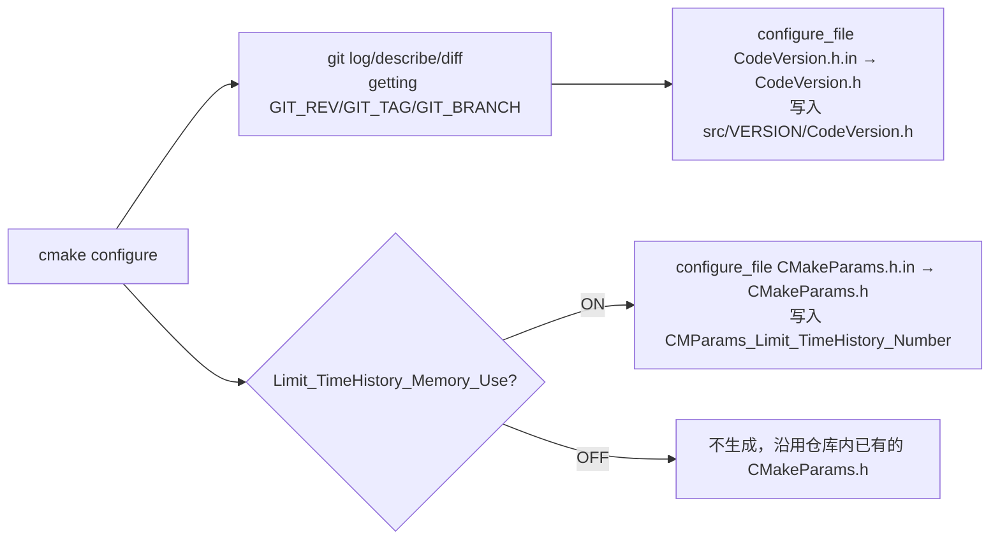
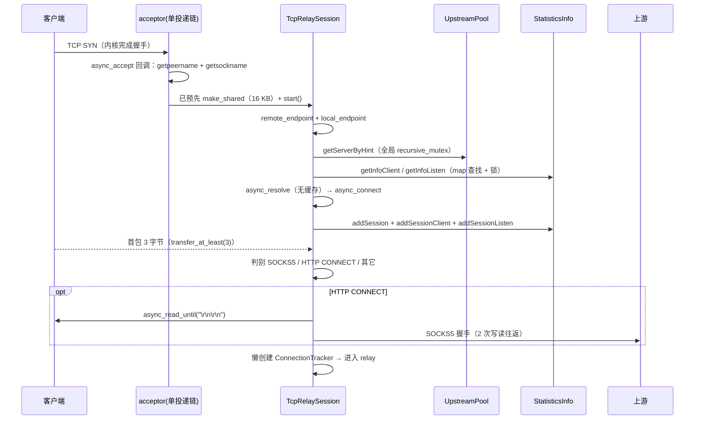

# 05 · 构建、配置、部署与资源开销分析

> 分析对象：C++ 项目 `Socks5BalancerAsio`（根目录 `H:\Code\CLionProjects\Socks5BalancerAsio`）
> 目标读者：本项目（`Socks5BalancerRust`）的实现者
> 本文所有路径**除特别说明外均以 C++ 项目根为基准**；行号位于对应文件的原始版本（`TcpRelaySession.cpp`、`ProxyHandshakeUtils/HttpServerImpl.cpp` 为 GB2312 编码，引用时使用 UTF-8 镜像 `.analysis/utf8-src/` 的行号，两者行号一致）。
> 编码：UTF-8（无 BOM），简体中文。
>
> 配套文档：[01-overview.md](01-overview.md)、[02-relay-core.md](02-relay-core.md)、[03-protocol.md](03-protocol.md)、[04-control-monitor.md](04-control-monitor.md)、[06-rust-port-assessment.md](06-rust-port-assessment.md)、[07-decisions.md](07-decisions.md)、[README.md](README.md)。
>
> **2026-10-26 修订**：§8.4 结论表末行与 §10（10.2/10.4/10.6）的 Rust 实现建议已按 [07-decisions.md](07-decisions.md) ADR-005/003/006/007 更新；关键数字：每连接 ≈17.5–18KB（2×8192 B 缓冲 + ≈1.2–1.5 KB 元数据）、10K 连接 ≈197–200MB，100MB 需方案 B 或限制连接数。§1–§7、§8.1–8.3、§8.5–8.6、§9 的 C++ 现状分析、实测数据与行号证据**未改动**（§0 的"10.24 KB/连接"是 C++ 推导的预算口径，ADR-005 后已不成立，见 §8.4 表末行与 §10.4）。与本文冲突处以 07-decisions.md 为准。

---

## 0. 结论摘要（先看这里）

| 编号 | 结论 | 依据 |
| --- | --- | --- |
| C1 | 这不是一个"轻量转发器"，而是一个**每连接重对象**的架构：`sizeof(TcpRelaySession)` 实测 **17 296 B**（其中 16 384 B 是两个 8KB 栈内缓冲） | `src/TcpRelaySession.h:79-85`；实测见 §8.3 |
| C2 | 实测每连接用户态常驻约 **20.3 KB**（session 17.4 KB + strand 0.2 KB + 首包分析/连接追踪 2.5 KB），再加统计容器约 **1.9 KB**，合计 **≈22 KB/连接** | §8.3 实测表 |
| C3 | **10 000 连接 = 约 220 MB 用户态堆**，`≤100 MB` 预算在 C++ 现有架构下**不可能达成**（差 2.2 倍）；即便开 `MINI_BUILD_MODE` 也约 176 MB | §8.4 |
| C4 | 每新建连接都做一次**无缓存的 DNS 解析**（`async_resolve`，每连接独立 `resolver` 对象），这是 1000 conn/s 的第一瓶颈 | `src/TcpRelaySession.cpp:144-177` |
| C5 | 日志是 **无过滤的同步 sink 直写 stdout**，每连接产生 8~15 条 trace 级别日志 → 1000 conn/s 下约 1~1.5 万次同步格式化+控制台写/秒，是第二瓶颈 | `src/log/Log.cpp:121-193` |
| C6 | 选路每连接都要抢一把**全局 `recursive_mutex`**（`UpstreamPool::mtx`），统计插入要写 **3~4 个 multi_index 容器**（每元素 7 个索引、实测 3 次 `new`、646 B） | `src/UpstreamPool.cpp:235-239`、`src/TcpRelayStatisticsInfo.cpp:114-234` |
| C7 | accept 是**串行单投递**：一个 acceptor 只有一个 pending accept，且每个 accept 前先 `make_shared<TcpRelaySession>` 预分配 16 KB 缓冲 | `src/TcpRelayServer.cpp:66-105` |
| C8 | 配置文件里 `internalBehavior.*`、`momentLocale`、`connectResetMeansOffline` 等字段**完全未被解析**（死配置）；`connectTimeout` 只在顶层有效 | `src/ConfigLoader.cpp:162-323`，全文无 `internalBehavior` |
| C9 | `azure-pipelines.yml` 是从 **trojan 项目复制**的残留（构建 `trojan`、链接 mysql、引用 `examples/`），与本项目无关；真实 CI 是 `.github/workflows/cmake-multi-platform.yml` | `azure-pipelines.yml:14-45` |
| C10 | CI 用 Boost **1.81.0**，但 `CMakeLists.txt` 要求 Boost **1.89.0** → 官方 CI 矩阵很可能在 `find_package` 阶段失败（**待确认**，见 §12） | `CMakeLists.txt:102` vs `.github/workflows/cmake-multi-platform.yml:128` |

对 Rust 实现的直接含义：按 C++ 推导的预算口径 **100 MB / 10 000 = 10.24 KB/连接**，则 C++ 的"每连接两个 8KB 缓冲 + 每连接独立 resolver + 每连接字符串"必须全部改掉。但 **ADR-005 已决策 Rust 侧维持双向 8 KB、会话建立时预分配（≈17.5–18 KB/连接）**，所以"100 MB + C10K"不能同时成立：100 MB 只能靠方案 B 的 `bufferSize`（2K→≈77 MB、4K→≈117 MB）或限制连接数（8K 下 ≈4,400–4,700），详见 §8.4 表末行与 §10.4。

---

## 1. 源文件清单与规模

统计口径：`src/` 下全部文件，用 PowerShell `[System.IO.File]::ReadAllText` 按行切分统计（`Lines` 为物理行含空行，`Code` 为非空行），排除 `cmake-build-*`、`html/`、`node_modules`。**共 59 个文件、13 187 行（其中非空 12 144 行）。**

### 1.1 汇总

| 扩展名 | 文件数 | 物理行数 |
| --- | --- | --- |
| `.cpp` | 26 | 9 466 |
| `.h` | 30 | 3 517 |
| `.hpp` | 1 | 151 |
| `.h.in` / `.in` | 2 | 53 |
| **合计** | **59** | **13 187** |

### 1.2 文件明细（含分类）

分类说明：**核心转发**＝承载数据面；**协议**＝SOCKS/HTTP 协议解析与握手；**控制监控**＝状态/统计/Web UI；**基础设施**＝配置、日志、工具、版本；**第三方**＝vendored 代码。

| 路径 | 行数 | 非空 | 字节 | 分类 |
| --- | --- | --- | --- | --- |
| `src/StateMonitorServer.cpp` | 1 274 | 1 145 | 60 694 | 控制监控（最大文件，REST API + JSON 生成） |
| `src/ProxyHandshakeUtils/Socks5ServerImpl.cpp` | 833 | 763 | 37 327 | 协议（Auth 模式下的 SOCKS5 服务端） |
| `src/ConnectTestHttps.cpp` | 800 | 711 | 35 990 | 控制监控（后端健康检查，含 TLS） |
| `src/ProxyHandshakeUtils/Socks5ClientImpl.cpp` | 524 | 477 | 25 767 | 协议（Auth 模式下的 SOCKS5 客户端） |
| `src/FirstPackAnalyzer.cpp` | 623 | 565 | 26 290 | 协议（首包判别：HTTP CONNECT/SOCKS5/SOCKS4） |
| `src/TcpRelayStatisticsInfo.cpp` | 574 | 524 | 19 348 | 控制监控（统计容器维护） |
| `src/UpstreamPool.cpp` | 634 | 573 | 22 798 | 核心转发（选路 + 健康检查调度） |
| `src/ProxyHandshakeUtils/HttpServerImpl.cpp` | 546 | 494 | 23 453 | 协议（Auth 模式下的 HTTP 代理服务端） |
| `src/TcpRelaySession.cpp` | 532 | 485 | 23 748 | 核心转发（**每连接主对象**，GB2312→镜像读取） |
| `src/EmbedWebServer.cpp` | 453 | 393 | 17 287 | 控制监控（静态文件 + `/backend`） |
| `src/ProxyHandshakeAuth.cpp` | 459 | 438 | 21 491 | 协议（Auth 模式总调度） |
| `src/ProxyHandshakeUtils/Socks4ServerImpl.cpp` | 343 | 305 | 14 003 | 协议 |
| `src/log/Log.cpp` | 233 | 198 | 10 305 | 基础设施（Boost.Log 初始化） |
| `src/main.cpp` | 225 | 197 | 8 690 | 基础设施（入口、线程模型） |
| `src/DelayCollection.h` | 283 | 222 | 8 682 | 控制监控（时延环形缓冲） |
| `src/TcpRelayStatisticsInfo.h` | 290 | 204 | 9 947 | 控制监控（7 索引 multi_index 定义） |
| `src/3thlib/http_client_async_ssl.cpp` | 244 | 205 | 7 631 | 第三方（Boost 示例改编） |
| `src/UpstreamPool.h` | 217 | 154 | 6 359 | 核心转发 |
| `src/TcpRelaySession.h` | 221 | 162 | 6 339 | 核心转发 |
| `src/TcpTest.cpp` | 223 | 197 | 7 430 | 控制监控（TCP 探活） |
| `src/ConnectTestHttps.h` | 191 | 141 | 5 752 | 控制监控 |
| `src/ConnectionTracker.h` | 184 | 143 | 5 922 | 协议（数据流分析，含 2 个 streambuf） |
| `src/ProxyHandshakeAuth.h` | 220 | 166 | 6 247 | 协议 |
| `src/AuthClientManager.h` | 165 | 134 | 5 978 | 控制监控（认证用户表，7 索引 multi_index） |
| `src/TcpRelayServer.h` | 98 | 75 | 3 034 | 核心转发（acceptor + 会话表） |
| `src/TcpRelayServer.cpp` | 174 | 149 | 6 068 | 核心转发 |
| `src/AuthClientManager.cpp` | 78 | 69 | 2 676 | 控制监控 |
| `src/ConnectionTracker.cpp` | 128 | 107 | 4 338 | 协议 |
| `src/FirstPackAnalyzer.h` | 133 | 94 | 3 625 | 协议 |
| `src/EmbedWebServer.h` | 139 | 116 | 4 662 | 控制监控 |
| `src/StateMonitorServer.h` | 155 | 124 | 5 318 | 控制监控 |
| `src/3thlib/root_certificates.hpp` | 151 | 125 | 6 747 | 第三方（CA 列表） |
| `src/log/Log.h` | 67 | 53 | 2 058 | 基础设施 |
| `src/log/BoostAssertionFailed.cpp` | 45 | 40 | 1 850 | 基础设施（Boost.Assert 处理器） |
| `src/ConfigLoader.cpp` | 323 | 268 | 13 260 | 基础设施（**配置解析唯一实现**） |
| `src/ConfigLoader.h` | 136 | 101 | 3 324 | 基础设施（配置结构定义） |
| `src/ConfigRuleEnum.h` | 33 | 29 | 1 131 | 基础设施（选路枚举） |
| `src/UtilTools.cpp` | 69 | 53 | 2 154 | 基础设施 |
| `src/UtilTools.h` | 58 | 48 | 1 601 | 基础设施 |
| `src/base64.h` | 88 | 71 | 3 301 | 基础设施（HTTP Basic 认证用） |
| `src/AsyncDelay.cpp` | 38 | 29 | 1 368 | 基础设施（随机化定时器） |
| `src/AsyncDelay.h` | 32 | 24 | 1 192 | 基础设施 |
| `src/SessionRelayId.cpp` | 23 | 19 | 1 006 | 基础设施（全局自增 relayId） |
| `src/SessionRelayId.h` | 55 | 43 | 1 644 | 基础设施 |
| `src/DelayCollection.cpp` | 24 | 19 | 894 | 控制监控 |
| `src/ConnectType.h` | 34 | 29 | 1 098 | 协议（枚举） |
| `src/ProxyHandshakeUtils/ProxyRelayMode.h` | 33 | 28 | 1 093 | 协议 |
| `src/ProxyHandshakeUtils/HttpServerImpl.h` | 117 | 86 | 3 696 | 协议 |
| `src/ProxyHandshakeUtils/HttpClientImpl.cpp` | 44 | 37 | 1 537 | 协议 |
| `src/ProxyHandshakeUtils/HttpClientImpl.h` | 72 | 55 | 2 053 | 协议 |
| `src/ProxyHandshakeUtils/Socks5ServerImpl.h` | 100 | 69 | 2 733 | 协议 |
| `src/ProxyHandshakeUtils/Socks5ClientImpl.h` | 88 | 63 | 2 364 | 协议 |
| `src/ProxyHandshakeUtils/Socks4ServerImpl.h` | 90 | 65 | 2 646 | 协议 |
| `src/VERSION/CodeVersion.h` | 28 | 24 | 1 204 | 基础设施（CMake 生成） |
| `src/VERSION/CodeVersion.h.in` | 28 | 24 | 1 186 | 基础设施（模板） |
| `src/VERSION/ProgramVersion.h` | 24 | 20 | 998 | 基础设施（手写版本号） |
| `src/CMakeParamsConfig/CMakeParams.h` | 25 | 20 | 1 009 | 基础设施（CMake 生成） |
| `src/CMakeParamsConfig/CMakeParams.h.in` | 25 | 20 | 1 033 | 基础设施（模板） |

### 1.3 观察

- **数据面只占约 1/4 代码**：核心转发 5 个文件约 1 880 行；协议（含 Auth 模式两套实现）约 4 570 行；控制监控约 4 800 行（统计 864、状态服务器 1 429、健康检查 991、Web 静态服务 592、探活/时延/认证 914）。Rust 首版若不做 Auth 模式与 Web UI，可砍掉约 40%~45% 代码量。
- **两套协议实现并存**：`Need_ProxyHandshakeAuth=OFF` 用 `FirstPackAnalyzer`（只判别，不实现完整代理）；`=ON` 用 `ProxyHandshakeUtils/*`（自实现 SOCKS4/5 + HTTP 客户端与服务端）。默认 OFF。
- `src/TcpRelaySession.cpp`、`src/ProxyHandshakeUtils/HttpServerImpl.cpp` 原文件是 **GB2312**，只有 `.analysis/utf8-src/` 镜像能正确阅读 —— 这与目标项目"源码一律 UTF-8"的要求冲突，可作为迁移动机之一。

---

## 2. CMakeLists.txt 逐段解读

文件：`CMakeLists.txt`（297 行）。

### 2.1 基本信息与编译标准

| 项 | 值 | 行号 |
| --- | --- | --- |
| CMake 最低版本 | `3.16` | `:1` |
| 工程名 | `Socks5BalancerAsio`（产出同名可执行文件） | `:2-3` |
| C++ 标准 | **`CMAKE_CXX_STANDARD 20`**（依赖 `<compare>`、`<=>`、`[[likely]]`、`std::span` 风格代码） | `:5` |
| 线程库 | `THREADS_PREFER_PTHREAD_FLAG ON` + `find_package(Threads REQUIRED)` | `:37-38` |
| 可执行目标 | `add_executable` 显式列出 39 个源文件 + 条件加入的 13 个 Auth 文件 | `:226-266` |

注意：`add_executable` 是**显式文件清单**（非 glob），因此新增/删除文件必须改 CMakeLists；`Need_ProxyHandshakeAuth=OFF` 时 `ProxyHandshakeUtils/*` 完全不参与编译（`:143` 设为空字符串）。

### 2.2 MSVC 与 GCC/Clang 分支

| 分支 | 动作 | 行号 | 说明 |
| --- | --- | --- | --- |
| MSVC | `-D_CRT_SECURE_NO_WARNINGS` | `:12` | 允许 `strcpy` 等 CRT 函数 |
| MSVC | `-DBOOST_ALL_NO_LIB` | `:13` | 关闭 Boost 自动链接 |
| MSVC | `-DMSVC` | `:15` | 源码用它做 `#pragma once` 保护（`src/ConfigLoader.h:22-24`） |
| MSVC | `-D_WIN32_WINNT=0x0601` | `:22` | **Win7 兼容目标**；注释说明 Boost.Log 链接报 `v2s_mt_nt62` 时需改 `0x0602` |
| MSVC | `/bigobj`、`/W4` | `:29`、`:31` | `/bigobj` 应付模板爆炸；**`add_definitions(/W4)` 写法可疑**（应 `add_compile_options`），实际效果**待确认** |
| GCC/Clang | `-Wall -Wextra` | `:33-35` | 无 `-Werror`、无优化级别；优化完全交给 `CMAKE_BUILD_TYPE`（CI 用 `Release`，`.github/workflows/cmake-multi-platform.yml:139`） |

### 2.3 Boost 依赖（`:83-111`）

```cmake
find_package(Boost 1.89.0 REQUIRED COMPONENTS
             filesystem program_options log log_setup url ${BOOST_THEAD_MODULE} REQUIRED)
```

| 组件 | 用途 | 证据 |
| --- | --- | --- |
| `filesystem` | `EmbedWebServer` 做路径规范化/存在性检查（`std::filesystem` 其实不需要 Boost.Filesystem，但显式链接了） | `src/EmbedWebServer.cpp:171-186` |
| `program_options` | 命令行 `-c/--config`、`-h/--help`、`-v/--version` | `src/main.cpp:58-90` |
| `log`, `log_setup` | 全局日志（同步 sink 到 stdout） | `src/log/Log.cpp:112-193` |
| `url` | **疑似未使用**：全仓库 `rg 'boost/url'` 无匹配，`Boost.URL` 在 1.81 才进入正式发布，疑似遗留依赖 | `CMakeLists.txt:102` |
| `thread`（可选） | `BOOST_THEAD_MODULE`；`NOT_USE_BOOST_THEAD` 时为空串 | `:75-81` |
| 静态/动态 | `USE_DYNAMIC_BOOST` 默认 OFF → `Boost_USE_STATIC_LIBS ON`、`Boost_USE_STATIC_RUNTIME OFF` | `:93-100` |
| 多线程 | `Boost_USE_MULTITHREADED ON` | `:101` |

> 版本矛盾：`CMakeLists.txt:102` 要求 **1.89.0**，而 `README.md:372` 写 "Boost >= 1.81"，CI 安装 **1.81.0**（`.github/workflows/cmake-multi-platform.yml:128`）。1.89.0 出现在 `CMakeSettings.json:43`（`x64-Debug-boost_1_89_0` 配置），说明作者本机已升级到 1.89 但 README/CI 未同步。`find_package(Boost 1.89.0)` 在只有 1.81 的环境会直接失败，**这是 CI 的红灯风险，待确认**。

Boost 头文件路径靠 `-DBOOST_INCLUDEDIR=...`（`CMakeLists.txt:9` 注释示例）或环境变量 `BOOST_ROOT` 指定；CMake 自身未设置 `BOOST_ROOT`。

### 2.4 OpenSSL 依赖（`:147-155`、`:277-287`）

| 项 | 值 | 行号 |
| --- | --- | --- |
| 最低版本 | `OpenSSL 1.1.0`（README 推荐 1.1.1h） | `:147` |
| 条件特性 | `OPENSSL_VERSION >= 1.1.1` 时开启 `ENABLE_SSL_KEYLOG`（默认 ON）、`ENABLE_TLS13_CIPHERSUITES`（默认 ON） | `:277-287` |
| **宏的实际使用** | `ENABLE_SSL_KEYLOG`、`ENABLE_TLS13_CIPHERSUITES` 在 `src/` 中**无任何 `#ifdef` 引用**（`rg` 结果仅 CMakeLists）→ **死宏**，仅影响编译期无代码 | grep 见 §3.3 |

### 2.5 生成步骤（`:157-221`）



| 步骤 | 行号 | 细节 |
| --- | --- | --- |
| 取 git 信息 | `:161-189` | `git log -1`、`git describe --exact-match --tags`、`git rev-parse --abbrev-ref HEAD`、`git diff --quiet \|\| echo +`（标记脏工作区）；**需要 `bash`**（`:175` 调用 `bash -c`），Windows 无 Git-Bash 时该步失败但被容忍（`ERROR_QUIET` + 空值不致命，`GIT_DIFF` 只会为空） |
| 生成时间戳 | `:192-196` | `string(TIMESTAMP ...)`，写入 `BUILD_DATETIME` |
| **就地生成** | `:206-207` | `configure_file(... CodeVersion.h.in → **源码目录内** CodeVersion.h)`：会把生成文件写回仓库（`src/VERSION/CodeVersion.h`），是"脏工作区"来源之一 |
| **就地生成 2** | `:219-220` | 同上，`CMakeParams.h`；只有 `Limit_TimeHistory_Memory_Use=ON` 才生成，OFF 时使用仓库里已提交的 `CMakeParams.h`（值为 12） |

> 副作用：每次 configure 都会改这两个头文件 → 增量编译触发大面积重编（`CodeVersion.h` 被 `src/log/Log.cpp:45-46` 包含）。

### 2.6 链接与平台差异（`:269-297`）

| 项 | 内容 |
| --- | --- |
| 线程 | `${CMAKE_THREAD_LIBS_INIT}` |
| Boost | `include_directories(${Boost_INCLUDE_DIRS})` + `target_link_libraries(${Boost_LIBRARIES})` |
| OpenSSL | `include_directories(${OPENSSL_INCLUDE_DIR})` + `${OPENSSL_LIBRARIES}` |
| Windows | `wsock32 ws2_32 crypt32`（`:295`） |
| Linux | 无额外库（`:296-297` 空 else 分支） |
| 缺失 | **无 `-pthread` 显式**、无 `_GNU_SOURCE`、无 `SO_REUSEPORT`、无 `TCP_FASTOPEN`（`azure-pipelines.yml:15` 传的 `-DFORCE_TCP_FASTOPEN=ON` 在本项目 CMake 里根本不存在此选项，进一步佐证该文件是残留） |

### 2.7 构建命令

| 场景 | 命令 | 来源 |
| --- | --- | --- |
| Linux 快速 | `git pull && cmake . && make` | `build.sh:2-5` |
| Linux 指定 Boost | `cmake -DBOOST_INCLUDEDIR=... -DOPENSSL_ROOT_DIR=... .` | `CMakeLists.txt:9` 注释 |
| Windows (CLion) | Ninja generator + `-DBOOST_INCLUDEDIR=h:\CodeLib\boost_1_89_0 -DOPENSSL_ROOT_DIR=h:\CodeLib\openssl-1.1.1h\x64 -DUSE_DYNAMIC_BOOST=OFF -DNeed_ProxyHandshakeAuth=ON` | `CMakeSettings.json:43` |
| 关闭 Web/Auth 的最小构建 | `cmake -DMINI_BUILD_MODE=ON .` | `CMakeLists.txt:40-48` |
| CI 方式 | `cmake -B build -DCMAKE_BUILD_TYPE=Release -DUSE_DYNAMIC_BOOST=OFF -DNeed_ProxyHandshakeAuth=ON/OFF -DMINI_BUILD_MODE=ON ...` | `.github/workflows/cmake-multi-platform.yml:135-145` |

> 注意 `build.sh` 是 **in-source build**（`cmake .`），会与仓库内 `cmake-build-*` 目录并列产生 `CMakeCache.txt`/`Makefile` 于项目根，`.gitignore` 里已忽略（`:1-?`）。

---

## 3. 编译开关矩阵

### 3.1 三个"聚合模式"

| 模式 | 定义方式 | 隐含打开的开关 | 后果 |
| --- | --- | --- | --- |
| 默认（Normal） | 不传参 | — | 完整功能：混合端口（SOCKS4/5 + HTTP）、首包分析、连接追踪、健康检查、状态服务器、EmbedWebServer |
| `MINI_BUILD_MODE` | `-DMINI_BUILD_MODE=ON` | 强制设 `NOT_USE_BOOST_THEAD=1`、`NOT_USE_EmbedWebServer=1`、`FORCE_disableConnectTest=1`、`FORCE_disableConnectionTracker=1`、`FORCE_traditionTcpRelay=1`（`CMakeLists.txt:42-48`） | **单线程 + 纯 TCP 转发**：不做协议判别、不做健康检查、不做连接追踪、无 Web UI。README 称其为 "extreme stable, time-tested"（`README.md:11`、`:505`） |
| ProxyHandshakeAuth | `-DNeed_ProxyHandshakeAuth=ON` | 编译进 `ProxyHandshakeUtils/*` 共 13 个文件（`CMakeLists.txt:127-140`）+ 定义 `-DNeed_ProxyHandshakeAuth`（`:289-292`） | 用 `ProxyHandshakeAuth` 替换 `FirstPackAnalyzer`，自实现 SOCKS4/5 + HTTP 代理的客户端/服务端，支持用户名密码认证（含 socks5 UDP，作者注明未充分测试 `README.md:271-272`） |

### 3.2 开关 → 影响文件:行 → 功能后果

| CMake 选项 | 产生的宏 | 源码作用点（文件:行） | 功能后果 |
| --- | --- | --- | --- |
| `NOT_USE_EmbedWebServer`（`CMakeLists.txt:51`） | `DISABLE_EmbedWebServer`（`:58`） | `src/main.cpp:120`（`#ifndef` 包裹 `embedWebServer` 的创建与 `start()`，`:120-137`）；`src/ConfigLoader.cpp:293`（`#ifndef` 包裹 `EmbedWebServerConfig` 解析，`:293-310`） | 编译期移除内嵌静态 Web 服务器；配置里的 `EmbedWebServerConfig` **整段被忽略**（但字段默认值仍写死，`:284-292`） |
| `NOT_USE_BOOST_THEAD`（`:50`） | 不定义 `USE_BOOST_THEAD`（反向逻辑，`:75-81`） | `src/main.cpp:41`（`#include <boost/thread/thread.hpp>`）、`:175`（多线程启动分支）、`:208`（`#else` 单线程 `ioc.run()`） | **强制单线程**：`threadNum` 配置完全失效，所有 io_context 回调在一个线程上跑 |
| （未关闭时） | `USE_BOOST_THEAD`（`:80`） | `src/main.cpp:175-207` | 多线程：`processor_count = min(hardware_concurrency, threadNum)`；仅当 `> 2` 才创建 `processor_count - 1` 个线程 + 主线程 `join_all`。**`threadNum<=2` 或机器 <3 核时退化为单线程**（`README.md:106` 也写明此行为） |
| `FORCE_disableConnectTest`（`:52`） | `FORCE_disableConnectTest`（`:63`） | `src/ConfigLoader.cpp:198-203` | 强制 `config.disableConnectTest = true`，**配置文件写 false 也无效**；后端不再做 `tcpCheck`/`connectCheck`，永远不判死 |
| `FORCE_disableConnectionTracker`（`:53`） | `FORCE_disableConnectionTracker`（`:67`） | `src/ConfigLoader.cpp:204-209` | 强制 `config.disableConnectionTracker = true`；`TcpRelaySession::getConnectionTracker()` 直接返回空（`src/TcpRelaySession.cpp:74-77`），不再分配 ConnectionTracker |
| `FORCE_traditionTcpRelay`（`:54`） | `FORCE_traditionTcpRelay`（`:71`） | `src/ConfigLoader.cpp:210-215` | 强制 `config.traditionTcpRelay = true`；`do_connect_upstream` 走 `traditionTcpRelay` 分支（`src/TcpRelaySession.cpp:203-208`），**跳过首包分析**（不建 FirstPackAnalyzer、不判协议、不解析目标域名） |
| `USE_DYNAMIC_BOOST`（`:83`） | `BOOST_ALL_DYN_LINK=1`（`:95`）；否则 `Boost_USE_STATIC_LIBS ON`（`:98`） | 仅链接方式 | 静态（默认，单文件分发）/ 动态（需 `boost_*.dll`） |
| `DEBUG_BOOST_ASIO`（`:86`，**未 `option()` 声明**，需 `-DDEBUG_BOOST_ASIO=ON`） | `BOOST_ASIO_ENABLE_HANDLER_TRACKING`（`:87`） | Boost.Asio 内部 | 输出 handler 调用链，**极大降低性能**，仅调试用 |
| `Need_ProxyHandshakeAuth`（`:124`，`option(... OFF)`） | `Need_ProxyHandshakeAuth`（`:291`） | `src/TcpRelaySession.h:39`/`:87`（选择 `ProxyHandshakeAuth` 或 `FirstPackAnalyzer` 成员类型）、`src/TcpRelaySession.cpp:259`（创建哪种分析器）、`src/log/Log.cpp:213-217`（版本信息里打印 ON/OFF） | **默认 OFF**。这是**唯一由 CMake 真正定义的功能宏**（`:289-292` 在 `find_package(OpenSSL)` 之后单独加 `add_definitions`）。README `:257-266` 明确要求手动 `-DNeed_ProxyHandshakeAuth=ON` 才启用认证 |
| `Limit_TimeHistory_Memory_Use`（`:214`，默认 OFF） | `Limit_TimeHistory_Memory_Use`（`:216`） | `src/DelayCollection.h:123-125` | 把每个 upstream 的时延历史环形缓冲上限从默认 **8192 条**（`src/DelayCollection.h:92`）改为 `CMParams_Limit_TimeHistory_Number`（`src/CMakeParamsConfig/CMakeParams.h:23`，当前值 **12**）。仅影响控制面内存（每 upstream 几十 KB → 几百字节） |
| `ENABLE_SSL_KEYLOG`（`:278`，默认 ON） | `ENABLE_SSL_KEYLOG`（`:280`） | **无源码引用** | 死宏 |
| `ENABLE_TLS13_CIPHERSUITES`（`:283`，默认 ON） | `ENABLE_TLS13_CIPHERSUITES`（`:285`） | **无源码引用** | 死宏 |

### 3.3 `Need_ProxyHandshakeAuth` 的定性结论

- 它**确实由 CMake 定义**（`CMakeLists.txt:124-144` 控制源文件清单、`:289-292` 控制宏），不是死代码。
- 但**默认 OFF**，官方 CI 会构建 `Normal`（OFF）、`ProxyHandshakeAuth`（ON）、`MINI_BUILD_MODE` 三种产物（`.github/workflows/cmake-multi-platform.yml:46-51`），文件名区分见 `README.md:502-505`。
- 代码里 `#ifdef Need_ProxyHandshakeAuth` 共 4 处（`src/log/Log.cpp:213`、`src/TcpRelaySession.cpp:259`、`src/TcpRelaySession.h:39`、`:87`），作用点集中，**不影响数据面路径的其它逻辑**。
- 结论：这是一个**编译期二选一的协议栈实现**，而非"手工开启的隐藏开关"。Rust 版**合并为一条路径**：入站认证（SOCKS5 0x02 / SOCKS4 USERID / HTTP Basic）始终可用，由 `authClientInfo` 是否为空决定是否启用（ADR-004），不再保留 C++ 的编译期分支。

---

## 4. 版本信息的三处来源

| 文件 | 内容 | 生成方式 | 行号 |
| --- | --- | --- | --- |
| `src/VERSION/ProgramVersion.h` | `#define ProgramVersion "1.6.0"` | **手写**，需人工改 | `:23` |
| `src/VERSION/CodeVersion.h` | `CodeVersion_GIT_REV "''5b4e9579...'"`（注意带引号的 `'...'`，实际字符串含单引号）、`CodeVersion_GIT_REV_F "5b4e9579"`、`CodeVersion_GIT_TAG ""`、`CodeVersion_GIT_BRANCH "master"`、`CodeVersion_BUILD_DATETIME "2026-10-21 00:15:53"` | `configure_file` 从 `CodeVersion.h.in` 生成，**写回源码目录**（`CMakeLists.txt:198-207`） | `:23-27` |
| `src/CMakeParamsConfig/CMakeParams.h` | `#define CMParams_Limit_TimeHistory_Number 12` | `configure_file` 从 `CMakeParams.h.in` 生成，仅在 `Limit_TimeHistory_Memory_Use=ON` 时（`CMakeLists.txt:214-221`） | `:23` |

三者的消费点：

| 版本串 | 消费点 |
| --- | --- |
| `ProgramVersion` | `src/log/Log.cpp:201`（`versionInfo()` 拼装） |
| `CodeVersion_GIT_REV_F` | `src/log/Log.cpp:135`（每条日志的 `[G:xxxx]` 前缀）→ **每条日志都带 8 字符 commit 前缀** |
| `CodeVersion_BUILD_DATETIME` / `GIT_TAG` / `GIT_BRANCH` | `src/log/Log.cpp:202-212` |
| `CMParams_Limit_TimeHistory_Number` | `src/DelayCollection.h:124` |

`-v/--version` 输出内容见 `src/log/Log.cpp:198-226`：程序版本、git rev/tag/branch、Boost 版本、OpenSSL 运行时版本与编译期版本、OpenSSL 编译参数、构建时间、`Need_ProxyHandshakeAuth` 开关状态、GPLv3 声明。

---

## 5. 配置系统

### 5.1 加载流程

```
main.cpp:57-90   解析命令行 (-c/--config，默认为可执行文件同目录的 "config.json"，见 :47-49 DEFAULT_CONFIG)
main.cpp:97-99   ConfigLoader::load(filename)
ConfigLoader.cpp:162-166   boost::property_tree::read_json(filename, tree)  ← 解析失败直接抛异常，被 main 的 catch(std::exception) 捕获后返回 -1
ConfigLoader.cpp:168-323   parse_json(tree)：逐字段 get(..., 默认值)
ConfigLoader.cpp:77-160    print()：把最终配置逐条打到日志（info 级）
```

要点：

| 行为 | 细节 |
| --- | --- |
| 缺文件 | `read_json` 抛 `json_parser_error` → `main.cpp:216-218` 捕获 → 进程退出码 `-1`（Windows 上即 4294967295），**不会**用全默认值启动 |
| 编码 | README 要求 `UTF-8 no BOM`（`README.md:63`）；`property_tree::read_json` 实际对 BOM 敏感，带 BOM 会解析失败 |
| 未知字段 | **静默忽略**（如 `comment`、`internalBehavior`） |
| 类型错误 | `ptree::get<T>` 转换失败会抛异常 → 启动失败；`uint16_t` 端口若写 > 65535 会异常 |
| 热重载 | **不支持**，改配置必须重启 |
| 部分配置可运行时改 | 通过状态服务器 `/op` 接口可改"选路规则、手动禁用后端、强制检查、关闭连接"，但**不改 config 对象**（见 `src/StateMonitorServer.cpp:1050-1130` 的 `path_op`） |

### 5.2 完整字段字典

以下字段 **按 `ConfigLoader.cpp:168-323` 的实际解析代码逐字段核对**，未出现的字段会标注"未被解析"。

#### 5.2.1 顶层标量字段

| 字段 | JSON 类型 | 示例 | 默认值（代码） | 约束/取值 | 消费点（文件:行） | 缺省行为 |
| --- | --- | --- | --- | --- | --- | --- |
| `listenHost` | string | `"127.0.0.1"` | `"127.0.0.1"` | 主机名或 IP；`"::"` 可双栈（`config-test.json:2`） | `ConfigLoader.cpp:171-175` 解析；`TcpRelayServer.cpp:19-20` 用于构造主监听；`resolver.resolve()` 于 `:23` | 只听本机 127.0.0.1 |
| `listenPort` | number(uint16) | `5000` | `5000` | 1~65535；被主监听与 `multiListen` 共享 | `ConfigLoader.cpp:172`；`TcpRelayServer.cpp:19-20` | 5000 |
| `retryTimes` | number(size_t) | `3` | `3` | ≥0；实际语义见 `TcpRelaySession.cpp:97`（`retryCount <= retryLimit` 判定，因此最多尝试 `retryTimes+1` 个后端） | `ConfigLoader.cpp:195-196`；`TcpRelayServer.cpp:73` 传入 session；`TcpRelaySession.cpp:97` | 3（最多 4 个后端） |
| `connectTimeout` | number(ms) | `2000` | `2000` | ≥0；`ConfigTimeDuration`= `std::chrono::milliseconds` | `ConfigLoader.cpp:223-224`；`TcpTest.cpp`/`ConnectTestHttps.cpp` 的超时设置（**待确认**具体使用行，`UpstreamPool.cpp` 有引用） | 2 s |
| `testRemoteHost` | string | `"www.google.com"` | `"www.google.com"` | 必须是可建连的 HTTPS/HTTP 目标 | `ConfigLoader.cpp:177-181`；`ConnectTestHttps` 使用（`src/ConnectTestHttps.cpp`） | 用 google.com 做健康检查（**在受限网络中会导致全部后端被判死**） |
| `testRemotePort` | number(uint16) | `443` | `443` | 1~65535 | 同上 | 443 |
| `stateServerHost` | string | `"127.0.0.1"` | `"127.0.0.1"` | IP/主机名 | `ConfigLoader.cpp:183-187`；`StateMonitorServer` 监听（`src/main.cpp:110-111` 创建，`StateMonitorServer.cpp` 内 `start()`） | 127.0.0.1 |
| `stateServerPort` | number(uint16) | `5010` | `5010` | 1~65535 | 同上；另被 `EmbedWebServerConfig.backendPort` 的缺省值兜底（`ConfigLoader.cpp:317-318`） | 5010 |
| `upstreamSelectRule` | string(enum) | `"random"` | `"random"` | 合法值：`loop` / `random` / `one_by_one` / `change_by_time` / `force_only_one` / `inherit`；**非法值静默降级为 `random`** | `ConfigLoader.cpp:27-47` 映射，`:189-190` 解析；`UpstreamPool.cpp:173-239` 选路 | random |
| `threadNum` | number(size_t) | `0` | `0` | 语义：`min(hardware_concurrency, threadNum)`；**仅当结果 > 2 才多线程** | `ConfigLoader.cpp:192-193`；`main.cpp:176-186` | 0 → 单线程；2 核机器设再多也是单线程 |
| `serverChangeTime` | number(ms) | `5000` | `60000` | ≥0；仅 `change_by_time` 规则使用 | `ConfigLoader.cpp:220-221`；`UpstreamPool.cpp` 中 `change_by_time` 分支（`:205-215` 附近） | 60 s |
| `sleepTime` | number(ms) | `1800000` | `1800000` | ≥0；"最后一次连接后多久进入休眠检查" | `ConfigLoader.cpp:226-227`；`UpstreamPool.cpp:95-100` 附近（`updateLastConnectComeTime` 与检查调度） | 30 min |
| `tcpCheckPeriod` | number(ms) | `5000` | `5000` | ≥0；TCP 探活周期 | `ConfigLoader.cpp:229-230`；`UpstreamPool::startCheckTimer`/`do_tcpCheckerTimer` | 5 s |
| `tcpCheckStart` | number(ms) | `1000` | `1000` | ≥0；首次探活延迟 | `ConfigLoader.cpp:231-232` | 1 s |
| `connectCheckPeriod` | number(ms) | `300000` | `300000` | ≥0；端到端（连通目标）检查周期 | `ConfigLoader.cpp:234-235`；`ConnectTestHttps` | 5 min |
| `connectCheckStart` | number(ms) | `1000` | `1000` | ≥0 | `ConfigLoader.cpp:236-237` | 1 s |
| `additionCheckPeriod` | number(ms) | `10000` | `10000` | ≥0；"全部后端都判死时"的强制复查周期 | `ConfigLoader.cpp:239-240`；`UpstreamPool::startAdditionTimer`/`do_AdditionTimer` | 10 s |
| `disableConnectTest` | bool/number | `false` | `false` | Falsy 判定（JSON `0`/`false`/缺省）；`FORCE_disableConnectTest` 编译时强制 true | `ConfigLoader.cpp:198-203`；`UpstreamPool.cpp` 的 `checkServer` | false |
| `disableConnectionTracker` | bool/number | `false` | `false` | 同上；被 `FORCE_disableConnectionTracker` 强制 | `ConfigLoader.cpp:204-209`；`TcpRelaySession.cpp:75` 直接返回空指针 | false |
| `traditionTcpRelay` | bool/number | `false` | `false` | 同上；被 `FORCE_traditionTcpRelay` 强制 | `ConfigLoader.cpp:210-215`；`TcpRelaySession.cpp:203` 分支 | false |
| `disableSocks4` | bool/number | `false` | **`true`** | 注意：代码默认 `true`（关闭 SOCKS4），`config.json:21` 显式写 `false` 才开启 | `ConfigLoader.cpp:217-218`；`FirstPackAnalyzer.cpp` 中 SOCKS4 分支（`:189-243` 附近） | **默认禁用 SOCKS4**（README 只写 "default is true"，容易忽略） |

#### 5.2.2 `multiListen[]`（附加监听端口）

| 字段 | JSON 类型 | 示例 | 默认 | 约束 | 消费点 | 缺省行为 |
| --- | --- | --- | --- | --- | --- | --- |
| `multiListen` | array<object> | 见 `config.json:22-35` | 空数组 | 元素最多不设限（每项一个 acceptor） | `ConfigLoader.cpp:258-267` | 只监听主端口 |
| `multiListen[].host` | string | `"127.0.0.1"` | `"127.0.0.1"` | 主机名/IP | `ConfigLoader.cpp:263`；`TcpRelayServer.cpp:45-47` → `f(a)` 每个都 `resolver.resolve` 后监听 | 127.0.0.1 |
| `multiListen[].port` | number(uint16) | `6600` | `0`（**无默认填充，0 表示"未设置"**） | 1~65535；0 会尝试监听 0（内核随机端口），实际等效于随机端口 | `ConfigLoader.cpp:264` | 随机端口（危险：静默行为） |

语义：所有 `multiListen` 端口与主端口**行为完全一致**（同一个 `TcpRelayServer`，同一套选路），仅用于"多端口聚合"。`PureTcpMultiListenMode.json` 即此用法的典型配置。

#### 5.2.3 `upstream[]`（后端池）

| 字段 | JSON 类型 | 示例 | 默认 | 约束 | 消费点 | 缺省行为 |
| --- | --- | --- | --- | --- | --- | --- |
| `upstream` | array<object> | 见 `config.json:36-60` | 空数组 | 为空则所有连接被拒（`TcpRelaySession.cpp:136-138` 记 "No Valid Server"） | `ConfigLoader.cpp:242-256` | 全部拒绝 |
| `upstream[].host` | string | `"127.0.0.1"` | `"127.0.0.1"` | 主机名或 IP；**写成域名会每连接触发真实 DNS 查询**（见 §9.4） | `ConfigLoader.cpp:247`；`TcpRelaySession.cpp:135` `do_resolve` | 127.0.0.1 |
| `upstream[].port` | number(uint16) | `26702` | `0`（无默认填充） | 1~65535 | `ConfigLoader.cpp:248` | 端口 0 → connect 必失败 → 换下一个后端 |
| `upstream[].name` | string | `"serverA"` | `""` | 任意，仅用于展示/日志/统计 JSON | `ConfigLoader.cpp:249`；`UpstreamPool.cpp` `print()`、`StateMonitorServer` JSON | 空名 |
| `upstream[].authUser` | string | `"username"` | `""` | **仅在 `Need_ProxyHandshakeAuth=ON` 时生效** | `ConfigLoader.cpp:250`；`ProxyHandshakeUtils/Socks5ClientImpl.cpp` 等 | 不认证 |
| `upstream[].authPwd` | string | `"password"` | `""` | 同上 | `ConfigLoader.cpp:251` | 不认证 |
| `upstream[].disable` | bool/number | `1` | `false` | Falsy 判定；`1` 表示启动即禁用（`config.json:41`、`:52`、`:58`） | `ConfigLoader.cpp:252`；`UpstreamPool.h:98-99` 构造 `isManualDisable`/`disable` | 启用 |
| `upstream[].slowImpl` | bool/number | `1` | `false` | 标记"慢实现"后端（如 Golang 实现可能不一次性发完整包） | `ConfigLoader.cpp:253`；`UpstreamPool.h:100`、`ConnectTestHttps`/`FirstPackAnalyzer` 的等待策略（**待确认**具体使用行，`README.md:143` 说明用途） | 快速实现 |

#### 5.2.4 `AuthClientInfo[]`（客户端认证用户表）

| 字段 | JSON 类型 | 示例 | 默认 | 约束 | 消费点 | 缺省行为 |
| --- | --- | --- | --- | --- | --- | --- |
| `AuthClientInfo` | array<object> | 见 `config.json:61-66` | 空数组 | 非空即"要求客户端认证"（仅 `Need_ProxyHandshakeAuth=ON` 编译时生效） | `ConfigLoader.cpp:269-282`；`AuthClientManager.cpp` `initUserInfo()` | 不认证 |
| `AuthClientInfo[].user` | string | `"123"` | `""` | **空 user 的条目被丢弃**（`ConfigLoader.cpp:277-280`）；不得含 `:`（HTTP Basic 语义）与 `"`（JSON 破坏）；建议纯 ASCII（`README.md:156-157`） | `ConfigLoader.cpp:274`；`AuthClientManager.h:99-132` 的 6 索引容器 | 丢弃该条目 |
| `AuthClientInfo[].pwd` | string | `"321"` | `""` | 同上；同一 user 可配多个 pwd（多密码） | `ConfigLoader.cpp:275` | 空密码（仍参与认证） |
| （派生）`base64AuthString` | — | — | 计算值 | `base64(user + ":" + pwd)`，用于 HTTP Basic 快速比对 | `ConfigLoader.cpp:276`；`AuthClientManager.h:69`、`:126-129` 索引 | — |

#### 5.2.5 `EmbedWebServerConfig.*`（内嵌静态服务器）

| 字段 | JSON 类型 | 示例 | 默认（代码） | 约束 | 消费点 | 缺省行为 |
| --- | --- | --- | --- | --- | --- | --- |
| `EmbedWebServerConfig` | object | 见 `config.json:73-85` | — | 整段在 `DISABLE_EmbedWebServer` 编译时被跳过（`ConfigLoader.cpp:293-310`） | `ConfigLoader.cpp:294-309` | — |
| `.enable` | bool | `true` | **`false`** | 为 false 时其余字段一律不解析（`ConfigLoader.cpp:298` 的 `if` 包住全部子字段） | `ConfigLoader.cpp:297`；`main.cpp:121` | 不启动内嵌 Web 服务器 |
| `.host` | string | `"127.0.0.1"` | `"127.0.0.1"` | IP/主机名；`make_address` 解析失败会抛异常（`main.cpp:122-125`） | `ConfigLoader.cpp:299` | 127.0.0.1 |
| `.port` | number(uint16) | `5102` | `5002` | 1~65535 | `ConfigLoader.cpp:300` | 5002 |
| `.root_path` | string | `"./html/"` | `"./html/"` | 相对（相对工作目录）或绝对；启动时 `std::filesystem::canonical` 解析（`EmbedWebServer.cpp:171-173`），**必须存在**否则报错 | `ConfigLoader.cpp:303`；`main.cpp:130`；`EmbedWebServer.cpp:171-186` 做目录逃逸检查 | ./html/ |
| `.index_file_of_root` | string | `"state.html"` | `"stateBootstrap.html"` | 必须是 `root_path` 下的相对路径 | `ConfigLoader.cpp:304-305`；`EmbedWebServer.cpp:349` | stateBootstrap.html |
| `.backendHost` | string | `""` | `""` | 空表示回落到 `stateServerHost` | `ConfigLoader.cpp:301`、`:313-319` | 用 stateServerHost |
| `.backendPort` | number(uint16) | `0` | `0` | 0 表示回落到 `stateServerPort` | `ConfigLoader.cpp:302`、`:317-318` | 用 stateServerPort |
| `.allowFileExtList` | string | `"htm html js json jpg ..."` | `"htm html js json jpg jpeg png bmp gif ico svg css"` | 空格分隔的扩展名白名单（**区分大小写**，`EmbedWebServer.cpp:204` 附近过滤） | `ConfigLoader.cpp:306`；`EmbedWebServer.cpp:390-393` | 上述默认白名单 |
| （派生）`.backend_json_string` | — | `{"host":"","port":5010}` | 计算值 | 由 `backendHost`/`backendPort` + 回落逻辑格式化（`ConfigLoader.cpp:313-319`），供前端 `/backend` 路由使用 | `main.cpp:132`；`EmbedWebServer.cpp:383-450` | — |

#### 5.2.6 配置里存在但**未被解析**的字段（死配置）

| 字段 | 出现位置 | 事实 | 影响 |
| --- | --- | --- | --- |
| `internalBehavior` | `config.json:67-72`、`config-test.json:114-117` | 全仓库 `rg internalBehavior` 只命中这两个 JSON，`ConfigLoader.cpp` 无任何读取 | **整段无效**。其中 `connectTimeout:2000` 看似配置了超时，实际 `config.json` **没有顶层 `connectTimeout`**，因此走默认值 2000（巧合相同）；`statisticalTimerPeriod` 实际被硬编码为 1000 ms（`TcpRelayServer.cpp:13`、`:170`） |
| `internalBehavior.connectResetMeansOffline` | `config-test.json:115` | 无任何读取 | 无效 |
| `internalBehavior.statisticalTimerPeriod` | `config.json:71`、`config-test.json:116` | 无读取；速度统计周期硬编码 1 s（`TcpRelayServer.cpp:13`） | 无效 |
| `internalBehavior.momentLocale` | `config.json:70` | 无读取；前端语言由浏览器/URL 参数决定 | 无效 |
| `momentLocale`（顶层） | `config-test.json:19` | 无读取 | 无效 |
| `comment` | `example-config/PureTcpMultiListenMode.json:2` | 无读取（property_tree 忽略未知键） | 仅注释 |
| 顶层 `connectTimeout` | `config-test.json:5`、`FullConfig.json:5`、`DockerConfig.json:5` | **有效**（`ConfigLoader.cpp:223`） | 与 `internalBehavior.connectTimeout` 并存时只有顶层生效 |

> 这是迁移时必须"修正"的地方：Rust 实现若照抄 JSON 结构，应把 `internalBehavior.*` 全部提升为顶层真实字段，或明确标注为兼容保留字段；否则用户会以为改 `internalBehavior.connectTimeout` 有用。

#### 5.2.7 样例配置差异对比

| 文件 | 监听 | 后端数 | 规则 | threadNum | 认证 | 内嵌 Web | 特点 |
| --- | --- | --- | --- | --- | --- | --- | --- |
| `config.json`（仓库根，开发者自用） | 5100 + 6600/6601/6602 | 4（3 个 `disable:1`） | `loop` | 11 | 1 用户 | 开（5102，state.html） | 含死字段 `internalBehavior` |
| `config-test.json` | `::`:5001 + 6600-6602 | 15 | `loop` | 0 | 无 | 开（默认 5002） | 顶层 `connectTimeout` + `momentLocale` + `internalBehavior.connectResetMeansOffline` |
| `example-config/SimpleMultiBackendMode.json` | 5000 | 3 | `loop` | 0 | 无 | 无（默认关） | 最小多后端示例 |
| `example-config/FullConfig.json` | 5000 + 6600-6602 | 3（含 `slowImpl`/`authUser`/`disable`） | `loop` | 0 | 1 用户 | 开（5002，stateBootstrap.html） | **"全字段"参考样例，CI 会把它当发行包 config.json**（workflow `:174-190`） |
| `example-config/DockerConfig.json` | `0.0.0.0`:1080 | 2（含 auth） | `one_by_one` | 10 | 无 | 开（`0.0.0.0`:80） | Docker 场景：对外 1080、Web 80、状态 5010、`disableSocks4:true` |
| `example-config/PureTcpMultiListenMode.json` | 5000 + 6600-6602 | 1 | 默认 random | 0 | 无 | 无 | **纯 TCP 转发模式**：`disableConnectTest/disableConnectionTracker/traditionTcpRelay` 全 true |

---

## 6. 部署形态

### 6.1 运行所需文件

| 文件/目录 | 必需性 | 说明 |
| --- | --- | --- |
| `Socks5BalancerAsio`（或 `.exe`） | 必需 | 唯一二进制 |
| `config.json`（或 `-c` 指定的路径） | 必需 | 缺失即启动失败（`ConfigLoader.cpp:162-166`） |
| `html/` | 可选 | 仅当 `EmbedWebServerConfig.enable=true`；缺失会导致 `canonical` 失败（`EmbedWebServer.cpp:171-173`） |
| Boost 动态库 | 可选 | 仅 `USE_DYNAMIC_BOOST=ON` 时需要 |
| `libssl` / `libcrypto` | 可选 | 仅动态链接 OpenSSL 时需要（Windows 上为 `libssl-1_1-x64.dll`、`libcrypto-1_1-x64.dll`，见 `README.md:500`） |
| 工作目录 | — | `root_path` 是相对路径，**进程工作目录必须正确**（Dockerfile 用 `/app`，`config.json` 里就是 `./html/`） |

### 6.2 端口一览

| 端口（默认） | 配置项 | 协议/用途 | 默认绑定 |
| --- | --- | --- | --- |
| 5000 | `listenPort` | SOCKS4/5 + HTTP 混合代理（客户端入口） | `127.0.0.1` |
| 6600/6601/6602 | `multiListen[]` | 同上的附加监听 | `127.0.0.1` |
| 5010 | `stateServerPort` | HTTP 状态/控制 REST API（`/`、`/op`、`/per_info`…） | `127.0.0.1` |
| 5002 | `EmbedWebServerConfig.port` | 静态监控页 + `/backend` | `127.0.0.1`（默认关闭） |
| 1080 | `DockerConfig.json` 的 `listenPort` | 容器化时的对外代理端口 | `0.0.0.0` |
| 80 | `DockerConfig.json` 的 Web 端口 | 容器化时的监控页 | `0.0.0.0` |

状态服务器 API（供前端/脚本消费，`src/StateMonitorServer.cpp`）：

| 路径 | 方法 | 作用 | 证据 |
| --- | --- | --- | --- |
| `/` | GET | 返回完整状态 JSON（上游列表、连接数、字节数、时延、配置摘要…） | `StateMonitorServer.cpp:1147` 起 |
| `/op?...` | GET | 控制操作：`disableServer`/`enableServer`/`changeRule`/`forceCheck`/`closeAllSession`/`closeSession` 等（通过 query 参数） | `StateMonitorServer.cpp:1040-1140`（控制逻辑）、`:1060` 的 `backendServerIndex` |
| `/per_info?...` | GET | 单后端详情 | 声明于 `StateMonitorServer.h`（`path_per_info`） |

> 注意：状态服务器与 EmbedWebServer **都没有任何认证**，默认只绑 127.0.0.1；`DockerConfig.json` 把 `stateServerHost` 设为 `0.0.0.0` 等于把控制面暴露到网络（安全风险）。

### 6.3 Dockerfile 解读（`Dockerfile`，41 行）

| 阶段 | 基础镜像 | 关键动作 | 问题 |
| --- | --- | --- | --- |
| `build-proxy` | `alpine:3.18` | `apk add boost-dev boost-static linux-headers cmake make openssl-dev gcc g++`（`:4`）→ `cmake .`（`:11`）→ `make -j$(nproc)`（`:13`） | `boost-dev` 在 Alpine 3.18 是 **1.82**，而 `CMakeLists.txt:102` 要求 **1.89** → **Docker 构建必然失败（待确认）** |
| `build-webui` | `node:18` | `git clone https://github.com/Socks5Balancer/html.git .`（`:23`）→ `yarn` → `yarn build` | 不构建本仓库 `html/` 子模块，而是拉取**外部独立仓库**；`yarn` 无 `--immutable`；需要网络 |
| `runtime` | `alpine:3.18` | `apk add boost-dev boost-static`（`:34`，运行时也装了一整套 Boost 头文件/静态库，**镜像臃肿**）→ 拷贝二进制与 `/app/html` → `CMD ./Socks5BalancerAsio`（`:41`） | `CMD` 用相对路径（依赖 WORKDIR `/app`，`:36` 有设）；**没有 `-c` 参数**，依赖 `/app/config.json` 存在，但 Dockerfile 里**没有 COPY config.json** → 容器启动即因缺配置失败，必须靠 compose 挂载 |
| 缺失 | — | 无 `EXPOSE`、无 `HEALTHCHECK`、无 `USER`（root 运行）、无多架构 | 生产可用性弱 |

### 6.4 docker-compose.yaml（14 行）

```yaml
services:
  socks5balancer:
    build: .
    container_name: socks5balancer
    ports:
      - 1080:1080   # 代理入口（对应 DockerConfig.json 的 listenPort）
      - 8080:80     # 监控页（宿主机 8080 → 容器 80）
      - 5010:5010   # 状态 API
    volumes:
      - ./config.json:/app/config.json   # 单文件挂载
    restart: always
```

| 项 | 值 | 备注 |
| --- | --- | --- |
| 卷挂载 | 仅 `./config.json → /app/config.json` | **未挂载 `html/`**，容器内用镜像自带 `/app/html`（且 `DockerConfig.json` 未指定，用默认 `./html/`） |
| 端口 | 1080/8080/5010 | 与 `example-config/DockerConfig.json`（1080、80、5010）匹配 |
| 版本 | `version: "3"` | 已过时（现代 compose 忽略） |
| 健康检查/资源限制 | 无 | 无 `deploy.resources`、无 `healthcheck` |

### 6.5 CI：真实流水线与残留文件

#### `.github/workflows/cmake-multi-platform.yml`（251 行，真实 CI）

| 维度 | 取值 | 行号 |
| --- | --- | --- |
| 触发 | push/PR 到 `master`，`workflow_dispatch` | `:5-10` |
| OS | `ubuntu-latest`、`windows-latest` | `:28` |
| 构建类型 | `Release` | `:29` |
| 编译器 | `gcc`（Linux）、`cl`（Windows） | `:30` |
| OpenSSL 链接 | `StaticSSL` / `DynamicSSL`（`-DOPENSSL_USE_STATIC_LIBS=ON/OFF`） | `:31`、`:52-55` |
| 构建模式 | `Normal` / `ProxyHandshakeAuth` / `MINI_BUILD_MODE` | `:32`、`:46-51` |
| 前端 | Node 18 + `corepack enable` + `yarn install` + `yarn run webpack`（在 `html/` 下） | `:71-84` |
| 清理 | 用第三方 action 删除 `html/node_modules`、`.git`、`package.json`、`tsconfig.json`、`i18n*`、`webpack.config.js` 等 | `:86-106` |
| Boost | `MarkusJx/install-boost@v2.4.1`，**version `1.81.0`** | `:121-130` |
| CMake 参数 | `-DUSE_DYNAMIC_BOOST=OFF`、模式串、SSL 串、`-DBoost_INCLUDE_DIR/Boost_LIBRARY_DIRS` | `:135-148` |
| 构建 | `cmake --build build --config Release -j 12` | `:150-152` |
| 打包 | 二进制 + `FullConfig.json`（**改名成 config.json 丢到产物根**，`:174-190`）+ `html/` + （DynamicSSL 时）OpenSSL DLL | `:160-190`、`:208-217` |
| 上传 | 4 个 artifact 分支（Win Dynamic/Static、Linux），命名 `Socks5BalancerAsio-<gitsha>-<SSL>-<Mode>-<OS>` | `:219-248` |

**关键缺陷**：`install-boost` 装的是 1.81.0（`:128`），但 `CMakeLists.txt:102` 用 `find_package(Boost 1.89.0 REQUIRED ...)`。`find_package` 的版本参数是"至少该版本"，1.81 < 1.89 → 配置阶段直接 `Could NOT find Boost (missing: Boost_INCLUDE_DIR ...)`。除非 runner 上另有 1.89，否则 CI 全红。**待确认**（也可能作者本地/CI 分支已改但该文件未同步）。

#### `github-action-old/`（6 个历史 workflow）

| 文件 | 与当前差异 |
| --- | --- |
| `cmake-multi-platform-Normal.yml`（180 行） | 无 SSL 维度、无前端构建步骤、`actions/upload-artifact@v3`、`checkout@v3`、Boost 1.81 |
| `cmake-multi-platform-Normal-StaticSSL.yml` | 增加 `-DOPENSSL_USE_STATIC_LIBS=ON` 与静态 OpenSSL 库路径 |
| `cmake-multi-platform-Need_ProxyHandshakeAuth.yml` | 固定 `-DNeed_ProxyHandshakeAuth=ON` |
| `cmake-multi-platform-Need_ProxyHandshakeAuth-StaticSSL.yml` | 上述两者组合 |
| `cmake-multi-platform-MINI_BUILD_MODE.yml` | 固定 `-DMINI_BUILD_MODE=ON`（README 提到的 "mini-build" 发行版来源） |
| `cmake-multi-platform-MINI_BUILD_MODE-StaticSSL.yml` | 组合 |

结论：历史 CI 用"6 个独立 workflow × 组合"实现矩阵，后来合并为单 workflow 的 matrix 维度（`ssl_type` × `build_mode`）。`github-action-old/` 已不被 GitHub 执行（不在 `.github/workflows` 下），仅是归档。

#### `azure-pipelines.yml`（138 行，**无关残留**）

| 证据 | 行号 |
| --- | --- |
| 向 CMakeLists 追加 `target_link_libraries(trojan dl)` | `:14` |
| `-DMYSQL_INCLUDE_DIR=... -DENABLE_MYSQL=OFF` | `:15`、`:28`、`:42` |
| `make` 后 `strip -s trojan` | `:16-17` |
| 产物发布为 `trojan`/`trojan.exe` | `:18-19`、`:44-45` |
| Package 阶段拷贝 `examples/`、`CONTRIBUTORS.md`、`examples/server.json-example` | `:83-84`、`:104-106` |
| 全文件无 `Socks5Balancer` 字样 | — |

结论：**这是从 [trojan](https://github.com/trojan-gfw/trojan) 项目复制来后未清理的文件，Azure Pipelines 若启用必然失败，应删除或标注废弃。**

### 6.6 前端 `html/` 的构建与部署

| 项 | 内容 | 证据 |
| --- | --- | --- |
| 独立子模块 | `html/` 是独立 Git 仓库（`.gitmodules` 存在，`html/README.md:6`：为开发方便拆出去） | `.gitmodules`、`html/README.md` |
| 包管理 | Yarn 3.4.1（`packageManager` 字段） | `html/package.json:3` |
| 打包器 | webpack 5 + ts-loader + TypeScript 5 | `html/package.json:20-24`；`html/webpack.config.js` |
| 入口 | `boot.ts`、`DelayInfo.ts`、`DelayInfoAll.ts`、`perState.ts`（4 个 entry） | `webpack.config.js:13-18` |
| 产物位置 | 与源码同目录（`output.path` 被注释掉 `dist`，直接输出到 `html/`） | `webpack.config.js:19-22` |
| 产物 | `boot.js` ~1.75 MB、`perState.js` ~1.2 MB、`DelayInfo.js` ~1.75 MB、`DelayInfoAll.js` ~1.75 MB + 同名 `.map`（合计 **约 13 MB 含 sourcemap**） | `Get-ChildItem html` 实测 |
| 页面 | `stateBootstrap.html`（34.8 KB，主监控页）、`DelayInfo.html`、`DelayInfoAll.html`、`perState.html` | 同上 |
| 依赖 | Vue 2（`vue/dist/vue.js` 别名）、chart.js 4、moment、lodash | `webpack.config.js:49-51`、`package.json:10-25` |
| 与后端 | 页面通过 `/backend`（或 URL 参数）拿到 `{"host":"","port":5010}`，再直接请求状态服务器 JSON；`/op` 做控制 | `README.md:328-357`；`ConfigLoader.cpp:313-319` |

两种部署形态：

| 形态 | 说明 | 配置 |
| --- | --- | --- |
| 内嵌（EmbedWebServer） | 二进制自己提供静态文件 + `/backend` | `EmbedWebServerConfig.enable=true`，`root_path="./html/"` |
| 外部（Nginx/静态托管） | 只需把 `html/` 丢给任意静态服务器，并把 `/backend` 反代/伪造为一行 JSON | `README.md:334-357` 给出 nginx 配置样例 |

Rust 迁移建议（已按 ADR-001/U2 落地）：**不移植静态文件服务与旧前端**。控制面只有 4 个 `/api/v1/*` 端点（`/healthz`、`/status`、`/upstreams`、`/control`），不实现 `/` 与 `/op` 兼容层；需要页面时另写极简静态页或由 Nginx 承担。

### 6.7 Systemd 部署（README 提供，`README.md:213-231`）

关键行：`WorkingDirectory=/home/username/Socks5BalancerAsio/` + `ExecStart=.../Socks5BalancerAsio -c .../config.json` + `Restart=always` + `AmbientCapabilities=CAP_NET_BIND_SERVICE`（用于监听 80 等低端口）。Rust 版应保持同样的命令行契约（`-c/--config`、`-h`、`-v`）。

---

## 7. README 要点提炼

### 7.1 功能清单（`README.md:34-47`）

1. 同一端口同时支持 http-proxy / socks5(socks5h)-proxy / socks4(socks4a)-proxy（**mixed-port**）
2. 多端口监听
3. 按多种规则把用户连接负载均衡到多个上游
4. 单配置文件
5. 上游数量不限
6. 监控上游存活状态
7. 监控上游是否"真正可用"（能连通目标站点）
8. 前端连接不会落到已死上游
9. 两种健康检查方式（TCP 握手 / 端到端连通）
10. 上游恢复后自动重新启用
11. **可按 client-ip / 按 listener 配置选路规则**（`inherit` 规则 + 统计 Info 的 `lastUseUpstreamIndex`）
12. 每次测试加随机延迟，避免同时打爆远端

### 7.2 选路规则（`README.md:49-55`）

| 规则 | 语义 |
| --- | --- |
| `loop` | 轮询所有存活上游 |
| `random` | 随机存活上游 |
| `one_by_one` | 优先复用上次成功的上游，死了才换 |
| `change_by_time` | 类似 one_by_one，但每隔 `serverChangeTime` 强制换下一个 |
| `force_only_one` | 只用第一个可用上游，永不自动切换 |
| `inherit` | （代码中存在，`ConfigLoader.cpp:43-45`）继承上层规则——由上层的 Info 决定；全局配置用它等于交给"按 client/listen 的规则" |

### 7.3 上下游假设与限制

| 主题 | 说明 | 证据 |
| --- | --- | --- |
| 上游类型 | 默认必须是"功能完整的 SOCKS5 代理"；若想接纯 TCP 后端，必须三开关全开（`disableConnectTest`/`disableConnectionTracker`/`traditionTcpRelay`），此时选路规则只能用 `random`/`loop` | `README.md:190-197` |
| 健康检查依赖外网 | `testRemoteHost` 默认 `www.google.com:443`；后端连不上该目标就判死 → **在无法访问 Google 的网络里整套判活机制失效，所有后端都会被禁用** | `README.md:276-290`、`ConfigLoader.cpp:177-178` |
| `connectCheckPeriod` 太长 | 默认 5 min，期间"半死"后端仍会接客，用户会 hang | `README.md:286` |
| 首连慢 | 很多 SOCKS5 实现在长时间空闲后首连会 hang | `README.md:288` |
| 检查带宽 | `connectCheckPeriod` 太短会浪费带宽 | `README.md:290` |
| 认证 | 需编译期 `-DNeed_ProxyHandshakeAuth=ON`；UDP 部分"实现了但未测试" | `README.md:257-272` |
| SOCKS4 认证 | socks4 只有 USERID，没有密码 | `README.md:154` |
| Unicode | 用户名/密码不支持非 ASCII；URL 不 decode，非 ASCII 文件名访问不到 | `README.md:157`、`:179` |
| 无 TLS 入口 | 客户端到 balancer 是明文 http/socks5（连接测试内部用 TLS，但代理入口不加密） | 代码无 server-side SSL stream |
| TODO 未完成项 | `best_latency`/`best_stable`/`fast_download_speed`/`fast_upload_speed` 规则、server priority、自动关闭连接、SOCKS5 协议深度分析、Trojan 客户端 | `README.md:515-546` |

### 7.4 作者对性能的说法

| 说法 | 原文位置 | 解读 |
| --- | --- | --- |
| 用 C++/Boost.Asio 重写的原因是 "performance of Node and JavaScript. it not stable, not fast, not lightly" | `README.md:565-567` | 性能是**第一动机** |
| Node 版在 "qemu of archlinux vm with 2G disk / 500MB memory / 2 Core, continue for 24x7" 环境下 "may crash on some times by memory limit and will hang hole system when connect create rate > 70/s" | `README.md:511-513` | **原文的关键性能数据：70 连接/秒就挂**。C++ 版的目标是超过这个数量级 |
| "it's a single executable file, can work in both Windows and Linux" | `README.md:553` | 单文件分发（静态链接 Boost/OpenSSL） |
| "now it continue run in my Home's network for a mouth ago without any error or crush" | `README.md:555` | 稳定性验证是"家用网络 + 一个月"，**不是压测数据** |

> 重要的期望管理：作者**从未给出并发连接数、内存占用、QPS 的实测数字**。README 里唯一的量级是"Node 版 70 conn/s 就挂"。因此本文的 10 000 并发 / 1000 conn/s / 100 MB 指标是**本项目新增的硬指标**，不是 C++ 项目的既有承诺。

---

## 8. 每连接内存开销定量估算

### 8.1 测量方法（可复现）

> 以下数字全部来自本机实测，不是拍脑袋估算。测量程序：`.analysis/sizeof_probe.cpp`、`.analysis/sizeof_probe2.cpp`、`.analysis/sizeof_probe3.cpp`（仅用于测量，不参与 Rust 工程构建）。

| 项 | 环境 |
| --- | --- |
| CPU/OS | x86-64 / Windows |
| 编译器 | MSVC 14.51（VS 18）`/std:c++20 /EHsc /O2 /MD` |
| Boost | 1.89.0（`H:\CodeLib\boost_1_89_0`，header-only 部分） |
| 测量方式 | ① `sizeof`；② 重载全局 `operator new/new[]` 统计字节与次数；③ `GetProcessMemoryInfo` 读 `WorkingSetSize`/`PrivateUsage` 差值 |
| 样本 | N = 10 000（与目标 C10K 一致） |

**局限（必须说明）**：

- 只在 **Windows/MSVC** 上测量。Linux/GCC 下 asio 对象尺寸与分配器行为略有差异（通常相差 <10%），本文数值应视为"Windows 基准值"，Linux 精确值**待确认**。
- 测量的是"结构体按真实字段复刻"后的尺寸（`TcpRelaySessionLike`），未包含 `enable_shared_from_this` 基类（+16 B）与虚表（+8 B），已把控制块计入（`make_shared` 实测包含）。
- 内核 socket 缓冲不计入进程 RSS/Private，单独在 §8.5 讨论。

### 8.2 基础对象尺寸（实测）

| 对象 | 字节 | 备注 |
| --- | --- | --- |
| `boost::asio::ip::tcp::socket` | **160** | 每个连接 **2 个**（downstream + upstream） |
| `boost::asio::ip::tcp::resolver` | **80** | 每个连接 **1 个**（`src/TcpRelaySession.h:61`），**仅用于连接上游那一次解析** |
| `boost::asio::any_io_executor` | **56** | 每个连接 1 个（strand 句柄） |
| `boost::asio::strand<any_io_executor>` | 72 | `sizeof`；`make_strand` 实测每连接**额外堆 205~259 B** |
| `boost::asio::streambuf` | 136 | `FirstPackAnalyzer` 2 个、`ConnectionTracker` 2 个；**默认构造即堆分配 264 B**（Boost 默认缓冲 512 B） |
| `boost::asio::ip::tcp::endpoint` | 28 | 2 个 |
| `std::string` | 32 | MSVC SSO 15 字符；`"127.0.0.1:54321"` 为 19 字符 → **堆分配** |
| `std::mutex` | 80 | 每连接 1 个（`nowServerMtx`） |
| `std::weak_ptr` / `shared_ptr` | 16 | — |
| `std::atomic_bool` / `std::atomic<long long>` | 1 / 8 | — |
| `std::function<void()>` | 64 | `FirstPackAnalyzer` 2 个回调 |
| **`TcpRelaySession`（复刻后）** | **17 296** | 其中 16 384 B 是两个 `std::array<unsigned char,8192>` |

### 8.3 每连接构成明细（实测 + 推算）

| 组成 | 字节/连接 | 性质 | 数据来源 | 说明 |
| --- | --- | --- | --- | --- |
| `TcpRelaySession` 对象本体（含 2×8 KB 缓冲、2 socket、1 resolver、5 个 string、mutex…） | **17 384** | 每连接固定 | 实测（`make_shared` + 触摸 16 KB 缓冲，10 000 样本，PrivateUsage 增量 / N） | 对象 17 296 + `make_shared` 控制块与分配器对齐 ≈ 88 B |
| 每连接 `strand`（`make_strand`） | **205 ~ 259**（取 208） | 每连接固定 | 实测 | 见 `src/TcpRelayServer.cpp:68` |
| `FirstPackAnalyzer` + 2 个 `streambuf`（各 512 B 初始缓冲） | ≈ **1 450**（拆分估算） | 每连接固定（除非 `traditionTcpRelay`） | 与下一项合计实测 2 461~2 482 B | `src/FirstPackAnalyzer.h:54-56`；`make_shared` 新建（`src/TcpRelaySession.cpp:271-278`） |
| `ConnectionTracker` + 2 个 `streambuf` | ≈ **1 011**（拆分估算） | 每连接固定（除非 `disableConnectionTracker`） | 同上 | `src/ConnectionTracker.h:43-48`；懒创建于 `src/TcpRelaySession.cpp:74-94` |
| `TcpRelayServer::sessions` 的 `std::list<std::weak_ptr>` 节点 | **45 ~ 54**（取 48） | 每连接固定，且**滞留最多 5 秒** | 实测 | `src/TcpRelayServer.h:54`、`:77` 每 accept 前 push；`src/TcpRelayServer.cpp:143-158` 每 5 s 清理一次 |
| 统计容器：`SessionInfo` 副本 × 3（或 4，含认证） | **646 × 3 ≈ 1 938** | 每连接固定，**线性增长** | 实测：7 索引 multi_index 每元素 646.4 B、3.09 次 `new` | `src/TcpRelayStatisticsInfo.cpp:114-234`（upstream/client/listen 各一份拷贝；`addSessionAuthUser` 再加一份） |
| 每连接日志缓冲/格式化临时对象 | 0（峰值）~ 数百 B | 瞬时 | 推测（未单独测） | 同步 sink，写完即释放；但每连接 8~15 条日志 → 分配抖动 |
| **小计（默认配置，无认证）** | **≈ 22 039** | — | 17 384 + 208 + 2 461 + 48 + 1 938 | 取整 **≈22 KB/连接** |
| 小计（`MINI_BUILD_MODE`：无 FPA/CT，但统计仍插入） | **≈ 19 578** | — | 17 384 + 208 + 48 + 1 938 | 首包分析与连接追踪被强制关闭（`CMakeLists.txt:45-47`） |
| 小计（`traditionTcpRelay=true` 运行期） | 仍 ≈ 22 039 | — | — | `FirstPackAnalyzer` 不创建，但 `TcpRelaySession` 的 16 KB 缓冲**照样分配** |

> 注意：`TcpRelaySession` 的两个 8 KB 数组是**成员**，无论走哪条路径、无论是否 `traditionTcpRelay`，都在 `make_shared` 时一次性分配 —— 这是 C++ 架构最"硬"的每连接成本（16 384 B，占 74%）。

### 8.4 10 000 连接的理论下限与 100 MB 可行性判断

> 单位说明：表中 **MiB 为二进制单位（1 MiB = 1 048 576 B）**，括号内为十进制 MB；"100 MB 预算"按十进制 100 000 000 B 计。10 000 连接时 1 KB/连接 ≈ 9.5 MiB。

| 场景 | 每连接 | ×10 000 | 与 100 MB 预算 |
| --- | --- | --- | --- |
| 理论下限（只有 2×8 KB 缓冲 + 2 socket + 最小元数据） | 16 384 + 320 + ~200 = **16 904 B** | **161 MiB**（169 MB） | **超 69%** |
| 默认配置（含 FPA、CT、strand、会话表、统计） | **≈ 22 039 B** | **≈ 210 MiB**（220 MB） | **超 120%** |
| `MINI_BUILD_MODE` | ≈ 19 578 B | **≈ 187 MiB**（196 MB） | **超 96%** |
| 关闭 ConnectionTracker | ≈ 21 028 B | ≈ 201 MiB（210 MB） | 超 110% |
| 只把缓冲减到 2×4 KB 的假想 C++（其余不变） | ≈ 13 367 B | ≈ 127 MiB（134 MB） | 仍超 34% |
| **Rust 目标（ADR-005 后）** | **≈ 17.5 KB**（2×8 KB = 16 384 B + 元数据 ≈1.2–1.5 KB） | **≈ 197–200 MB**（含固定 ≈18 MB、统计 ≈4 MB） | **超约 97–100%**；100 MB 需 ADR-005 方案 B（`bufferSize`=2K→≈77 MB、4K→≈117 MB）或限制连接数（8K 下 ≈4,400–4,700） |

> 末行说明：Rust 侧**沿用 ADR-005 的双向 8 KB 预分配**（用户决策），因此"每连接 ≤10 KB"的目标作废；8K 下 100 MB 与 C10K 不能同时成立。**已裁决方案 B**：`bufferSize` 可配 2048/4096/8192（默认 8192），100 MB 达标压测用 2048（≈77 MB）。处置依据见 ADR-005 与 [02-relay-core.md](02-relay-core.md) §3.2、§8.2。

**可行性结论**：

1. **C++ 现有架构在 10 000 连接下需要约 210 MiB 用户态内存，100 MB 预算不可能达成**（差 2.1~2.2 倍）。
2. 压缩路径的杠杆顺序：① 缓冲从 2×8 KB → 2×4 KB（省 8 KB/连接，最大项）；② 去掉每连接 `resolver` 与字符串（省 ~300 B）；③ 统计从"每连接 3 份 multi_index 拷贝"改为"每连接 1 个紧凑条目 + 按 IP 聚合的计数器"（省 ~1.9 KB）；④ 会话表从 `std::list<weak_ptr>` 改 slab（省 ~50 B，但更大价值是去掉 5 秒滞留）。
3. **ADR-005 已决策 Rust 侧维持 2×8 KB 预分配**：每连接 ≈17.5–18 KB、10K 连接 ≈197–200 MB。100 MB 只能靠 ADR-005 方案 B（`bufferSize`=2K/4K，2K→≈77 MB、4K→≈117 MB）或连接数上限（8K 下 100 MB ≈4,400–4,700 连接）——"每连接 10.24 KB"不再是设计前提（预算核算见 §10.4）。

### 8.5 内核 socket 缓冲（不在进程 RSS 内，但决定系统内存与吞吐）

| 平台 | 参数 | 默认值 | 说明 |
| --- | --- | --- | --- |
| Windows | `SO_RCVBUF` / `SO_SNDBUF` 默认 | **65 536 B / 65 536 B**（MSDN 默认，**待确认**当前 Windows 版本精确值） | 每个连接 **2 个 socket** → 内核态潜在 2×128 KB；实际按窗口增长 |
| Windows | 动态端口范围 | 49 152–65 535（默认 16 384 个） | 上游连接源端口耗尽会直接限制 conn/s（TIME_WAIT 120 s） |
| Linux | `net.core.rmem_default` / `wmem_default` | 212 992 B | 可在 `sysctl.conf` 调整 |
| Linux | `net.ipv4.tcp_rmem` | `4096 87380 6291456` | 自动调优（窗口可涨到 6 MB） |
| Linux | `net.ipv4.tcp_wmem` | `4096 16384 4194304` | 同上 |
| Linux | 每 fd 内核结构 | ≈ 1 KB（socket + epoll 节点，**估算**） | 20 000 fd（双向）→ 约 20 MB 内核内存 |

**结论**：`100 MB` 这类预算只能约束**用户态堆**；内核 socket 缓冲是"按需增长"的，若连接真的在传数据，10 000 并发 × 双向的窗口内存会远超 100 MB。所以指标口径必须写明："100 MB = 进程常驻内存（RSS），不含内核 socket 缓冲；空载/低流量场景"。Rust 实现已提供 `socketRecvBuffer`/`socketSendBuffer` 配置（监听 socket 与 accepted socket 都会设置），部署时显式设为 32~64 KB 可避免自动调优把单连接窗口撑到 MB 级。

### 8.6 C++ 实现的浪费点清单

#### A. 每连接固定开销（不随连接数变化的部分，但每连接都付）

| # | 浪费点 | 量级 | 位置 | 说明 |
| --- | --- | --- | --- | --- |
| W1 | **两个 8 KB 栈内缓冲无条件分配** | 16 384 B/连接（74%） | `src/TcpRelaySession.h:79-85` | 即使 `traditionTcpRelay`（纯转发）也用同一对象；即使连接只传几百字节也占满 16 KB |
| W2 | **每连接一个独立的 `resolver` 对象** | 80 B + 内部 op 分配 | `src/TcpRelaySession.h:61` | resolver 只需在连接建立阶段用一次，生命周期却与连接相同 |
| W3 | **每连接一个 `strand`（堆分配）** | ~208 B | `src/TcpRelayServer.cpp:68` `make_strand(ioc)` | 目的是给单连接事件串行化，但同一连接的两条 socket 已在一个 strand 上，可用"每 worker 一个 strand"或直接 `&` 串行化 |
| W4 | **`FirstPackAnalyzer` 每连接堆对象 + 2 个 `streambuf`（各 512 B 起）** | ~1 450 B | `src/TcpRelaySession.cpp:271-278`、`src/FirstPackAnalyzer.h:54-56` | 首包分析完即不再需要，对象却挂到连接结束 |
| W5 | **`ConnectionTracker` 每连接堆对象 + 2 个 `streambuf`** | ~1 011 B | `src/TcpRelaySession.cpp:74-94`、`src/ConnectionTracker.h:43-48` | `isEnd` 后对象仍驻留（不置空 → ~1 KB 白占）。**（Lead 复核修正）** `analysisData` 是占位实现：首个 ≥3 字节块返回 `ok` 后立即 `isEnd=true`，之后每块数据只做一次 `isEnd` 短路判断，**并非每块都二次拷贝**；该层实际是死代码（`up_count/down_count` 无读取方） |
| W6 | **每连接 4~5 个 `std::string`**（client IP、client ip:port、listen ip:port、target ip:port） | 2 个堆字符串 ≈ 64~96 B + 分配头 | `src/TcpRelaySession.cpp:62-68`、`:223-225` | 其中 `"127.0.0.1:54321"`（19 字符）超出 MSVC SSO 15 字符 → 必堆分配 |
| W7 | **每连接一个 `std::mutex`（80 B）用于保护 `nowServer`** | 80 B | `src/TcpRelaySession.h:94` | 该指针只在连接建立阶段写一次，读多写一次；可用 `atomic<shared_ptr>` 或普通指针 + 生命周期保证 |
| W8 | **每连接 3 个 `atomic` 标志 + 2 个时间戳** | ~32 B | `src/TcpRelaySession.h:108-110` | 首包时延统计用，`traditionTcpRelay` 时无用 |

#### B. 随连接数线性增长的容器开销（真正的"放大系数"）

| # | 浪费点 | 量级 | 位置 | 说明 |
| --- | --- | --- | --- | --- |
| W9 | **统计：每连接在 3 个 `Info` 容器里各存一份 `SessionInfo` 拷贝** | 3 × 646 = **1 938 B/连接**，或 4 × 646 = 2 584 B（有认证） | `src/TcpRelayStatisticsInfo.cpp:135`、`:165`、`:195`、`:228`（`emplace_back(s)` 每次构造新 `SessionInfo`） | `SessionInfo` 含 5 个 `std::string` + `weak_ptr` + 7 个索引节点；**插入一次 = 3.09 次 `new`（实测）** → 每连接约 9~12 次分配，只为了"能按 upstream / client / listen 三个维度查统计" |
| W10 | **`SessionInfo` 用 7 索引 `multi_index_container`**（sequenced + ordered_unique + 3×hashed_non_unique + hashed_unique(composite) + hashed_unique(rawPtr) + random_access） | 646 B/元素 | `src/TcpRelayStatisticsInfo.h:107-142` | 7 个索引维护 7 套内部链接；对"只读展示"的统计来说严重过度设计 |
| W11 | **会话表 `std::list<std::weak_ptr>` 每 5 秒才清理一次** | 48 B × 5 秒内的连接数 | `src/TcpRelayServer.h:54`、`src/TcpRelayServer.cpp:143-158` | 1000 conn/s × 5 s = **最多 5 000 条僵尸条目**（≈240 KB 额外峰值） |
| W12 | **`Info` 容器本身不按连接增长，但每 client-IP 一个** | 每 IP 约 1.5 KB（246 B 空容器 + `shared_ptr` 控制块 + 4 个 `recursive_mutex` 中的 2 个 + 原子量） | `src/TcpRelayStatisticsInfo.h:144-183` | 若客户端来自大量不同的 NAT 后公网 IP（如移动网络），`clientIndex` 会随 IP 数增长；**没有淘汰机制**（只有会话过期，`Info` 永不删除） → 真正的**无界增长风险** |
| W13 | **`DelayCollection` 每 upstream 3 个 `circular_buffer`，默认各 8192 条** | 8192 × sizeof(DelayInfo) × 3 ≈ 200 KB/upstream（未开 `Limit_TimeHistory_Memory_Use`） | `src/DelayCollection.h:92`、`:170-190` | 不随连接增长，但 upstream 多时膨胀；默认构建（CMake 默认 OFF）就是 8192 |

#### C. 时间/CPU 侧的浪费（与内存同源，详见 §9）

- **W14**：每连接一次 `async_resolve`，无 DNS 缓存（`src/TcpRelaySession.cpp:147-152`）。
- **W15**：每连接 4 次端点查询系统调用（`src/TcpRelayServer.cpp:89-90` + `src/TcpRelaySession.cpp:62-68`）。
- **W16**：每连接 8~15 条 trace 级日志且无级别过滤，同步写 stdout（`src/log/Log.cpp:121-156`）。
- **W17**：数据面每块数据都走 `async_write`，且 `ConnectionTracker` 对首块数据做二次拷贝（`src/TcpRelaySession.cpp:302-439`、`src/ConnectionTracker.h:120-181`）。
- **W18**：选路抢全局 `recursive_mutex`，`getServerGlobal` 内层再调 `getServerByHint` 重复加锁（`src/UpstreamPool.cpp:235-239`、`:173-178`）。

---

## 9. 每秒 1000 新建连接的关键路径开销

### 9.1 建连时序（默认配置，非 `traditionTcpRelay`）



### 9.2 每步开销表（每连接一次）

| 步骤 | syscall（Win/Linux 名） | 堆分配次数 | 锁 | 日志条数 | 备注 |
| --- | --- | --- | --- | --- | --- |
| `accept` 完成 | `WSAAccept`/`accept4` = 1 | asio handler 分配 ≈ 1 | 无 | 1~2（trace） | 单 acceptor 串行 |
| **预创建 session** | 0 | **1**（`make_shared` 17.3 KB，`src/TcpRelayServer.cpp:67`） | 无 | 0 | **accept 还没返回就分配了 16 KB** |
| `make_strand` | 0 | 1~2（≈208 B） | 无 | 0 | `src/TcpRelayServer.cpp:68` |
| 端点查询 | `getpeername`×2 + `getsockname`×2 = **4** | 2（字符串） | 无 | 1 | `TcpRelayServer.cpp:89-90` + `TcpRelaySession.cpp:62-68` |
| 会话表登记 | 0 | 1（list node 48 B） | **无锁**（`std::list` 被多线程并发访问 → 数据竞争，见 §9.4） | 1 | `TcpRelayServer.cpp:77` |
| 选路 | 0 | 0~1（`filterValidServer` 时 vector） | **全局 `recursive_mutex` ×2（外层 getServerGlobal + 内层 getServerByHint）** | 2~4 | `UpstreamPool.cpp:235-239`、`:173-178` |
| 取统计 Info | 0 | 0（map 已有） | `TcpRelayStatisticsInfo::mtx` ×2 + `Info::lastUseUpstreamIndexMtx` | 0 | `TcpRelaySession.cpp:103`、`:112` |
| `async_resolve` | `getaddrinfo`（内部线程）≈ 1+ 系统调用；**域名时是真实 DNS 查询** | op 1 + results 若干（≈2~4） | resolver 内部无锁（每连接独立对象） | 1 | `TcpRelaySession.cpp:147-152`。**无缓存**：同一上游 1000 次/秒就 1000 次 `getaddrinfo` |
| `async_connect` | `connect` = 1（WSAConnect 非阻塞） | op 1 | 无 | 1 | `TcpRelaySession.cpp:182-298` |
| 统计插入 ×3 | 0 | **9~12**（3 元素 × 3.09 次 `new`） | `mtx` + 3 个 `Info::sessionsMtx` | 3（trace，每次都把 client/listen 字符串拼接） | `TcpRelaySession.cpp:194-201`、`TcpRelayStatisticsInfo.cpp:114-234` |
| 首包等待 | `recv` = 1 | op 1 | 无 | 1 | `FirstPackAnalyzer.cpp:158-161`，`transfer_at_least(3)` |
| 首包分析（HTTP CONNECT） | 额外 `recv`（`read_until`）= 1~n | `std::regex` 匹配临时对象若干 | 无 | 2~3 | `FirstPackAnalyzer.cpp:244-330`，用 `std::regex` 解析 URL（**每连接构造/匹配正则，慢**） |
| SOCKS5 握手（仅 HTTP CONNECT 路径） | 上游 `send`+`recv` ×2 往返 = **4**，下游 `send` = 1 | 每步 op 1 + `std::string` 若干 | 无 | 3~5 | `FirstPackAnalyzer.cpp:393-586` |
| 创建 `ConnectionTracker` | 0 | **1 + 2×streambuf(264) = 3**（≈1 KB） | 无 | 1 | `TcpRelaySession.cpp:74-94` |
| 进入 relay | 0 | 0 | 无 | 2 | `TcpRelaySession.cpp:302-439` |
| **合计（SOCKS5 直通，无握手）** | **≈ 8~10 次 syscall** | **≈ 18~24 次 `new`** | 全局锁 ≥2 次 | **8~15 条** | 内存峰值 ≈22 KB |
| **合计（HTTP CONNECT）** | **≈ 15~18 次 syscall** | **≈ 25~35 次 `new`** | 同上 | 12~20 条 | 额外 1 次 read_until + SOCKS5 握手 |

### 9.3 1000 conn/s 的量化

| 资源 | 每连接 | ×1000/s | 评估 |
| --- | --- | --- | --- |
| 用户态堆分配量 | ≈22 KB | **22 MB/s** | 分配器压力可承受（glibc/mimalloc 都行），但 22 KB 的块会走 large-bin/mmap 阈值附近，需注意 |
| 堆分配次数 | 18~24 | **18 000~24 000 次/s** | C++ 下可承受；Rust 下若每连接 1 次分配则更优 |
| 全局锁获取 | ≥2（`UpstreamPool::mtx`） | **≥2 000 次/s** 串行化 | 2~4 核下这不是绝对瓶颈，但与选路内部逻辑叠加会抖动 |
| 统计容器插锁 | 4~5 把（含 4 个 `recursive_mutex`） | **4 000~5 000 次/s**，且插入时持锁做 9~12 次 `new` | **锁内做堆分配**是典型反模式 |
| DNS 解析 | 1 次/连接 | **1 000 次/s** | 若上游写域名且有系统 DNS 缓存，勉强；若走真实上游 DNS，**必然成为第一瓶颈**（典型 UDP DNS 往返 1~20 ms） |
| 日志输出 | 8~15 条 | **8 000~15 000 条/s**，同步 sink 全局互斥 | **第二瓶颈**：Windows 控制台 `WriteConsole` 单次约 10~100 µs → 8 000 条即 0.08~0.8 s/s 的纯 CPU 时间在控制台上；容器里 stdout 被采集时更慢 |
| 内核 socket 创建 | 2 个 | 2 000 个/s | Windows 上 `WSASocket` + 动态端口消耗（16 384 端口 × 2 min TIME_WAIT 复用周期）需关注 |

### 9.4 瓶颈排序与代码级证据

| 排名 | 瓶颈 | 为什么 | 证据 |
| --- | --- | --- | --- |
| 1 | **无缓存 DNS（`async_resolve` 每连接一次）** | 每个连接一次 `getaddrinfo`，即使上游写的是 IP 也会走 resolver 的内部处理路径（`getaddrinfo` 对数字地址是本地解析，但仍有一次 resolver worker 投递与结果分配）；写域名时是真实 DNS | `src/TcpRelaySession.cpp:144-177`；`TcpRelaySession.h:61`（resolver 是成员）；全仓库无 resolver 缓存 |
| 2 | **同步日志 sink 无级别过滤** | `synchronous_sink<text_ostream_backend>` 写 `std::cout`，全局 mutex；没有 `set_filter`（相关过滤代码全被注释，`src/log/Log.cpp:166-181`），因此 trace 全量输出 | `src/log/Log.cpp:121-156`、`:166-181` |
| 3 | **每连接 22 KB 内存 + 18~24 次分配** | 10 000 并发即 220 MB；分配/回收带来缓存压力 | §8 实测 |
| 4 | **统计插入持全局锁做多次堆分配** | `mtx`（`std::recursive_mutex`）保护 4 个 `map`，插入时构造 3~4 份 `SessionInfo`、9~12 次 `new` | `src/TcpRelayStatisticsInfo.cpp:114-234` |
| 5 | **选路全局 `recursive_mutex`** | 每连接 2 次锁；`getServerGlobal` 复入 `getServerByHint` | `src/UpstreamPool.cpp:235-239`、`:173-178` |
| 6 | **accept 单投递串行链** | 每个 acceptor 只有 1 个 pending `async_accept`，回调里才投递下一个；回调中还要做 4 次 syscall + 日志 + 选路 | `src/TcpRelayServer.cpp:66-105` |
| 7 | **无 `TCP_NODELAY`** | 全仓库没有任何 `set_option(tcp::no_delay(true))` → Nagle 生效，小包延迟增加（不影响 conn/s，但影响 relay 首字节时延与 `firstDelay` 统计） | `rg "no_delay\|TCP_NODELAY"` 无命中；仅 acceptor 设了 `reuse_address`（`src/TcpRelayServer.cpp:36`） |
| 8 | **`std::list` 会话表无锁并发访问** | `sessions.push_back` 在 accept 回调（可能多线程）中执行，`removeExpiredSession` 在 5 s 定时器回调中执行；两者没有锁或 strand 保护 → **数据竞争（UB）** | `src/TcpRelayServer.cpp:77`、`:107-116`、`:143-158` |
| 9 | **`updateSessionInfo` 逻辑写反（死代码）** | `if (ui == upstreamIndex.end())` 才进入，条件与意图相反；进入后还会对 `end()` 迭代器解引用 → UB（目前因条件恒假而未触发） | `src/TcpRelayStatisticsInfo.cpp:241-243`、`:257-259`、`:273-275` |
| 10 | **每连接独立 `resolver` 对象** | 80 B + 内部 op，纯浪费 | `src/TcpRelaySession.h:61` |

### 9.5 如果要在 C++ 里达标（供对照，Rust 不必照抄）

缓冲改按需分配/池化（−8 KB/连接）、全局 resolver + 主机名缓存（去掉 1 000 次/s `getaddrinfo`）、日志改异步 sink 且默认 info（去掉 8 000~15 000 次同步 IO/s）、统计改"每连接 1 个紧凑条目 + 分片计数器"（−1.9 KB/连接、去锁内分配）、会话表改 slab、accept 改多投递/`SO_REUSEPORT`。

> 注：这是**假想的 C++ 改造**路线，其中"按需分配/池化缓冲"**不能搬到 Rust**——ADR-005 已决定 Rust 双向 8 KB 预分配、不池化（见 §10.4 与 [02-relay-core.md](02-relay-core.md) §8.2）。

---

## 10. Rust 移植要点

### 10.1 运行时选型

| 选项 | 结论 | 理由 |
| --- | --- | --- |
| **tokio（多线程 runtime）** | ✅ **首选** | 唯一同时成熟支持 Windows IOCP 与 Linux epoll 的通用运行时；`tokio::net::{TcpListener, TcpStream}`、`copy_bidirectional_with_sizes` 开箱即用；生态（`socket2`/`tokio-util`/`tracing`）完整 |
| monoio | ❌ | Linux 专属（io_uring），不满足 Windows 双平台硬指标 |
| glommio | ❌ | Linux 专属（io_uring + 线程绑定），且要求每核独立 runtime，2~4 core 下收益有限 |
| smol / async-std | ❌ | 生态与性能均不如 tokio，不值得为"轻量"牺牲可控性 |

> 参考数据：C++ 版在 2 核 / 500 MB 环境下，Node 版 70 conn/s 就挂（`README.md:511-513`）。tokio 在 2~4 core 上处理 1000 conn/s 的建连 + 10 000 并发空闲连接是**常规负载**，不需要 io_uring。

### 10.2 crate 选型建议

> 依据 [07-decisions.md](07-decisions.md) ADR-007：**默认用成熟 crate，自研仅限 3 处**（见本节末表）。下表为固定清单，新增/替换依赖须回到 ADR-007 登记。

| 领域 | 推荐 crate（备选） | 用途与要点 |
| --- | --- | --- |
| 异步运行时 | `tokio`（features：`rt-multi-thread`/`net`/`time`/`sync`/`io-util`/`signal`/`macros`） | 全部异步 I/O、任务、定时器；Windows IOCP + Linux epoll 双平台唯一合理选择 |
| 网络工具 | `tokio-util`、`socket2` | 取消令牌（`CancellationToken`）、`SO_*` 选项与 `TcpStream` 精细控制：`SO_REUSEPORT`(Linux)/`TCP_NODELAY`/`SO_RCVBUF`/`SO_SNDBUF` |
| 双向转发 | `tokio-util::io::copy_bidirectional_with_sizes(a, b, bufferSize, bufferSize)`（或自写 relay 循环） | 缓冲按 ADR-005：`bufferSize = 8192`（方案 B 可改 2K/4K），缓冲在 future 创建时分配一次；**需每包统计/首包延迟时自写循环**（见 [02-relay-core.md](02-relay-core.md) §8.3） |
| 半关闭/优雅关闭 | `AsyncWriteExt::shutdown` + 单方向 `copy` | C++ 用 `shutdown(both)+cancel+close`（`src/TcpRelaySession.cpp:453-469`），会 RST 丢数据；Rust 用半关闭 + 读完剩余数据 |
| 配置 | `serde`、`serde_json`（备选 `json5` 兼容注释写法） | `config.json` 解析；`deny_unknown_fields` 关闭以保持"未知字段静默忽略"；**字段名与旧配置兼容**（映射见 07 §5.2） |
| 日志 | `tracing`、`tracing-subscriber`、`tracing-appender`（备选 `log`+`env_logger`） | 结构化日志、级别过滤、异步写；默认 `info`，编译期 `max_level_info`，**禁止 per-connection trace** |
| 控制面 HTTP 服务 | `hyper` 1.x + `hyper-util` + `http` + `http-body-util`（备选 `axum`） | 按 ADR-001：仅 4 个端点（`/api/v1/status`、`/api/v1/upstreams`、`/api/v1/control`、`/healthz`），无鉴权、不移植 `html/`；选 `hyper` 以控制依赖树 |
| HTTP 解析（入站嗅探） | `httparse` | HTTP CONNECT / absolute-URI 请求行与头解析；零拷贝、成熟、无 async |
| 出站 TLS（健康探测） | `rustls`、`tokio-rustls`、`rustls-platform-verifier`（备选 `rustls-native-certs`） | 按 ADR-006：强制证书校验（不可关闭）、SNI、系统信任库；**不手写 TLS** |
| HTTP 客户端（探测） | `hyper`（client http1 handshake） | 发探测请求、读响应；**不引入 `reqwest`**（connector 定制成本高） |
| SOCKS5 上游客户端 | `tokio-socks` | 上游握手（含用户名密码认证）并返回已建连 `TcpStream`；**需验证**自定义 resolver/超时/`slowImpl` 兼容，不满足则升格为自研例外并登记 |
| DNS | 启动期 `tokio::net::lookup_host` + 自管刷新（`dnsTtl`） | 上游域名解析 + 周期刷新，替代 C++ 的每连接 `async_resolve`；探测目标解析共用 |
| 分配器 | `mimalloc`（备选 Linux `tikv-jemallocator`） | 全局分配器；每连接 KB 级分配在多线程下会争 `malloc` 锁，mimalloc 在 Windows 上最稳 |
| 锁/快照 | `parking_lot`、`arc-swap` | 非热路径锁、配置与统计快照；**热路径仍用原子**（分片 `AtomicU64`） |
| 随机/抖动 | `fastrand` | 探测错峰、退避抖动（ADR-002 的 `probeJitter`/`downBackoff.jitter`） |
| 统计/会话表 | `slab` + 分片原子计数（备选 `hashbrown`） | 每连接一个槽位 + `u32` 索引；统计按 IP 聚合，不按连接存容器 |
| CLI | `clap`（derive） | `-c/--config`、`--help`、`--version`，与 C++ 参数兼容 |
| 错误 | `thiserror`（边界）+ 手写 `enum`（热路径） | 错误类型；热路径不分配 |
| 信号 | `tokio::signal` | SIGINT/SIGTERM（Unix）+ `ctrl_c`（Windows） |

**允许自研的 3 处例外（ADR-007，必须登记）**：

| 例外 | 原因 | 规模上限 |
| --- | --- | --- |
| 首包嗅探/协议分派（读首包 → 判 SOCKS4/5/HTTP/其他） | 需要"读一点、判定、把字节原样回放"的透传语义，现有库都是"终结式"协议栈 | ≤300 行 |
| SOCKS5 **入站**方法协商与 RFC1929 认证校验 | 同上；且 ADR-004 要求 `0x00`/`0x02` 精确行为 | ≤400 行 |
| HTTP CONNECT 的"解析后接管连接" | `hyper` upgrade 语义可做但更绕；`httparse` 解析 + 接管字节流更直接 | ≤150 行 |

其余（TLS、HTTP 客户端/服务端、DNS、SOCKS5 上游客户端、HTTP 头解析、JSON、日志、配置、CLI、分配器）**一律用库**，总量目标 ≤1,000 行。

### 10.3 Cargo profile 建议

```toml
[profile.release]
opt-level = 3
lto = "fat"          # 跨 crate 内联：对 copy_bidirectional / 协议解析路径收益明显
codegen-units = 1    # 最大化优化；2~4 core 机器上构建时间可接受
panic = "abort"      # 无 unwinding 表，单二进制更小、启动更快；注意不能 catch_unwind
strip = "symbols"    # 产物剥符号（Windows: 会保留 PDB 由 debug=1 生成，另存）
debug = false
overflow-checks = false

# 可选：给分配器单独优化（mimalloc 已自带）
[profile.release.package.mimalloc]
opt-level = 3
```

补充建议：

| 项 | 建议值 | 理由 |
| --- | --- | --- |
| `[profile.dev]opt-level` | `1` | 开发期也不要用 0（转发路径会慢到无法观察真实行为） |
| `panic = "abort"` 与测试 | 测试用 `[profile.test]` 默认（unwind） | — |
| `target-cpu=native` | **不要** | 发行版要跨机器运行；CI 产物也不应绑死指令集 |
| 静态 CRT（Windows） | `-C target-feature=+crt-static` | 单文件分发（对齐 C++ 版 `StaticSSL` 的形态） |
| 二进制体积 | `strip` + `lto` + `panic=abort` 后预计 **3~6 MB** | 对比 C++ 静态版（Boost+OpenSSL 静态链接）通常 8~20 MB |

### 10.4 运行时旋钮（ADR-005 缓冲 + ADR-003 线程）与 100 MB 重算

```rust
// 线程：ADR-003，全部来自配置，不是硬编码
//   threadNum（最大 worker 上限，0=自动）、workerThreads（精确指定）、
//   maxBlockingThreads（默认 2）、threadStackSize（默认 512 KB）
let effective_worker = if cfg.worker_threads > 0 {
    cfg.worker_threads
} else if cfg.thread_num > 0 {
    cfg.thread_num.min(available_parallelism)
} else {
    available_parallelism
};
let rt = tokio::runtime::Builder::new_multi_thread()
    .worker_threads(effective_worker)              // 总线程 = worker + blocking
    .max_blocking_threads(cfg.max_blocking_threads) // 默认 2（不是 tokio 默认的 512）
    .thread_stack_size(cfg.thread_stack_size)       // 默认 512 KB
    .thread_name("s5b")
    .enable_all()
    .build()?;
// 缓冲：ADR-005 / U1=方案 B，启动配置项（非运行期切换）
let buffer_size = cfg.buffer_size;   // 2048 / 4096 / 8192，默认 8192
debug_assert!([2048usize, 4096, 8192].contains(&buffer_size));
// 每连接：Box<[u8; N]> × 2，在会话建立时一次性分配，随 task drop 释放
```

| 旋钮 | 建议值 | 依据/说明 |
| --- | --- | --- |
| `workerThreads` / `threadNum` | `workerThreads` 精确指定；否则 `min(可用核数, threadNum)`；`threadNum=0` = 自动 | ADR-003 第 1–2 条；**不要**复刻 C++ "≤2 核退化成单线程"的怪异逻辑（`src/main.cpp:179`） |
| `maxBlockingThreads` | **2**（tokio 默认 512） | ADR-003 第 3 条；阻塞线程只用于 DNS/文件/配置，512 个 × 2 MB 栈 = 1 GB 虚拟地址 |
| `threadStackSize` | **512 KB** | ADR-003 第 5 条；future 在 tokio worker 上轮询，深递归风险低，缓冲在堆上不在栈上 |
| 总线程预算 | `effective_worker + maxBlockingThreads`；4 核默认 4+2=6 线程，栈 512 KB → 虚拟内存 ≈3 MB | ADR-003 第 4 条（写进文档与验收） |
| 每连接缓冲 | **`bufferSize × 2`，会话建立时预分配**（默认 8 K×2 = 16 KB），运行期零分配、不池化、不切换 | ADR-005 第 1–4 条 + U1 方案 B |
| `bufferSize` | **配置项**，默认 8192；100 MB 达标压测设 **2048**（4096 为中间档） | ADR-005 方案 B：2K→≈77 MB、4K→≈117 MB |
| 连接上限 | 显式 `Semaphore`/计数器；8K 缓冲下 100 MB ≈4,400–4,700 连接 | ADR-005；防止慢速攻击把内存打爆 |
| accept 策略 | Linux：`SO_REUSEPORT` + 每 worker 一个 listener；Windows：单 listener + 多个并发 accept future | 打破 C++ 的单投递串行链（`src/TcpRelayServer.cpp:66-105`） |
| DNS | 启动期解析 + `dnsTtl` 周期刷新（IP 字面量跳过） | ADR-007；对齐 §9.4 的第一瓶颈 |
| 计时器 | 合并为 1 个 `tokio::time::interval` 驱动健康检查 tick（`healthCheck.*` 周期） | ADR-002；减少 timer 数量与唤醒次数 |
| 日志 | `tracing_subscriber` + `non_blocking`，默认 `info`，禁止 per-connection trace | ADR-007；stats 每分钟一条摘要即可 |

**内存预算核算（ADR-005 口径，8 KB × 2 预分配）**：

| 项 | 每连接 | 10 000 连接 |
| --- | --- | --- |
| 双向缓冲 2×`bufferSize`（默认 8 KB；会话建立时预分配） | 16 384 B | **160 MiB（167.8 MB）** |
| 连接元数据（task + 会话状态 + 注册表项；不含缓冲） | ≈1.2–1.5 KB | ≈12–15 MB |
| 统计（按 IP 聚合 + 原子计数器，不按连接存容器） | 0（连接级只加计数器） | ≈4 MB |
| 固定开销（runtime、worker/blocking 线程栈、代码段、分配器段） | — | ≈18 MB |
| **合计** | **≈17.5–18 KB** | **≈197–200 MB** |

> 各分项取整后与汇总值存在几 MB 舍入差；口径与 [07-decisions.md](07-decisions.md) ADR-005 后果表一致。

**结论（重算）**：

1. **8 KB × 2 预分配下，10 000 连接 ≈197–200 MB，`≤100 MB` 目标不可能达成**（超约 97–100%）。这与 C++ 现状分析（§8.4）的结论一致，只是原因从"C++ 的冗余对象"变成"ADR-005 的缓冲决策本身"。
2. 100 MB 的两条可行路径（ADR-005）：
   - **方案 B**：`bufferSize` 改 2K → **≈77 MB ✅**；改 4K → ≈117 MB（仍略超）；
   - **限制连接数**：8K 缓冲下 100 MB 可承载 **≈4,400–4,700 连接**（而非 10,000）。
3. 方案 C（池化 ≈80–100 MB）**已否决**：违反 ADR-005 的"提前分配"，且需额外背压机制。
4. 线程侧不是瓶颈：ADR-003 的 6 线程 × 512 KB 栈 ≈3 MB 虚拟内存，RSS 更小；`maxBlockingThreads` 保持 2 而不是 512。

### 10.5 跨平台差异清单（Windows vs Linux）

| 主题 | Windows | Linux | 应对 |
| --- | --- | --- | --- |
| IO 模型 | IOCP（完成端口，无 oneshot 概念） | epoll（边沿/水平触发，oneshot 注册） | tokio 已抽象；**不要**用 `try_io` 假设 epoll 语义 |
| `SO_REUSEADDR` | **危险**：允许绑定到已被别的进程监听的端口（抢占），Windows 官方建议用 `SO_EXCLUSIVEADDRUSE` | 只影响 TIME_WAIT 复用，语义安全 | 双平台统一：**Linux 设 `SO_REUSEADDR`；Windows 不设或设 `SO_EXCLUSIVEADDRUSE`**（`socket2` 需 `cfg` 分支） |
| 关闭与 RST | `closesocket` 时若接收缓冲仍有未读数据 → **发 RST**，对端丢数据 | 同样会 RST，但 `shutdown(SHUT_RD)` 后行为更可控 | 优雅关闭：先 `shutdown(Write)`（发 FIN）→ 继续读完 → 等对端 FIN → 关闭；用 `copy_bidirectional` 的两个方向分别结束时处理 |
| 半关闭（half-close） | 支持 `shutdown(SD_SEND)`，但若对端已关且本端还有未读数据，可能立即 RST | 支持良好 | 用 `AsyncWrite::shutdown` + 单向 `copy` 而非 `shutdown(both)`（C++ 版 `shutdown_both` 是错误示范） |
| `TCP_NODELAY` | 默认 Nagle 开启 | 默认 Nagle 开启 | **两端都显式设 true**（代理场景必须） |
| 每 fd/句柄内核内存 | IOCP 每 socket 内核对象较重（**估算** 1~4 KB/连接 + 重叠结构） | socket 结构 ≈ 1 KB + epoll 节点 | 无法完全控制；文档里说明"100 MB 指用户态" |
| 端口耗尽 | 上游连接源端口默认 49 152–65 535（16 384 个），TIME_WAIT 120 s → 理论上限 ≈ 136 conn/s **每目标 IP:Port**；实际内核会做端口复用 | `net.ipv4.ip_local_port_range` 默认 32 768–60 999 | 1000 conn/s 到**同一个上游**会踩端口限制 → 需要 `SO_LINGER 0`（RST 关闭，跳过 TIME_WAIT）或调大端口范围/多源 IP。这是 1000 conn/s 指标最容易被忽略的硬限制 |
| `SO_LINGER` | 支持 | 支持 | 高频短连接场景可设 `linger(0)`，但要接受 RST 语义 |
| 绑定 IPv6 双栈 | `"::"` 默认可能双栈（依赖 `IPV6_V6ONLY` 默认值，Windows 默认 **关闭** v6only） | Linux 默认 `net.ipv6.bindv6only=0`（双栈） | 对齐 C++ 的 `listenHost: "::"` 行为，需显式设 `set_only_v6(false)` |
| 信号 | `SIGINT`/`SIGTERM` 语义弱 | 标准 | `tokio::signal::ctrl_c`（Win）+ `signal::unix`（Linux） |
| 文件路径 | `\` 分隔、盘符 | `/` | 用 `std::path::Path`，不要手拼字符串（C++ 版 `root_path` 用 `std::filesystem`，`src/EmbedWebServer.cpp:171-186`） |
| 控制台编码 | GBK 代码页下 UTF-8 输出乱码（`cl` 已警告 C4819） | UTF-8 | Rust 源码/输出统一 UTF-8；Windows 控制台用 `SetConsoleOutputCP(65001)` 或直接输出到文件 |
| 大页/THP | 无 | `madvise`/THP | 长时间运行可选，收益不确定，先不做 |

### 10.6 迁移优先级建议（按"指标达成 + 决策落地"排序）

| 优先级 | 事项 | 理由 |
| --- | --- | --- |
| P0 | 定死每连接内存口径：**8K×2 会话建立时预分配（ADR-005）≈17.5–18 KB/连接** + 元数据 ≤1.5 KB；`bufferSize` 常量化（方案 B） | 内存指标的唯一杠杆；100 MB 需 2K/4K 或限制连接数 |
| P0 | 上游解析结果缓存（启动解析 + `dnsTtl` 周期刷新） | 1000 conn/s 的第一瓶颈（已实现） |
| P0 | 日志默认 `info`、异步写入、禁止 per-connection trace | 第二瓶颈 |
| P0 | **健康检查 fail-fast + DOWN 退避（ADR-002）**：单次失败即判不可用、不做重试/去抖；`down` 后端按 `initial × multiplier^n` 退避；数据面 connect 失败立即降级并换后端 | 取代 C++ 的 5 分钟判死与全池高频探测（04 §3） |
| P1 | 统计改为"聚合计数器 + 读时快照"，不按连接存容器 | 省 1.9 KB/连接 + 去锁内分配 |
| P1 | `set_nodelay(true)` + 优雅半关闭 | relay 时延与数据完整性 |
| P1 | 线程旋钮（ADR-003）：`threadNum`/`workerThreads`/`maxBlockingThreads`（默认 2）/`threadStackSize`（默认 512K） | 避免线程栈虚拟内存失控；2~4 核可精确限制 |
| P1 | **TLS 探测对齐 C++（ADR-006）**：`rustls` + `tokio-rustls` + `rustls-platform-verifier` + `hyper`，强制证书校验、只看 HTTP 往返是否完成 | 健康检查的核心能力，不手写 TLS/HTTP |
| P2 | `SO_REUSEPORT` 多 listener（Linux）/ 多 accept future（Windows） | 高并发建连 |
| P2 | **控制面精简（ADR-001）**：仅 `/api/v1/status`、`/api/v1/upstreams`、`/api/v1/control`、`/healthz`；**无鉴权、默认绑回环、不移植 `html/` 与 `/op`** | 控制面从 ~1500 行降到 ≤400 行，去掉无鉴权/CORS 风险 |
| P2 | SOCKS5 入站方法协商（`0x00`/`0x02`，ADR-004）+ 上游认证 `authUser/authPwd` | ADR-004 要求首版即解析方法协商；HTTP Basic 认证另议 |
| P3 | UDP ASSOCIATE | ADR-004 明确 `CMD=0x03` 回 `0x07`；`README.md:271-272` 作者也没测，首版不做 |

---

## 11. 待确认清单

| # | 事项 | 影响 | 建议核实方式 |
| --- | --- | --- | --- |
| Q1 | `find_package(Boost 1.89.0)` 与 CI 安装的 1.81.0 冲突，官方 CI 是否真的失败 | 若 CI 全红，说明"官方发行产物"来自 `github-action-old/` 或在别的分支/本地构建 | 看 GitHub Actions 最近一次 run 的 Configure 步骤日志 |
| Q2 | `add_definitions(/W4)` 是否真的生效 | 只影响警告级别，不影响行为 | 看编译日志是否出现 `/W4` 被当作宏定义（`/DW4`）的警告 |
| Q3 | `Boost.URL` 组件是否被使用 | 若未使用可从依赖中删除 | `rg -n "boost::urls\|boost/url" src`（本次 grep 无命中，倾向未使用） |
| Q4 | `connectTimeout` 在 `TcpTest`/`ConnectTestHttps`/`UpstreamPool` 中的具体使用位置 | 影响健康检查超时行为 | 需 grep `connectTimeout` 全仓库（本次未逐处确认） |
| Q5 | `slowImpl` 标志的具体使用位置 | 影响对慢后端的等待策略 | 同上，仓库内 grep `slowImpl`（仅见 `ConfigLoader`/`UpstreamPool.h:100`/`print()`） |
| Q6 | 本机 Windows 的 `SO_RCVBUF`/`SO_SNDBUF` 默认值精确数字 | 影响内核内存估算 | `netsh int tcp show global`、或 `getsockopt` 实测 |
| Q7 | Linux/GCC 下各 asio 对象的确切 `sizeof` | 影响 Linux 侧内存估算（本文为 MSVC 实测） | 在 Linux 上重跑 §8.1 的探针（把 `.analysis/sizeof_probe*.cpp` 用 g++ 编译） |
| Q8 | `TcpRelayStatisticsInfo::updateSessionInfo` 的条件是否为笔误 | 目标域名/时延信息在统计里其实**从未更新**（死代码） | 读代码即可确认（`:241`、`:257`、`:273` 三处 `== end()` 均为反逻辑）；需确认是否影响前端展示 |
| Q9 | `TcpRelayServer::sessions`（`std::list`）多线程下的数据竞争是否真实触发 | 可能崩溃/UB | 多线程 + accept 压测（ThreadSanitizer 在 Linux 上可复现） |
| Q10 | `html/` 子模块的 commit 与仓库内已提交产物是否一致 | 影响"直接复用 html/"的可行性 | `git -C html rev-parse HEAD` 与 `.gitmodules` 对照 |
| Q11 | `DelayCollection` 默认 `maxSize=8192`（未开 `Limit_TimeHistory_Memory_Use`）在发行版中是否被 CMake 覆盖 | 每 upstream 约 200 KB；upstream 多时显著 | 看发行包 `--version` 输出无法判断；需查 CI 是否传 `-DLimit_TimeHistory_Memory_Use=ON`（CI 未传，故为 8192） |
| Q12 | 作者声称的"Node 版 70 conn/s 挂"对应的硬件/QEMU 参数 | 仅作背景参考 | 无法核实，按 `README.md:511-513` 原文引用即可 |

---

## 12. 附录

### 12.1 本次使用的统计/测量命令（可复现）

```powershell
# 1) 源文件行数（物理行 + 非空行；按行切分统计，排除 cmake-build-*）
$root='H:\Code\CLionProjects\Socks5BalancerAsio'
Get-ChildItem "$root\src" -Recurse -File | Where-Object { $_.FullName -notmatch 'cmake-build' } | ForEach-Object {
  $txt=[System.IO.File]::ReadAllText($_.FullName,[System.Text.Encoding]::GetEncoding(1252))
  $arr=$txt -split "`r`n|`n|`r"; $n=$arr.Count; if($txt.EndsWith("`n")){$n--}
  [PSCustomObject]@{Path=$_.FullName.Substring($root.Length+1);Lines=$n;Code=$n-(($arr|?{$_.Trim() -eq ''}).Count)} }

# 2) 编译开关在源码中的实际作用点
rg -n "DISABLE_EmbedWebServer|FORCE_disableConnectTest|FORCE_disableConnectionTracker|FORCE_traditionTcpRelay|USE_BOOST_THEAD|Need_ProxyHandshakeAuth|Limit_TimeHistory_Memory_Use|ENABLE_SSL_KEYLOG" src CMakeLists.txt

# 3) 配置字段是否被消费（internalBehavior 等）
rg -n "internalBehavior|momentLocale|statisticalTimerPeriod|connectResetMeansOffline" -g '!html/**'

# 4) 内存探针（MSVC + Boost 1.89 头文件；probe1=sizeof/heap 计数，probe3=进程内存实测）
cmd /c "call `"C:\Program Files\Microsoft Visual Studio\18\Community\VC\Auxiliary\Build\vcvars64.bat`" && cl /nologo /utf-8 /std:c++20 /EHsc /O2 /MD /I`"H:\CodeLib\boost_1_89_0`" .analysis\sizeof_probe3.cpp /Fe:.analysis\sizeof_probe3.exe"
.\.analysis\sizeof_probe3.exe 10000
```

### 12.2 实测数值汇总（供他人复核，Windows/MSVC/Boost 1.89）

| 项 | 值 | 项 | 值 |
| --- | --- | --- | --- |
| `sizeof(void*)` | 8 | `sizeof(boost::asio::ip::tcp::socket)` | **160** |
| `sizeof(std::string)` | 32 | `sizeof(tcp::resolver)` | **80** |
| `sizeof(shared_ptr/weak_ptr)` | 16 / 16 | `sizeof(any_io_executor)` | **56** |
| `sizeof(std::mutex)` | **80** | `sizeof(strand<any_io_executor>)` | 72 |
| `sizeof(atomic_bool / atomic<i64>)` | 1 / 8 | `sizeof(tcp::endpoint)` | 28 |
| `sizeof(streambuf)` | **136**（另堆 264 B） | `sizeof(steady_timer)` | 120 |
| `sizeof(std::function<void()>)` | 64 | `sizeof(SessionInfo` 复刻`)` | 184 |
| `sizeof(ContainerLike)`（7 索引容器头） | 360 | `sizeof(TcpRelaySession` 复刻`)` | **17 296** |
| streambuf `prepare(4096)+commit` 后堆 | 4 407 B | multi_index 每元素（7 索引） | **646.4 B / 3.09 次 new** |
| [10 000] session（`make_shared` + 2×8 KB touch） | **17 384 B/连接** | [10 000] `make_strand` | 205~259 B/连接 |
| [10 000] `FirstPackAnalyzer`+`ConnectionTracker` | **2 461~2 482 B/连接** | [10 000] `std::list<weak_ptr>` 节点 | 45~54 B/连接 |
